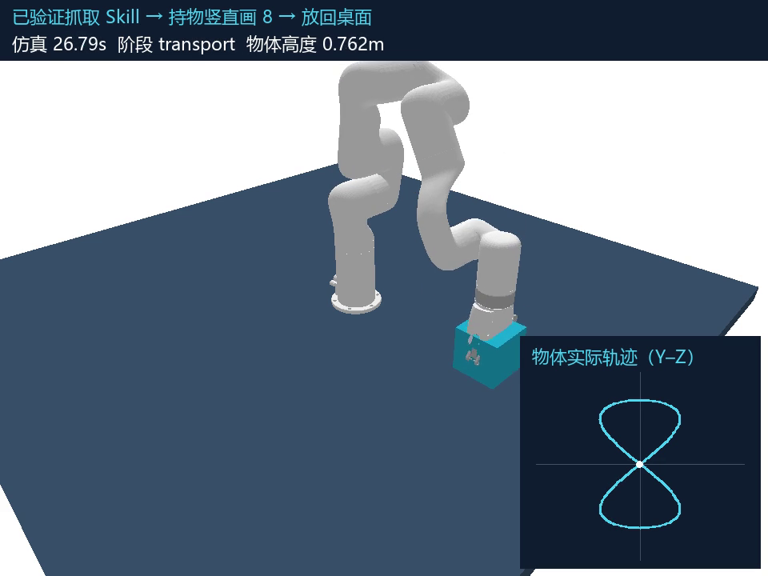

# 持物竖直画 8 字：学习与执行记录

日期：2026-10-19（Asia/Shanghai）。任务：复用已验证的抓取失败恢复 Skill，抓起方块，在空中竖直画一个完整的 8 字，随后放回桌面。

完整模型调用记录见 [FIGURE_EIGHT_LLM_CALLS.md](FIGURE_EIGHT_LLM_CALLS.md)。已验证的前置和新 Skill 见 [vertical_figure_eight.json](../assets/skills/vertical_figure_eight.json)。以下按开发、真实调用、试验和验证顺序持续记录；每个路点都包含目标位置、实际位置、跟踪误差和抓持状态。

## 已完成结果

- 实际使用 CC Switch `http://127.0.0.1:15723/v1/responses`；9 次请求的服务响应模型均为 `gpt-6.1-sol`。9 次完整请求、9 次完整原始响应和9 次解析结果均已保存并逐一核对，无错误、无规则回退。
- 模型第一次提出的参数即通过真实仿真；模型读取反馈后接受同一参数。随后完成6次独立验证（正常、低力度、抓取偏移各2次），全部通过。候选晋级为 `held_vertical_figure_eight_v1`，依赖 `grasp_without_lift_v1`。
- 完成2次重新加载复用：学习流程末尾1次，独立 CLI 从已提交的 Skill 文件读取1次。独立复用记录同时包含两个 `applied_skill_ids`。
- 每条8字轨迹有73个路点，实际宽约0.100 m、高约0.160 m；六次验证中最大路点跟踪误差约0.00001202 m，最大放置目标误差约0.003711 m，抓持全部保持。一次画8阶段约24.3仿真秒，含抓取恢复、放回和稳定观察的视频约27.95秒。
- 两个会话共记录838条步骤/事件，其中657条为逐路点记录；这些包括1次学习、6次验证和2次复用。物理步进检查与事件路点记录是不同粒度：每次画8连续检查5960个物理步，并汇总净空和抓持状态；文档逐项列出动作和路点，JSONL 保存完整事件快照。
- 19项测试全部通过、无跳过，记录见 [figure_eight_tests.log](figure_eight_tests.log)。两个视频都完成全片解码检查。
- [实测汇总与调用审计](figure_eight_summary.json)；[最终复用视频](../artifacts/figure_eight_replay_20261019/replay.mp4)。



新 Skill 的文字表达：**先调用已有经验检查抓取和实际抬升；若未抬升，重新定位并重抓。确认抓牢后，将物体抬到8字交叉点，在Y–Z竖直平面以约10厘米宽、16厘米高的轨迹完成上环和下环，逐路点检查实际位置、净空和抓持。完成闭合后回到已知抬升高度，移动到放置位置、松开夹爪，再观察1秒确认物体放稳。**

本次学习范围为“大模型选择预定义运动原语参数、组合已有 Skill、依据仿真反馈接受候选并重复验证”。xArm6 使用已有固定抓取约束并屏蔽机器人与方块的碰撞对，微小跟踪误差反映这一简化场景，不能当作真实机器人的定位精度。本次未进行神经网络训练，也没有实测过跨物体、随机位置或真实硬件泛化。

## 遇到的事件与处理

1. 项目缺少“持物运动”动作：增加受抓持/抬升门槛约束的物体中心路点控制，复用现有 IK 和位置控制器。
2. 原先按 Skill 名称识别防护，模型可能改变名称：改为按稳定的 `skill_id` 识别；测试确认原有抓取流程仍然通过。
3. 每次低力度或抓取偏移场景首次抓取失败：比较器实际报告未抬升，模型诊断生成候选经验，原有本地恢复流程刷新位置并重抓，确认实际抬升后才进入画8阶段。恢复仍按原项目策略清除注入故障。
4. 模型不能仅凭方案宣称成功：首次输出 `try`，收到真实轨迹与放置反馈后输出 `accept`；模型接受后仍须通过本地6次独立验证。
5. 验证结果和调用日志已按阶段提交 Git；最终补充完整审计和视频预览。没有出现必须调整参数才能通过的失败候选，不能把本次结果描述为已证明模型具备失败后调参能力。

## 复现命令

```powershell
# 读取已提交的两个 Skill 并执行完整任务；每次调用仍记录输入输出。
.\run.cmd -m robotmp.figure_eight --replay-only --output artifacts/figure_eight_replay

# 加 --gui 可实时查看；不加时仍导出相机视频与物体轨迹叠加。
.\run.cmd -m robotmp.figure_eight --replay-only --gui --output artifacts/figure_eight_gui

# 在新输出目录重新进行模型提议、实际试验和独立验证。
.\run.cmd -m robotmp.figure_eight --output artifacts/figure_eight_new_run
```

以下保留完整开发记录与逐步运行记录。

## 记录 01：检查与开始

- 已检查当前代码：xArm6 已能接近、闭合、检测抬升、失败后重新定位并重抓、放下物体；尚无持物轨迹动作。
- 已有经验：`grasp_without_lift_v1`，前次 20 次固定低力度仿真验证通过，经验为“闭合不代表抓牢；确认实际抬升再搬运”。来源为 `artifacts/verification_20261019/skills.json`。
- 当前工作区有上次任务留下的 `run.cmd`、`run.ps1`、`README.md` 修改。先保存为独立 Git 提交，再实现本次任务。
- 将“竖直 8 字”定义为 Y–Z 竖直平面中的上下两环：横向位移与 `sin(2t)` 成正比，高度位移与 `sin(t)` 成正比，X 保持不变；物体中心为轨迹验收对象。
- 学习采用明确的参数候选试验、实际轨迹反馈、重复验证和持久化复用。不会把手写轨迹公式称为自主发现的新运动规律。
- 每个任务动作、每个轨迹路点及其实际位姿、误差、抓取状态和事件会立即追加到本文档及 JSONL，运行结束后补充评估。

## 验收要求

1. 读取并应用已有抓取 Skill，确认实际抬升事件后才开始画 8。
2. 物体全程被抓持，轨迹位于桌面之上，实际物体轨迹覆盖上下两个环并回到交叉点附近。
3. 按实际物体位置检查每个路点的跟踪误差；失败候选必须保留原因和全部已执行步骤。
4. 将成功参数作为候选新 Skill 保存，经过独立重复验证后才能标记 `verified`。
5. 新环境重新加载新 Skill，完成抓取、完整 8 字、放下和稳定性检查。

后续记录在开发和运行过程中追加；时间使用 Asia/Shanghai，轨迹时刻为仿真秒。

## 记录 02：接入大模型与逐步记录

- 用户指定本机 CC Switch `127.0.0.1:15723`，已确认端口正在监听。使用项目可配置模型 ID，默认 `gpt-6.1-sol`；实际模型身份以服务响应为准。
- 已增加独立学习入口 `robotmp.figure_eight`：模型提出图形幅度、抬高量、路点数与步进时长；本地严格校验参数后执行预定义轨迹，反馈实际误差，再请模型接受或修改候选。
- 新增 `after_lift` 扩展点，复用原抓取、低力度诊断、重抓和放下流程；新动作只有在实际抬升之后执行。
- 以物体中心真实位置检查双环面积、闭合、交叉点、平面偏差、跟踪误差；逐个物理步检查持物状态和离桌净空，最后检查放下位置、速度和稳定性。
- 已有 Skill 的识别改为稳定的 `skill_id`，避免模型给 Skill 起不同名称后丢失预测防护。
- 每次模型请求、完整原始响应、解析结果及错误均立即写入 `docs/FIGURE_EIGHT_LLM_CALLS.md` 和输出目录中的 JSONL；不截断响应，不记录认证头。每个任务动作和每个轨迹路点立即追加到本记录。
- 先运行离线几何与物理测试，再进行实际模型学习；不把测试替身的响应当作真实模型调用。

## 记录 03：实现阶段验证

- `run.cmd -m unittest discover -s tests -v`：19 项全部通过，无跳过，包含 5 项新增测试。
- 离线端到端测试确认：复用前置 Skill、低力度重抓、65 个轨迹路点、两个相反方向的环、放下并稳定。测试参数下最大物体跟踪误差约 0.0913 mm；这只是控制原语测试，不计入模型新 Skill 的学习证据。
- 拒绝未抓持时开始画 8；拒绝非有限值、越界参数、横向 8 字、轨迹未完成和退化为直线的结果。
- 下一阶段实际调用 CC Switch；每次调用完整输入输出将随调用立即保存。


[2026-10-19T21:36:55+08:00] 开始运行 d3f92a3928fd；输出目录 artifacts\figure_eight_20261019。


[2026-10-19T21:36:55+08:00] 载入已验证前置 Skill grasp_without_lift_v1，来源 artifacts\verification_20261019\skills.json，验证次数 20。


[2026-10-19T21:36:55+08:00] 大模型 request；request_id=fbfe59d56585478696ac19f17150ca58；完整内容已写入 docs\FIGURE_EIGHT_LLM_CALLS.md。


[2026-10-19T21:37:19+08:00] 大模型 response；request_id=fbfe59d56585478696ac19f17150ca58；完整内容已写入 docs\FIGURE_EIGHT_LLM_CALLS.md。


[2026-10-19T21:37:19+08:00] 大模型 parsed_output；request_id=fbfe59d56585478696ac19f17150ca58；完整内容已写入 docs\FIGURE_EIGHT_LLM_CALLS.md。

1. 仿真 0.000s；物体中心 (—) m；{"kind": "model_proposal_validated", "attempt": 1, "proposal": {"decision": "try", "name": "方块竖直八字搬运与放置", "description": "用于本地 PyBullet 仿真的可复用组合技能：调用已验证技能 grasp_without_lift_v1 检查抓取未抬起的情况，仅在确认方块已被稳定抬起后，使用预定义竖直八字原语运动，随后执行放置。原语保持物体中心的 x 坐标不变，在竖直平面内完成闭合八字；不生成任意航点或底层控制指令。", "prerequisite_skill_ids": ["grasp_without_lift_v1"], "parameters": {"half_width_m": 0.05, "half_height_m": 0.08, "center_raise_m": 0.1, "samples": 72, "steps_per_waypoint": 80}, "observed_facts": ["当前没有实际试验报告，因此本次仅提出试运行，不判定通过。", "已提供技能 grasp_without_lift_v1 的验证记录为20次，误报成功率为0，恢复成功率为1；其作用是识别和处理抓取后未抬起，不能据此证明本组合技能已成功。", "夹爪闭合不代表抓取成功；运输前必须有实际抬起证据。", "给定初始抬起物体中心约为[0.4526, 0, 0.9052]米，桌面高度为0.70米，方块半尺寸为0.05米。"], "hypotheses": ["将八字中心相对初始抬起中心升高0.10米，并采用水平半宽0.05米、竖直半高0.08米，预计可形成竖直方向更长的两个相反有向面积的叶瓣。", "上述参数满足竖直半高至少为水平半宽的1.3倍，以及中心抬升量不小于竖直半高的约束。", "在方块保持直立的假设下，八字段标称最低底面高度约为0.8752米，相对桌面净空约为0.1752米；这只是几何估计，仍须连续测量实际净空。", "72个采样点和每航点80步可能有利于平稳跟踪，但跟踪精度、抓持保持及放置稳定性仍需试验确认。"], "rationale": "首次采用范围内的中等幅度和较充分的执行步数，优先检验组合流程而非追求速度。先确认抬起，再由预定义原语完成中心抬升和完整八字，最后放置到试验指定目标。通过条件必须全部满足：物体中心跟踪误差不超过0.02米，交叉、闭合及平面误差各不超过0.015米，两个叶瓣有向面积符号相反，全过程底部净空连续不小于0.035米且保持抓持，放置误差不超过0.025米，放置后漂移不超过0.003米。只有实际试验报告确认这些条件全部通过，后续才能接受该技能；本提案不涉及控制器自主学习。", "recovery": ["若没有可靠抬起证据，禁止进入八字或运输阶段；调用已有技能的恢复流程，停止运输、刷新物体位姿，并在安全条件下重试抓取。", "若实际跟踪、交叉、闭合或平面误差超限，停止后续八字执行并安全放置；记录各项实测误差，再在允许范围内调整采样数、每航点步数或幅度后重新试验。", "若连续净空不足或抓持丢失，立即中止该试验并执行仿真中的安全停止与物体状态检查；依据实测最低净空和姿态，在约束内调整中心抬升量或竖直半高。", "若放置误差或漂移超限，不接受本技能；复核目标位姿、释放前稳定性与释放后测量结果，再重新验证完整流程。"]}}


[2026-10-19T21:37:19+08:00] 开始 learning_1，故障=low_grip_force，参数={"half_width_m": 0.05, "half_height_m": 0.08, "center_raise_m": 0.1, "samples": 72, "steps_per_waypoint": 80}

2. 仿真 0.042s；物体中心 (0.45000, -0.00000, 0.74991) m；{"trial": "learning_1", "kind": "reset", "prediction": null, "comparison": null, "物体抓持": false, "实际抬升": false, "事件": []}

3. 仿真 0.042s；物体中心 (0.45000, -0.00000, 0.74991) m；{"trial": "learning_1", "kind": "retrieve", "prediction": null, "comparison": null, "skills": [{"skill_id": "grasp_without_lift_v1", "name": "grasp_without_lift", "status": "verified", "version": 1, "task": "pick_and_place", "object_types": ["cube"], "trigger_conditions": ["gripper_closed == true", "lift_window_elapsed == true", "object_lifted == false"], "facts": ["gripper_closed_does_not_imply_grasp_success", "object_lift_was_not_detected", "object_may_have_been_displaced_before_grasp"], "hypotheses": ["grasp_point_may_be_misaligned", "insufficient_grip_force"], "prediction_correction": ["do_not_enter_transport_phase", "require_lift_evidence_before_transport"], "recovery": ["stop_transport_motion", "refresh_object_pose", "retry_grasp_if_safe"], "validation_trials": 20, "false_success_rate": 0.0, "recovery_success_rate": 1.0, "prerequisite_skill_ids": [], "parameters": {}, "validation_success_rate": null, "validation_metrics": {}}], "物体抓持": false, "实际抬升": false, "事件": []}

4. 仿真 0.242s；物体中心 (0.45000, 0.00000, 0.74999) m；{"trial": "learning_1", "kind": "action", "prediction": null, "comparison": null, "action": "approach_object", "物体抓持": false, "实际抬升": false, "事件": ["object_approached"]}

5. 仿真 0.442s；物体中心 (0.45000, 0.00001, 0.74999) m；{"trial": "learning_1", "kind": "action", "prediction": null, "comparison": null, "action": "close_gripper", "物体抓持": false, "实际抬升": false, "事件": ["gripper_closed", "gripper_contact"]}

6. 仿真 0.442s；物体中心 (0.45000, 0.00001, 0.74999) m；{"trial": "learning_1", "kind": "prediction", "prediction": {"prediction_id": "pred-1", "action": "lift_object", "expected_phase": "lift", "expected_events": ["object_lift_detected"], "expected_object_lifted": true, "position_tolerance_m": 0.03, "confidence": 0.9, "applied_skill_ids": ["grasp_without_lift_v1"], "requires_lift_evidence": true}, "comparison": null, "物体抓持": false, "实际抬升": false, "事件": ["gripper_closed", "gripper_contact"]}

7. 仿真 0.642s；物体中心 (0.45000, 0.00001, 0.74999) m；{"trial": "learning_1", "kind": "action", "prediction": {"prediction_id": "pred-1", "action": "lift_object", "expected_phase": "lift", "expected_events": ["object_lift_detected"], "expected_object_lifted": true, "position_tolerance_m": 0.03, "confidence": 0.9, "applied_skill_ids": ["grasp_without_lift_v1"], "requires_lift_evidence": true}, "comparison": null, "action": "lift_object", "物体抓持": false, "实际抬升": false, "事件": []}

8. 仿真 0.642s；物体中心 (0.45000, 0.00001, 0.74999) m；{"trial": "learning_1", "kind": "comparison", "prediction": {"prediction_id": "pred-1", "action": "lift_object", "expected_phase": "lift", "expected_events": ["object_lift_detected"], "expected_object_lifted": true, "position_tolerance_m": 0.03, "confidence": 0.9, "applied_skill_ids": ["grasp_without_lift_v1"], "requires_lift_evidence": true}, "comparison": {"status": "deviation", "errors": ["expected_lift_but_not_detected", "missing_event:object_lift_detected"], "severity": "medium"}, "物体抓持": false, "实际抬升": false, "事件": []}


[2026-10-19T21:37:19+08:00] 大模型 request；request_id=04ead49822d54e2681534b1e22a0ec57；完整内容已写入 docs\FIGURE_EIGHT_LLM_CALLS.md。


[2026-10-19T21:37:31+08:00] 大模型 response；request_id=04ead49822d54e2681534b1e22a0ec57；完整内容已写入 docs\FIGURE_EIGHT_LLM_CALLS.md。


[2026-10-19T21:37:31+08:00] 大模型 parsed_output；request_id=04ead49822d54e2681534b1e22a0ec57；完整内容已写入 docs\FIGURE_EIGHT_LLM_CALLS.md。

9. 仿真 0.642s；物体中心 (0.45000, 0.00001, 0.74999) m；{"trial": "learning_1", "kind": "diagnosis", "prediction": {"prediction_id": "pred-1", "action": "lift_object", "expected_phase": "lift", "expected_events": ["object_lift_detected"], "expected_object_lifted": true, "position_tolerance_m": 0.03, "confidence": 0.9, "applied_skill_ids": ["grasp_without_lift_v1"], "requires_lift_evidence": true}, "comparison": {"status": "deviation", "errors": ["expected_lift_but_not_detected", "missing_event:object_lift_detected"], "severity": "medium"}, "skill": {"skill_id": "grasp_without_lift_v1", "name": "grasp_without_lift_candidate_v2", "status": "candidate", "version": 1, "task": "pick_and_place", "object_types": ["cube"], "trigger_conditions": ["A lift prediction requires positive object-lift evidence.", "The gripper is closed while the object is observed as not grasped and not lifted.", "The expected object_lift_detected event is absent."], "facts": ["Prediction pred-1 expected the cube to be lifted.", "The observation reports phase lift.", "The cube is visible, with grasped=false and lifted=false.", "Object observation confidence is 0.95.", "The gripper is closed and reported gripper force is 0.4.", "No events were reported.", "The comparison reports a medium-severity deviation.", "Skill grasp_without_lift_v1 was applied.", "The observation does not establish that a lift window elapsed."], "hypotheses": ["The grasp may have missed the cube because of misalignment.", "The gripper may have closed without securing the cube.", "Grip effectiveness may have been insufficient; the force reading alone does not establish this.", "The cube may have shifted before grasping; no displacement is confirmed."], "prediction_correction": ["Mark pred-1's expected lift outcome as unconfirmed and contradicted by the current object state.", "Do not infer grasp success from gripper closure or end-effector height.", "Do not infer object displacement from a single position observation.", "Require positive object-lift evidence before entering transport.", "Treat this skill revision as a candidate, not as validated by prior-version results.", "do_not_enter_transport_phase", "require_lift_evidence_before_transport"], "recovery": ["Withhold transport until positive object-lift evidence is established.", "Assess the current scene for collision, contact, and object-stability risks.", "Refresh the cube pose and verify its support state.", "Reassess grasp suitability before considering another attempt.", "Retry grasping only if the scene and grasp plan are assessed as safe.", "Verify secure grasp and positive object lift before authorizing transport.", "Request assistance if safe recovery or reliable lift verification is unavailable."], "validation_trials": 0, "false_success_rate": null, "recovery_success_rate": null, "prerequisite_skill_ids": [], "parameters": {}, "validation_success_rate": null, "validation_metrics": {}}, "source": "OpenAICompatibleDiagnoser", "物体抓持": false, "实际抬升": false, "事件": []}

10. 仿真 0.642s；物体中心 (0.45000, 0.00001, 0.74999) m；{"trial": "learning_1", "kind": "candidate", "prediction": {"prediction_id": "pred-1", "action": "lift_object", "expected_phase": "lift", "expected_events": ["object_lift_detected"], "expected_object_lifted": true, "position_tolerance_m": 0.03, "confidence": 0.9, "applied_skill_ids": ["grasp_without_lift_v1"], "requires_lift_evidence": true}, "comparison": {"status": "deviation", "errors": ["expected_lift_but_not_detected", "missing_event:object_lift_detected"], "severity": "medium"}, "skill": {"skill_id": "grasp_without_lift_v1", "name": "grasp_without_lift_candidate_v2", "status": "candidate", "version": 1, "task": "pick_and_place", "object_types": ["cube"], "trigger_conditions": ["A lift prediction requires positive object-lift evidence.", "The gripper is closed while the object is observed as not grasped and not lifted.", "The expected object_lift_detected event is absent."], "facts": ["Prediction pred-1 expected the cube to be lifted.", "The observation reports phase lift.", "The cube is visible, with grasped=false and lifted=false.", "Object observation confidence is 0.95.", "The gripper is closed and reported gripper force is 0.4.", "No events were reported.", "The comparison reports a medium-severity deviation.", "Skill grasp_without_lift_v1 was applied.", "The observation does not establish that a lift window elapsed."], "hypotheses": ["The grasp may have missed the cube because of misalignment.", "The gripper may have closed without securing the cube.", "Grip effectiveness may have been insufficient; the force reading alone does not establish this.", "The cube may have shifted before grasping; no displacement is confirmed."], "prediction_correction": ["Mark pred-1's expected lift outcome as unconfirmed and contradicted by the current object state.", "Do not infer grasp success from gripper closure or end-effector height.", "Do not infer object displacement from a single position observation.", "Require positive object-lift evidence before entering transport.", "Treat this skill revision as a candidate, not as validated by prior-version results.", "do_not_enter_transport_phase", "require_lift_evidence_before_transport"], "recovery": ["Withhold transport until positive object-lift evidence is established.", "Assess the current scene for collision, contact, and object-stability risks.", "Refresh the cube pose and verify its support state.", "Reassess grasp suitability before considering another attempt.", "Retry grasping only if the scene and grasp plan are assessed as safe.", "Verify secure grasp and positive object lift before authorizing transport.", "Request assistance if safe recovery or reliable lift verification is unavailable."], "validation_trials": 0, "false_success_rate": null, "recovery_success_rate": null, "prerequisite_skill_ids": [], "parameters": {}, "validation_success_rate": null, "validation_metrics": {}}, "物体抓持": false, "实际抬升": false, "事件": []}

11. 仿真 0.642s；物体中心 (0.45000, 0.00001, 0.74999) m；{"trial": "learning_1", "kind": "action", "prediction": {"prediction_id": "pred-1", "action": "lift_object", "expected_phase": "lift", "expected_events": ["object_lift_detected"], "expected_object_lifted": true, "position_tolerance_m": 0.03, "confidence": 0.9, "applied_skill_ids": ["grasp_without_lift_v1"], "requires_lift_evidence": true}, "comparison": {"status": "deviation", "errors": ["expected_lift_but_not_detected", "missing_event:object_lift_detected"], "severity": "medium"}, "action": "refresh_object_pose", "物体抓持": false, "实际抬升": false, "事件": ["object_pose_refreshed"]}

12. 仿真 0.842s；物体中心 (0.45000, 0.00001, 0.74999) m；{"trial": "learning_1", "kind": "action", "prediction": {"prediction_id": "pred-1", "action": "lift_object", "expected_phase": "lift", "expected_events": ["object_lift_detected"], "expected_object_lifted": true, "position_tolerance_m": 0.03, "confidence": 0.9, "applied_skill_ids": ["grasp_without_lift_v1"], "requires_lift_evidence": true}, "comparison": {"status": "deviation", "errors": ["expected_lift_but_not_detected", "missing_event:object_lift_detected"], "severity": "medium"}, "action": "retry_grasp", "物体抓持": false, "实际抬升": false, "事件": ["grasp_retry_requested"]}

13. 仿真 1.042s；物体中心 (0.45000, 0.00001, 0.74999) m；{"trial": "learning_1", "kind": "action", "prediction": {"prediction_id": "pred-1", "action": "lift_object", "expected_phase": "lift", "expected_events": ["object_lift_detected"], "expected_object_lifted": true, "position_tolerance_m": 0.03, "confidence": 0.9, "applied_skill_ids": ["grasp_without_lift_v1"], "requires_lift_evidence": true}, "comparison": {"status": "deviation", "errors": ["expected_lift_but_not_detected", "missing_event:object_lift_detected"], "severity": "medium"}, "action": "close_gripper", "物体抓持": true, "实际抬升": false, "事件": ["gripper_closed", "gripper_contact", "grasp_constraint_created"]}

14. 仿真 1.242s；物体中心 (0.45265, -0.00063, 0.90524) m；{"trial": "learning_1", "kind": "action", "prediction": {"prediction_id": "pred-1", "action": "lift_object", "expected_phase": "lift", "expected_events": ["object_lift_detected"], "expected_object_lifted": true, "position_tolerance_m": 0.03, "confidence": 0.9, "applied_skill_ids": ["grasp_without_lift_v1"], "requires_lift_evidence": true}, "comparison": {"status": "deviation", "errors": ["expected_lift_but_not_detected", "missing_event:object_lift_detected"], "severity": "medium"}, "action": "lift_object", "物体抓持": true, "实际抬升": true, "事件": ["object_lift_detected"]}

15. 仿真 1.242s；物体中心 (0.45265, -0.00063, 0.90524) m；{"trial": "learning_1", "kind": "lift_gate_passed", "prerequisite_skill_id": "grasp_without_lift_v1", "物体抓持": true, "实际抬升": true, "事件": ["object_lift_detected"]}

16. 仿真 1.742s；物体中心 (0.45201, -0.00063, 1.00523) m；{"trial": "learning_1", "kind": "move_to_crossing", "target": [0.45264591498190104, -0.0006272425879208008, 1.0052366031601594], "物体抓持": true, "实际抬升": true, "事件": ["held_object_waypoint_reached"]}

17. 仿真 2.075s；物体中心 (0.45264, -0.00063, 1.00523) m；{"trial": "learning_1", "kind": "figure_eight_waypoint", "index": 0, "target": [0.45264591498190104, -0.0006272425879208008, 1.0052366031601594], "tracking_error_m": 9.825228975071803e-06, "物体抓持": true, "实际抬升": true, "事件": ["held_object_waypoint_reached"]}

18. 仿真 2.408s；物体中心 (0.45264, 0.00805, 1.01220) m；{"trial": "learning_1", "kind": "figure_eight_waypoint", "index": 1, "target": [0.45264591498190104, 0.008055166295425716, 1.012209062579972], "tracking_error_m": 1.1722698804804077e-05, "物体抓持": true, "实际抬升": true, "事件": ["held_object_waypoint_reached"]}

19. 仿真 2.742s；物体中心 (0.45264, 0.01647, 1.01912) m；{"trial": "learning_1", "kind": "figure_eight_waypoint", "index": 2, "target": [0.45264591498190104, 0.016473764578362634, 1.0191284573735138], "tracking_error_m": 1.14159202509719e-05, "物体抓持": true, "实际抬升": true, "事件": ["held_object_waypoint_reached"]}

20. 仿真 3.075s；物体中心 (0.45264, 0.02437, 1.02593) m；{"trial": "learning_1", "kind": "figure_eight_waypoint", "index": 3, "target": [0.45264591498190104, 0.024372757412079196, 1.025942126768361], "tracking_error_m": 1.1833336309672512e-05, "物体抓持": true, "实际抬升": true, "事件": ["held_object_waypoint_reached"]}

21. 仿真 3.408s；物体中心 (0.45264, 0.03151, 1.03259) m；{"trial": "learning_1", "kind": "figure_eight_waypoint", "index": 4, "target": [0.45264591498190104, 0.03151213789640616, 1.032598214626213], "tracking_error_m": 1.1983316368247924e-05, "物体抓持": true, "实际抬升": true, "事件": ["held_object_waypoint_reached"]}

22. 仿真 3.742s；物体中心 (0.45264, 0.03767, 1.03904) m；{"trial": "learning_1", "kind": "figure_eight_waypoint", "index": 5, "target": [0.45264591498190104, 0.0376749795680281, 1.0390460640994152], "tracking_error_m": 1.2019591061309376e-05, "物体抓持": true, "实际抬升": true, "事件": ["held_object_waypoint_reached"]}

23. 仿真 4.075s；物体中心 (0.45264, 0.04267, 1.04523) m；{"trial": "learning_1", "kind": "figure_eight_waypoint", "index": 6, "target": [0.45264591498190104, 0.04267402760130113, 1.0452366031601594], "tracking_error_m": 1.1825229503351622e-05, "物体抓持": true, "实际抬升": true, "事件": ["held_object_waypoint_reached"]}

24. 仿真 4.408s；物体中心 (0.45264, 0.04636, 1.05111) m；{"trial": "learning_1", "kind": "figure_eight_waypoint", "index": 7, "target": [0.45264591498190104, 0.04635738845137462, 1.051122718068243], "tracking_error_m": 1.1955388824130604e-05, "物体抓持": true, "实际抬升": true, "事件": ["held_object_waypoint_reached"]}

25. 仿真 4.742s；物体中心 (0.45264, 0.04861, 1.05665) m；{"trial": "learning_1", "kind": "figure_eight_waypoint", "index": 8, "target": [0.45264591498190104, 0.0486131450626896, 1.0566596119350826], "tracking_error_m": 1.1957418835597624e-05, "物体抓持": true, "实际抬升": true, "事件": ["held_object_waypoint_reached"]}

26. 仿真 5.075s；物体中心 (0.45264, 0.04937, 1.06180) m；{"trial": "learning_1", "kind": "figure_eight_waypoint", "index": 9, "target": [0.45264591498190104, 0.0493727574120792, 1.0618051456550832], "tracking_error_m": 1.1550893406183224e-05, "物体抓持": true, "实际抬升": true, "事件": ["held_object_waypoint_reached"]}

27. 仿真 5.408s；物体中心 (0.45264, 0.04861, 1.06651) m；{"trial": "learning_1", "kind": "figure_eight_waypoint", "index": 10, "target": [0.45264591498190104, 0.0486131450626896, 1.0665201586096775], "tracking_error_m": 1.1597359135804862e-05, "物体抓持": true, "实际抬升": true, "事件": ["held_object_waypoint_reached"]}

28. 仿真 5.742s；物体中心 (0.45264, 0.04636, 1.07076) m；{"trial": "learning_1", "kind": "figure_eight_waypoint", "index": 11, "target": [0.45264591498190104, 0.046357388451374625, 1.0707687667032788], "tracking_error_m": 1.1958353455549596e-05, "物体抓持": true, "实际抬升": true, "事件": ["held_object_waypoint_reached"]}

29. 仿真 6.075s；物体中心 (0.45264, 0.04267, 1.07451) m；{"trial": "learning_1", "kind": "figure_eight_waypoint", "index": 12, "target": [0.45264591498190104, 0.04267402760130114, 1.0745186354629146], "tracking_error_m": 1.1412571619188529e-05, "物体抓持": true, "实际抬升": true, "事件": ["held_object_waypoint_reached"]}

30. 仿真 6.408s；物体中心 (0.45264, 0.03768, 1.07773) m；{"trial": "learning_1", "kind": "figure_eight_waypoint", "index": 13, "target": [0.45264591498190104, 0.0376749795680281, 1.0777412261230914], "tracking_error_m": 1.0821092255073984e-05, "物体抓持": true, "实际抬升": true, "事件": ["held_object_waypoint_reached"]}

31. 仿真 6.742s；物体中心 (0.45264, 0.03151, 1.08040) m；{"trial": "learning_1", "kind": "figure_eight_waypoint", "index": 14, "target": [0.45264591498190104, 0.031512137896406174, 1.0804120128230321], "tracking_error_m": 1.1188722986544236e-05, "物体抓持": true, "实际抬升": true, "事件": ["held_object_waypoint_reached"]}

32. 仿真 7.075s；物体中心 (0.45264, 0.02438, 1.08250) m；{"trial": "learning_1", "kind": "figure_eight_waypoint", "index": 15, "target": [0.45264591498190104, 0.024372757412079216, 1.0825106692632849], "tracking_error_m": 1.0981201972020882e-05, "物体抓持": true, "实际抬升": true, "事件": ["held_object_waypoint_reached"]}

33. 仿真 7.408s；物体中心 (0.45264, 0.01648, 1.08401) m；{"trial": "learning_1", "kind": "figure_eight_waypoint", "index": 16, "target": [0.45264591498190104, 0.01647376457836264, 1.084021223401136], "tracking_error_m": 1.1311737799280377e-05, "物体抓持": true, "实际抬升": true, "事件": ["held_object_waypoint_reached"]}

34. 仿真 7.742s；物体中心 (0.45264, 0.00806, 1.08493) m；{"trial": "learning_1", "kind": "figure_eight_waypoint", "index": 17, "target": [0.45264591498190104, 0.008055166295425714, 1.084932179007499], "tracking_error_m": 1.1318139864966431e-05, "物体抓持": true, "实际抬升": true, "事件": ["held_object_waypoint_reached"]}

35. 仿真 8.075s；物体中心 (0.45264, -0.00062, 1.08523) m；{"trial": "learning_1", "kind": "figure_eight_waypoint", "index": 18, "target": [0.45264591498190104, -0.0006272425879207947, 1.0852366031601595], "tracking_error_m": 1.0413441285878392e-05, "物体抓持": true, "实际抬升": true, "事件": ["held_object_waypoint_reached"]}

36. 仿真 8.408s；物体中心 (0.45265, -0.00930, 1.08493) m；{"trial": "learning_1", "kind": "figure_eight_waypoint", "index": 19, "target": [0.45264591498190104, -0.009309651471267302, 1.084932179007499], "tracking_error_m": 1.0559154254763748e-05, "物体抓持": true, "实际抬升": true, "事件": ["held_object_waypoint_reached"]}

37. 仿真 8.742s；物体中心 (0.45265, -0.01772, 1.08402) m；{"trial": "learning_1", "kind": "figure_eight_waypoint", "index": 20, "target": [0.45264591498190104, -0.017728249754204235, 1.084021223401136], "tracking_error_m": 9.336175789837343e-06, "物体抓持": true, "实际抬升": true, "事件": ["held_object_waypoint_reached"]}

38. 仿真 9.075s；物体中心 (0.45265, -0.02562, 1.08252) m；{"trial": "learning_1", "kind": "figure_eight_waypoint", "index": 21, "target": [0.45264591498190104, -0.02562724258792081, 1.0825106692632849], "tracking_error_m": 9.446146197652011e-06, "物体抓持": true, "实际抬升": true, "事件": ["held_object_waypoint_reached"]}

39. 仿真 9.408s；物体中心 (0.45265, -0.03276, 1.08042) m；{"trial": "learning_1", "kind": "figure_eight_waypoint", "index": 22, "target": [0.45264591498190104, -0.03276662307224775, 1.0804120128230321], "tracking_error_m": 8.8119922385219e-06, "物体抓持": true, "实际抬升": true, "事件": ["held_object_waypoint_reached"]}

40. 仿真 9.742s；物体中心 (0.45265, -0.03893, 1.07775) m；{"trial": "learning_1", "kind": "figure_eight_waypoint", "index": 23, "target": [0.45264591498190104, -0.0389294647438697, 1.0777412261230914], "tracking_error_m": 8.3751925769035e-06, "物体抓持": true, "实际抬升": true, "事件": ["held_object_waypoint_reached"]}

41. 仿真 10.075s；物体中心 (0.45265, -0.04393, 1.07452) m；{"trial": "learning_1", "kind": "figure_eight_waypoint", "index": 24, "target": [0.45264591498190104, -0.04392851277714273, 1.0745186354629146], "tracking_error_m": 8.296758761531722e-06, "物体抓持": true, "实际抬升": true, "事件": ["held_object_waypoint_reached"]}

42. 仿真 10.408s；物体中心 (0.45265, -0.04761, 1.07077) m；{"trial": "learning_1", "kind": "figure_eight_waypoint", "index": 25, "target": [0.45264591498190104, -0.04761187362721623, 1.0707687667032788], "tracking_error_m": 8.58921841059014e-06, "物体抓持": true, "实际抬升": true, "事件": ["held_object_waypoint_reached"]}

43. 仿真 10.742s；物体中心 (0.45265, -0.04987, 1.06653) m；{"trial": "learning_1", "kind": "figure_eight_waypoint", "index": 26, "target": [0.45264591498190104, -0.049867630238531205, 1.0665201586096775], "tracking_error_m": 8.552919869286601e-06, "物体抓持": true, "实际抬升": true, "事件": ["held_object_waypoint_reached"]}

44. 仿真 11.075s；物体中心 (0.45265, -0.05063, 1.06181) m；{"trial": "learning_1", "kind": "figure_eight_waypoint", "index": 27, "target": [0.45264591498190104, -0.050627242587920805, 1.0618051456550832], "tracking_error_m": 8.886087807579407e-06, "物体抓持": true, "实际抬升": true, "事件": ["held_object_waypoint_reached"]}

45. 仿真 11.408s；物体中心 (0.45265, -0.04987, 1.05667) m；{"trial": "learning_1", "kind": "figure_eight_waypoint", "index": 28, "target": [0.45264591498190104, -0.04986763023853121, 1.0566596119350826], "tracking_error_m": 8.903830642524458e-06, "物体抓持": true, "实际抬升": true, "事件": ["held_object_waypoint_reached"]}

46. 仿真 11.742s；物体中心 (0.45265, -0.04761, 1.05113) m；{"trial": "learning_1", "kind": "figure_eight_waypoint", "index": 29, "target": [0.45264591498190104, -0.04761187362721622, 1.051122718068243], "tracking_error_m": 9.33375511517905e-06, "物体抓持": true, "实际抬升": true, "事件": ["held_object_waypoint_reached"]}

47. 仿真 12.075s；物体中心 (0.45265, -0.04393, 1.04524) m；{"trial": "learning_1", "kind": "figure_eight_waypoint", "index": 30, "target": [0.45264591498190104, -0.043928512777142756, 1.0452366031601594], "tracking_error_m": 9.491967114500645e-06, "物体抓持": true, "实际抬升": true, "事件": ["held_object_waypoint_reached"]}

48. 仿真 12.408s；物体中心 (0.45265, -0.03893, 1.03905) m；{"trial": "learning_1", "kind": "figure_eight_waypoint", "index": 31, "target": [0.45264591498190104, -0.03892946474386971, 1.0390460640994152], "tracking_error_m": 9.43167635753271e-06, "物体抓持": true, "实际抬升": true, "事件": ["held_object_waypoint_reached"]}

49. 仿真 12.742s；物体中心 (0.45265, -0.03277, 1.03260) m；{"trial": "learning_1", "kind": "figure_eight_waypoint", "index": 32, "target": [0.45264591498190104, -0.032766623072247786, 1.032598214626213], "tracking_error_m": 9.19036646058306e-06, "物体抓持": true, "实际抬升": true, "事件": ["held_object_waypoint_reached"]}

50. 仿真 13.075s；物体中心 (0.45265, -0.02563, 1.02595) m；{"trial": "learning_1", "kind": "figure_eight_waypoint", "index": 33, "target": [0.45264591498190104, -0.025627242587920786, 1.025942126768361], "tracking_error_m": 9.609982218292752e-06, "物体抓持": true, "实际抬升": true, "事件": ["held_object_waypoint_reached"]}

51. 仿真 13.408s；物体中心 (0.45265, -0.01773, 1.01913) m；{"trial": "learning_1", "kind": "figure_eight_waypoint", "index": 34, "target": [0.45264591498190104, -0.017728249754204232, 1.0191284573735138], "tracking_error_m": 9.529714812389023e-06, "物体抓持": true, "实际抬升": true, "事件": ["held_object_waypoint_reached"]}

52. 仿真 13.742s；物体中心 (0.45265, -0.00931, 1.01221) m；{"trial": "learning_1", "kind": "figure_eight_waypoint", "index": 35, "target": [0.45264591498190104, -0.00930965147126732, 1.012209062579972], "tracking_error_m": 9.24346807634351e-06, "物体抓持": true, "实际抬升": true, "事件": ["held_object_waypoint_reached"]}

53. 仿真 14.075s；物体中心 (0.45265, -0.00063, 1.00524) m；{"trial": "learning_1", "kind": "figure_eight_waypoint", "index": 36, "target": [0.45264591498190104, -0.000627242587920813, 1.0052366031601594], "tracking_error_m": 9.410107499424716e-06, "物体抓持": true, "实际抬升": true, "事件": ["held_object_waypoint_reached"]}

54. 仿真 14.408s；物体中心 (0.45265, 0.00805, 0.99827) m；{"trial": "learning_1", "kind": "figure_eight_waypoint", "index": 37, "target": [0.45264591498190104, 0.008055166295425695, 0.9982641437403468], "tracking_error_m": 8.865652875235118e-06, "物体抓持": true, "实际抬升": true, "事件": ["held_object_waypoint_reached"]}

55. 仿真 14.742s；物体中心 (0.45265, 0.01647, 0.99135) m；{"trial": "learning_1", "kind": "figure_eight_waypoint", "index": 38, "target": [0.45264591498190104, 0.016473764578362603, 0.991344748946805], "tracking_error_m": 9.656633475830879e-06, "物体抓持": true, "实际抬升": true, "事件": ["held_object_waypoint_reached"]}

56. 仿真 15.075s；物体中心 (0.45265, 0.02437, 0.98454) m；{"trial": "learning_1", "kind": "figure_eight_waypoint", "index": 39, "target": [0.45264591498190104, 0.024372757412079164, 0.9845310795519577], "tracking_error_m": 9.33024930354992e-06, "物体抓持": true, "实际抬升": true, "事件": ["held_object_waypoint_reached"]}

57. 仿真 15.408s；物体中心 (0.45265, 0.03151, 0.97788) m；{"trial": "learning_1", "kind": "figure_eight_waypoint", "index": 40, "target": [0.45264591498190104, 0.03151213789640616, 0.9778749916941059], "tracking_error_m": 9.699572427609614e-06, "物体抓持": true, "实际抬升": true, "事件": ["held_object_waypoint_reached"]}

58. 仿真 15.742s；物体中心 (0.45265, 0.03767, 0.97143) m；{"trial": "learning_1", "kind": "figure_eight_waypoint", "index": 41, "target": [0.45264591498190104, 0.03767497956802806, 0.9714271422209035], "tracking_error_m": 9.24214939319394e-06, "物体抓持": true, "实际抬升": true, "事件": ["held_object_waypoint_reached"]}

59. 仿真 16.075s；物体中心 (0.45265, 0.04267, 0.96524) m；{"trial": "learning_1", "kind": "figure_eight_waypoint", "index": 42, "target": [0.45264591498190104, 0.042674027601301144, 0.9652366031601594], "tracking_error_m": 8.895601798084327e-06, "物体抓持": true, "实际抬升": true, "事件": ["held_object_waypoint_reached"]}

60. 仿真 16.408s；物体中心 (0.45265, 0.04635, 0.95936) m；{"trial": "learning_1", "kind": "figure_eight_waypoint", "index": 43, "target": [0.45264591498190104, 0.046357388451374604, 0.9593504882520757], "tracking_error_m": 8.020568334976511e-06, "物体抓持": true, "实际抬升": true, "事件": ["held_object_waypoint_reached"]}

61. 仿真 16.742s；物体中心 (0.45265, 0.04861, 0.95382) m；{"trial": "learning_1", "kind": "figure_eight_waypoint", "index": 44, "target": [0.45264591498190104, 0.04861314506268959, 0.9538135943852363], "tracking_error_m": 8.210137813706943e-06, "物体抓持": true, "实际抬升": true, "事件": ["held_object_waypoint_reached"]}

62. 仿真 17.075s；物体中心 (0.45265, 0.04937, 0.94867) m；{"trial": "learning_1", "kind": "figure_eight_waypoint", "index": 45, "target": [0.45264591498190104, 0.0493727574120792, 0.9486680606652356], "tracking_error_m": 7.93281425994093e-06, "物体抓持": true, "实际抬升": true, "事件": ["held_object_waypoint_reached"]}

63. 仿真 17.408s；物体中心 (0.45265, 0.04861, 0.94396) m；{"trial": "learning_1", "kind": "figure_eight_waypoint", "index": 46, "target": [0.45264591498190104, 0.04861314506268961, 0.9439530477106411], "tracking_error_m": 7.611136645372591e-06, "物体抓持": true, "实际抬升": true, "事件": ["held_object_waypoint_reached"]}

64. 仿真 17.742s；物体中心 (0.45265, 0.04636, 0.93971) m；{"trial": "learning_1", "kind": "figure_eight_waypoint", "index": 47, "target": [0.45264591498190104, 0.0463573884513746, 0.93970443961704], "tracking_error_m": 8.108692544251485e-06, "物体抓持": true, "实际抬升": true, "事件": ["held_object_waypoint_reached"]}

65. 仿真 18.075s；物体中心 (0.45265, 0.04268, 0.93596) m；{"trial": "learning_1", "kind": "figure_eight_waypoint", "index": 48, "target": [0.45264591498190104, 0.04267402760130116, 0.9359545708574043], "tracking_error_m": 8.498180689987163e-06, "物体抓持": true, "实际抬升": true, "事件": ["held_object_waypoint_reached"]}

66. 仿真 18.408s；物体中心 (0.45265, 0.03768, 0.93274) m；{"trial": "learning_1", "kind": "figure_eight_waypoint", "index": 49, "target": [0.45264591498190104, 0.03767497956802814, 0.9327319801972274], "tracking_error_m": 9.51483503174602e-06, "物体抓持": true, "实际抬升": true, "事件": ["held_object_waypoint_reached"]}

67. 仿真 18.742s；物体中心 (0.45265, 0.03152, 0.93006) m；{"trial": "learning_1", "kind": "figure_eight_waypoint", "index": 50, "target": [0.45264591498190104, 0.03151213789640615, 0.9300611934972867], "tracking_error_m": 9.574993091253927e-06, "物体抓持": true, "实际抬升": true, "事件": ["held_object_waypoint_reached"]}

68. 仿真 19.075s；物体中心 (0.45265, 0.02438, 0.92796) m；{"trial": "learning_1", "kind": "figure_eight_waypoint", "index": 51, "target": [0.45264591498190104, 0.02437275741207919, 0.9279625370570339], "tracking_error_m": 9.657086129582539e-06, "物体抓持": true, "实际抬升": true, "事件": ["held_object_waypoint_reached"]}

69. 仿真 19.408s；物体中心 (0.45265, 0.01648, 0.92645) m；{"trial": "learning_1", "kind": "figure_eight_waypoint", "index": 52, "target": [0.45264591498190104, 0.016473764578362634, 0.9264519829191827], "tracking_error_m": 9.499928885995933e-06, "物体抓持": true, "实际抬升": true, "事件": ["held_object_waypoint_reached"]}

70. 仿真 19.742s；物体中心 (0.45265, 0.00807, 0.92554) m；{"trial": "learning_1", "kind": "figure_eight_waypoint", "index": 53, "target": [0.45264591498190104, 0.008055166295425725, 0.9255410273128197], "tracking_error_m": 1.0016639000704845e-05, "物体抓持": true, "实际抬升": true, "事件": ["held_object_waypoint_reached"]}

71. 仿真 20.075s；物体中心 (0.45265, -0.00062, 0.92524) m；{"trial": "learning_1", "kind": "figure_eight_waypoint", "index": 54, "target": [0.45264591498190104, -0.0006272425879207824, 0.9252366031601594], "tracking_error_m": 1.0365636031915278e-05, "物体抓持": true, "实际抬升": true, "事件": ["held_object_waypoint_reached"]}

72. 仿真 20.408s；物体中心 (0.45264, -0.00930, 0.92554) m；{"trial": "learning_1", "kind": "figure_eight_waypoint", "index": 55, "target": [0.45264591498190104, -0.00930965147126729, 0.9255410273128197], "tracking_error_m": 1.0533410525326592e-05, "物体抓持": true, "实际抬升": true, "事件": ["held_object_waypoint_reached"]}

73. 仿真 20.742s；物体中心 (0.45264, -0.01772, 0.92645) m；{"trial": "learning_1", "kind": "figure_eight_waypoint", "index": 56, "target": [0.45264591498190104, -0.017728249754204204, 0.9264519829191827], "tracking_error_m": 1.0506599315497056e-05, "物体抓持": true, "实际抬升": true, "事件": ["held_object_waypoint_reached"]}

74. 仿真 21.075s；物体中心 (0.45264, -0.02562, 0.92796) m；{"trial": "learning_1", "kind": "figure_eight_waypoint", "index": 57, "target": [0.45264591498190104, -0.025627242587920762, 0.9279625370570339], "tracking_error_m": 1.0083201997372576e-05, "物体抓持": true, "实际抬升": true, "事件": ["held_object_waypoint_reached"]}

75. 仿真 21.408s；物体中心 (0.45264, -0.03276, 0.93006) m；{"trial": "learning_1", "kind": "figure_eight_waypoint", "index": 58, "target": [0.45264591498190104, -0.03276662307224779, 0.9300611934972867], "tracking_error_m": 1.0558042127304782e-05, "物体抓持": true, "实际抬升": true, "事件": ["held_object_waypoint_reached"]}

76. 仿真 21.742s；物体中心 (0.45264, -0.03892, 0.93273) m；{"trial": "learning_1", "kind": "figure_eight_waypoint", "index": 59, "target": [0.45264591498190104, -0.038929464743869664, 0.9327319801972274], "tracking_error_m": 9.964669037316951e-06, "物体抓持": true, "实际抬升": true, "事件": ["held_object_waypoint_reached"]}

77. 仿真 22.075s；物体中心 (0.45264, -0.04392, 0.93595) m；{"trial": "learning_1", "kind": "figure_eight_waypoint", "index": 60, "target": [0.45264591498190104, -0.04392851277714269, 0.9359545708574043], "tracking_error_m": 1.0012383667408977e-05, "物体抓持": true, "实际抬升": true, "事件": ["held_object_waypoint_reached"]}

78. 仿真 22.408s；物体中心 (0.45264, -0.04761, 0.93970) m；{"trial": "learning_1", "kind": "figure_eight_waypoint", "index": 61, "target": [0.45264591498190104, -0.04761187362721623, 0.9397044396170401], "tracking_error_m": 9.98123250903834e-06, "物体抓持": true, "实际抬升": true, "事件": ["held_object_waypoint_reached"]}

79. 仿真 22.742s；物体中心 (0.45264, -0.04986, 0.94395) m；{"trial": "learning_1", "kind": "figure_eight_waypoint", "index": 62, "target": [0.45264591498190104, -0.049867630238531205, 0.9439530477106411], "tracking_error_m": 1.0051295895945696e-05, "物体抓持": true, "实际抬升": true, "事件": ["held_object_waypoint_reached"]}

80. 仿真 23.075s；物体中心 (0.45264, -0.05063, 0.94866) m；{"trial": "learning_1", "kind": "figure_eight_waypoint", "index": 63, "target": [0.45264591498190104, -0.050627242587920805, 0.9486680606652356], "tracking_error_m": 1.060270810759323e-05, "物体抓持": true, "实际抬升": true, "事件": ["held_object_waypoint_reached"]}

81. 仿真 23.408s；物体中心 (0.45264, -0.04987, 0.95381) m；{"trial": "learning_1", "kind": "figure_eight_waypoint", "index": 64, "target": [0.45264591498190104, -0.04986763023853121, 0.9538135943852363], "tracking_error_m": 1.0222677982051398e-05, "物体抓持": true, "实际抬升": true, "事件": ["held_object_waypoint_reached"]}

82. 仿真 23.742s；物体中心 (0.45264, -0.04761, 0.95934) m；{"trial": "learning_1", "kind": "figure_eight_waypoint", "index": 65, "target": [0.45264591498190104, -0.047611873627216236, 0.9593504882520757], "tracking_error_m": 1.0484390290833198e-05, "物体抓持": true, "实际抬升": true, "事件": ["held_object_waypoint_reached"]}

83. 仿真 24.075s；物体中心 (0.45264, -0.04393, 0.96523) m；{"trial": "learning_1", "kind": "figure_eight_waypoint", "index": 66, "target": [0.45264591498190104, -0.04392851277714272, 0.9652366031601595], "tracking_error_m": 1.0386497153910475e-05, "物体抓持": true, "实际抬升": true, "事件": ["held_object_waypoint_reached"]}

84. 仿真 24.408s；物体中心 (0.45264, -0.03893, 0.97142) m；{"trial": "learning_1", "kind": "figure_eight_waypoint", "index": 67, "target": [0.45264591498190104, -0.03892946474386975, 0.9714271422209034], "tracking_error_m": 1.0633010653884269e-05, "物体抓持": true, "实际抬升": true, "事件": ["held_object_waypoint_reached"]}

85. 仿真 24.742s；物体中心 (0.45264, -0.03277, 0.97787) m；{"trial": "learning_1", "kind": "figure_eight_waypoint", "index": 68, "target": [0.45264591498190104, -0.03276662307224776, 0.9778749916941059], "tracking_error_m": 1.1026288180352668e-05, "物体抓持": true, "实际抬升": true, "事件": ["held_object_waypoint_reached"]}

86. 仿真 25.075s；物体中心 (0.45264, -0.02563, 0.98452) m；{"trial": "learning_1", "kind": "figure_eight_waypoint", "index": 69, "target": [0.45264591498190104, -0.025627242587920797, 0.9845310795519577], "tracking_error_m": 1.0788283690083127e-05, "物体抓持": true, "实际抬升": true, "事件": ["held_object_waypoint_reached"]}

87. 仿真 25.408s；物体中心 (0.45264, -0.01773, 0.99134) m；{"trial": "learning_1", "kind": "figure_eight_waypoint", "index": 70, "target": [0.45264591498190104, -0.017728249754204246, 0.9913447489468049], "tracking_error_m": 1.1155896547512084e-05, "物体抓持": true, "实际抬升": true, "事件": ["held_object_waypoint_reached"]}

88. 仿真 25.742s；物体中心 (0.45264, -0.00931, 0.99826) m；{"trial": "learning_1", "kind": "figure_eight_waypoint", "index": 71, "target": [0.45264591498190104, -0.009309651471267333, 0.9982641437403468], "tracking_error_m": 1.0847454228936114e-05, "物体抓持": true, "实际抬升": true, "事件": ["held_object_waypoint_reached"]}

89. 仿真 26.075s；物体中心 (0.45264, -0.00063, 1.00523) m；{"trial": "learning_1", "kind": "figure_eight_waypoint", "index": 72, "target": [0.45264591498190104, -0.0006272425879208253, 1.0052366031601594], "tracking_error_m": 1.1075575461633367e-05, "物体抓持": true, "实际抬升": true, "事件": ["held_object_waypoint_reached"]}

90. 仿真 26.075s；物体中心 (0.45264, -0.00063, 1.00523) m；{"trial": "learning_1", "kind": "figure_eight_evaluation", "metrics": {"waypoints": 73, "max_tracking_error_m": 1.2019591061309376e-05, "rms_tracking_error_m": 1.0116421539797707e-05, "closure_error_m": 4.412914100216481e-06, "midpoint_crossing_error_m": 9.410107499429497e-06, "plane_error_m": 8.59271740649703e-06, "upper_loop_area_m2": 0.005316280373141388, "lower_loop_area_m2": -0.005316268112438575, "vertical_span_m": 0.1599971706759794, "horizontal_span_m": 0.09999990322861345, "passed": true, "samples": 5960, "min_clearance_m": 0.15596467740279674, "grasp_retained": true}, "物体抓持": true, "实际抬升": true, "事件": ["held_object_waypoint_reached"]}

91. 仿真 26.575s；物体中心 (0.45264, -0.00063, 0.90524) m；{"trial": "learning_1", "kind": "return_to_lift_height", "target": [0.45264591498190104, -0.0006272425879208008, 0.9052366031601594], "物体抓持": true, "实际抬升": true, "事件": ["held_object_waypoint_reached"]}

92. 仿真 26.775s；物体中心 (0.50177, -0.00063, 0.76742) m；{"trial": "learning_1", "kind": "action", "prediction": {"prediction_id": "pred-1", "action": "lift_object", "expected_phase": "lift", "expected_events": ["object_lift_detected"], "expected_object_lifted": true, "position_tolerance_m": 0.03, "confidence": 0.9, "applied_skill_ids": ["grasp_without_lift_v1"], "requires_lift_evidence": true}, "comparison": {"status": "deviation", "errors": ["expected_lift_but_not_detected", "missing_event:object_lift_detected"], "severity": "medium"}, "action": "move_to_target", "物体抓持": true, "实际抬升": false, "事件": ["object_at_target"]}

93. 仿真 26.975s；物体中心 (0.49987, -0.00063, 0.74996) m；{"trial": "learning_1", "kind": "action", "prediction": {"prediction_id": "pred-1", "action": "lift_object", "expected_phase": "lift", "expected_events": ["object_lift_detected"], "expected_object_lifted": true, "position_tolerance_m": 0.03, "confidence": 0.9, "applied_skill_ids": ["grasp_without_lift_v1"], "requires_lift_evidence": true}, "comparison": {"status": "deviation", "errors": ["expected_lift_but_not_detected", "missing_event:object_lift_detected"], "severity": "medium"}, "action": "release_object", "物体抓持": false, "实际抬升": false, "事件": ["object_released"]}

94. 仿真 26.975s；物体中心 (0.49987, -0.00063, 0.74996) m；{"trial": "learning_1", "kind": "result", "prediction": {"prediction_id": "pred-1", "action": "lift_object", "expected_phase": "lift", "expected_events": ["object_lift_detected"], "expected_object_lifted": true, "position_tolerance_m": 0.03, "confidence": 0.9, "applied_skill_ids": ["grasp_without_lift_v1"], "requires_lift_evidence": true}, "comparison": {"status": "deviation", "errors": ["expected_lift_but_not_detected", "missing_event:object_lift_detected"], "severity": "medium"}, "result": {"mode": "skills", "failure_mode": "low_grip_force", "status": "recovered", "false_success": false, "recovered": true, "applied_skill_ids": ["grasp_without_lift_v1"]}, "物体抓持": false, "实际抬升": false, "事件": ["object_released"]}

95. 仿真 27.975s；物体中心 (0.49987, -0.00061, 0.74999) m；{"trial": "learning_1", "kind": "placement_evaluation", "metrics": {"drift_m": 3.128409276385285e-05, "speed_m_s": 1.2362729741205837e-05, "target_error_m": 0.0006261867748050345, "released": true, "height_error_m": 1.1393495004896614e-05, "passed": true}, "物体抓持": false, "实际抬升": false, "事件": ["placement_settled"]}


[2026-10-19T21:37:32+08:00] learning_1 结束：{"label": "learning_1", "failure_mode": "low_grip_force", "parameters": {"half_width_m": 0.05, "half_height_m": 0.08, "center_raise_m": 0.1, "samples": 72, "steps_per_waypoint": 80}, "trajectory": {"waypoints": 73, "max_tracking_error_m": 1.2019591061309376e-05, "rms_tracking_error_m": 1.0116421539797707e-05, "closure_error_m": 4.412914100216481e-06, "midpoint_crossing_error_m": 9.410107499429497e-06, "plane_error_m": 8.59271740649703e-06, "upper_loop_area_m2": 0.005316280373141388, "lower_loop_area_m2": -0.005316268112438575, "vertical_span_m": 0.1599971706759794, "horizontal_span_m": 0.09999990322861345, "passed": true, "samples": 5960, "min_clearance_m": 0.15596467740279674, "grasp_retained": true}, "placement": {"drift_m": 3.128409276385285e-05, "speed_m_s": 1.2362729741205837e-05, "target_error_m": 0.0006261867748050345, "released": true, "height_error_m": 1.1393495004896614e-05, "passed": true}, "error": null, "applied_skill_ids": ["grasp_without_lift_v1"], "diagnosis_fallback": false, "result": {"mode": "skills", "failure_mode": "low_grip_force", "status": "recovered", "false_success": false, "recovered": true, "applied_skill_ids": ["grasp_without_lift_v1"]}, "passed": true}


[2026-10-19T21:37:32+08:00] 大模型 request；request_id=6cafdd0414b7488cb0ad231b90421446；完整内容已写入 docs\FIGURE_EIGHT_LLM_CALLS.md。


[2026-10-19T21:37:53+08:00] 大模型 response；request_id=6cafdd0414b7488cb0ad231b90421446；完整内容已写入 docs\FIGURE_EIGHT_LLM_CALLS.md。


[2026-10-19T21:37:53+08:00] 大模型 parsed_output；request_id=6cafdd0414b7488cb0ad231b90421446；完整内容已写入 docs\FIGURE_EIGHT_LLM_CALLS.md。

96. 仿真 0.000s；物体中心 (—) m；{"kind": "model_feedback_review", "proposal": {"decision": "accept", "name": "方块竖直八字搬运与放置", "description": "用于本地 PyBullet 仿真的可复用组合技能：结合已验证的 grasp_without_lift_v1 处理抓取后未抬起的情况，仅在确认稳定抬起后调用预定义竖直八字原语，完成运动后放置到指定目标。原语的物体中心目标为 x=cx、y=cy+a*sin(2t)、z=cz+b*sin(t)，其中 t 从0到2π，a和b分别对应水平半宽与竖直半高；中心相对初始抬起中心升高指定距离。不生成任意航点或底层控制指令。", "prerequisite_skill_ids": ["grasp_without_lift_v1"], "parameters": {"half_width_m": 0.05, "half_height_m": 0.08, "center_raise_m": 0.1, "samples": 72, "steps_per_waypoint": 80}, "observed_facts": ["实际试验 learning_1 的总体 passed 为 true，且调用了 grasp_without_lift_v1；低抓力故障场景的结果为 recovered，false_success 为 false。", "最大跟踪误差为0.0000120196米，小于0.02米。", "闭合误差为0.0000044129米，中点交叉误差为0.0000094101米，平面误差为0.0000085927米，均小于0.015米。", "两个叶瓣的有向面积分别约为0.00531628平方米和-0.00531627平方米，符号相反。", "实测竖直跨度约0.159997米，水平跨度约0.100000米。", "报告中的最小底部净空约为0.155965米，大于0.035米，且 grasp_retained 为 true。", "放置目标误差约为0.000626187米，小于0.025米；释放后漂移约为0.0000312841米，小于0.003米，且已释放，放置判定通过。", "当前参数均在允许范围内，采样数和每航点步数均为偶数；0.08米不小于1.3乘以0.05米，0.10米不小于0.08米。"], "hypotheses": ["这些参数可作为相同仿真条件下重复执行的候选配置；单次实际通过尚不能证明在不同物体、摩擦条件或初始位姿下同样可靠。", "保留运输前的实际抬起证据检查和既有恢复流程，有望减少将夹爪闭合误判为成功抓取的风险；每次执行仍须监测。"], "rationale": "本次接受依据是已提供的实际试验通过，而不是仅依据几何预测或既有技能的验证记录。该报告的跟踪、交叉、闭合、平面、叶瓣面积符号、净空、抓持保持、放置误差和漂移均满足要求，因此保留已通过的参数，不作无依据调整。接受范围限于本地 PyBullet 仿真中已测试的组合流程及条件，不代表跨场景可靠性保证，也不涉及控制器自主学习。", "recovery": ["若未检测到可靠抬起证据，禁止进入八字或运输阶段；调用 grasp_without_lift_v1 的恢复流程，停止运输、刷新物体位姿，并在安全条件下重试抓取。", "若跟踪误差超过0.02米，或交叉、闭合、平面误差任一超过0.015米，中止试验并安全处理物体；依据实测误差，仅在允许范围内修订五个原语参数，再进行完整验证。", "若底部净空低于0.035米或抓持丢失，立即中止并检查物体状态；根据实测净空和姿态评估中心抬升量、竖直半高的调整，保持全部参数约束。", "若两个叶瓣面积符号不相反、放置误差超过0.025米或漂移超过0.003米，不将该次执行判为成功；记录测量结果，检查原语执行与放置状态，修订后重新试验。"]}}


[2026-10-19T21:37:53+08:00] 新 Skill held_vertical_figure_eight_v1 保存为 candidate，开始独立重复验证。


[2026-10-19T21:37:53+08:00] 开始 validation_1，故障=none，参数={"half_width_m": 0.05, "half_height_m": 0.08, "center_raise_m": 0.1, "samples": 72, "steps_per_waypoint": 80}

97. 仿真 0.042s；物体中心 (0.45000, -0.00000, 0.74991) m；{"trial": "validation_1", "kind": "reset", "prediction": null, "comparison": null, "物体抓持": false, "实际抬升": false, "事件": []}

98. 仿真 0.042s；物体中心 (0.45000, -0.00000, 0.74991) m；{"trial": "validation_1", "kind": "retrieve", "prediction": null, "comparison": null, "skills": [{"skill_id": "grasp_without_lift_v1", "name": "grasp_without_lift", "status": "verified", "version": 1, "task": "pick_and_place", "object_types": ["cube"], "trigger_conditions": ["gripper_closed == true", "lift_window_elapsed == true", "object_lifted == false"], "facts": ["gripper_closed_does_not_imply_grasp_success", "object_lift_was_not_detected", "object_may_have_been_displaced_before_grasp"], "hypotheses": ["grasp_point_may_be_misaligned", "insufficient_grip_force"], "prediction_correction": ["do_not_enter_transport_phase", "require_lift_evidence_before_transport"], "recovery": ["stop_transport_motion", "refresh_object_pose", "retry_grasp_if_safe"], "validation_trials": 20, "false_success_rate": 0.0, "recovery_success_rate": 1.0, "prerequisite_skill_ids": [], "parameters": {}, "validation_success_rate": null, "validation_metrics": {}}], "物体抓持": false, "实际抬升": false, "事件": []}

99. 仿真 0.242s；物体中心 (0.45000, 0.00000, 0.74999) m；{"trial": "validation_1", "kind": "action", "prediction": null, "comparison": null, "action": "approach_object", "物体抓持": false, "实际抬升": false, "事件": ["object_approached"]}

100. 仿真 0.442s；物体中心 (0.45000, 0.00001, 0.74999) m；{"trial": "validation_1", "kind": "action", "prediction": null, "comparison": null, "action": "close_gripper", "物体抓持": true, "实际抬升": false, "事件": ["gripper_closed", "gripper_contact", "grasp_constraint_created"]}

101. 仿真 0.442s；物体中心 (0.45000, 0.00001, 0.74999) m；{"trial": "validation_1", "kind": "prediction", "prediction": {"prediction_id": "pred-2", "action": "lift_object", "expected_phase": "lift", "expected_events": ["object_lift_detected"], "expected_object_lifted": true, "position_tolerance_m": 0.03, "confidence": 0.9, "applied_skill_ids": ["grasp_without_lift_v1"], "requires_lift_evidence": true}, "comparison": null, "物体抓持": true, "实际抬升": false, "事件": ["gripper_closed", "gripper_contact", "grasp_constraint_created"]}

102. 仿真 0.642s；物体中心 (0.45290, -0.00063, 0.90520) m；{"trial": "validation_1", "kind": "action", "prediction": {"prediction_id": "pred-2", "action": "lift_object", "expected_phase": "lift", "expected_events": ["object_lift_detected"], "expected_object_lifted": true, "position_tolerance_m": 0.03, "confidence": 0.9, "applied_skill_ids": ["grasp_without_lift_v1"], "requires_lift_evidence": true}, "comparison": null, "action": "lift_object", "物体抓持": true, "实际抬升": true, "事件": ["object_lift_detected"]}

103. 仿真 0.642s；物体中心 (0.45290, -0.00063, 0.90520) m；{"trial": "validation_1", "kind": "comparison", "prediction": {"prediction_id": "pred-2", "action": "lift_object", "expected_phase": "lift", "expected_events": ["object_lift_detected"], "expected_object_lifted": true, "position_tolerance_m": 0.03, "confidence": 0.9, "applied_skill_ids": ["grasp_without_lift_v1"], "requires_lift_evidence": true}, "comparison": {"status": "match", "errors": [], "severity": "none"}, "物体抓持": true, "实际抬升": true, "事件": ["object_lift_detected"]}

104. 仿真 0.642s；物体中心 (0.45290, -0.00063, 0.90520) m；{"trial": "validation_1", "kind": "lift_gate_passed", "prerequisite_skill_id": "grasp_without_lift_v1", "物体抓持": true, "实际抬升": true, "事件": ["object_lift_detected"]}

105. 仿真 1.142s；物体中心 (0.45222, -0.00063, 1.00517) m；{"trial": "validation_1", "kind": "move_to_crossing", "target": [0.4528974334073634, -0.0006344299818815758, 1.0052026992631744], "物体抓持": true, "实际抬升": true, "事件": ["held_object_waypoint_reached"]}

106. 仿真 1.475s；物体中心 (0.45289, -0.00063, 1.00520) m；{"trial": "validation_1", "kind": "figure_eight_waypoint", "index": 0, "target": [0.4528974334073634, -0.0006344299818815758, 1.0052026992631744], "tracking_error_m": 9.920403544765934e-06, "物体抓持": true, "实际抬升": true, "事件": ["held_object_waypoint_reached"]}

107. 仿真 1.808s；物体中心 (0.45289, 0.00804, 1.01217) m；{"trial": "validation_1", "kind": "figure_eight_waypoint", "index": 1, "target": [0.4528974334073634, 0.008047978901464942, 1.012175158682987], "tracking_error_m": 1.1680643902635131e-05, "物体抓持": true, "实际抬升": true, "事件": ["held_object_waypoint_reached"]}

108. 仿真 2.142s；物体中心 (0.45289, 0.01646, 1.01909) m；{"trial": "validation_1", "kind": "figure_eight_waypoint", "index": 2, "target": [0.4528974334073634, 0.01646657718440186, 1.0190945534765288], "tracking_error_m": 1.1566129504178251e-05, "物体抓持": true, "实际抬升": true, "事件": ["held_object_waypoint_reached"]}

109. 仿真 2.475s；物体中心 (0.45289, 0.02436, 1.02590) m；{"trial": "validation_1", "kind": "figure_eight_waypoint", "index": 3, "target": [0.4528974334073634, 0.024365570018118423, 1.025908222871376], "tracking_error_m": 1.1871525878058683e-05, "物体抓持": true, "实际抬升": true, "事件": ["held_object_waypoint_reached"]}

110. 仿真 2.808s；物体中心 (0.45289, 0.03150, 1.03256) m；{"trial": "validation_1", "kind": "figure_eight_waypoint", "index": 4, "target": [0.4528974334073634, 0.03150495050244539, 1.032564310729228], "tracking_error_m": 1.1384559115067023e-05, "物体抓持": true, "实际抬升": true, "事件": ["held_object_waypoint_reached"]}

111. 仿真 3.142s；物体中心 (0.45289, 0.03766, 1.03900) m；{"trial": "validation_1", "kind": "figure_eight_waypoint", "index": 5, "target": [0.4528974334073634, 0.03766779217406733, 1.0390121602024303], "tracking_error_m": 1.1954161890633958e-05, "物体抓持": true, "实际抬升": true, "事件": ["held_object_waypoint_reached"]}

112. 仿真 3.475s；物体中心 (0.45289, 0.04266, 1.04519) m；{"trial": "validation_1", "kind": "figure_eight_waypoint", "index": 6, "target": [0.4528974334073634, 0.04266684020734036, 1.0452026992631744], "tracking_error_m": 1.1716925432155549e-05, "物体抓持": true, "实际抬升": true, "事件": ["held_object_waypoint_reached"]}

113. 仿真 3.808s；物体中心 (0.45289, 0.04635, 1.05108) m；{"trial": "validation_1", "kind": "figure_eight_waypoint", "index": 7, "target": [0.4528974334073634, 0.046350201057413845, 1.051088814171258], "tracking_error_m": 1.1920846071734499e-05, "物体抓持": true, "实际抬升": true, "事件": ["held_object_waypoint_reached"]}

114. 仿真 4.142s；物体中心 (0.45289, 0.04860, 1.05662) m；{"trial": "validation_1", "kind": "figure_eight_waypoint", "index": 8, "target": [0.4528974334073634, 0.04860595766872883, 1.0566257080380976], "tracking_error_m": 1.1778556103503817e-05, "物体抓持": true, "实际抬升": true, "事件": ["held_object_waypoint_reached"]}

115. 仿真 4.475s；物体中心 (0.45289, 0.04936, 1.06176) m；{"trial": "validation_1", "kind": "figure_eight_waypoint", "index": 9, "target": [0.4528974334073634, 0.04936557001811843, 1.0617712417580982], "tracking_error_m": 1.1491362005053545e-05, "物体抓持": true, "实际抬升": true, "事件": ["held_object_waypoint_reached"]}

116. 仿真 4.808s；物体中心 (0.45289, 0.04861, 1.06648) m；{"trial": "validation_1", "kind": "figure_eight_waypoint", "index": 10, "target": [0.4528974334073634, 0.04860595766872883, 1.0664862547126925], "tracking_error_m": 1.1387702083650851e-05, "物体抓持": true, "实际抬升": true, "事件": ["held_object_waypoint_reached"]}

117. 仿真 5.142s；物体中心 (0.45289, 0.04635, 1.07073) m；{"trial": "validation_1", "kind": "figure_eight_waypoint", "index": 11, "target": [0.4528974334073634, 0.04635020105741385, 1.0707348628062938], "tracking_error_m": 1.1776133375323463e-05, "物体抓持": true, "实际抬升": true, "事件": ["held_object_waypoint_reached"]}

118. 仿真 5.475s；物体中心 (0.45289, 0.04267, 1.07448) m；{"trial": "validation_1", "kind": "figure_eight_waypoint", "index": 12, "target": [0.4528974334073634, 0.042666840207340365, 1.0744847315659296], "tracking_error_m": 1.1197360978749318e-05, "物体抓持": true, "实际抬升": true, "事件": ["held_object_waypoint_reached"]}

119. 仿真 5.808s；物体中心 (0.45289, 0.03767, 1.07770) m；{"trial": "validation_1", "kind": "figure_eight_waypoint", "index": 13, "target": [0.4528974334073634, 0.03766779217406733, 1.0777073222261064], "tracking_error_m": 1.1595007189486302e-05, "物体抓持": true, "实际抬升": true, "事件": ["held_object_waypoint_reached"]}

120. 仿真 6.142s；物体中心 (0.45289, 0.03151, 1.08037) m；{"trial": "validation_1", "kind": "figure_eight_waypoint", "index": 14, "target": [0.4528974334073634, 0.0315049505024454, 1.0803781089260471], "tracking_error_m": 1.0912334397057462e-05, "物体抓持": true, "实际抬升": true, "事件": ["held_object_waypoint_reached"]}

121. 仿真 6.475s；物体中心 (0.45289, 0.02437, 1.08247) m；{"trial": "validation_1", "kind": "figure_eight_waypoint", "index": 15, "target": [0.4528974334073634, 0.024365570018118444, 1.0824767653662999], "tracking_error_m": 1.118765306793093e-05, "物体抓持": true, "实际抬升": true, "事件": ["held_object_waypoint_reached"]}

122. 仿真 6.808s；物体中心 (0.45289, 0.01647, 1.08398) m；{"trial": "validation_1", "kind": "figure_eight_waypoint", "index": 16, "target": [0.4528974334073634, 0.01646657718440187, 1.083987319504151], "tracking_error_m": 1.1254450194181367e-05, "物体抓持": true, "实际抬升": true, "事件": ["held_object_waypoint_reached"]}

123. 仿真 7.142s；物体中心 (0.45289, 0.00806, 1.08489) m；{"trial": "validation_1", "kind": "figure_eight_waypoint", "index": 17, "target": [0.4528974334073634, 0.008047978901464938, 1.084898275110514], "tracking_error_m": 1.0952583716214884e-05, "物体抓持": true, "实际抬升": true, "事件": ["held_object_waypoint_reached"]}

124. 仿真 7.475s；物体中心 (0.45290, -0.00062, 1.08520) m；{"trial": "validation_1", "kind": "figure_eight_waypoint", "index": 18, "target": [0.4528974334073634, -0.0006344299818815697, 1.0852026992631745], "tracking_error_m": 1.0460015663526669e-05, "物体抓持": true, "实际抬升": true, "事件": ["held_object_waypoint_reached"]}

125. 仿真 7.808s；物体中心 (0.45290, -0.00931, 1.08490) m；{"trial": "validation_1", "kind": "figure_eight_waypoint", "index": 19, "target": [0.4528974334073634, -0.009316838865228078, 1.084898275110514], "tracking_error_m": 9.80891377852424e-06, "物体抓持": true, "实际抬升": true, "事件": ["held_object_waypoint_reached"]}

126. 仿真 8.142s；物体中心 (0.45290, -0.01773, 1.08399) m；{"trial": "validation_1", "kind": "figure_eight_waypoint", "index": 20, "target": [0.4528974334073634, -0.017735437148165008, 1.083987319504151], "tracking_error_m": 1.0241585437559832e-05, "物体抓持": true, "实际抬升": true, "事件": ["held_object_waypoint_reached"]}

127. 仿真 8.475s；物体中心 (0.45290, -0.02563, 1.08248) m；{"trial": "validation_1", "kind": "figure_eight_waypoint", "index": 21, "target": [0.4528974334073634, -0.025634429981881583, 1.0824767653662999], "tracking_error_m": 9.691382452432946e-06, "物体抓持": true, "实际抬升": true, "事件": ["held_object_waypoint_reached"]}

128. 仿真 8.808s；物体中心 (0.45290, -0.03277, 1.08038) m；{"trial": "validation_1", "kind": "figure_eight_waypoint", "index": 22, "target": [0.4528974334073634, -0.032773810466208524, 1.0803781089260471], "tracking_error_m": 9.34908097765988e-06, "物体抓持": true, "实际抬升": true, "事件": ["held_object_waypoint_reached"]}

129. 仿真 9.142s；物体中心 (0.45290, -0.03893, 1.07771) m；{"trial": "validation_1", "kind": "figure_eight_waypoint", "index": 23, "target": [0.4528974334073634, -0.03893665213783047, 1.0777073222261064], "tracking_error_m": 8.597372949810514e-06, "物体抓持": true, "实际抬升": true, "事件": ["held_object_waypoint_reached"]}

130. 仿真 9.475s；物体中心 (0.45290, -0.04393, 1.07449) m；{"trial": "validation_1", "kind": "figure_eight_waypoint", "index": 24, "target": [0.4528974334073634, -0.0439357001711035, 1.0744847315659296], "tracking_error_m": 8.481777650016219e-06, "物体抓持": true, "实际抬升": true, "事件": ["held_object_waypoint_reached"]}

131. 仿真 9.808s；物体中心 (0.45290, -0.04762, 1.07074) m；{"trial": "validation_1", "kind": "figure_eight_waypoint", "index": 25, "target": [0.4528974334073634, -0.047619061021177, 1.0707348628062938], "tracking_error_m": 8.692818929024127e-06, "物体抓持": true, "实际抬升": true, "事件": ["held_object_waypoint_reached"]}

132. 仿真 10.142s；物体中心 (0.45290, -0.04988, 1.06649) m；{"trial": "validation_1", "kind": "figure_eight_waypoint", "index": 26, "target": [0.4528974334073634, -0.04987481763249198, 1.0664862547126925], "tracking_error_m": 8.695903090261136e-06, "物体抓持": true, "实际抬升": true, "事件": ["held_object_waypoint_reached"]}

133. 仿真 10.475s；物体中心 (0.45290, -0.05064, 1.06178) m；{"trial": "validation_1", "kind": "figure_eight_waypoint", "index": 27, "target": [0.4528974334073634, -0.05063442998188158, 1.0617712417580982], "tracking_error_m": 8.963648886656562e-06, "物体抓持": true, "实际抬升": true, "事件": ["held_object_waypoint_reached"]}

134. 仿真 10.808s；物体中心 (0.45290, -0.04988, 1.05663) m；{"trial": "validation_1", "kind": "figure_eight_waypoint", "index": 28, "target": [0.4528974334073634, -0.049874817632491984, 1.0566257080380976], "tracking_error_m": 9.055861548427115e-06, "物体抓持": true, "实际抬升": true, "事件": ["held_object_waypoint_reached"]}

135. 仿真 11.142s；物体中心 (0.45290, -0.04762, 1.05109) m；{"trial": "validation_1", "kind": "figure_eight_waypoint", "index": 29, "target": [0.4528974334073634, -0.047619061021176995, 1.051088814171258], "tracking_error_m": 8.809315448996226e-06, "物体抓持": true, "实际抬升": true, "事件": ["held_object_waypoint_reached"]}

136. 仿真 11.475s；物体中心 (0.45290, -0.04394, 1.04521) m；{"trial": "validation_1", "kind": "figure_eight_waypoint", "index": 30, "target": [0.4528974334073634, -0.04393570017110353, 1.0452026992631744], "tracking_error_m": 8.986360840572293e-06, "物体抓持": true, "实际抬升": true, "事件": ["held_object_waypoint_reached"]}

137. 仿真 11.808s；物体中心 (0.45290, -0.03894, 1.03902) m；{"trial": "validation_1", "kind": "figure_eight_waypoint", "index": 31, "target": [0.4528974334073634, -0.038936652137830485, 1.0390121602024303], "tracking_error_m": 9.079470428825662e-06, "物体抓持": true, "实际抬升": true, "事件": ["held_object_waypoint_reached"]}

138. 仿真 12.142s；物体中心 (0.45290, -0.03278, 1.03257) m；{"trial": "validation_1", "kind": "figure_eight_waypoint", "index": 32, "target": [0.4528974334073634, -0.03277381046620856, 1.032564310729228], "tracking_error_m": 9.034161002277645e-06, "物体抓持": true, "实际抬升": true, "事件": ["held_object_waypoint_reached"]}

139. 仿真 12.475s；物体中心 (0.45290, -0.02564, 1.02591) m；{"trial": "validation_1", "kind": "figure_eight_waypoint", "index": 33, "target": [0.4528974334073634, -0.02563442998188156, 1.025908222871376], "tracking_error_m": 9.181309068109676e-06, "物体抓持": true, "实际抬升": true, "事件": ["held_object_waypoint_reached"]}

140. 仿真 12.808s；物体中心 (0.45290, -0.01774, 1.01910) m；{"trial": "validation_1", "kind": "figure_eight_waypoint", "index": 34, "target": [0.4528974334073634, -0.017735437148165004, 1.0190945534765288], "tracking_error_m": 9.798651001457485e-06, "物体抓持": true, "实际抬升": true, "事件": ["held_object_waypoint_reached"]}

141. 仿真 13.142s；物体中心 (0.45290, -0.00932, 1.01218) m；{"trial": "validation_1", "kind": "figure_eight_waypoint", "index": 35, "target": [0.4528974334073634, -0.009316838865228095, 1.012175158682987], "tracking_error_m": 9.546268543303593e-06, "物体抓持": true, "实际抬升": true, "事件": ["held_object_waypoint_reached"]}

142. 仿真 13.475s；物体中心 (0.45290, -0.00064, 1.00521) m；{"trial": "validation_1", "kind": "figure_eight_waypoint", "index": 36, "target": [0.4528974334073634, -0.000634429981881588, 1.0052026992631744], "tracking_error_m": 9.224319593817179e-06, "物体抓持": true, "实际抬升": true, "事件": ["held_object_waypoint_reached"]}

143. 仿真 13.808s；物体中心 (0.45290, 0.00804, 0.99823) m；{"trial": "validation_1", "kind": "figure_eight_waypoint", "index": 37, "target": [0.4528974334073634, 0.00804797890146492, 0.9982302398433618], "tracking_error_m": 9.54654321031273e-06, "物体抓持": true, "实际抬升": true, "事件": ["held_object_waypoint_reached"]}

144. 仿真 14.142s；物体中心 (0.45290, 0.01646, 0.99132) m；{"trial": "validation_1", "kind": "figure_eight_waypoint", "index": 38, "target": [0.4528974334073634, 0.01646657718440183, 0.99131084504982], "tracking_error_m": 9.380179134926829e-06, "物体抓持": true, "实际抬升": true, "事件": ["held_object_waypoint_reached"]}

145. 仿真 14.475s；物体中心 (0.45290, 0.02436, 0.98450) m；{"trial": "validation_1", "kind": "figure_eight_waypoint", "index": 39, "target": [0.4528974334073634, 0.024365570018118392, 0.9844971756549727], "tracking_error_m": 9.800597336348615e-06, "物体抓持": true, "实际抬升": true, "事件": ["held_object_waypoint_reached"]}

146. 仿真 14.808s；物体中心 (0.45290, 0.03150, 0.97785) m；{"trial": "validation_1", "kind": "figure_eight_waypoint", "index": 40, "target": [0.4528974334073634, 0.03150495050244539, 0.9778410877971209], "tracking_error_m": 9.434580588372975e-06, "物体抓持": true, "实际抬升": true, "事件": ["held_object_waypoint_reached"]}

147. 仿真 15.142s；物体中心 (0.45290, 0.03766, 0.97140) m；{"trial": "validation_1", "kind": "figure_eight_waypoint", "index": 41, "target": [0.4528974334073634, 0.03766779217406729, 0.9713932383239186], "tracking_error_m": 9.817090958329259e-06, "物体抓持": true, "实际抬升": true, "事件": ["held_object_waypoint_reached"]}

148. 仿真 15.475s；物体中心 (0.45290, 0.04266, 0.96521) m；{"trial": "validation_1", "kind": "figure_eight_waypoint", "index": 42, "target": [0.4528974334073634, 0.04266684020734037, 0.9652026992631744], "tracking_error_m": 9.034129037001789e-06, "物体抓持": true, "实际抬升": true, "事件": ["held_object_waypoint_reached"]}

149. 仿真 15.808s；物体中心 (0.45290, 0.04634, 0.95932) m；{"trial": "validation_1", "kind": "figure_eight_waypoint", "index": 43, "target": [0.4528974334073634, 0.04635020105741383, 0.9593165843550907], "tracking_error_m": 8.917119027823787e-06, "物体抓持": true, "实际抬升": true, "事件": ["held_object_waypoint_reached"]}

150. 仿真 16.142s；物体中心 (0.45290, 0.04860, 0.95379) m；{"trial": "validation_1", "kind": "figure_eight_waypoint", "index": 44, "target": [0.4528974334073634, 0.04860595766872882, 0.9537796904882513], "tracking_error_m": 8.04425947318351e-06, "物体抓持": true, "实际抬升": true, "事件": ["held_object_waypoint_reached"]}

151. 仿真 16.475s；物体中心 (0.45290, 0.04936, 0.94864) m；{"trial": "validation_1", "kind": "figure_eight_waypoint", "index": 45, "target": [0.4528974334073634, 0.04936557001811843, 0.9486341567682506], "tracking_error_m": 7.558254125467342e-06, "物体抓持": true, "实际抬升": true, "事件": ["held_object_waypoint_reached"]}

152. 仿真 16.808s；物体中心 (0.45290, 0.04861, 0.94393) m；{"trial": "validation_1", "kind": "figure_eight_waypoint", "index": 46, "target": [0.4528974334073634, 0.048605957668728834, 0.9439191438136562], "tracking_error_m": 8.088922183349345e-06, "物体抓持": true, "实际抬升": true, "事件": ["held_object_waypoint_reached"]}

153. 仿真 17.142s；物体中心 (0.45290, 0.04635, 0.93968) m；{"trial": "validation_1", "kind": "figure_eight_waypoint", "index": 47, "target": [0.4528974334073634, 0.046350201057413824, 0.939670535720055], "tracking_error_m": 7.955343933260548e-06, "物体抓持": true, "实际抬升": true, "事件": ["held_object_waypoint_reached"]}

154. 仿真 17.475s；物体中心 (0.45290, 0.04267, 0.93593) m；{"trial": "validation_1", "kind": "figure_eight_waypoint", "index": 48, "target": [0.4528974334073634, 0.042666840207340385, 0.9359206669604193], "tracking_error_m": 8.584202476253245e-06, "物体抓持": true, "实际抬升": true, "事件": ["held_object_waypoint_reached"]}

155. 仿真 17.808s；物体中心 (0.45290, 0.03768, 0.93270) m；{"trial": "validation_1", "kind": "figure_eight_waypoint", "index": 49, "target": [0.4528974334073634, 0.03766779217406737, 0.9326980763002424], "tracking_error_m": 8.486016233733546e-06, "物体抓持": true, "实际抬升": true, "事件": ["held_object_waypoint_reached"]}

156. 仿真 18.142s；物体中心 (0.45290, 0.03151, 0.93003) m；{"trial": "validation_1", "kind": "figure_eight_waypoint", "index": 50, "target": [0.4528974334073634, 0.03150495050244538, 0.9300272896003017], "tracking_error_m": 9.10134332517816e-06, "物体抓持": true, "实际抬升": true, "事件": ["held_object_waypoint_reached"]}

157. 仿真 18.475s；物体中心 (0.45290, 0.02437, 0.92793) m；{"trial": "validation_1", "kind": "figure_eight_waypoint", "index": 51, "target": [0.4528974334073634, 0.024365570018118416, 0.9279286331600489], "tracking_error_m": 9.723444423564346e-06, "物体抓持": true, "实际抬升": true, "事件": ["held_object_waypoint_reached"]}

158. 仿真 18.808s；物体中心 (0.45290, 0.01648, 0.92642) m；{"trial": "validation_1", "kind": "figure_eight_waypoint", "index": 52, "target": [0.4528974334073634, 0.01646657718440186, 0.9264180790221977], "tracking_error_m": 9.598218112252472e-06, "物体抓持": true, "实际抬升": true, "事件": ["held_object_waypoint_reached"]}

159. 仿真 19.142s；物体中心 (0.45290, 0.00806, 0.92551) m；{"trial": "validation_1", "kind": "figure_eight_waypoint", "index": 53, "target": [0.4528974334073634, 0.008047978901464949, 0.9255071234158347], "tracking_error_m": 1.0205782943614907e-05, "物体抓持": true, "实际抬升": true, "事件": ["held_object_waypoint_reached"]}

160. 仿真 19.475s；物体中心 (0.45290, -0.00062, 0.92520) m；{"trial": "validation_1", "kind": "figure_eight_waypoint", "index": 54, "target": [0.4528974334073634, -0.0006344299818815574, 0.9252026992631744], "tracking_error_m": 1.059049931868065e-05, "物体抓持": true, "实际抬升": true, "事件": ["held_object_waypoint_reached"]}

161. 仿真 19.808s；物体中心 (0.45290, -0.00931, 0.92551) m；{"trial": "validation_1", "kind": "figure_eight_waypoint", "index": 55, "target": [0.4528974334073634, -0.009316838865228064, 0.9255071234158347], "tracking_error_m": 1.0709232994040663e-05, "物体抓持": true, "实际抬升": true, "事件": ["held_object_waypoint_reached"]}

162. 仿真 20.142s；物体中心 (0.45290, -0.01773, 0.92642) m；{"trial": "validation_1", "kind": "figure_eight_waypoint", "index": 56, "target": [0.4528974334073634, -0.017735437148164977, 0.9264180790221977], "tracking_error_m": 1.0589950150846543e-05, "物体抓持": true, "实际抬升": true, "事件": ["held_object_waypoint_reached"]}

163. 仿真 20.475s；物体中心 (0.45289, -0.02562, 0.92793) m；{"trial": "validation_1", "kind": "figure_eight_waypoint", "index": 57, "target": [0.4528974334073634, -0.025634429981881535, 0.9279286331600489], "tracking_error_m": 1.0230950553766843e-05, "物体抓持": true, "实际抬升": true, "事件": ["held_object_waypoint_reached"]}

164. 仿真 20.808s；物体中心 (0.45289, -0.03276, 0.93002) m；{"trial": "validation_1", "kind": "figure_eight_waypoint", "index": 58, "target": [0.4528974334073634, -0.032773810466208565, 0.9300272896003017], "tracking_error_m": 1.0250261806170664e-05, "物体抓持": true, "实际抬升": true, "事件": ["held_object_waypoint_reached"]}

165. 仿真 21.142s；物体中心 (0.45289, -0.03893, 0.93269) m；{"trial": "validation_1", "kind": "figure_eight_waypoint", "index": 59, "target": [0.4528974334073634, -0.03893665213783044, 0.9326980763002424], "tracking_error_m": 1.0287441680002127e-05, "物体抓持": true, "实际抬升": true, "事件": ["held_object_waypoint_reached"]}

166. 仿真 21.475s；物体中心 (0.45289, -0.04393, 0.93592) m；{"trial": "validation_1", "kind": "figure_eight_waypoint", "index": 60, "target": [0.4528974334073634, -0.043935700171103466, 0.9359206669604193], "tracking_error_m": 1.0070821481257108e-05, "物体抓持": true, "实际抬升": true, "事件": ["held_object_waypoint_reached"]}

167. 仿真 21.808s；物体中心 (0.45289, -0.04761, 0.93966) m；{"trial": "validation_1", "kind": "figure_eight_waypoint", "index": 61, "target": [0.4528974334073634, -0.047619061021177, 0.9396705357200551], "tracking_error_m": 1.061411333238788e-05, "物体抓持": true, "实际抬升": true, "事件": ["held_object_waypoint_reached"]}

168. 仿真 22.142s；物体中心 (0.45289, -0.04987, 0.94391) m；{"trial": "validation_1", "kind": "figure_eight_waypoint", "index": 62, "target": [0.4528974334073634, -0.04987481763249198, 0.9439191438136562], "tracking_error_m": 1.0443045624716627e-05, "物体抓持": true, "实际抬升": true, "事件": ["held_object_waypoint_reached"]}

169. 仿真 22.475s；物体中心 (0.45289, -0.05063, 0.94862) m；{"trial": "validation_1", "kind": "figure_eight_waypoint", "index": 63, "target": [0.4528974334073634, -0.05063442998188158, 0.9486341567682506], "tracking_error_m": 1.0832794214950319e-05, "物体抓持": true, "实际抬升": true, "事件": ["held_object_waypoint_reached"]}

170. 仿真 22.808s；物体中心 (0.45289, -0.04988, 0.95377) m；{"trial": "validation_1", "kind": "figure_eight_waypoint", "index": 64, "target": [0.4528974334073634, -0.049874817632491984, 0.9537796904882513], "tracking_error_m": 1.0348854645591015e-05, "物体抓持": true, "实际抬升": true, "事件": ["held_object_waypoint_reached"]}

171. 仿真 23.142s；物体中心 (0.45289, -0.04762, 0.95931) m；{"trial": "validation_1", "kind": "figure_eight_waypoint", "index": 65, "target": [0.4528974334073634, -0.04761906102117701, 0.9593165843550907], "tracking_error_m": 1.0629372089620816e-05, "物体抓持": true, "实际抬升": true, "事件": ["held_object_waypoint_reached"]}

172. 仿真 23.475s；物体中心 (0.45289, -0.04394, 0.96519) m；{"trial": "validation_1", "kind": "figure_eight_waypoint", "index": 66, "target": [0.4528974334073634, -0.043935700171103494, 0.9652026992631745], "tracking_error_m": 1.065482669652157e-05, "物体抓持": true, "实际抬升": true, "事件": ["held_object_waypoint_reached"]}

173. 仿真 23.808s；物体中心 (0.45289, -0.03894, 0.97139) m；{"trial": "validation_1", "kind": "figure_eight_waypoint", "index": 67, "target": [0.4528974334073634, -0.03893665213783052, 0.9713932383239184], "tracking_error_m": 1.0947362434756742e-05, "物体抓持": true, "实际抬升": true, "事件": ["held_object_waypoint_reached"]}

174. 仿真 24.142s；物体中心 (0.45289, -0.03278, 0.97783) m；{"trial": "validation_1", "kind": "figure_eight_waypoint", "index": 68, "target": [0.4528974334073634, -0.03277381046620853, 0.9778410877971209], "tracking_error_m": 1.1343077961149555e-05, "物体抓持": true, "实际抬升": true, "事件": ["held_object_waypoint_reached"]}

175. 仿真 24.475s；物体中心 (0.45289, -0.02564, 0.98449) m；{"trial": "validation_1", "kind": "figure_eight_waypoint", "index": 69, "target": [0.4528974334073634, -0.02563442998188157, 0.9844971756549727], "tracking_error_m": 1.1039951081492808e-05, "物体抓持": true, "实际抬升": true, "事件": ["held_object_waypoint_reached"]}

176. 仿真 24.808s；物体中心 (0.45289, -0.01774, 0.99130) m；{"trial": "validation_1", "kind": "figure_eight_waypoint", "index": 70, "target": [0.4528974334073634, -0.017735437148165018, 0.9913108450498199], "tracking_error_m": 1.1517277258658115e-05, "物体抓持": true, "实际抬升": true, "事件": ["held_object_waypoint_reached"]}

177. 仿真 25.142s；物体中心 (0.45289, -0.00932, 0.99822) m；{"trial": "validation_1", "kind": "figure_eight_waypoint", "index": 71, "target": [0.4528974334073634, -0.009316838865228109, 0.9982302398433618], "tracking_error_m": 1.1408529897329454e-05, "物体抓持": true, "实际抬升": true, "事件": ["held_object_waypoint_reached"]}

178. 仿真 25.475s；物体中心 (0.45289, -0.00064, 1.00520) m；{"trial": "validation_1", "kind": "figure_eight_waypoint", "index": 72, "target": [0.4528974334073634, -0.0006344299818816003, 1.0052026992631744], "tracking_error_m": 1.1718502896254566e-05, "物体抓持": true, "实际抬升": true, "事件": ["held_object_waypoint_reached"]}

179. 仿真 25.475s；物体中心 (0.45289, -0.00064, 1.00520) m；{"trial": "validation_1", "kind": "figure_eight_evaluation", "metrics": {"waypoints": 73, "max_tracking_error_m": 1.1954161890633958e-05, "rms_tracking_error_m": 1.0184776453572149e-05, "closure_error_m": 4.982989818085528e-06, "midpoint_crossing_error_m": 9.224319593822801e-06, "plane_error_m": 8.670638504737482e-06, "upper_loop_area_m2": 0.005316285097840193, "lower_loop_area_m2": -0.005316254251095085, "vertical_span_m": 0.15999753636336966, "horizontal_span_m": 0.09999949413977735, "passed": true, "samples": 5960, "min_clearance_m": 0.15590934894299047, "grasp_retained": true}, "物体抓持": true, "实际抬升": true, "事件": ["held_object_waypoint_reached"]}

180. 仿真 25.975s；物体中心 (0.45289, -0.00063, 0.90521) m；{"trial": "validation_1", "kind": "return_to_lift_height", "target": [0.4528974334073634, -0.0006344299818815758, 0.9052026992631744], "物体抓持": true, "实际抬升": true, "事件": ["held_object_waypoint_reached"]}

181. 仿真 26.175s；物体中心 (0.50605, -0.00063, 0.76983) m；{"trial": "validation_1", "kind": "action", "prediction": {"prediction_id": "pred-2", "action": "lift_object", "expected_phase": "lift", "expected_events": ["object_lift_detected"], "expected_object_lifted": true, "position_tolerance_m": 0.03, "confidence": 0.9, "applied_skill_ids": ["grasp_without_lift_v1"], "requires_lift_evidence": true}, "comparison": {"status": "match", "errors": [], "severity": "none"}, "action": "move_to_target", "物体抓持": true, "实际抬升": false, "事件": ["object_at_target"]}

182. 仿真 26.375s；物体中心 (0.50366, -0.00063, 0.74992) m；{"trial": "validation_1", "kind": "action", "prediction": {"prediction_id": "pred-2", "action": "lift_object", "expected_phase": "lift", "expected_events": ["object_lift_detected"], "expected_object_lifted": true, "position_tolerance_m": 0.03, "confidence": 0.9, "applied_skill_ids": ["grasp_without_lift_v1"], "requires_lift_evidence": true}, "comparison": {"status": "match", "errors": [], "severity": "none"}, "action": "release_object", "物体抓持": false, "实际抬升": false, "事件": ["object_released"]}

183. 仿真 26.375s；物体中心 (0.50366, -0.00063, 0.74992) m；{"trial": "validation_1", "kind": "result", "prediction": {"prediction_id": "pred-2", "action": "lift_object", "expected_phase": "lift", "expected_events": ["object_lift_detected"], "expected_object_lifted": true, "position_tolerance_m": 0.03, "confidence": 0.9, "applied_skill_ids": ["grasp_without_lift_v1"], "requires_lift_evidence": true}, "comparison": {"status": "match", "errors": [], "severity": "none"}, "result": {"mode": "skills", "failure_mode": "none", "status": "success", "false_success": false, "recovered": false, "applied_skill_ids": ["grasp_without_lift_v1"]}, "物体抓持": false, "实际抬升": false, "事件": ["object_released"]}

184. 仿真 27.375s；物体中心 (0.50366, -0.00062, 0.74999) m；{"trial": "validation_1", "kind": "placement_evaluation", "metrics": {"drift_m": 7.479898592284431e-05, "speed_m_s": 1.2363044401845236e-05, "target_error_m": 0.0037105272944116525, "released": true, "height_error_m": 1.139348923773209e-05, "passed": true}, "物体抓持": false, "实际抬升": false, "事件": ["placement_settled"]}


[2026-10-19T21:37:54+08:00] validation_1 结束：{"label": "validation_1", "failure_mode": "none", "parameters": {"half_width_m": 0.05, "half_height_m": 0.08, "center_raise_m": 0.1, "samples": 72, "steps_per_waypoint": 80}, "trajectory": {"waypoints": 73, "max_tracking_error_m": 1.1954161890633958e-05, "rms_tracking_error_m": 1.0184776453572149e-05, "closure_error_m": 4.982989818085528e-06, "midpoint_crossing_error_m": 9.224319593822801e-06, "plane_error_m": 8.670638504737482e-06, "upper_loop_area_m2": 0.005316285097840193, "lower_loop_area_m2": -0.005316254251095085, "vertical_span_m": 0.15999753636336966, "horizontal_span_m": 0.09999949413977735, "passed": true, "samples": 5960, "min_clearance_m": 0.15590934894299047, "grasp_retained": true}, "placement": {"drift_m": 7.479898592284431e-05, "speed_m_s": 1.2363044401845236e-05, "target_error_m": 0.0037105272944116525, "released": true, "height_error_m": 1.139348923773209e-05, "passed": true}, "error": null, "applied_skill_ids": ["grasp_without_lift_v1"], "diagnosis_fallback": false, "result": {"mode": "skills", "failure_mode": "none", "status": "success", "false_success": false, "recovered": false, "applied_skill_ids": ["grasp_without_lift_v1"]}, "passed": true}


[2026-10-19T21:37:54+08:00] 开始 validation_2，故障=low_grip_force，参数={"half_width_m": 0.05, "half_height_m": 0.08, "center_raise_m": 0.1, "samples": 72, "steps_per_waypoint": 80}

185. 仿真 0.042s；物体中心 (0.45000, -0.00000, 0.74991) m；{"trial": "validation_2", "kind": "reset", "prediction": null, "comparison": null, "物体抓持": false, "实际抬升": false, "事件": []}

186. 仿真 0.042s；物体中心 (0.45000, -0.00000, 0.74991) m；{"trial": "validation_2", "kind": "retrieve", "prediction": null, "comparison": null, "skills": [{"skill_id": "grasp_without_lift_v1", "name": "grasp_without_lift", "status": "verified", "version": 1, "task": "pick_and_place", "object_types": ["cube"], "trigger_conditions": ["gripper_closed == true", "lift_window_elapsed == true", "object_lifted == false"], "facts": ["gripper_closed_does_not_imply_grasp_success", "object_lift_was_not_detected", "object_may_have_been_displaced_before_grasp"], "hypotheses": ["grasp_point_may_be_misaligned", "insufficient_grip_force"], "prediction_correction": ["do_not_enter_transport_phase", "require_lift_evidence_before_transport"], "recovery": ["stop_transport_motion", "refresh_object_pose", "retry_grasp_if_safe"], "validation_trials": 20, "false_success_rate": 0.0, "recovery_success_rate": 1.0, "prerequisite_skill_ids": [], "parameters": {}, "validation_success_rate": null, "validation_metrics": {}}], "物体抓持": false, "实际抬升": false, "事件": []}

187. 仿真 0.242s；物体中心 (0.45000, 0.00000, 0.74999) m；{"trial": "validation_2", "kind": "action", "prediction": null, "comparison": null, "action": "approach_object", "物体抓持": false, "实际抬升": false, "事件": ["object_approached"]}

188. 仿真 0.442s；物体中心 (0.45000, 0.00001, 0.74999) m；{"trial": "validation_2", "kind": "action", "prediction": null, "comparison": null, "action": "close_gripper", "物体抓持": false, "实际抬升": false, "事件": ["gripper_closed", "gripper_contact"]}

189. 仿真 0.442s；物体中心 (0.45000, 0.00001, 0.74999) m；{"trial": "validation_2", "kind": "prediction", "prediction": {"prediction_id": "pred-3", "action": "lift_object", "expected_phase": "lift", "expected_events": ["object_lift_detected"], "expected_object_lifted": true, "position_tolerance_m": 0.03, "confidence": 0.9, "applied_skill_ids": ["grasp_without_lift_v1"], "requires_lift_evidence": true}, "comparison": null, "物体抓持": false, "实际抬升": false, "事件": ["gripper_closed", "gripper_contact"]}

190. 仿真 0.642s；物体中心 (0.45000, 0.00001, 0.74999) m；{"trial": "validation_2", "kind": "action", "prediction": {"prediction_id": "pred-3", "action": "lift_object", "expected_phase": "lift", "expected_events": ["object_lift_detected"], "expected_object_lifted": true, "position_tolerance_m": 0.03, "confidence": 0.9, "applied_skill_ids": ["grasp_without_lift_v1"], "requires_lift_evidence": true}, "comparison": null, "action": "lift_object", "物体抓持": false, "实际抬升": false, "事件": []}

191. 仿真 0.642s；物体中心 (0.45000, 0.00001, 0.74999) m；{"trial": "validation_2", "kind": "comparison", "prediction": {"prediction_id": "pred-3", "action": "lift_object", "expected_phase": "lift", "expected_events": ["object_lift_detected"], "expected_object_lifted": true, "position_tolerance_m": 0.03, "confidence": 0.9, "applied_skill_ids": ["grasp_without_lift_v1"], "requires_lift_evidence": true}, "comparison": {"status": "deviation", "errors": ["expected_lift_but_not_detected", "missing_event:object_lift_detected"], "severity": "medium"}, "物体抓持": false, "实际抬升": false, "事件": []}


[2026-10-19T21:37:55+08:00] 大模型 request；request_id=99124ea8012742e5ab07983a3b264484；完整内容已写入 docs\FIGURE_EIGHT_LLM_CALLS.md。


[2026-10-19T21:38:09+08:00] 大模型 response；request_id=99124ea8012742e5ab07983a3b264484；完整内容已写入 docs\FIGURE_EIGHT_LLM_CALLS.md。


[2026-10-19T21:38:09+08:00] 大模型 parsed_output；request_id=99124ea8012742e5ab07983a3b264484；完整内容已写入 docs\FIGURE_EIGHT_LLM_CALLS.md。

192. 仿真 0.642s；物体中心 (0.45000, 0.00001, 0.74999) m；{"trial": "validation_2", "kind": "diagnosis", "prediction": {"prediction_id": "pred-3", "action": "lift_object", "expected_phase": "lift", "expected_events": ["object_lift_detected"], "expected_object_lifted": true, "position_tolerance_m": 0.03, "confidence": 0.9, "applied_skill_ids": ["grasp_without_lift_v1"], "requires_lift_evidence": true}, "comparison": {"status": "deviation", "errors": ["expected_lift_but_not_detected", "missing_event:object_lift_detected"], "severity": "medium"}, "skill": {"skill_id": "grasp_without_lift_v1", "name": "grasp_without_lift_candidate_v2", "status": "candidate", "version": 1, "task": "pick_and_place", "object_types": ["cube"], "trigger_conditions": ["A lift action predicts positive object lift evidence.", "The gripper is observed closed.", "The object is observed not grasped and not lifted.", "The expected object_lift_detected event is absent."], "facts": ["The current phase is lift.", "The cube is visible with observation confidence 0.95.", "The cube is reported as not grasped and not lifted.", "The gripper is closed and reports force 0.4; units are unspecified.", "The end effector is approximately 0.118 m above the cube's reported position.", "No events were reported.", "The comparison reports a medium-severity deviation.", "The prior skill was applied, but this observation still lacks lift evidence.", "A closed gripper alone does not establish grasp success."], "hypotheses": ["The grasp may have missed the cube because of grasp-point misalignment.", "The cube may have slipped or been released during the lift attempt.", "Grip contact may have been insufficient; the force reading alone does not establish this.", "Object displacement before closure may have invalidated the grasp pose.", "Perception or event reporting may have missed a lift, although current observations do not support lift success."], "prediction_correction": ["Treat the predicted lift success as unconfirmed.", "Do not infer grasp success from gripper closure or end-effector height.", "Do not enter transport without positive object lift evidence.", "Revalidate grasp and lift evidence after any recovery attempt.", "Do not inherit the prior skill's validation results as validation of this candidate.", "do_not_enter_transport_phase", "require_lift_evidence_before_transport"], "recovery": ["Suspend progression to transport.", "Confirm the object and surrounding workspace are safe for recovery.", "Refresh object localization and assess possible displacement.", "Reassess grasp suitability and object contact.", "Retry the grasp only if the safety assessment permits.", "Require positive object lift evidence before authorizing transport.", "Request operator assistance if safe recovery or reliable lift verification is unavailable."], "validation_trials": 0, "false_success_rate": null, "recovery_success_rate": null, "prerequisite_skill_ids": [], "parameters": {}, "validation_success_rate": null, "validation_metrics": {}}, "source": "OpenAICompatibleDiagnoser", "物体抓持": false, "实际抬升": false, "事件": []}

193. 仿真 0.642s；物体中心 (0.45000, 0.00001, 0.74999) m；{"trial": "validation_2", "kind": "candidate", "prediction": {"prediction_id": "pred-3", "action": "lift_object", "expected_phase": "lift", "expected_events": ["object_lift_detected"], "expected_object_lifted": true, "position_tolerance_m": 0.03, "confidence": 0.9, "applied_skill_ids": ["grasp_without_lift_v1"], "requires_lift_evidence": true}, "comparison": {"status": "deviation", "errors": ["expected_lift_but_not_detected", "missing_event:object_lift_detected"], "severity": "medium"}, "skill": {"skill_id": "grasp_without_lift_v1", "name": "grasp_without_lift_candidate_v2", "status": "candidate", "version": 1, "task": "pick_and_place", "object_types": ["cube"], "trigger_conditions": ["A lift action predicts positive object lift evidence.", "The gripper is observed closed.", "The object is observed not grasped and not lifted.", "The expected object_lift_detected event is absent."], "facts": ["The current phase is lift.", "The cube is visible with observation confidence 0.95.", "The cube is reported as not grasped and not lifted.", "The gripper is closed and reports force 0.4; units are unspecified.", "The end effector is approximately 0.118 m above the cube's reported position.", "No events were reported.", "The comparison reports a medium-severity deviation.", "The prior skill was applied, but this observation still lacks lift evidence.", "A closed gripper alone does not establish grasp success."], "hypotheses": ["The grasp may have missed the cube because of grasp-point misalignment.", "The cube may have slipped or been released during the lift attempt.", "Grip contact may have been insufficient; the force reading alone does not establish this.", "Object displacement before closure may have invalidated the grasp pose.", "Perception or event reporting may have missed a lift, although current observations do not support lift success."], "prediction_correction": ["Treat the predicted lift success as unconfirmed.", "Do not infer grasp success from gripper closure or end-effector height.", "Do not enter transport without positive object lift evidence.", "Revalidate grasp and lift evidence after any recovery attempt.", "Do not inherit the prior skill's validation results as validation of this candidate.", "do_not_enter_transport_phase", "require_lift_evidence_before_transport"], "recovery": ["Suspend progression to transport.", "Confirm the object and surrounding workspace are safe for recovery.", "Refresh object localization and assess possible displacement.", "Reassess grasp suitability and object contact.", "Retry the grasp only if the safety assessment permits.", "Require positive object lift evidence before authorizing transport.", "Request operator assistance if safe recovery or reliable lift verification is unavailable."], "validation_trials": 0, "false_success_rate": null, "recovery_success_rate": null, "prerequisite_skill_ids": [], "parameters": {}, "validation_success_rate": null, "validation_metrics": {}}, "物体抓持": false, "实际抬升": false, "事件": []}

194. 仿真 0.642s；物体中心 (0.45000, 0.00001, 0.74999) m；{"trial": "validation_2", "kind": "action", "prediction": {"prediction_id": "pred-3", "action": "lift_object", "expected_phase": "lift", "expected_events": ["object_lift_detected"], "expected_object_lifted": true, "position_tolerance_m": 0.03, "confidence": 0.9, "applied_skill_ids": ["grasp_without_lift_v1"], "requires_lift_evidence": true}, "comparison": {"status": "deviation", "errors": ["expected_lift_but_not_detected", "missing_event:object_lift_detected"], "severity": "medium"}, "action": "refresh_object_pose", "物体抓持": false, "实际抬升": false, "事件": ["object_pose_refreshed"]}

195. 仿真 0.842s；物体中心 (0.45000, 0.00001, 0.74999) m；{"trial": "validation_2", "kind": "action", "prediction": {"prediction_id": "pred-3", "action": "lift_object", "expected_phase": "lift", "expected_events": ["object_lift_detected"], "expected_object_lifted": true, "position_tolerance_m": 0.03, "confidence": 0.9, "applied_skill_ids": ["grasp_without_lift_v1"], "requires_lift_evidence": true}, "comparison": {"status": "deviation", "errors": ["expected_lift_but_not_detected", "missing_event:object_lift_detected"], "severity": "medium"}, "action": "retry_grasp", "物体抓持": false, "实际抬升": false, "事件": ["grasp_retry_requested"]}

196. 仿真 1.042s；物体中心 (0.45000, 0.00001, 0.74999) m；{"trial": "validation_2", "kind": "action", "prediction": {"prediction_id": "pred-3", "action": "lift_object", "expected_phase": "lift", "expected_events": ["object_lift_detected"], "expected_object_lifted": true, "position_tolerance_m": 0.03, "confidence": 0.9, "applied_skill_ids": ["grasp_without_lift_v1"], "requires_lift_evidence": true}, "comparison": {"status": "deviation", "errors": ["expected_lift_but_not_detected", "missing_event:object_lift_detected"], "severity": "medium"}, "action": "close_gripper", "物体抓持": true, "实际抬升": false, "事件": ["gripper_closed", "gripper_contact", "grasp_constraint_created"]}

197. 仿真 1.242s；物体中心 (0.45265, -0.00063, 0.90524) m；{"trial": "validation_2", "kind": "action", "prediction": {"prediction_id": "pred-3", "action": "lift_object", "expected_phase": "lift", "expected_events": ["object_lift_detected"], "expected_object_lifted": true, "position_tolerance_m": 0.03, "confidence": 0.9, "applied_skill_ids": ["grasp_without_lift_v1"], "requires_lift_evidence": true}, "comparison": {"status": "deviation", "errors": ["expected_lift_but_not_detected", "missing_event:object_lift_detected"], "severity": "medium"}, "action": "lift_object", "物体抓持": true, "实际抬升": true, "事件": ["object_lift_detected"]}

198. 仿真 1.242s；物体中心 (0.45265, -0.00063, 0.90524) m；{"trial": "validation_2", "kind": "lift_gate_passed", "prerequisite_skill_id": "grasp_without_lift_v1", "物体抓持": true, "实际抬升": true, "事件": ["object_lift_detected"]}

199. 仿真 1.742s；物体中心 (0.45201, -0.00063, 1.00523) m；{"trial": "validation_2", "kind": "move_to_crossing", "target": [0.45264591498190104, -0.0006272425879208008, 1.0052366031601594], "物体抓持": true, "实际抬升": true, "事件": ["held_object_waypoint_reached"]}

200. 仿真 2.075s；物体中心 (0.45264, -0.00063, 1.00523) m；{"trial": "validation_2", "kind": "figure_eight_waypoint", "index": 0, "target": [0.45264591498190104, -0.0006272425879208008, 1.0052366031601594], "tracking_error_m": 9.825228975071803e-06, "物体抓持": true, "实际抬升": true, "事件": ["held_object_waypoint_reached"]}

201. 仿真 2.408s；物体中心 (0.45264, 0.00805, 1.01220) m；{"trial": "validation_2", "kind": "figure_eight_waypoint", "index": 1, "target": [0.45264591498190104, 0.008055166295425716, 1.012209062579972], "tracking_error_m": 1.1722698804804077e-05, "物体抓持": true, "实际抬升": true, "事件": ["held_object_waypoint_reached"]}

202. 仿真 2.742s；物体中心 (0.45264, 0.01647, 1.01912) m；{"trial": "validation_2", "kind": "figure_eight_waypoint", "index": 2, "target": [0.45264591498190104, 0.016473764578362634, 1.0191284573735138], "tracking_error_m": 1.14159202509719e-05, "物体抓持": true, "实际抬升": true, "事件": ["held_object_waypoint_reached"]}

203. 仿真 3.075s；物体中心 (0.45264, 0.02437, 1.02593) m；{"trial": "validation_2", "kind": "figure_eight_waypoint", "index": 3, "target": [0.45264591498190104, 0.024372757412079196, 1.025942126768361], "tracking_error_m": 1.1833336309672512e-05, "物体抓持": true, "实际抬升": true, "事件": ["held_object_waypoint_reached"]}

204. 仿真 3.408s；物体中心 (0.45264, 0.03151, 1.03259) m；{"trial": "validation_2", "kind": "figure_eight_waypoint", "index": 4, "target": [0.45264591498190104, 0.03151213789640616, 1.032598214626213], "tracking_error_m": 1.1983316368247924e-05, "物体抓持": true, "实际抬升": true, "事件": ["held_object_waypoint_reached"]}

205. 仿真 3.742s；物体中心 (0.45264, 0.03767, 1.03904) m；{"trial": "validation_2", "kind": "figure_eight_waypoint", "index": 5, "target": [0.45264591498190104, 0.0376749795680281, 1.0390460640994152], "tracking_error_m": 1.2019591061309376e-05, "物体抓持": true, "实际抬升": true, "事件": ["held_object_waypoint_reached"]}

206. 仿真 4.075s；物体中心 (0.45264, 0.04267, 1.04523) m；{"trial": "validation_2", "kind": "figure_eight_waypoint", "index": 6, "target": [0.45264591498190104, 0.04267402760130113, 1.0452366031601594], "tracking_error_m": 1.1825229503351622e-05, "物体抓持": true, "实际抬升": true, "事件": ["held_object_waypoint_reached"]}

207. 仿真 4.408s；物体中心 (0.45264, 0.04636, 1.05111) m；{"trial": "validation_2", "kind": "figure_eight_waypoint", "index": 7, "target": [0.45264591498190104, 0.04635738845137462, 1.051122718068243], "tracking_error_m": 1.1955388824130604e-05, "物体抓持": true, "实际抬升": true, "事件": ["held_object_waypoint_reached"]}

208. 仿真 4.742s；物体中心 (0.45264, 0.04861, 1.05665) m；{"trial": "validation_2", "kind": "figure_eight_waypoint", "index": 8, "target": [0.45264591498190104, 0.0486131450626896, 1.0566596119350826], "tracking_error_m": 1.1957418835597624e-05, "物体抓持": true, "实际抬升": true, "事件": ["held_object_waypoint_reached"]}

209. 仿真 5.075s；物体中心 (0.45264, 0.04937, 1.06180) m；{"trial": "validation_2", "kind": "figure_eight_waypoint", "index": 9, "target": [0.45264591498190104, 0.0493727574120792, 1.0618051456550832], "tracking_error_m": 1.1550893406183224e-05, "物体抓持": true, "实际抬升": true, "事件": ["held_object_waypoint_reached"]}

210. 仿真 5.408s；物体中心 (0.45264, 0.04861, 1.06651) m；{"trial": "validation_2", "kind": "figure_eight_waypoint", "index": 10, "target": [0.45264591498190104, 0.0486131450626896, 1.0665201586096775], "tracking_error_m": 1.1597359135804862e-05, "物体抓持": true, "实际抬升": true, "事件": ["held_object_waypoint_reached"]}

211. 仿真 5.742s；物体中心 (0.45264, 0.04636, 1.07076) m；{"trial": "validation_2", "kind": "figure_eight_waypoint", "index": 11, "target": [0.45264591498190104, 0.046357388451374625, 1.0707687667032788], "tracking_error_m": 1.1958353455549596e-05, "物体抓持": true, "实际抬升": true, "事件": ["held_object_waypoint_reached"]}

212. 仿真 6.075s；物体中心 (0.45264, 0.04267, 1.07451) m；{"trial": "validation_2", "kind": "figure_eight_waypoint", "index": 12, "target": [0.45264591498190104, 0.04267402760130114, 1.0745186354629146], "tracking_error_m": 1.1412571619188529e-05, "物体抓持": true, "实际抬升": true, "事件": ["held_object_waypoint_reached"]}

213. 仿真 6.408s；物体中心 (0.45264, 0.03768, 1.07773) m；{"trial": "validation_2", "kind": "figure_eight_waypoint", "index": 13, "target": [0.45264591498190104, 0.0376749795680281, 1.0777412261230914], "tracking_error_m": 1.0821092255073984e-05, "物体抓持": true, "实际抬升": true, "事件": ["held_object_waypoint_reached"]}

214. 仿真 6.742s；物体中心 (0.45264, 0.03151, 1.08040) m；{"trial": "validation_2", "kind": "figure_eight_waypoint", "index": 14, "target": [0.45264591498190104, 0.031512137896406174, 1.0804120128230321], "tracking_error_m": 1.1188722986544236e-05, "物体抓持": true, "实际抬升": true, "事件": ["held_object_waypoint_reached"]}

215. 仿真 7.075s；物体中心 (0.45264, 0.02438, 1.08250) m；{"trial": "validation_2", "kind": "figure_eight_waypoint", "index": 15, "target": [0.45264591498190104, 0.024372757412079216, 1.0825106692632849], "tracking_error_m": 1.0981201972020882e-05, "物体抓持": true, "实际抬升": true, "事件": ["held_object_waypoint_reached"]}

216. 仿真 7.408s；物体中心 (0.45264, 0.01648, 1.08401) m；{"trial": "validation_2", "kind": "figure_eight_waypoint", "index": 16, "target": [0.45264591498190104, 0.01647376457836264, 1.084021223401136], "tracking_error_m": 1.1311737799280377e-05, "物体抓持": true, "实际抬升": true, "事件": ["held_object_waypoint_reached"]}

217. 仿真 7.742s；物体中心 (0.45264, 0.00806, 1.08493) m；{"trial": "validation_2", "kind": "figure_eight_waypoint", "index": 17, "target": [0.45264591498190104, 0.008055166295425714, 1.084932179007499], "tracking_error_m": 1.1318139864966431e-05, "物体抓持": true, "实际抬升": true, "事件": ["held_object_waypoint_reached"]}

218. 仿真 8.075s；物体中心 (0.45264, -0.00062, 1.08523) m；{"trial": "validation_2", "kind": "figure_eight_waypoint", "index": 18, "target": [0.45264591498190104, -0.0006272425879207947, 1.0852366031601595], "tracking_error_m": 1.0413441285878392e-05, "物体抓持": true, "实际抬升": true, "事件": ["held_object_waypoint_reached"]}

219. 仿真 8.408s；物体中心 (0.45265, -0.00930, 1.08493) m；{"trial": "validation_2", "kind": "figure_eight_waypoint", "index": 19, "target": [0.45264591498190104, -0.009309651471267302, 1.084932179007499], "tracking_error_m": 1.0559154254763748e-05, "物体抓持": true, "实际抬升": true, "事件": ["held_object_waypoint_reached"]}

220. 仿真 8.742s；物体中心 (0.45265, -0.01772, 1.08402) m；{"trial": "validation_2", "kind": "figure_eight_waypoint", "index": 20, "target": [0.45264591498190104, -0.017728249754204235, 1.084021223401136], "tracking_error_m": 9.336175789837343e-06, "物体抓持": true, "实际抬升": true, "事件": ["held_object_waypoint_reached"]}

221. 仿真 9.075s；物体中心 (0.45265, -0.02562, 1.08252) m；{"trial": "validation_2", "kind": "figure_eight_waypoint", "index": 21, "target": [0.45264591498190104, -0.02562724258792081, 1.0825106692632849], "tracking_error_m": 9.446146197652011e-06, "物体抓持": true, "实际抬升": true, "事件": ["held_object_waypoint_reached"]}

222. 仿真 9.408s；物体中心 (0.45265, -0.03276, 1.08042) m；{"trial": "validation_2", "kind": "figure_eight_waypoint", "index": 22, "target": [0.45264591498190104, -0.03276662307224775, 1.0804120128230321], "tracking_error_m": 8.8119922385219e-06, "物体抓持": true, "实际抬升": true, "事件": ["held_object_waypoint_reached"]}

223. 仿真 9.742s；物体中心 (0.45265, -0.03893, 1.07775) m；{"trial": "validation_2", "kind": "figure_eight_waypoint", "index": 23, "target": [0.45264591498190104, -0.0389294647438697, 1.0777412261230914], "tracking_error_m": 8.3751925769035e-06, "物体抓持": true, "实际抬升": true, "事件": ["held_object_waypoint_reached"]}

224. 仿真 10.075s；物体中心 (0.45265, -0.04393, 1.07452) m；{"trial": "validation_2", "kind": "figure_eight_waypoint", "index": 24, "target": [0.45264591498190104, -0.04392851277714273, 1.0745186354629146], "tracking_error_m": 8.296758761531722e-06, "物体抓持": true, "实际抬升": true, "事件": ["held_object_waypoint_reached"]}

225. 仿真 10.408s；物体中心 (0.45265, -0.04761, 1.07077) m；{"trial": "validation_2", "kind": "figure_eight_waypoint", "index": 25, "target": [0.45264591498190104, -0.04761187362721623, 1.0707687667032788], "tracking_error_m": 8.58921841059014e-06, "物体抓持": true, "实际抬升": true, "事件": ["held_object_waypoint_reached"]}

226. 仿真 10.742s；物体中心 (0.45265, -0.04987, 1.06653) m；{"trial": "validation_2", "kind": "figure_eight_waypoint", "index": 26, "target": [0.45264591498190104, -0.049867630238531205, 1.0665201586096775], "tracking_error_m": 8.552919869286601e-06, "物体抓持": true, "实际抬升": true, "事件": ["held_object_waypoint_reached"]}

227. 仿真 11.075s；物体中心 (0.45265, -0.05063, 1.06181) m；{"trial": "validation_2", "kind": "figure_eight_waypoint", "index": 27, "target": [0.45264591498190104, -0.050627242587920805, 1.0618051456550832], "tracking_error_m": 8.886087807579407e-06, "物体抓持": true, "实际抬升": true, "事件": ["held_object_waypoint_reached"]}

228. 仿真 11.408s；物体中心 (0.45265, -0.04987, 1.05667) m；{"trial": "validation_2", "kind": "figure_eight_waypoint", "index": 28, "target": [0.45264591498190104, -0.04986763023853121, 1.0566596119350826], "tracking_error_m": 8.903830642524458e-06, "物体抓持": true, "实际抬升": true, "事件": ["held_object_waypoint_reached"]}

229. 仿真 11.742s；物体中心 (0.45265, -0.04761, 1.05113) m；{"trial": "validation_2", "kind": "figure_eight_waypoint", "index": 29, "target": [0.45264591498190104, -0.04761187362721622, 1.051122718068243], "tracking_error_m": 9.33375511517905e-06, "物体抓持": true, "实际抬升": true, "事件": ["held_object_waypoint_reached"]}

230. 仿真 12.075s；物体中心 (0.45265, -0.04393, 1.04524) m；{"trial": "validation_2", "kind": "figure_eight_waypoint", "index": 30, "target": [0.45264591498190104, -0.043928512777142756, 1.0452366031601594], "tracking_error_m": 9.491967114500645e-06, "物体抓持": true, "实际抬升": true, "事件": ["held_object_waypoint_reached"]}

231. 仿真 12.408s；物体中心 (0.45265, -0.03893, 1.03905) m；{"trial": "validation_2", "kind": "figure_eight_waypoint", "index": 31, "target": [0.45264591498190104, -0.03892946474386971, 1.0390460640994152], "tracking_error_m": 9.43167635753271e-06, "物体抓持": true, "实际抬升": true, "事件": ["held_object_waypoint_reached"]}

232. 仿真 12.742s；物体中心 (0.45265, -0.03277, 1.03260) m；{"trial": "validation_2", "kind": "figure_eight_waypoint", "index": 32, "target": [0.45264591498190104, -0.032766623072247786, 1.032598214626213], "tracking_error_m": 9.19036646058306e-06, "物体抓持": true, "实际抬升": true, "事件": ["held_object_waypoint_reached"]}

233. 仿真 13.075s；物体中心 (0.45265, -0.02563, 1.02595) m；{"trial": "validation_2", "kind": "figure_eight_waypoint", "index": 33, "target": [0.45264591498190104, -0.025627242587920786, 1.025942126768361], "tracking_error_m": 9.609982218292752e-06, "物体抓持": true, "实际抬升": true, "事件": ["held_object_waypoint_reached"]}

234. 仿真 13.408s；物体中心 (0.45265, -0.01773, 1.01913) m；{"trial": "validation_2", "kind": "figure_eight_waypoint", "index": 34, "target": [0.45264591498190104, -0.017728249754204232, 1.0191284573735138], "tracking_error_m": 9.529714812389023e-06, "物体抓持": true, "实际抬升": true, "事件": ["held_object_waypoint_reached"]}

235. 仿真 13.742s；物体中心 (0.45265, -0.00931, 1.01221) m；{"trial": "validation_2", "kind": "figure_eight_waypoint", "index": 35, "target": [0.45264591498190104, -0.00930965147126732, 1.012209062579972], "tracking_error_m": 9.24346807634351e-06, "物体抓持": true, "实际抬升": true, "事件": ["held_object_waypoint_reached"]}

236. 仿真 14.075s；物体中心 (0.45265, -0.00063, 1.00524) m；{"trial": "validation_2", "kind": "figure_eight_waypoint", "index": 36, "target": [0.45264591498190104, -0.000627242587920813, 1.0052366031601594], "tracking_error_m": 9.410107499424716e-06, "物体抓持": true, "实际抬升": true, "事件": ["held_object_waypoint_reached"]}

237. 仿真 14.408s；物体中心 (0.45265, 0.00805, 0.99827) m；{"trial": "validation_2", "kind": "figure_eight_waypoint", "index": 37, "target": [0.45264591498190104, 0.008055166295425695, 0.9982641437403468], "tracking_error_m": 8.865652875235118e-06, "物体抓持": true, "实际抬升": true, "事件": ["held_object_waypoint_reached"]}

238. 仿真 14.742s；物体中心 (0.45265, 0.01647, 0.99135) m；{"trial": "validation_2", "kind": "figure_eight_waypoint", "index": 38, "target": [0.45264591498190104, 0.016473764578362603, 0.991344748946805], "tracking_error_m": 9.656633475830879e-06, "物体抓持": true, "实际抬升": true, "事件": ["held_object_waypoint_reached"]}

239. 仿真 15.075s；物体中心 (0.45265, 0.02437, 0.98454) m；{"trial": "validation_2", "kind": "figure_eight_waypoint", "index": 39, "target": [0.45264591498190104, 0.024372757412079164, 0.9845310795519577], "tracking_error_m": 9.33024930354992e-06, "物体抓持": true, "实际抬升": true, "事件": ["held_object_waypoint_reached"]}

240. 仿真 15.408s；物体中心 (0.45265, 0.03151, 0.97788) m；{"trial": "validation_2", "kind": "figure_eight_waypoint", "index": 40, "target": [0.45264591498190104, 0.03151213789640616, 0.9778749916941059], "tracking_error_m": 9.699572427609614e-06, "物体抓持": true, "实际抬升": true, "事件": ["held_object_waypoint_reached"]}

241. 仿真 15.742s；物体中心 (0.45265, 0.03767, 0.97143) m；{"trial": "validation_2", "kind": "figure_eight_waypoint", "index": 41, "target": [0.45264591498190104, 0.03767497956802806, 0.9714271422209035], "tracking_error_m": 9.24214939319394e-06, "物体抓持": true, "实际抬升": true, "事件": ["held_object_waypoint_reached"]}

242. 仿真 16.075s；物体中心 (0.45265, 0.04267, 0.96524) m；{"trial": "validation_2", "kind": "figure_eight_waypoint", "index": 42, "target": [0.45264591498190104, 0.042674027601301144, 0.9652366031601594], "tracking_error_m": 8.895601798084327e-06, "物体抓持": true, "实际抬升": true, "事件": ["held_object_waypoint_reached"]}

243. 仿真 16.408s；物体中心 (0.45265, 0.04635, 0.95936) m；{"trial": "validation_2", "kind": "figure_eight_waypoint", "index": 43, "target": [0.45264591498190104, 0.046357388451374604, 0.9593504882520757], "tracking_error_m": 8.020568334976511e-06, "物体抓持": true, "实际抬升": true, "事件": ["held_object_waypoint_reached"]}

244. 仿真 16.742s；物体中心 (0.45265, 0.04861, 0.95382) m；{"trial": "validation_2", "kind": "figure_eight_waypoint", "index": 44, "target": [0.45264591498190104, 0.04861314506268959, 0.9538135943852363], "tracking_error_m": 8.210137813706943e-06, "物体抓持": true, "实际抬升": true, "事件": ["held_object_waypoint_reached"]}

245. 仿真 17.075s；物体中心 (0.45265, 0.04937, 0.94867) m；{"trial": "validation_2", "kind": "figure_eight_waypoint", "index": 45, "target": [0.45264591498190104, 0.0493727574120792, 0.9486680606652356], "tracking_error_m": 7.93281425994093e-06, "物体抓持": true, "实际抬升": true, "事件": ["held_object_waypoint_reached"]}

246. 仿真 17.408s；物体中心 (0.45265, 0.04861, 0.94396) m；{"trial": "validation_2", "kind": "figure_eight_waypoint", "index": 46, "target": [0.45264591498190104, 0.04861314506268961, 0.9439530477106411], "tracking_error_m": 7.611136645372591e-06, "物体抓持": true, "实际抬升": true, "事件": ["held_object_waypoint_reached"]}

247. 仿真 17.742s；物体中心 (0.45265, 0.04636, 0.93971) m；{"trial": "validation_2", "kind": "figure_eight_waypoint", "index": 47, "target": [0.45264591498190104, 0.0463573884513746, 0.93970443961704], "tracking_error_m": 8.108692544251485e-06, "物体抓持": true, "实际抬升": true, "事件": ["held_object_waypoint_reached"]}

248. 仿真 18.075s；物体中心 (0.45265, 0.04268, 0.93596) m；{"trial": "validation_2", "kind": "figure_eight_waypoint", "index": 48, "target": [0.45264591498190104, 0.04267402760130116, 0.9359545708574043], "tracking_error_m": 8.498180689987163e-06, "物体抓持": true, "实际抬升": true, "事件": ["held_object_waypoint_reached"]}

249. 仿真 18.408s；物体中心 (0.45265, 0.03768, 0.93274) m；{"trial": "validation_2", "kind": "figure_eight_waypoint", "index": 49, "target": [0.45264591498190104, 0.03767497956802814, 0.9327319801972274], "tracking_error_m": 9.51483503174602e-06, "物体抓持": true, "实际抬升": true, "事件": ["held_object_waypoint_reached"]}

250. 仿真 18.742s；物体中心 (0.45265, 0.03152, 0.93006) m；{"trial": "validation_2", "kind": "figure_eight_waypoint", "index": 50, "target": [0.45264591498190104, 0.03151213789640615, 0.9300611934972867], "tracking_error_m": 9.574993091253927e-06, "物体抓持": true, "实际抬升": true, "事件": ["held_object_waypoint_reached"]}

251. 仿真 19.075s；物体中心 (0.45265, 0.02438, 0.92796) m；{"trial": "validation_2", "kind": "figure_eight_waypoint", "index": 51, "target": [0.45264591498190104, 0.02437275741207919, 0.9279625370570339], "tracking_error_m": 9.657086129582539e-06, "物体抓持": true, "实际抬升": true, "事件": ["held_object_waypoint_reached"]}

252. 仿真 19.408s；物体中心 (0.45265, 0.01648, 0.92645) m；{"trial": "validation_2", "kind": "figure_eight_waypoint", "index": 52, "target": [0.45264591498190104, 0.016473764578362634, 0.9264519829191827], "tracking_error_m": 9.499928885995933e-06, "物体抓持": true, "实际抬升": true, "事件": ["held_object_waypoint_reached"]}

253. 仿真 19.742s；物体中心 (0.45265, 0.00807, 0.92554) m；{"trial": "validation_2", "kind": "figure_eight_waypoint", "index": 53, "target": [0.45264591498190104, 0.008055166295425725, 0.9255410273128197], "tracking_error_m": 1.0016639000704845e-05, "物体抓持": true, "实际抬升": true, "事件": ["held_object_waypoint_reached"]}

254. 仿真 20.075s；物体中心 (0.45265, -0.00062, 0.92524) m；{"trial": "validation_2", "kind": "figure_eight_waypoint", "index": 54, "target": [0.45264591498190104, -0.0006272425879207824, 0.9252366031601594], "tracking_error_m": 1.0365636031915278e-05, "物体抓持": true, "实际抬升": true, "事件": ["held_object_waypoint_reached"]}

255. 仿真 20.408s；物体中心 (0.45264, -0.00930, 0.92554) m；{"trial": "validation_2", "kind": "figure_eight_waypoint", "index": 55, "target": [0.45264591498190104, -0.00930965147126729, 0.9255410273128197], "tracking_error_m": 1.0533410525326592e-05, "物体抓持": true, "实际抬升": true, "事件": ["held_object_waypoint_reached"]}

256. 仿真 20.742s；物体中心 (0.45264, -0.01772, 0.92645) m；{"trial": "validation_2", "kind": "figure_eight_waypoint", "index": 56, "target": [0.45264591498190104, -0.017728249754204204, 0.9264519829191827], "tracking_error_m": 1.0506599315497056e-05, "物体抓持": true, "实际抬升": true, "事件": ["held_object_waypoint_reached"]}

257. 仿真 21.075s；物体中心 (0.45264, -0.02562, 0.92796) m；{"trial": "validation_2", "kind": "figure_eight_waypoint", "index": 57, "target": [0.45264591498190104, -0.025627242587920762, 0.9279625370570339], "tracking_error_m": 1.0083201997372576e-05, "物体抓持": true, "实际抬升": true, "事件": ["held_object_waypoint_reached"]}

258. 仿真 21.408s；物体中心 (0.45264, -0.03276, 0.93006) m；{"trial": "validation_2", "kind": "figure_eight_waypoint", "index": 58, "target": [0.45264591498190104, -0.03276662307224779, 0.9300611934972867], "tracking_error_m": 1.0558042127304782e-05, "物体抓持": true, "实际抬升": true, "事件": ["held_object_waypoint_reached"]}

259. 仿真 21.742s；物体中心 (0.45264, -0.03892, 0.93273) m；{"trial": "validation_2", "kind": "figure_eight_waypoint", "index": 59, "target": [0.45264591498190104, -0.038929464743869664, 0.9327319801972274], "tracking_error_m": 9.964669037316951e-06, "物体抓持": true, "实际抬升": true, "事件": ["held_object_waypoint_reached"]}

260. 仿真 22.075s；物体中心 (0.45264, -0.04392, 0.93595) m；{"trial": "validation_2", "kind": "figure_eight_waypoint", "index": 60, "target": [0.45264591498190104, -0.04392851277714269, 0.9359545708574043], "tracking_error_m": 1.0012383667408977e-05, "物体抓持": true, "实际抬升": true, "事件": ["held_object_waypoint_reached"]}

261. 仿真 22.408s；物体中心 (0.45264, -0.04761, 0.93970) m；{"trial": "validation_2", "kind": "figure_eight_waypoint", "index": 61, "target": [0.45264591498190104, -0.04761187362721623, 0.9397044396170401], "tracking_error_m": 9.98123250903834e-06, "物体抓持": true, "实际抬升": true, "事件": ["held_object_waypoint_reached"]}

262. 仿真 22.742s；物体中心 (0.45264, -0.04986, 0.94395) m；{"trial": "validation_2", "kind": "figure_eight_waypoint", "index": 62, "target": [0.45264591498190104, -0.049867630238531205, 0.9439530477106411], "tracking_error_m": 1.0051295895945696e-05, "物体抓持": true, "实际抬升": true, "事件": ["held_object_waypoint_reached"]}

263. 仿真 23.075s；物体中心 (0.45264, -0.05063, 0.94866) m；{"trial": "validation_2", "kind": "figure_eight_waypoint", "index": 63, "target": [0.45264591498190104, -0.050627242587920805, 0.9486680606652356], "tracking_error_m": 1.060270810759323e-05, "物体抓持": true, "实际抬升": true, "事件": ["held_object_waypoint_reached"]}

264. 仿真 23.408s；物体中心 (0.45264, -0.04987, 0.95381) m；{"trial": "validation_2", "kind": "figure_eight_waypoint", "index": 64, "target": [0.45264591498190104, -0.04986763023853121, 0.9538135943852363], "tracking_error_m": 1.0222677982051398e-05, "物体抓持": true, "实际抬升": true, "事件": ["held_object_waypoint_reached"]}

265. 仿真 23.742s；物体中心 (0.45264, -0.04761, 0.95934) m；{"trial": "validation_2", "kind": "figure_eight_waypoint", "index": 65, "target": [0.45264591498190104, -0.047611873627216236, 0.9593504882520757], "tracking_error_m": 1.0484390290833198e-05, "物体抓持": true, "实际抬升": true, "事件": ["held_object_waypoint_reached"]}

266. 仿真 24.075s；物体中心 (0.45264, -0.04393, 0.96523) m；{"trial": "validation_2", "kind": "figure_eight_waypoint", "index": 66, "target": [0.45264591498190104, -0.04392851277714272, 0.9652366031601595], "tracking_error_m": 1.0386497153910475e-05, "物体抓持": true, "实际抬升": true, "事件": ["held_object_waypoint_reached"]}

267. 仿真 24.408s；物体中心 (0.45264, -0.03893, 0.97142) m；{"trial": "validation_2", "kind": "figure_eight_waypoint", "index": 67, "target": [0.45264591498190104, -0.03892946474386975, 0.9714271422209034], "tracking_error_m": 1.0633010653884269e-05, "物体抓持": true, "实际抬升": true, "事件": ["held_object_waypoint_reached"]}

268. 仿真 24.742s；物体中心 (0.45264, -0.03277, 0.97787) m；{"trial": "validation_2", "kind": "figure_eight_waypoint", "index": 68, "target": [0.45264591498190104, -0.03276662307224776, 0.9778749916941059], "tracking_error_m": 1.1026288180352668e-05, "物体抓持": true, "实际抬升": true, "事件": ["held_object_waypoint_reached"]}

269. 仿真 25.075s；物体中心 (0.45264, -0.02563, 0.98452) m；{"trial": "validation_2", "kind": "figure_eight_waypoint", "index": 69, "target": [0.45264591498190104, -0.025627242587920797, 0.9845310795519577], "tracking_error_m": 1.0788283690083127e-05, "物体抓持": true, "实际抬升": true, "事件": ["held_object_waypoint_reached"]}

270. 仿真 25.408s；物体中心 (0.45264, -0.01773, 0.99134) m；{"trial": "validation_2", "kind": "figure_eight_waypoint", "index": 70, "target": [0.45264591498190104, -0.017728249754204246, 0.9913447489468049], "tracking_error_m": 1.1155896547512084e-05, "物体抓持": true, "实际抬升": true, "事件": ["held_object_waypoint_reached"]}

271. 仿真 25.742s；物体中心 (0.45264, -0.00931, 0.99826) m；{"trial": "validation_2", "kind": "figure_eight_waypoint", "index": 71, "target": [0.45264591498190104, -0.009309651471267333, 0.9982641437403468], "tracking_error_m": 1.0847454228936114e-05, "物体抓持": true, "实际抬升": true, "事件": ["held_object_waypoint_reached"]}

272. 仿真 26.075s；物体中心 (0.45264, -0.00063, 1.00523) m；{"trial": "validation_2", "kind": "figure_eight_waypoint", "index": 72, "target": [0.45264591498190104, -0.0006272425879208253, 1.0052366031601594], "tracking_error_m": 1.1075575461633367e-05, "物体抓持": true, "实际抬升": true, "事件": ["held_object_waypoint_reached"]}

273. 仿真 26.075s；物体中心 (0.45264, -0.00063, 1.00523) m；{"trial": "validation_2", "kind": "figure_eight_evaluation", "metrics": {"waypoints": 73, "max_tracking_error_m": 1.2019591061309376e-05, "rms_tracking_error_m": 1.0116421539797707e-05, "closure_error_m": 4.412914100216481e-06, "midpoint_crossing_error_m": 9.410107499429497e-06, "plane_error_m": 8.59271740649703e-06, "upper_loop_area_m2": 0.005316280373141388, "lower_loop_area_m2": -0.005316268112438575, "vertical_span_m": 0.1599971706759794, "horizontal_span_m": 0.09999990322861345, "passed": true, "samples": 5960, "min_clearance_m": 0.15596467740279674, "grasp_retained": true}, "物体抓持": true, "实际抬升": true, "事件": ["held_object_waypoint_reached"]}

274. 仿真 26.575s；物体中心 (0.45264, -0.00063, 0.90524) m；{"trial": "validation_2", "kind": "return_to_lift_height", "target": [0.45264591498190104, -0.0006272425879208008, 0.9052366031601594], "物体抓持": true, "实际抬升": true, "事件": ["held_object_waypoint_reached"]}

275. 仿真 26.775s；物体中心 (0.50177, -0.00063, 0.76742) m；{"trial": "validation_2", "kind": "action", "prediction": {"prediction_id": "pred-3", "action": "lift_object", "expected_phase": "lift", "expected_events": ["object_lift_detected"], "expected_object_lifted": true, "position_tolerance_m": 0.03, "confidence": 0.9, "applied_skill_ids": ["grasp_without_lift_v1"], "requires_lift_evidence": true}, "comparison": {"status": "deviation", "errors": ["expected_lift_but_not_detected", "missing_event:object_lift_detected"], "severity": "medium"}, "action": "move_to_target", "物体抓持": true, "实际抬升": false, "事件": ["object_at_target"]}

276. 仿真 26.975s；物体中心 (0.49987, -0.00063, 0.74996) m；{"trial": "validation_2", "kind": "action", "prediction": {"prediction_id": "pred-3", "action": "lift_object", "expected_phase": "lift", "expected_events": ["object_lift_detected"], "expected_object_lifted": true, "position_tolerance_m": 0.03, "confidence": 0.9, "applied_skill_ids": ["grasp_without_lift_v1"], "requires_lift_evidence": true}, "comparison": {"status": "deviation", "errors": ["expected_lift_but_not_detected", "missing_event:object_lift_detected"], "severity": "medium"}, "action": "release_object", "物体抓持": false, "实际抬升": false, "事件": ["object_released"]}

277. 仿真 26.975s；物体中心 (0.49987, -0.00063, 0.74996) m；{"trial": "validation_2", "kind": "result", "prediction": {"prediction_id": "pred-3", "action": "lift_object", "expected_phase": "lift", "expected_events": ["object_lift_detected"], "expected_object_lifted": true, "position_tolerance_m": 0.03, "confidence": 0.9, "applied_skill_ids": ["grasp_without_lift_v1"], "requires_lift_evidence": true}, "comparison": {"status": "deviation", "errors": ["expected_lift_but_not_detected", "missing_event:object_lift_detected"], "severity": "medium"}, "result": {"mode": "skills", "failure_mode": "low_grip_force", "status": "recovered", "false_success": false, "recovered": true, "applied_skill_ids": ["grasp_without_lift_v1"]}, "物体抓持": false, "实际抬升": false, "事件": ["object_released"]}

278. 仿真 27.975s；物体中心 (0.49987, -0.00061, 0.74999) m；{"trial": "validation_2", "kind": "placement_evaluation", "metrics": {"drift_m": 3.128409276385285e-05, "speed_m_s": 1.2362729741205837e-05, "target_error_m": 0.0006261867748050345, "released": true, "height_error_m": 1.1393495004896614e-05, "passed": true}, "物体抓持": false, "实际抬升": false, "事件": ["placement_settled"]}


[2026-10-19T21:38:10+08:00] validation_2 结束：{"label": "validation_2", "failure_mode": "low_grip_force", "parameters": {"half_width_m": 0.05, "half_height_m": 0.08, "center_raise_m": 0.1, "samples": 72, "steps_per_waypoint": 80}, "trajectory": {"waypoints": 73, "max_tracking_error_m": 1.2019591061309376e-05, "rms_tracking_error_m": 1.0116421539797707e-05, "closure_error_m": 4.412914100216481e-06, "midpoint_crossing_error_m": 9.410107499429497e-06, "plane_error_m": 8.59271740649703e-06, "upper_loop_area_m2": 0.005316280373141388, "lower_loop_area_m2": -0.005316268112438575, "vertical_span_m": 0.1599971706759794, "horizontal_span_m": 0.09999990322861345, "passed": true, "samples": 5960, "min_clearance_m": 0.15596467740279674, "grasp_retained": true}, "placement": {"drift_m": 3.128409276385285e-05, "speed_m_s": 1.2362729741205837e-05, "target_error_m": 0.0006261867748050345, "released": true, "height_error_m": 1.1393495004896614e-05, "passed": true}, "error": null, "applied_skill_ids": ["grasp_without_lift_v1"], "diagnosis_fallback": false, "result": {"mode": "skills", "failure_mode": "low_grip_force", "status": "recovered", "false_success": false, "recovered": true, "applied_skill_ids": ["grasp_without_lift_v1"]}, "passed": true}


[2026-10-19T21:38:10+08:00] 开始 validation_3，故障=misaligned_grasp，参数={"half_width_m": 0.05, "half_height_m": 0.08, "center_raise_m": 0.1, "samples": 72, "steps_per_waypoint": 80}

279. 仿真 0.042s；物体中心 (0.45000, -0.00000, 0.74991) m；{"trial": "validation_3", "kind": "reset", "prediction": null, "comparison": null, "物体抓持": false, "实际抬升": false, "事件": []}

280. 仿真 0.042s；物体中心 (0.45000, -0.00000, 0.74991) m；{"trial": "validation_3", "kind": "retrieve", "prediction": null, "comparison": null, "skills": [{"skill_id": "grasp_without_lift_v1", "name": "grasp_without_lift", "status": "verified", "version": 1, "task": "pick_and_place", "object_types": ["cube"], "trigger_conditions": ["gripper_closed == true", "lift_window_elapsed == true", "object_lifted == false"], "facts": ["gripper_closed_does_not_imply_grasp_success", "object_lift_was_not_detected", "object_may_have_been_displaced_before_grasp"], "hypotheses": ["grasp_point_may_be_misaligned", "insufficient_grip_force"], "prediction_correction": ["do_not_enter_transport_phase", "require_lift_evidence_before_transport"], "recovery": ["stop_transport_motion", "refresh_object_pose", "retry_grasp_if_safe"], "validation_trials": 20, "false_success_rate": 0.0, "recovery_success_rate": 1.0, "prerequisite_skill_ids": [], "parameters": {}, "validation_success_rate": null, "validation_metrics": {}}], "物体抓持": false, "实际抬升": false, "事件": []}

281. 仿真 0.242s；物体中心 (0.45000, 0.00000, 0.74999) m；{"trial": "validation_3", "kind": "action", "prediction": null, "comparison": null, "action": "approach_object", "物体抓持": false, "实际抬升": false, "事件": ["object_approached"]}

282. 仿真 0.442s；物体中心 (0.45000, 0.00001, 0.74999) m；{"trial": "validation_3", "kind": "action", "prediction": null, "comparison": null, "action": "close_gripper", "物体抓持": false, "实际抬升": false, "事件": ["gripper_closed", "gripper_contact"]}

283. 仿真 0.442s；物体中心 (0.45000, 0.00001, 0.74999) m；{"trial": "validation_3", "kind": "prediction", "prediction": {"prediction_id": "pred-4", "action": "lift_object", "expected_phase": "lift", "expected_events": ["object_lift_detected"], "expected_object_lifted": true, "position_tolerance_m": 0.03, "confidence": 0.9, "applied_skill_ids": ["grasp_without_lift_v1"], "requires_lift_evidence": true}, "comparison": null, "物体抓持": false, "实际抬升": false, "事件": ["gripper_closed", "gripper_contact"]}

284. 仿真 0.642s；物体中心 (0.45000, 0.00001, 0.74999) m；{"trial": "validation_3", "kind": "action", "prediction": {"prediction_id": "pred-4", "action": "lift_object", "expected_phase": "lift", "expected_events": ["object_lift_detected"], "expected_object_lifted": true, "position_tolerance_m": 0.03, "confidence": 0.9, "applied_skill_ids": ["grasp_without_lift_v1"], "requires_lift_evidence": true}, "comparison": null, "action": "lift_object", "物体抓持": false, "实际抬升": false, "事件": []}

285. 仿真 0.642s；物体中心 (0.45000, 0.00001, 0.74999) m；{"trial": "validation_3", "kind": "comparison", "prediction": {"prediction_id": "pred-4", "action": "lift_object", "expected_phase": "lift", "expected_events": ["object_lift_detected"], "expected_object_lifted": true, "position_tolerance_m": 0.03, "confidence": 0.9, "applied_skill_ids": ["grasp_without_lift_v1"], "requires_lift_evidence": true}, "comparison": {"status": "deviation", "errors": ["expected_lift_but_not_detected", "missing_event:object_lift_detected"], "severity": "medium"}, "物体抓持": false, "实际抬升": false, "事件": []}


[2026-10-19T21:38:10+08:00] 大模型 request；request_id=437fdc3403dd44deaffc62db12e93900；完整内容已写入 docs\FIGURE_EIGHT_LLM_CALLS.md。


[2026-10-19T21:38:24+08:00] 大模型 response；request_id=437fdc3403dd44deaffc62db12e93900；完整内容已写入 docs\FIGURE_EIGHT_LLM_CALLS.md。


[2026-10-19T21:38:24+08:00] 大模型 parsed_output；request_id=437fdc3403dd44deaffc62db12e93900；完整内容已写入 docs\FIGURE_EIGHT_LLM_CALLS.md。

286. 仿真 0.642s；物体中心 (0.45000, 0.00001, 0.74999) m；{"trial": "validation_3", "kind": "diagnosis", "prediction": {"prediction_id": "pred-4", "action": "lift_object", "expected_phase": "lift", "expected_events": ["object_lift_detected"], "expected_object_lifted": true, "position_tolerance_m": 0.03, "confidence": 0.9, "applied_skill_ids": ["grasp_without_lift_v1"], "requires_lift_evidence": true}, "comparison": {"status": "deviation", "errors": ["expected_lift_but_not_detected", "missing_event:object_lift_detected"], "severity": "medium"}, "skill": {"skill_id": "grasp_without_lift_v1", "name": "grasp_without_lift_candidate_v2", "status": "candidate", "version": 1, "task": "pick_and_place", "object_types": ["cube"], "trigger_conditions": ["Lift action predicts positive object lift.", "Gripper is closed.", "Object is reported not grasped and not lifted.", "Expected object_lift_detected event is absent."], "facts": ["Prediction pred-4 expected the cube to be lifted.", "Observation phase is lift.", "The cube is visible with observation confidence 0.95.", "The cube is reported not grasped and not lifted.", "The gripper is closed with reported force 1.0.", "No events were reported.", "The comparison reports a medium-severity deviation.", "Skill grasp_without_lift_v1 was already applied.", "Elapsed lift-window duration is not established by the supplied observation."], "hypotheses": ["The grasp may have missed the cube because of alignment error.", "Contact may have occurred without secure object retention.", "The cube may have slipped during the lift attempt.", "The object pose estimate may need refreshing.", "Reported gripper force alone may not establish effective object contact."], "prediction_correction": ["Treat this attempt as an unconfirmed grasp with no positive lift evidence.", "Do not infer grasp success from gripper closure or force alone.", "Do not infer object lift from end-effector position alone.", "Block transport until positive object-lift evidence is available.", "Do not treat prior skill application as proof of successful recovery.", "Keep this revised skill a candidate until independently validated.", "do_not_enter_transport_phase", "require_lift_evidence_before_transport"], "recovery": ["Suspend progression to transport.", "Assess object support, workspace clearance, and contact safety.", "Refresh the cube pose and grasp assessment.", "If safe, reassess grasp alignment and retry acquisition.", "Verify secure retention and positive object lift before permitting transport.", "If lift remains unconfirmed or safe recovery is uncertain, request supervision."], "validation_trials": 0, "false_success_rate": null, "recovery_success_rate": null, "prerequisite_skill_ids": [], "parameters": {}, "validation_success_rate": null, "validation_metrics": {}}, "source": "OpenAICompatibleDiagnoser", "物体抓持": false, "实际抬升": false, "事件": []}

287. 仿真 0.642s；物体中心 (0.45000, 0.00001, 0.74999) m；{"trial": "validation_3", "kind": "candidate", "prediction": {"prediction_id": "pred-4", "action": "lift_object", "expected_phase": "lift", "expected_events": ["object_lift_detected"], "expected_object_lifted": true, "position_tolerance_m": 0.03, "confidence": 0.9, "applied_skill_ids": ["grasp_without_lift_v1"], "requires_lift_evidence": true}, "comparison": {"status": "deviation", "errors": ["expected_lift_but_not_detected", "missing_event:object_lift_detected"], "severity": "medium"}, "skill": {"skill_id": "grasp_without_lift_v1", "name": "grasp_without_lift_candidate_v2", "status": "candidate", "version": 1, "task": "pick_and_place", "object_types": ["cube"], "trigger_conditions": ["Lift action predicts positive object lift.", "Gripper is closed.", "Object is reported not grasped and not lifted.", "Expected object_lift_detected event is absent."], "facts": ["Prediction pred-4 expected the cube to be lifted.", "Observation phase is lift.", "The cube is visible with observation confidence 0.95.", "The cube is reported not grasped and not lifted.", "The gripper is closed with reported force 1.0.", "No events were reported.", "The comparison reports a medium-severity deviation.", "Skill grasp_without_lift_v1 was already applied.", "Elapsed lift-window duration is not established by the supplied observation."], "hypotheses": ["The grasp may have missed the cube because of alignment error.", "Contact may have occurred without secure object retention.", "The cube may have slipped during the lift attempt.", "The object pose estimate may need refreshing.", "Reported gripper force alone may not establish effective object contact."], "prediction_correction": ["Treat this attempt as an unconfirmed grasp with no positive lift evidence.", "Do not infer grasp success from gripper closure or force alone.", "Do not infer object lift from end-effector position alone.", "Block transport until positive object-lift evidence is available.", "Do not treat prior skill application as proof of successful recovery.", "Keep this revised skill a candidate until independently validated.", "do_not_enter_transport_phase", "require_lift_evidence_before_transport"], "recovery": ["Suspend progression to transport.", "Assess object support, workspace clearance, and contact safety.", "Refresh the cube pose and grasp assessment.", "If safe, reassess grasp alignment and retry acquisition.", "Verify secure retention and positive object lift before permitting transport.", "If lift remains unconfirmed or safe recovery is uncertain, request supervision."], "validation_trials": 0, "false_success_rate": null, "recovery_success_rate": null, "prerequisite_skill_ids": [], "parameters": {}, "validation_success_rate": null, "validation_metrics": {}}, "物体抓持": false, "实际抬升": false, "事件": []}

288. 仿真 0.642s；物体中心 (0.45000, 0.00001, 0.74999) m；{"trial": "validation_3", "kind": "action", "prediction": {"prediction_id": "pred-4", "action": "lift_object", "expected_phase": "lift", "expected_events": ["object_lift_detected"], "expected_object_lifted": true, "position_tolerance_m": 0.03, "confidence": 0.9, "applied_skill_ids": ["grasp_without_lift_v1"], "requires_lift_evidence": true}, "comparison": {"status": "deviation", "errors": ["expected_lift_but_not_detected", "missing_event:object_lift_detected"], "severity": "medium"}, "action": "refresh_object_pose", "物体抓持": false, "实际抬升": false, "事件": ["object_pose_refreshed"]}

289. 仿真 0.842s；物体中心 (0.45000, 0.00001, 0.74999) m；{"trial": "validation_3", "kind": "action", "prediction": {"prediction_id": "pred-4", "action": "lift_object", "expected_phase": "lift", "expected_events": ["object_lift_detected"], "expected_object_lifted": true, "position_tolerance_m": 0.03, "confidence": 0.9, "applied_skill_ids": ["grasp_without_lift_v1"], "requires_lift_evidence": true}, "comparison": {"status": "deviation", "errors": ["expected_lift_but_not_detected", "missing_event:object_lift_detected"], "severity": "medium"}, "action": "retry_grasp", "物体抓持": false, "实际抬升": false, "事件": ["grasp_retry_requested"]}

290. 仿真 1.042s；物体中心 (0.45000, 0.00001, 0.74999) m；{"trial": "validation_3", "kind": "action", "prediction": {"prediction_id": "pred-4", "action": "lift_object", "expected_phase": "lift", "expected_events": ["object_lift_detected"], "expected_object_lifted": true, "position_tolerance_m": 0.03, "confidence": 0.9, "applied_skill_ids": ["grasp_without_lift_v1"], "requires_lift_evidence": true}, "comparison": {"status": "deviation", "errors": ["expected_lift_but_not_detected", "missing_event:object_lift_detected"], "severity": "medium"}, "action": "close_gripper", "物体抓持": true, "实际抬升": false, "事件": ["gripper_closed", "gripper_contact", "grasp_constraint_created"]}

291. 仿真 1.242s；物体中心 (0.45265, -0.00063, 0.90524) m；{"trial": "validation_3", "kind": "action", "prediction": {"prediction_id": "pred-4", "action": "lift_object", "expected_phase": "lift", "expected_events": ["object_lift_detected"], "expected_object_lifted": true, "position_tolerance_m": 0.03, "confidence": 0.9, "applied_skill_ids": ["grasp_without_lift_v1"], "requires_lift_evidence": true}, "comparison": {"status": "deviation", "errors": ["expected_lift_but_not_detected", "missing_event:object_lift_detected"], "severity": "medium"}, "action": "lift_object", "物体抓持": true, "实际抬升": true, "事件": ["object_lift_detected"]}

292. 仿真 1.242s；物体中心 (0.45265, -0.00063, 0.90524) m；{"trial": "validation_3", "kind": "lift_gate_passed", "prerequisite_skill_id": "grasp_without_lift_v1", "物体抓持": true, "实际抬升": true, "事件": ["object_lift_detected"]}

293. 仿真 1.742s；物体中心 (0.45201, -0.00063, 1.00523) m；{"trial": "validation_3", "kind": "move_to_crossing", "target": [0.45264591498190104, -0.0006272425879208008, 1.0052366031601594], "物体抓持": true, "实际抬升": true, "事件": ["held_object_waypoint_reached"]}

294. 仿真 2.075s；物体中心 (0.45264, -0.00063, 1.00523) m；{"trial": "validation_3", "kind": "figure_eight_waypoint", "index": 0, "target": [0.45264591498190104, -0.0006272425879208008, 1.0052366031601594], "tracking_error_m": 9.825228975071803e-06, "物体抓持": true, "实际抬升": true, "事件": ["held_object_waypoint_reached"]}

295. 仿真 2.408s；物体中心 (0.45264, 0.00805, 1.01220) m；{"trial": "validation_3", "kind": "figure_eight_waypoint", "index": 1, "target": [0.45264591498190104, 0.008055166295425716, 1.012209062579972], "tracking_error_m": 1.1722698804804077e-05, "物体抓持": true, "实际抬升": true, "事件": ["held_object_waypoint_reached"]}

296. 仿真 2.742s；物体中心 (0.45264, 0.01647, 1.01912) m；{"trial": "validation_3", "kind": "figure_eight_waypoint", "index": 2, "target": [0.45264591498190104, 0.016473764578362634, 1.0191284573735138], "tracking_error_m": 1.14159202509719e-05, "物体抓持": true, "实际抬升": true, "事件": ["held_object_waypoint_reached"]}

297. 仿真 3.075s；物体中心 (0.45264, 0.02437, 1.02593) m；{"trial": "validation_3", "kind": "figure_eight_waypoint", "index": 3, "target": [0.45264591498190104, 0.024372757412079196, 1.025942126768361], "tracking_error_m": 1.1833336309672512e-05, "物体抓持": true, "实际抬升": true, "事件": ["held_object_waypoint_reached"]}

298. 仿真 3.408s；物体中心 (0.45264, 0.03151, 1.03259) m；{"trial": "validation_3", "kind": "figure_eight_waypoint", "index": 4, "target": [0.45264591498190104, 0.03151213789640616, 1.032598214626213], "tracking_error_m": 1.1983316368247924e-05, "物体抓持": true, "实际抬升": true, "事件": ["held_object_waypoint_reached"]}

299. 仿真 3.742s；物体中心 (0.45264, 0.03767, 1.03904) m；{"trial": "validation_3", "kind": "figure_eight_waypoint", "index": 5, "target": [0.45264591498190104, 0.0376749795680281, 1.0390460640994152], "tracking_error_m": 1.2019591061309376e-05, "物体抓持": true, "实际抬升": true, "事件": ["held_object_waypoint_reached"]}

300. 仿真 4.075s；物体中心 (0.45264, 0.04267, 1.04523) m；{"trial": "validation_3", "kind": "figure_eight_waypoint", "index": 6, "target": [0.45264591498190104, 0.04267402760130113, 1.0452366031601594], "tracking_error_m": 1.1825229503351622e-05, "物体抓持": true, "实际抬升": true, "事件": ["held_object_waypoint_reached"]}

301. 仿真 4.408s；物体中心 (0.45264, 0.04636, 1.05111) m；{"trial": "validation_3", "kind": "figure_eight_waypoint", "index": 7, "target": [0.45264591498190104, 0.04635738845137462, 1.051122718068243], "tracking_error_m": 1.1955388824130604e-05, "物体抓持": true, "实际抬升": true, "事件": ["held_object_waypoint_reached"]}

302. 仿真 4.742s；物体中心 (0.45264, 0.04861, 1.05665) m；{"trial": "validation_3", "kind": "figure_eight_waypoint", "index": 8, "target": [0.45264591498190104, 0.0486131450626896, 1.0566596119350826], "tracking_error_m": 1.1957418835597624e-05, "物体抓持": true, "实际抬升": true, "事件": ["held_object_waypoint_reached"]}

303. 仿真 5.075s；物体中心 (0.45264, 0.04937, 1.06180) m；{"trial": "validation_3", "kind": "figure_eight_waypoint", "index": 9, "target": [0.45264591498190104, 0.0493727574120792, 1.0618051456550832], "tracking_error_m": 1.1550893406183224e-05, "物体抓持": true, "实际抬升": true, "事件": ["held_object_waypoint_reached"]}

304. 仿真 5.408s；物体中心 (0.45264, 0.04861, 1.06651) m；{"trial": "validation_3", "kind": "figure_eight_waypoint", "index": 10, "target": [0.45264591498190104, 0.0486131450626896, 1.0665201586096775], "tracking_error_m": 1.1597359135804862e-05, "物体抓持": true, "实际抬升": true, "事件": ["held_object_waypoint_reached"]}

305. 仿真 5.742s；物体中心 (0.45264, 0.04636, 1.07076) m；{"trial": "validation_3", "kind": "figure_eight_waypoint", "index": 11, "target": [0.45264591498190104, 0.046357388451374625, 1.0707687667032788], "tracking_error_m": 1.1958353455549596e-05, "物体抓持": true, "实际抬升": true, "事件": ["held_object_waypoint_reached"]}

306. 仿真 6.075s；物体中心 (0.45264, 0.04267, 1.07451) m；{"trial": "validation_3", "kind": "figure_eight_waypoint", "index": 12, "target": [0.45264591498190104, 0.04267402760130114, 1.0745186354629146], "tracking_error_m": 1.1412571619188529e-05, "物体抓持": true, "实际抬升": true, "事件": ["held_object_waypoint_reached"]}

307. 仿真 6.408s；物体中心 (0.45264, 0.03768, 1.07773) m；{"trial": "validation_3", "kind": "figure_eight_waypoint", "index": 13, "target": [0.45264591498190104, 0.0376749795680281, 1.0777412261230914], "tracking_error_m": 1.0821092255073984e-05, "物体抓持": true, "实际抬升": true, "事件": ["held_object_waypoint_reached"]}

308. 仿真 6.742s；物体中心 (0.45264, 0.03151, 1.08040) m；{"trial": "validation_3", "kind": "figure_eight_waypoint", "index": 14, "target": [0.45264591498190104, 0.031512137896406174, 1.0804120128230321], "tracking_error_m": 1.1188722986544236e-05, "物体抓持": true, "实际抬升": true, "事件": ["held_object_waypoint_reached"]}

309. 仿真 7.075s；物体中心 (0.45264, 0.02438, 1.08250) m；{"trial": "validation_3", "kind": "figure_eight_waypoint", "index": 15, "target": [0.45264591498190104, 0.024372757412079216, 1.0825106692632849], "tracking_error_m": 1.0981201972020882e-05, "物体抓持": true, "实际抬升": true, "事件": ["held_object_waypoint_reached"]}

310. 仿真 7.408s；物体中心 (0.45264, 0.01648, 1.08401) m；{"trial": "validation_3", "kind": "figure_eight_waypoint", "index": 16, "target": [0.45264591498190104, 0.01647376457836264, 1.084021223401136], "tracking_error_m": 1.1311737799280377e-05, "物体抓持": true, "实际抬升": true, "事件": ["held_object_waypoint_reached"]}

311. 仿真 7.742s；物体中心 (0.45264, 0.00806, 1.08493) m；{"trial": "validation_3", "kind": "figure_eight_waypoint", "index": 17, "target": [0.45264591498190104, 0.008055166295425714, 1.084932179007499], "tracking_error_m": 1.1318139864966431e-05, "物体抓持": true, "实际抬升": true, "事件": ["held_object_waypoint_reached"]}

312. 仿真 8.075s；物体中心 (0.45264, -0.00062, 1.08523) m；{"trial": "validation_3", "kind": "figure_eight_waypoint", "index": 18, "target": [0.45264591498190104, -0.0006272425879207947, 1.0852366031601595], "tracking_error_m": 1.0413441285878392e-05, "物体抓持": true, "实际抬升": true, "事件": ["held_object_waypoint_reached"]}

313. 仿真 8.408s；物体中心 (0.45265, -0.00930, 1.08493) m；{"trial": "validation_3", "kind": "figure_eight_waypoint", "index": 19, "target": [0.45264591498190104, -0.009309651471267302, 1.084932179007499], "tracking_error_m": 1.0559154254763748e-05, "物体抓持": true, "实际抬升": true, "事件": ["held_object_waypoint_reached"]}

314. 仿真 8.742s；物体中心 (0.45265, -0.01772, 1.08402) m；{"trial": "validation_3", "kind": "figure_eight_waypoint", "index": 20, "target": [0.45264591498190104, -0.017728249754204235, 1.084021223401136], "tracking_error_m": 9.336175789837343e-06, "物体抓持": true, "实际抬升": true, "事件": ["held_object_waypoint_reached"]}

315. 仿真 9.075s；物体中心 (0.45265, -0.02562, 1.08252) m；{"trial": "validation_3", "kind": "figure_eight_waypoint", "index": 21, "target": [0.45264591498190104, -0.02562724258792081, 1.0825106692632849], "tracking_error_m": 9.446146197652011e-06, "物体抓持": true, "实际抬升": true, "事件": ["held_object_waypoint_reached"]}

316. 仿真 9.408s；物体中心 (0.45265, -0.03276, 1.08042) m；{"trial": "validation_3", "kind": "figure_eight_waypoint", "index": 22, "target": [0.45264591498190104, -0.03276662307224775, 1.0804120128230321], "tracking_error_m": 8.8119922385219e-06, "物体抓持": true, "实际抬升": true, "事件": ["held_object_waypoint_reached"]}

317. 仿真 9.742s；物体中心 (0.45265, -0.03893, 1.07775) m；{"trial": "validation_3", "kind": "figure_eight_waypoint", "index": 23, "target": [0.45264591498190104, -0.0389294647438697, 1.0777412261230914], "tracking_error_m": 8.3751925769035e-06, "物体抓持": true, "实际抬升": true, "事件": ["held_object_waypoint_reached"]}

318. 仿真 10.075s；物体中心 (0.45265, -0.04393, 1.07452) m；{"trial": "validation_3", "kind": "figure_eight_waypoint", "index": 24, "target": [0.45264591498190104, -0.04392851277714273, 1.0745186354629146], "tracking_error_m": 8.296758761531722e-06, "物体抓持": true, "实际抬升": true, "事件": ["held_object_waypoint_reached"]}

319. 仿真 10.408s；物体中心 (0.45265, -0.04761, 1.07077) m；{"trial": "validation_3", "kind": "figure_eight_waypoint", "index": 25, "target": [0.45264591498190104, -0.04761187362721623, 1.0707687667032788], "tracking_error_m": 8.58921841059014e-06, "物体抓持": true, "实际抬升": true, "事件": ["held_object_waypoint_reached"]}

320. 仿真 10.742s；物体中心 (0.45265, -0.04987, 1.06653) m；{"trial": "validation_3", "kind": "figure_eight_waypoint", "index": 26, "target": [0.45264591498190104, -0.049867630238531205, 1.0665201586096775], "tracking_error_m": 8.552919869286601e-06, "物体抓持": true, "实际抬升": true, "事件": ["held_object_waypoint_reached"]}

321. 仿真 11.075s；物体中心 (0.45265, -0.05063, 1.06181) m；{"trial": "validation_3", "kind": "figure_eight_waypoint", "index": 27, "target": [0.45264591498190104, -0.050627242587920805, 1.0618051456550832], "tracking_error_m": 8.886087807579407e-06, "物体抓持": true, "实际抬升": true, "事件": ["held_object_waypoint_reached"]}

322. 仿真 11.408s；物体中心 (0.45265, -0.04987, 1.05667) m；{"trial": "validation_3", "kind": "figure_eight_waypoint", "index": 28, "target": [0.45264591498190104, -0.04986763023853121, 1.0566596119350826], "tracking_error_m": 8.903830642524458e-06, "物体抓持": true, "实际抬升": true, "事件": ["held_object_waypoint_reached"]}

323. 仿真 11.742s；物体中心 (0.45265, -0.04761, 1.05113) m；{"trial": "validation_3", "kind": "figure_eight_waypoint", "index": 29, "target": [0.45264591498190104, -0.04761187362721622, 1.051122718068243], "tracking_error_m": 9.33375511517905e-06, "物体抓持": true, "实际抬升": true, "事件": ["held_object_waypoint_reached"]}

324. 仿真 12.075s；物体中心 (0.45265, -0.04393, 1.04524) m；{"trial": "validation_3", "kind": "figure_eight_waypoint", "index": 30, "target": [0.45264591498190104, -0.043928512777142756, 1.0452366031601594], "tracking_error_m": 9.491967114500645e-06, "物体抓持": true, "实际抬升": true, "事件": ["held_object_waypoint_reached"]}

325. 仿真 12.408s；物体中心 (0.45265, -0.03893, 1.03905) m；{"trial": "validation_3", "kind": "figure_eight_waypoint", "index": 31, "target": [0.45264591498190104, -0.03892946474386971, 1.0390460640994152], "tracking_error_m": 9.43167635753271e-06, "物体抓持": true, "实际抬升": true, "事件": ["held_object_waypoint_reached"]}

326. 仿真 12.742s；物体中心 (0.45265, -0.03277, 1.03260) m；{"trial": "validation_3", "kind": "figure_eight_waypoint", "index": 32, "target": [0.45264591498190104, -0.032766623072247786, 1.032598214626213], "tracking_error_m": 9.19036646058306e-06, "物体抓持": true, "实际抬升": true, "事件": ["held_object_waypoint_reached"]}

327. 仿真 13.075s；物体中心 (0.45265, -0.02563, 1.02595) m；{"trial": "validation_3", "kind": "figure_eight_waypoint", "index": 33, "target": [0.45264591498190104, -0.025627242587920786, 1.025942126768361], "tracking_error_m": 9.609982218292752e-06, "物体抓持": true, "实际抬升": true, "事件": ["held_object_waypoint_reached"]}

328. 仿真 13.408s；物体中心 (0.45265, -0.01773, 1.01913) m；{"trial": "validation_3", "kind": "figure_eight_waypoint", "index": 34, "target": [0.45264591498190104, -0.017728249754204232, 1.0191284573735138], "tracking_error_m": 9.529714812389023e-06, "物体抓持": true, "实际抬升": true, "事件": ["held_object_waypoint_reached"]}

329. 仿真 13.742s；物体中心 (0.45265, -0.00931, 1.01221) m；{"trial": "validation_3", "kind": "figure_eight_waypoint", "index": 35, "target": [0.45264591498190104, -0.00930965147126732, 1.012209062579972], "tracking_error_m": 9.24346807634351e-06, "物体抓持": true, "实际抬升": true, "事件": ["held_object_waypoint_reached"]}

330. 仿真 14.075s；物体中心 (0.45265, -0.00063, 1.00524) m；{"trial": "validation_3", "kind": "figure_eight_waypoint", "index": 36, "target": [0.45264591498190104, -0.000627242587920813, 1.0052366031601594], "tracking_error_m": 9.410107499424716e-06, "物体抓持": true, "实际抬升": true, "事件": ["held_object_waypoint_reached"]}

331. 仿真 14.408s；物体中心 (0.45265, 0.00805, 0.99827) m；{"trial": "validation_3", "kind": "figure_eight_waypoint", "index": 37, "target": [0.45264591498190104, 0.008055166295425695, 0.9982641437403468], "tracking_error_m": 8.865652875235118e-06, "物体抓持": true, "实际抬升": true, "事件": ["held_object_waypoint_reached"]}

332. 仿真 14.742s；物体中心 (0.45265, 0.01647, 0.99135) m；{"trial": "validation_3", "kind": "figure_eight_waypoint", "index": 38, "target": [0.45264591498190104, 0.016473764578362603, 0.991344748946805], "tracking_error_m": 9.656633475830879e-06, "物体抓持": true, "实际抬升": true, "事件": ["held_object_waypoint_reached"]}

333. 仿真 15.075s；物体中心 (0.45265, 0.02437, 0.98454) m；{"trial": "validation_3", "kind": "figure_eight_waypoint", "index": 39, "target": [0.45264591498190104, 0.024372757412079164, 0.9845310795519577], "tracking_error_m": 9.33024930354992e-06, "物体抓持": true, "实际抬升": true, "事件": ["held_object_waypoint_reached"]}

334. 仿真 15.408s；物体中心 (0.45265, 0.03151, 0.97788) m；{"trial": "validation_3", "kind": "figure_eight_waypoint", "index": 40, "target": [0.45264591498190104, 0.03151213789640616, 0.9778749916941059], "tracking_error_m": 9.699572427609614e-06, "物体抓持": true, "实际抬升": true, "事件": ["held_object_waypoint_reached"]}

335. 仿真 15.742s；物体中心 (0.45265, 0.03767, 0.97143) m；{"trial": "validation_3", "kind": "figure_eight_waypoint", "index": 41, "target": [0.45264591498190104, 0.03767497956802806, 0.9714271422209035], "tracking_error_m": 9.24214939319394e-06, "物体抓持": true, "实际抬升": true, "事件": ["held_object_waypoint_reached"]}

336. 仿真 16.075s；物体中心 (0.45265, 0.04267, 0.96524) m；{"trial": "validation_3", "kind": "figure_eight_waypoint", "index": 42, "target": [0.45264591498190104, 0.042674027601301144, 0.9652366031601594], "tracking_error_m": 8.895601798084327e-06, "物体抓持": true, "实际抬升": true, "事件": ["held_object_waypoint_reached"]}

337. 仿真 16.408s；物体中心 (0.45265, 0.04635, 0.95936) m；{"trial": "validation_3", "kind": "figure_eight_waypoint", "index": 43, "target": [0.45264591498190104, 0.046357388451374604, 0.9593504882520757], "tracking_error_m": 8.020568334976511e-06, "物体抓持": true, "实际抬升": true, "事件": ["held_object_waypoint_reached"]}

338. 仿真 16.742s；物体中心 (0.45265, 0.04861, 0.95382) m；{"trial": "validation_3", "kind": "figure_eight_waypoint", "index": 44, "target": [0.45264591498190104, 0.04861314506268959, 0.9538135943852363], "tracking_error_m": 8.210137813706943e-06, "物体抓持": true, "实际抬升": true, "事件": ["held_object_waypoint_reached"]}

339. 仿真 17.075s；物体中心 (0.45265, 0.04937, 0.94867) m；{"trial": "validation_3", "kind": "figure_eight_waypoint", "index": 45, "target": [0.45264591498190104, 0.0493727574120792, 0.9486680606652356], "tracking_error_m": 7.93281425994093e-06, "物体抓持": true, "实际抬升": true, "事件": ["held_object_waypoint_reached"]}

340. 仿真 17.408s；物体中心 (0.45265, 0.04861, 0.94396) m；{"trial": "validation_3", "kind": "figure_eight_waypoint", "index": 46, "target": [0.45264591498190104, 0.04861314506268961, 0.9439530477106411], "tracking_error_m": 7.611136645372591e-06, "物体抓持": true, "实际抬升": true, "事件": ["held_object_waypoint_reached"]}

341. 仿真 17.742s；物体中心 (0.45265, 0.04636, 0.93971) m；{"trial": "validation_3", "kind": "figure_eight_waypoint", "index": 47, "target": [0.45264591498190104, 0.0463573884513746, 0.93970443961704], "tracking_error_m": 8.108692544251485e-06, "物体抓持": true, "实际抬升": true, "事件": ["held_object_waypoint_reached"]}

342. 仿真 18.075s；物体中心 (0.45265, 0.04268, 0.93596) m；{"trial": "validation_3", "kind": "figure_eight_waypoint", "index": 48, "target": [0.45264591498190104, 0.04267402760130116, 0.9359545708574043], "tracking_error_m": 8.498180689987163e-06, "物体抓持": true, "实际抬升": true, "事件": ["held_object_waypoint_reached"]}

343. 仿真 18.408s；物体中心 (0.45265, 0.03768, 0.93274) m；{"trial": "validation_3", "kind": "figure_eight_waypoint", "index": 49, "target": [0.45264591498190104, 0.03767497956802814, 0.9327319801972274], "tracking_error_m": 9.51483503174602e-06, "物体抓持": true, "实际抬升": true, "事件": ["held_object_waypoint_reached"]}

344. 仿真 18.742s；物体中心 (0.45265, 0.03152, 0.93006) m；{"trial": "validation_3", "kind": "figure_eight_waypoint", "index": 50, "target": [0.45264591498190104, 0.03151213789640615, 0.9300611934972867], "tracking_error_m": 9.574993091253927e-06, "物体抓持": true, "实际抬升": true, "事件": ["held_object_waypoint_reached"]}

345. 仿真 19.075s；物体中心 (0.45265, 0.02438, 0.92796) m；{"trial": "validation_3", "kind": "figure_eight_waypoint", "index": 51, "target": [0.45264591498190104, 0.02437275741207919, 0.9279625370570339], "tracking_error_m": 9.657086129582539e-06, "物体抓持": true, "实际抬升": true, "事件": ["held_object_waypoint_reached"]}

346. 仿真 19.408s；物体中心 (0.45265, 0.01648, 0.92645) m；{"trial": "validation_3", "kind": "figure_eight_waypoint", "index": 52, "target": [0.45264591498190104, 0.016473764578362634, 0.9264519829191827], "tracking_error_m": 9.499928885995933e-06, "物体抓持": true, "实际抬升": true, "事件": ["held_object_waypoint_reached"]}

347. 仿真 19.742s；物体中心 (0.45265, 0.00807, 0.92554) m；{"trial": "validation_3", "kind": "figure_eight_waypoint", "index": 53, "target": [0.45264591498190104, 0.008055166295425725, 0.9255410273128197], "tracking_error_m": 1.0016639000704845e-05, "物体抓持": true, "实际抬升": true, "事件": ["held_object_waypoint_reached"]}

348. 仿真 20.075s；物体中心 (0.45265, -0.00062, 0.92524) m；{"trial": "validation_3", "kind": "figure_eight_waypoint", "index": 54, "target": [0.45264591498190104, -0.0006272425879207824, 0.9252366031601594], "tracking_error_m": 1.0365636031915278e-05, "物体抓持": true, "实际抬升": true, "事件": ["held_object_waypoint_reached"]}

349. 仿真 20.408s；物体中心 (0.45264, -0.00930, 0.92554) m；{"trial": "validation_3", "kind": "figure_eight_waypoint", "index": 55, "target": [0.45264591498190104, -0.00930965147126729, 0.9255410273128197], "tracking_error_m": 1.0533410525326592e-05, "物体抓持": true, "实际抬升": true, "事件": ["held_object_waypoint_reached"]}

350. 仿真 20.742s；物体中心 (0.45264, -0.01772, 0.92645) m；{"trial": "validation_3", "kind": "figure_eight_waypoint", "index": 56, "target": [0.45264591498190104, -0.017728249754204204, 0.9264519829191827], "tracking_error_m": 1.0506599315497056e-05, "物体抓持": true, "实际抬升": true, "事件": ["held_object_waypoint_reached"]}

351. 仿真 21.075s；物体中心 (0.45264, -0.02562, 0.92796) m；{"trial": "validation_3", "kind": "figure_eight_waypoint", "index": 57, "target": [0.45264591498190104, -0.025627242587920762, 0.9279625370570339], "tracking_error_m": 1.0083201997372576e-05, "物体抓持": true, "实际抬升": true, "事件": ["held_object_waypoint_reached"]}

352. 仿真 21.408s；物体中心 (0.45264, -0.03276, 0.93006) m；{"trial": "validation_3", "kind": "figure_eight_waypoint", "index": 58, "target": [0.45264591498190104, -0.03276662307224779, 0.9300611934972867], "tracking_error_m": 1.0558042127304782e-05, "物体抓持": true, "实际抬升": true, "事件": ["held_object_waypoint_reached"]}

353. 仿真 21.742s；物体中心 (0.45264, -0.03892, 0.93273) m；{"trial": "validation_3", "kind": "figure_eight_waypoint", "index": 59, "target": [0.45264591498190104, -0.038929464743869664, 0.9327319801972274], "tracking_error_m": 9.964669037316951e-06, "物体抓持": true, "实际抬升": true, "事件": ["held_object_waypoint_reached"]}

354. 仿真 22.075s；物体中心 (0.45264, -0.04392, 0.93595) m；{"trial": "validation_3", "kind": "figure_eight_waypoint", "index": 60, "target": [0.45264591498190104, -0.04392851277714269, 0.9359545708574043], "tracking_error_m": 1.0012383667408977e-05, "物体抓持": true, "实际抬升": true, "事件": ["held_object_waypoint_reached"]}

355. 仿真 22.408s；物体中心 (0.45264, -0.04761, 0.93970) m；{"trial": "validation_3", "kind": "figure_eight_waypoint", "index": 61, "target": [0.45264591498190104, -0.04761187362721623, 0.9397044396170401], "tracking_error_m": 9.98123250903834e-06, "物体抓持": true, "实际抬升": true, "事件": ["held_object_waypoint_reached"]}

356. 仿真 22.742s；物体中心 (0.45264, -0.04986, 0.94395) m；{"trial": "validation_3", "kind": "figure_eight_waypoint", "index": 62, "target": [0.45264591498190104, -0.049867630238531205, 0.9439530477106411], "tracking_error_m": 1.0051295895945696e-05, "物体抓持": true, "实际抬升": true, "事件": ["held_object_waypoint_reached"]}

357. 仿真 23.075s；物体中心 (0.45264, -0.05063, 0.94866) m；{"trial": "validation_3", "kind": "figure_eight_waypoint", "index": 63, "target": [0.45264591498190104, -0.050627242587920805, 0.9486680606652356], "tracking_error_m": 1.060270810759323e-05, "物体抓持": true, "实际抬升": true, "事件": ["held_object_waypoint_reached"]}

358. 仿真 23.408s；物体中心 (0.45264, -0.04987, 0.95381) m；{"trial": "validation_3", "kind": "figure_eight_waypoint", "index": 64, "target": [0.45264591498190104, -0.04986763023853121, 0.9538135943852363], "tracking_error_m": 1.0222677982051398e-05, "物体抓持": true, "实际抬升": true, "事件": ["held_object_waypoint_reached"]}

359. 仿真 23.742s；物体中心 (0.45264, -0.04761, 0.95934) m；{"trial": "validation_3", "kind": "figure_eight_waypoint", "index": 65, "target": [0.45264591498190104, -0.047611873627216236, 0.9593504882520757], "tracking_error_m": 1.0484390290833198e-05, "物体抓持": true, "实际抬升": true, "事件": ["held_object_waypoint_reached"]}

360. 仿真 24.075s；物体中心 (0.45264, -0.04393, 0.96523) m；{"trial": "validation_3", "kind": "figure_eight_waypoint", "index": 66, "target": [0.45264591498190104, -0.04392851277714272, 0.9652366031601595], "tracking_error_m": 1.0386497153910475e-05, "物体抓持": true, "实际抬升": true, "事件": ["held_object_waypoint_reached"]}

361. 仿真 24.408s；物体中心 (0.45264, -0.03893, 0.97142) m；{"trial": "validation_3", "kind": "figure_eight_waypoint", "index": 67, "target": [0.45264591498190104, -0.03892946474386975, 0.9714271422209034], "tracking_error_m": 1.0633010653884269e-05, "物体抓持": true, "实际抬升": true, "事件": ["held_object_waypoint_reached"]}

362. 仿真 24.742s；物体中心 (0.45264, -0.03277, 0.97787) m；{"trial": "validation_3", "kind": "figure_eight_waypoint", "index": 68, "target": [0.45264591498190104, -0.03276662307224776, 0.9778749916941059], "tracking_error_m": 1.1026288180352668e-05, "物体抓持": true, "实际抬升": true, "事件": ["held_object_waypoint_reached"]}

363. 仿真 25.075s；物体中心 (0.45264, -0.02563, 0.98452) m；{"trial": "validation_3", "kind": "figure_eight_waypoint", "index": 69, "target": [0.45264591498190104, -0.025627242587920797, 0.9845310795519577], "tracking_error_m": 1.0788283690083127e-05, "物体抓持": true, "实际抬升": true, "事件": ["held_object_waypoint_reached"]}

364. 仿真 25.408s；物体中心 (0.45264, -0.01773, 0.99134) m；{"trial": "validation_3", "kind": "figure_eight_waypoint", "index": 70, "target": [0.45264591498190104, -0.017728249754204246, 0.9913447489468049], "tracking_error_m": 1.1155896547512084e-05, "物体抓持": true, "实际抬升": true, "事件": ["held_object_waypoint_reached"]}

365. 仿真 25.742s；物体中心 (0.45264, -0.00931, 0.99826) m；{"trial": "validation_3", "kind": "figure_eight_waypoint", "index": 71, "target": [0.45264591498190104, -0.009309651471267333, 0.9982641437403468], "tracking_error_m": 1.0847454228936114e-05, "物体抓持": true, "实际抬升": true, "事件": ["held_object_waypoint_reached"]}

366. 仿真 26.075s；物体中心 (0.45264, -0.00063, 1.00523) m；{"trial": "validation_3", "kind": "figure_eight_waypoint", "index": 72, "target": [0.45264591498190104, -0.0006272425879208253, 1.0052366031601594], "tracking_error_m": 1.1075575461633367e-05, "物体抓持": true, "实际抬升": true, "事件": ["held_object_waypoint_reached"]}

367. 仿真 26.075s；物体中心 (0.45264, -0.00063, 1.00523) m；{"trial": "validation_3", "kind": "figure_eight_evaluation", "metrics": {"waypoints": 73, "max_tracking_error_m": 1.2019591061309376e-05, "rms_tracking_error_m": 1.0116421539797707e-05, "closure_error_m": 4.412914100216481e-06, "midpoint_crossing_error_m": 9.410107499429497e-06, "plane_error_m": 8.59271740649703e-06, "upper_loop_area_m2": 0.005316280373141388, "lower_loop_area_m2": -0.005316268112438575, "vertical_span_m": 0.1599971706759794, "horizontal_span_m": 0.09999990322861345, "passed": true, "samples": 5960, "min_clearance_m": 0.15596467740279674, "grasp_retained": true}, "物体抓持": true, "实际抬升": true, "事件": ["held_object_waypoint_reached"]}

368. 仿真 26.575s；物体中心 (0.45264, -0.00063, 0.90524) m；{"trial": "validation_3", "kind": "return_to_lift_height", "target": [0.45264591498190104, -0.0006272425879208008, 0.9052366031601594], "物体抓持": true, "实际抬升": true, "事件": ["held_object_waypoint_reached"]}

369. 仿真 26.775s；物体中心 (0.50177, -0.00063, 0.76742) m；{"trial": "validation_3", "kind": "action", "prediction": {"prediction_id": "pred-4", "action": "lift_object", "expected_phase": "lift", "expected_events": ["object_lift_detected"], "expected_object_lifted": true, "position_tolerance_m": 0.03, "confidence": 0.9, "applied_skill_ids": ["grasp_without_lift_v1"], "requires_lift_evidence": true}, "comparison": {"status": "deviation", "errors": ["expected_lift_but_not_detected", "missing_event:object_lift_detected"], "severity": "medium"}, "action": "move_to_target", "物体抓持": true, "实际抬升": false, "事件": ["object_at_target"]}

370. 仿真 26.975s；物体中心 (0.49987, -0.00063, 0.74996) m；{"trial": "validation_3", "kind": "action", "prediction": {"prediction_id": "pred-4", "action": "lift_object", "expected_phase": "lift", "expected_events": ["object_lift_detected"], "expected_object_lifted": true, "position_tolerance_m": 0.03, "confidence": 0.9, "applied_skill_ids": ["grasp_without_lift_v1"], "requires_lift_evidence": true}, "comparison": {"status": "deviation", "errors": ["expected_lift_but_not_detected", "missing_event:object_lift_detected"], "severity": "medium"}, "action": "release_object", "物体抓持": false, "实际抬升": false, "事件": ["object_released"]}

371. 仿真 26.975s；物体中心 (0.49987, -0.00063, 0.74996) m；{"trial": "validation_3", "kind": "result", "prediction": {"prediction_id": "pred-4", "action": "lift_object", "expected_phase": "lift", "expected_events": ["object_lift_detected"], "expected_object_lifted": true, "position_tolerance_m": 0.03, "confidence": 0.9, "applied_skill_ids": ["grasp_without_lift_v1"], "requires_lift_evidence": true}, "comparison": {"status": "deviation", "errors": ["expected_lift_but_not_detected", "missing_event:object_lift_detected"], "severity": "medium"}, "result": {"mode": "skills", "failure_mode": "misaligned_grasp", "status": "recovered", "false_success": false, "recovered": true, "applied_skill_ids": ["grasp_without_lift_v1"]}, "物体抓持": false, "实际抬升": false, "事件": ["object_released"]}

372. 仿真 27.975s；物体中心 (0.49987, -0.00061, 0.74999) m；{"trial": "validation_3", "kind": "placement_evaluation", "metrics": {"drift_m": 3.128409276385285e-05, "speed_m_s": 1.2362729741205837e-05, "target_error_m": 0.0006261867748050345, "released": true, "height_error_m": 1.1393495004896614e-05, "passed": true}, "物体抓持": false, "实际抬升": false, "事件": ["placement_settled"]}


[2026-10-19T21:38:25+08:00] validation_3 结束：{"label": "validation_3", "failure_mode": "misaligned_grasp", "parameters": {"half_width_m": 0.05, "half_height_m": 0.08, "center_raise_m": 0.1, "samples": 72, "steps_per_waypoint": 80}, "trajectory": {"waypoints": 73, "max_tracking_error_m": 1.2019591061309376e-05, "rms_tracking_error_m": 1.0116421539797707e-05, "closure_error_m": 4.412914100216481e-06, "midpoint_crossing_error_m": 9.410107499429497e-06, "plane_error_m": 8.59271740649703e-06, "upper_loop_area_m2": 0.005316280373141388, "lower_loop_area_m2": -0.005316268112438575, "vertical_span_m": 0.1599971706759794, "horizontal_span_m": 0.09999990322861345, "passed": true, "samples": 5960, "min_clearance_m": 0.15596467740279674, "grasp_retained": true}, "placement": {"drift_m": 3.128409276385285e-05, "speed_m_s": 1.2362729741205837e-05, "target_error_m": 0.0006261867748050345, "released": true, "height_error_m": 1.1393495004896614e-05, "passed": true}, "error": null, "applied_skill_ids": ["grasp_without_lift_v1"], "diagnosis_fallback": false, "result": {"mode": "skills", "failure_mode": "misaligned_grasp", "status": "recovered", "false_success": false, "recovered": true, "applied_skill_ids": ["grasp_without_lift_v1"]}, "passed": true}


[2026-10-19T21:38:25+08:00] 开始 validation_4，故障=none，参数={"half_width_m": 0.05, "half_height_m": 0.08, "center_raise_m": 0.1, "samples": 72, "steps_per_waypoint": 80}

373. 仿真 0.042s；物体中心 (0.45000, -0.00000, 0.74991) m；{"trial": "validation_4", "kind": "reset", "prediction": null, "comparison": null, "物体抓持": false, "实际抬升": false, "事件": []}

374. 仿真 0.042s；物体中心 (0.45000, -0.00000, 0.74991) m；{"trial": "validation_4", "kind": "retrieve", "prediction": null, "comparison": null, "skills": [{"skill_id": "grasp_without_lift_v1", "name": "grasp_without_lift", "status": "verified", "version": 1, "task": "pick_and_place", "object_types": ["cube"], "trigger_conditions": ["gripper_closed == true", "lift_window_elapsed == true", "object_lifted == false"], "facts": ["gripper_closed_does_not_imply_grasp_success", "object_lift_was_not_detected", "object_may_have_been_displaced_before_grasp"], "hypotheses": ["grasp_point_may_be_misaligned", "insufficient_grip_force"], "prediction_correction": ["do_not_enter_transport_phase", "require_lift_evidence_before_transport"], "recovery": ["stop_transport_motion", "refresh_object_pose", "retry_grasp_if_safe"], "validation_trials": 20, "false_success_rate": 0.0, "recovery_success_rate": 1.0, "prerequisite_skill_ids": [], "parameters": {}, "validation_success_rate": null, "validation_metrics": {}}], "物体抓持": false, "实际抬升": false, "事件": []}

375. 仿真 0.242s；物体中心 (0.45000, 0.00000, 0.74999) m；{"trial": "validation_4", "kind": "action", "prediction": null, "comparison": null, "action": "approach_object", "物体抓持": false, "实际抬升": false, "事件": ["object_approached"]}

376. 仿真 0.442s；物体中心 (0.45000, 0.00001, 0.74999) m；{"trial": "validation_4", "kind": "action", "prediction": null, "comparison": null, "action": "close_gripper", "物体抓持": true, "实际抬升": false, "事件": ["gripper_closed", "gripper_contact", "grasp_constraint_created"]}

377. 仿真 0.442s；物体中心 (0.45000, 0.00001, 0.74999) m；{"trial": "validation_4", "kind": "prediction", "prediction": {"prediction_id": "pred-5", "action": "lift_object", "expected_phase": "lift", "expected_events": ["object_lift_detected"], "expected_object_lifted": true, "position_tolerance_m": 0.03, "confidence": 0.9, "applied_skill_ids": ["grasp_without_lift_v1"], "requires_lift_evidence": true}, "comparison": null, "物体抓持": true, "实际抬升": false, "事件": ["gripper_closed", "gripper_contact", "grasp_constraint_created"]}

378. 仿真 0.642s；物体中心 (0.45290, -0.00063, 0.90520) m；{"trial": "validation_4", "kind": "action", "prediction": {"prediction_id": "pred-5", "action": "lift_object", "expected_phase": "lift", "expected_events": ["object_lift_detected"], "expected_object_lifted": true, "position_tolerance_m": 0.03, "confidence": 0.9, "applied_skill_ids": ["grasp_without_lift_v1"], "requires_lift_evidence": true}, "comparison": null, "action": "lift_object", "物体抓持": true, "实际抬升": true, "事件": ["object_lift_detected"]}

379. 仿真 0.642s；物体中心 (0.45290, -0.00063, 0.90520) m；{"trial": "validation_4", "kind": "comparison", "prediction": {"prediction_id": "pred-5", "action": "lift_object", "expected_phase": "lift", "expected_events": ["object_lift_detected"], "expected_object_lifted": true, "position_tolerance_m": 0.03, "confidence": 0.9, "applied_skill_ids": ["grasp_without_lift_v1"], "requires_lift_evidence": true}, "comparison": {"status": "match", "errors": [], "severity": "none"}, "物体抓持": true, "实际抬升": true, "事件": ["object_lift_detected"]}

380. 仿真 0.642s；物体中心 (0.45290, -0.00063, 0.90520) m；{"trial": "validation_4", "kind": "lift_gate_passed", "prerequisite_skill_id": "grasp_without_lift_v1", "物体抓持": true, "实际抬升": true, "事件": ["object_lift_detected"]}

381. 仿真 1.142s；物体中心 (0.45222, -0.00063, 1.00517) m；{"trial": "validation_4", "kind": "move_to_crossing", "target": [0.4528974334073634, -0.0006344299818815758, 1.0052026992631744], "物体抓持": true, "实际抬升": true, "事件": ["held_object_waypoint_reached"]}

382. 仿真 1.475s；物体中心 (0.45289, -0.00063, 1.00520) m；{"trial": "validation_4", "kind": "figure_eight_waypoint", "index": 0, "target": [0.4528974334073634, -0.0006344299818815758, 1.0052026992631744], "tracking_error_m": 9.920403544765934e-06, "物体抓持": true, "实际抬升": true, "事件": ["held_object_waypoint_reached"]}

383. 仿真 1.808s；物体中心 (0.45289, 0.00804, 1.01217) m；{"trial": "validation_4", "kind": "figure_eight_waypoint", "index": 1, "target": [0.4528974334073634, 0.008047978901464942, 1.012175158682987], "tracking_error_m": 1.1680643902635131e-05, "物体抓持": true, "实际抬升": true, "事件": ["held_object_waypoint_reached"]}

384. 仿真 2.142s；物体中心 (0.45289, 0.01646, 1.01909) m；{"trial": "validation_4", "kind": "figure_eight_waypoint", "index": 2, "target": [0.4528974334073634, 0.01646657718440186, 1.0190945534765288], "tracking_error_m": 1.1566129504178251e-05, "物体抓持": true, "实际抬升": true, "事件": ["held_object_waypoint_reached"]}

385. 仿真 2.475s；物体中心 (0.45289, 0.02436, 1.02590) m；{"trial": "validation_4", "kind": "figure_eight_waypoint", "index": 3, "target": [0.4528974334073634, 0.024365570018118423, 1.025908222871376], "tracking_error_m": 1.1871525878058683e-05, "物体抓持": true, "实际抬升": true, "事件": ["held_object_waypoint_reached"]}

386. 仿真 2.808s；物体中心 (0.45289, 0.03150, 1.03256) m；{"trial": "validation_4", "kind": "figure_eight_waypoint", "index": 4, "target": [0.4528974334073634, 0.03150495050244539, 1.032564310729228], "tracking_error_m": 1.1384559115067023e-05, "物体抓持": true, "实际抬升": true, "事件": ["held_object_waypoint_reached"]}

387. 仿真 3.142s；物体中心 (0.45289, 0.03766, 1.03900) m；{"trial": "validation_4", "kind": "figure_eight_waypoint", "index": 5, "target": [0.4528974334073634, 0.03766779217406733, 1.0390121602024303], "tracking_error_m": 1.1954161890633958e-05, "物体抓持": true, "实际抬升": true, "事件": ["held_object_waypoint_reached"]}

388. 仿真 3.475s；物体中心 (0.45289, 0.04266, 1.04519) m；{"trial": "validation_4", "kind": "figure_eight_waypoint", "index": 6, "target": [0.4528974334073634, 0.04266684020734036, 1.0452026992631744], "tracking_error_m": 1.1716925432155549e-05, "物体抓持": true, "实际抬升": true, "事件": ["held_object_waypoint_reached"]}

389. 仿真 3.808s；物体中心 (0.45289, 0.04635, 1.05108) m；{"trial": "validation_4", "kind": "figure_eight_waypoint", "index": 7, "target": [0.4528974334073634, 0.046350201057413845, 1.051088814171258], "tracking_error_m": 1.1920846071734499e-05, "物体抓持": true, "实际抬升": true, "事件": ["held_object_waypoint_reached"]}

390. 仿真 4.142s；物体中心 (0.45289, 0.04860, 1.05662) m；{"trial": "validation_4", "kind": "figure_eight_waypoint", "index": 8, "target": [0.4528974334073634, 0.04860595766872883, 1.0566257080380976], "tracking_error_m": 1.1778556103503817e-05, "物体抓持": true, "实际抬升": true, "事件": ["held_object_waypoint_reached"]}

391. 仿真 4.475s；物体中心 (0.45289, 0.04936, 1.06176) m；{"trial": "validation_4", "kind": "figure_eight_waypoint", "index": 9, "target": [0.4528974334073634, 0.04936557001811843, 1.0617712417580982], "tracking_error_m": 1.1491362005053545e-05, "物体抓持": true, "实际抬升": true, "事件": ["held_object_waypoint_reached"]}

392. 仿真 4.808s；物体中心 (0.45289, 0.04861, 1.06648) m；{"trial": "validation_4", "kind": "figure_eight_waypoint", "index": 10, "target": [0.4528974334073634, 0.04860595766872883, 1.0664862547126925], "tracking_error_m": 1.1387702083650851e-05, "物体抓持": true, "实际抬升": true, "事件": ["held_object_waypoint_reached"]}

393. 仿真 5.142s；物体中心 (0.45289, 0.04635, 1.07073) m；{"trial": "validation_4", "kind": "figure_eight_waypoint", "index": 11, "target": [0.4528974334073634, 0.04635020105741385, 1.0707348628062938], "tracking_error_m": 1.1776133375323463e-05, "物体抓持": true, "实际抬升": true, "事件": ["held_object_waypoint_reached"]}

394. 仿真 5.475s；物体中心 (0.45289, 0.04267, 1.07448) m；{"trial": "validation_4", "kind": "figure_eight_waypoint", "index": 12, "target": [0.4528974334073634, 0.042666840207340365, 1.0744847315659296], "tracking_error_m": 1.1197360978749318e-05, "物体抓持": true, "实际抬升": true, "事件": ["held_object_waypoint_reached"]}

395. 仿真 5.808s；物体中心 (0.45289, 0.03767, 1.07770) m；{"trial": "validation_4", "kind": "figure_eight_waypoint", "index": 13, "target": [0.4528974334073634, 0.03766779217406733, 1.0777073222261064], "tracking_error_m": 1.1595007189486302e-05, "物体抓持": true, "实际抬升": true, "事件": ["held_object_waypoint_reached"]}

396. 仿真 6.142s；物体中心 (0.45289, 0.03151, 1.08037) m；{"trial": "validation_4", "kind": "figure_eight_waypoint", "index": 14, "target": [0.4528974334073634, 0.0315049505024454, 1.0803781089260471], "tracking_error_m": 1.0912334397057462e-05, "物体抓持": true, "实际抬升": true, "事件": ["held_object_waypoint_reached"]}

397. 仿真 6.475s；物体中心 (0.45289, 0.02437, 1.08247) m；{"trial": "validation_4", "kind": "figure_eight_waypoint", "index": 15, "target": [0.4528974334073634, 0.024365570018118444, 1.0824767653662999], "tracking_error_m": 1.118765306793093e-05, "物体抓持": true, "实际抬升": true, "事件": ["held_object_waypoint_reached"]}

398. 仿真 6.808s；物体中心 (0.45289, 0.01647, 1.08398) m；{"trial": "validation_4", "kind": "figure_eight_waypoint", "index": 16, "target": [0.4528974334073634, 0.01646657718440187, 1.083987319504151], "tracking_error_m": 1.1254450194181367e-05, "物体抓持": true, "实际抬升": true, "事件": ["held_object_waypoint_reached"]}

399. 仿真 7.142s；物体中心 (0.45289, 0.00806, 1.08489) m；{"trial": "validation_4", "kind": "figure_eight_waypoint", "index": 17, "target": [0.4528974334073634, 0.008047978901464938, 1.084898275110514], "tracking_error_m": 1.0952583716214884e-05, "物体抓持": true, "实际抬升": true, "事件": ["held_object_waypoint_reached"]}

400. 仿真 7.475s；物体中心 (0.45290, -0.00062, 1.08520) m；{"trial": "validation_4", "kind": "figure_eight_waypoint", "index": 18, "target": [0.4528974334073634, -0.0006344299818815697, 1.0852026992631745], "tracking_error_m": 1.0460015663526669e-05, "物体抓持": true, "实际抬升": true, "事件": ["held_object_waypoint_reached"]}

401. 仿真 7.808s；物体中心 (0.45290, -0.00931, 1.08490) m；{"trial": "validation_4", "kind": "figure_eight_waypoint", "index": 19, "target": [0.4528974334073634, -0.009316838865228078, 1.084898275110514], "tracking_error_m": 9.80891377852424e-06, "物体抓持": true, "实际抬升": true, "事件": ["held_object_waypoint_reached"]}

402. 仿真 8.142s；物体中心 (0.45290, -0.01773, 1.08399) m；{"trial": "validation_4", "kind": "figure_eight_waypoint", "index": 20, "target": [0.4528974334073634, -0.017735437148165008, 1.083987319504151], "tracking_error_m": 1.0241585437559832e-05, "物体抓持": true, "实际抬升": true, "事件": ["held_object_waypoint_reached"]}

403. 仿真 8.475s；物体中心 (0.45290, -0.02563, 1.08248) m；{"trial": "validation_4", "kind": "figure_eight_waypoint", "index": 21, "target": [0.4528974334073634, -0.025634429981881583, 1.0824767653662999], "tracking_error_m": 9.691382452432946e-06, "物体抓持": true, "实际抬升": true, "事件": ["held_object_waypoint_reached"]}

404. 仿真 8.808s；物体中心 (0.45290, -0.03277, 1.08038) m；{"trial": "validation_4", "kind": "figure_eight_waypoint", "index": 22, "target": [0.4528974334073634, -0.032773810466208524, 1.0803781089260471], "tracking_error_m": 9.34908097765988e-06, "物体抓持": true, "实际抬升": true, "事件": ["held_object_waypoint_reached"]}

405. 仿真 9.142s；物体中心 (0.45290, -0.03893, 1.07771) m；{"trial": "validation_4", "kind": "figure_eight_waypoint", "index": 23, "target": [0.4528974334073634, -0.03893665213783047, 1.0777073222261064], "tracking_error_m": 8.597372949810514e-06, "物体抓持": true, "实际抬升": true, "事件": ["held_object_waypoint_reached"]}

406. 仿真 9.475s；物体中心 (0.45290, -0.04393, 1.07449) m；{"trial": "validation_4", "kind": "figure_eight_waypoint", "index": 24, "target": [0.4528974334073634, -0.0439357001711035, 1.0744847315659296], "tracking_error_m": 8.481777650016219e-06, "物体抓持": true, "实际抬升": true, "事件": ["held_object_waypoint_reached"]}

407. 仿真 9.808s；物体中心 (0.45290, -0.04762, 1.07074) m；{"trial": "validation_4", "kind": "figure_eight_waypoint", "index": 25, "target": [0.4528974334073634, -0.047619061021177, 1.0707348628062938], "tracking_error_m": 8.692818929024127e-06, "物体抓持": true, "实际抬升": true, "事件": ["held_object_waypoint_reached"]}

408. 仿真 10.142s；物体中心 (0.45290, -0.04988, 1.06649) m；{"trial": "validation_4", "kind": "figure_eight_waypoint", "index": 26, "target": [0.4528974334073634, -0.04987481763249198, 1.0664862547126925], "tracking_error_m": 8.695903090261136e-06, "物体抓持": true, "实际抬升": true, "事件": ["held_object_waypoint_reached"]}

409. 仿真 10.475s；物体中心 (0.45290, -0.05064, 1.06178) m；{"trial": "validation_4", "kind": "figure_eight_waypoint", "index": 27, "target": [0.4528974334073634, -0.05063442998188158, 1.0617712417580982], "tracking_error_m": 8.963648886656562e-06, "物体抓持": true, "实际抬升": true, "事件": ["held_object_waypoint_reached"]}

410. 仿真 10.808s；物体中心 (0.45290, -0.04988, 1.05663) m；{"trial": "validation_4", "kind": "figure_eight_waypoint", "index": 28, "target": [0.4528974334073634, -0.049874817632491984, 1.0566257080380976], "tracking_error_m": 9.055861548427115e-06, "物体抓持": true, "实际抬升": true, "事件": ["held_object_waypoint_reached"]}

411. 仿真 11.142s；物体中心 (0.45290, -0.04762, 1.05109) m；{"trial": "validation_4", "kind": "figure_eight_waypoint", "index": 29, "target": [0.4528974334073634, -0.047619061021176995, 1.051088814171258], "tracking_error_m": 8.809315448996226e-06, "物体抓持": true, "实际抬升": true, "事件": ["held_object_waypoint_reached"]}

412. 仿真 11.475s；物体中心 (0.45290, -0.04394, 1.04521) m；{"trial": "validation_4", "kind": "figure_eight_waypoint", "index": 30, "target": [0.4528974334073634, -0.04393570017110353, 1.0452026992631744], "tracking_error_m": 8.986360840572293e-06, "物体抓持": true, "实际抬升": true, "事件": ["held_object_waypoint_reached"]}

413. 仿真 11.808s；物体中心 (0.45290, -0.03894, 1.03902) m；{"trial": "validation_4", "kind": "figure_eight_waypoint", "index": 31, "target": [0.4528974334073634, -0.038936652137830485, 1.0390121602024303], "tracking_error_m": 9.079470428825662e-06, "物体抓持": true, "实际抬升": true, "事件": ["held_object_waypoint_reached"]}

414. 仿真 12.142s；物体中心 (0.45290, -0.03278, 1.03257) m；{"trial": "validation_4", "kind": "figure_eight_waypoint", "index": 32, "target": [0.4528974334073634, -0.03277381046620856, 1.032564310729228], "tracking_error_m": 9.034161002277645e-06, "物体抓持": true, "实际抬升": true, "事件": ["held_object_waypoint_reached"]}

415. 仿真 12.475s；物体中心 (0.45290, -0.02564, 1.02591) m；{"trial": "validation_4", "kind": "figure_eight_waypoint", "index": 33, "target": [0.4528974334073634, -0.02563442998188156, 1.025908222871376], "tracking_error_m": 9.181309068109676e-06, "物体抓持": true, "实际抬升": true, "事件": ["held_object_waypoint_reached"]}

416. 仿真 12.808s；物体中心 (0.45290, -0.01774, 1.01910) m；{"trial": "validation_4", "kind": "figure_eight_waypoint", "index": 34, "target": [0.4528974334073634, -0.017735437148165004, 1.0190945534765288], "tracking_error_m": 9.798651001457485e-06, "物体抓持": true, "实际抬升": true, "事件": ["held_object_waypoint_reached"]}

417. 仿真 13.142s；物体中心 (0.45290, -0.00932, 1.01218) m；{"trial": "validation_4", "kind": "figure_eight_waypoint", "index": 35, "target": [0.4528974334073634, -0.009316838865228095, 1.012175158682987], "tracking_error_m": 9.546268543303593e-06, "物体抓持": true, "实际抬升": true, "事件": ["held_object_waypoint_reached"]}

418. 仿真 13.475s；物体中心 (0.45290, -0.00064, 1.00521) m；{"trial": "validation_4", "kind": "figure_eight_waypoint", "index": 36, "target": [0.4528974334073634, -0.000634429981881588, 1.0052026992631744], "tracking_error_m": 9.224319593817179e-06, "物体抓持": true, "实际抬升": true, "事件": ["held_object_waypoint_reached"]}

419. 仿真 13.808s；物体中心 (0.45290, 0.00804, 0.99823) m；{"trial": "validation_4", "kind": "figure_eight_waypoint", "index": 37, "target": [0.4528974334073634, 0.00804797890146492, 0.9982302398433618], "tracking_error_m": 9.54654321031273e-06, "物体抓持": true, "实际抬升": true, "事件": ["held_object_waypoint_reached"]}

420. 仿真 14.142s；物体中心 (0.45290, 0.01646, 0.99132) m；{"trial": "validation_4", "kind": "figure_eight_waypoint", "index": 38, "target": [0.4528974334073634, 0.01646657718440183, 0.99131084504982], "tracking_error_m": 9.380179134926829e-06, "物体抓持": true, "实际抬升": true, "事件": ["held_object_waypoint_reached"]}

421. 仿真 14.475s；物体中心 (0.45290, 0.02436, 0.98450) m；{"trial": "validation_4", "kind": "figure_eight_waypoint", "index": 39, "target": [0.4528974334073634, 0.024365570018118392, 0.9844971756549727], "tracking_error_m": 9.800597336348615e-06, "物体抓持": true, "实际抬升": true, "事件": ["held_object_waypoint_reached"]}

422. 仿真 14.808s；物体中心 (0.45290, 0.03150, 0.97785) m；{"trial": "validation_4", "kind": "figure_eight_waypoint", "index": 40, "target": [0.4528974334073634, 0.03150495050244539, 0.9778410877971209], "tracking_error_m": 9.434580588372975e-06, "物体抓持": true, "实际抬升": true, "事件": ["held_object_waypoint_reached"]}

423. 仿真 15.142s；物体中心 (0.45290, 0.03766, 0.97140) m；{"trial": "validation_4", "kind": "figure_eight_waypoint", "index": 41, "target": [0.4528974334073634, 0.03766779217406729, 0.9713932383239186], "tracking_error_m": 9.817090958329259e-06, "物体抓持": true, "实际抬升": true, "事件": ["held_object_waypoint_reached"]}

424. 仿真 15.475s；物体中心 (0.45290, 0.04266, 0.96521) m；{"trial": "validation_4", "kind": "figure_eight_waypoint", "index": 42, "target": [0.4528974334073634, 0.04266684020734037, 0.9652026992631744], "tracking_error_m": 9.034129037001789e-06, "物体抓持": true, "实际抬升": true, "事件": ["held_object_waypoint_reached"]}

425. 仿真 15.808s；物体中心 (0.45290, 0.04634, 0.95932) m；{"trial": "validation_4", "kind": "figure_eight_waypoint", "index": 43, "target": [0.4528974334073634, 0.04635020105741383, 0.9593165843550907], "tracking_error_m": 8.917119027823787e-06, "物体抓持": true, "实际抬升": true, "事件": ["held_object_waypoint_reached"]}

426. 仿真 16.142s；物体中心 (0.45290, 0.04860, 0.95379) m；{"trial": "validation_4", "kind": "figure_eight_waypoint", "index": 44, "target": [0.4528974334073634, 0.04860595766872882, 0.9537796904882513], "tracking_error_m": 8.04425947318351e-06, "物体抓持": true, "实际抬升": true, "事件": ["held_object_waypoint_reached"]}

427. 仿真 16.475s；物体中心 (0.45290, 0.04936, 0.94864) m；{"trial": "validation_4", "kind": "figure_eight_waypoint", "index": 45, "target": [0.4528974334073634, 0.04936557001811843, 0.9486341567682506], "tracking_error_m": 7.558254125467342e-06, "物体抓持": true, "实际抬升": true, "事件": ["held_object_waypoint_reached"]}

428. 仿真 16.808s；物体中心 (0.45290, 0.04861, 0.94393) m；{"trial": "validation_4", "kind": "figure_eight_waypoint", "index": 46, "target": [0.4528974334073634, 0.048605957668728834, 0.9439191438136562], "tracking_error_m": 8.088922183349345e-06, "物体抓持": true, "实际抬升": true, "事件": ["held_object_waypoint_reached"]}

429. 仿真 17.142s；物体中心 (0.45290, 0.04635, 0.93968) m；{"trial": "validation_4", "kind": "figure_eight_waypoint", "index": 47, "target": [0.4528974334073634, 0.046350201057413824, 0.939670535720055], "tracking_error_m": 7.955343933260548e-06, "物体抓持": true, "实际抬升": true, "事件": ["held_object_waypoint_reached"]}

430. 仿真 17.475s；物体中心 (0.45290, 0.04267, 0.93593) m；{"trial": "validation_4", "kind": "figure_eight_waypoint", "index": 48, "target": [0.4528974334073634, 0.042666840207340385, 0.9359206669604193], "tracking_error_m": 8.584202476253245e-06, "物体抓持": true, "实际抬升": true, "事件": ["held_object_waypoint_reached"]}

431. 仿真 17.808s；物体中心 (0.45290, 0.03768, 0.93270) m；{"trial": "validation_4", "kind": "figure_eight_waypoint", "index": 49, "target": [0.4528974334073634, 0.03766779217406737, 0.9326980763002424], "tracking_error_m": 8.486016233733546e-06, "物体抓持": true, "实际抬升": true, "事件": ["held_object_waypoint_reached"]}

432. 仿真 18.142s；物体中心 (0.45290, 0.03151, 0.93003) m；{"trial": "validation_4", "kind": "figure_eight_waypoint", "index": 50, "target": [0.4528974334073634, 0.03150495050244538, 0.9300272896003017], "tracking_error_m": 9.10134332517816e-06, "物体抓持": true, "实际抬升": true, "事件": ["held_object_waypoint_reached"]}

433. 仿真 18.475s；物体中心 (0.45290, 0.02437, 0.92793) m；{"trial": "validation_4", "kind": "figure_eight_waypoint", "index": 51, "target": [0.4528974334073634, 0.024365570018118416, 0.9279286331600489], "tracking_error_m": 9.723444423564346e-06, "物体抓持": true, "实际抬升": true, "事件": ["held_object_waypoint_reached"]}

434. 仿真 18.808s；物体中心 (0.45290, 0.01648, 0.92642) m；{"trial": "validation_4", "kind": "figure_eight_waypoint", "index": 52, "target": [0.4528974334073634, 0.01646657718440186, 0.9264180790221977], "tracking_error_m": 9.598218112252472e-06, "物体抓持": true, "实际抬升": true, "事件": ["held_object_waypoint_reached"]}

435. 仿真 19.142s；物体中心 (0.45290, 0.00806, 0.92551) m；{"trial": "validation_4", "kind": "figure_eight_waypoint", "index": 53, "target": [0.4528974334073634, 0.008047978901464949, 0.9255071234158347], "tracking_error_m": 1.0205782943614907e-05, "物体抓持": true, "实际抬升": true, "事件": ["held_object_waypoint_reached"]}

436. 仿真 19.475s；物体中心 (0.45290, -0.00062, 0.92520) m；{"trial": "validation_4", "kind": "figure_eight_waypoint", "index": 54, "target": [0.4528974334073634, -0.0006344299818815574, 0.9252026992631744], "tracking_error_m": 1.059049931868065e-05, "物体抓持": true, "实际抬升": true, "事件": ["held_object_waypoint_reached"]}

437. 仿真 19.808s；物体中心 (0.45290, -0.00931, 0.92551) m；{"trial": "validation_4", "kind": "figure_eight_waypoint", "index": 55, "target": [0.4528974334073634, -0.009316838865228064, 0.9255071234158347], "tracking_error_m": 1.0709232994040663e-05, "物体抓持": true, "实际抬升": true, "事件": ["held_object_waypoint_reached"]}

438. 仿真 20.142s；物体中心 (0.45290, -0.01773, 0.92642) m；{"trial": "validation_4", "kind": "figure_eight_waypoint", "index": 56, "target": [0.4528974334073634, -0.017735437148164977, 0.9264180790221977], "tracking_error_m": 1.0589950150846543e-05, "物体抓持": true, "实际抬升": true, "事件": ["held_object_waypoint_reached"]}

439. 仿真 20.475s；物体中心 (0.45289, -0.02562, 0.92793) m；{"trial": "validation_4", "kind": "figure_eight_waypoint", "index": 57, "target": [0.4528974334073634, -0.025634429981881535, 0.9279286331600489], "tracking_error_m": 1.0230950553766843e-05, "物体抓持": true, "实际抬升": true, "事件": ["held_object_waypoint_reached"]}

440. 仿真 20.808s；物体中心 (0.45289, -0.03276, 0.93002) m；{"trial": "validation_4", "kind": "figure_eight_waypoint", "index": 58, "target": [0.4528974334073634, -0.032773810466208565, 0.9300272896003017], "tracking_error_m": 1.0250261806170664e-05, "物体抓持": true, "实际抬升": true, "事件": ["held_object_waypoint_reached"]}

441. 仿真 21.142s；物体中心 (0.45289, -0.03893, 0.93269) m；{"trial": "validation_4", "kind": "figure_eight_waypoint", "index": 59, "target": [0.4528974334073634, -0.03893665213783044, 0.9326980763002424], "tracking_error_m": 1.0287441680002127e-05, "物体抓持": true, "实际抬升": true, "事件": ["held_object_waypoint_reached"]}

442. 仿真 21.475s；物体中心 (0.45289, -0.04393, 0.93592) m；{"trial": "validation_4", "kind": "figure_eight_waypoint", "index": 60, "target": [0.4528974334073634, -0.043935700171103466, 0.9359206669604193], "tracking_error_m": 1.0070821481257108e-05, "物体抓持": true, "实际抬升": true, "事件": ["held_object_waypoint_reached"]}

443. 仿真 21.808s；物体中心 (0.45289, -0.04761, 0.93966) m；{"trial": "validation_4", "kind": "figure_eight_waypoint", "index": 61, "target": [0.4528974334073634, -0.047619061021177, 0.9396705357200551], "tracking_error_m": 1.061411333238788e-05, "物体抓持": true, "实际抬升": true, "事件": ["held_object_waypoint_reached"]}

444. 仿真 22.142s；物体中心 (0.45289, -0.04987, 0.94391) m；{"trial": "validation_4", "kind": "figure_eight_waypoint", "index": 62, "target": [0.4528974334073634, -0.04987481763249198, 0.9439191438136562], "tracking_error_m": 1.0443045624716627e-05, "物体抓持": true, "实际抬升": true, "事件": ["held_object_waypoint_reached"]}

445. 仿真 22.475s；物体中心 (0.45289, -0.05063, 0.94862) m；{"trial": "validation_4", "kind": "figure_eight_waypoint", "index": 63, "target": [0.4528974334073634, -0.05063442998188158, 0.9486341567682506], "tracking_error_m": 1.0832794214950319e-05, "物体抓持": true, "实际抬升": true, "事件": ["held_object_waypoint_reached"]}

446. 仿真 22.808s；物体中心 (0.45289, -0.04988, 0.95377) m；{"trial": "validation_4", "kind": "figure_eight_waypoint", "index": 64, "target": [0.4528974334073634, -0.049874817632491984, 0.9537796904882513], "tracking_error_m": 1.0348854645591015e-05, "物体抓持": true, "实际抬升": true, "事件": ["held_object_waypoint_reached"]}

447. 仿真 23.142s；物体中心 (0.45289, -0.04762, 0.95931) m；{"trial": "validation_4", "kind": "figure_eight_waypoint", "index": 65, "target": [0.4528974334073634, -0.04761906102117701, 0.9593165843550907], "tracking_error_m": 1.0629372089620816e-05, "物体抓持": true, "实际抬升": true, "事件": ["held_object_waypoint_reached"]}

448. 仿真 23.475s；物体中心 (0.45289, -0.04394, 0.96519) m；{"trial": "validation_4", "kind": "figure_eight_waypoint", "index": 66, "target": [0.4528974334073634, -0.043935700171103494, 0.9652026992631745], "tracking_error_m": 1.065482669652157e-05, "物体抓持": true, "实际抬升": true, "事件": ["held_object_waypoint_reached"]}

449. 仿真 23.808s；物体中心 (0.45289, -0.03894, 0.97139) m；{"trial": "validation_4", "kind": "figure_eight_waypoint", "index": 67, "target": [0.4528974334073634, -0.03893665213783052, 0.9713932383239184], "tracking_error_m": 1.0947362434756742e-05, "物体抓持": true, "实际抬升": true, "事件": ["held_object_waypoint_reached"]}

450. 仿真 24.142s；物体中心 (0.45289, -0.03278, 0.97783) m；{"trial": "validation_4", "kind": "figure_eight_waypoint", "index": 68, "target": [0.4528974334073634, -0.03277381046620853, 0.9778410877971209], "tracking_error_m": 1.1343077961149555e-05, "物体抓持": true, "实际抬升": true, "事件": ["held_object_waypoint_reached"]}

451. 仿真 24.475s；物体中心 (0.45289, -0.02564, 0.98449) m；{"trial": "validation_4", "kind": "figure_eight_waypoint", "index": 69, "target": [0.4528974334073634, -0.02563442998188157, 0.9844971756549727], "tracking_error_m": 1.1039951081492808e-05, "物体抓持": true, "实际抬升": true, "事件": ["held_object_waypoint_reached"]}

452. 仿真 24.808s；物体中心 (0.45289, -0.01774, 0.99130) m；{"trial": "validation_4", "kind": "figure_eight_waypoint", "index": 70, "target": [0.4528974334073634, -0.017735437148165018, 0.9913108450498199], "tracking_error_m": 1.1517277258658115e-05, "物体抓持": true, "实际抬升": true, "事件": ["held_object_waypoint_reached"]}

453. 仿真 25.142s；物体中心 (0.45289, -0.00932, 0.99822) m；{"trial": "validation_4", "kind": "figure_eight_waypoint", "index": 71, "target": [0.4528974334073634, -0.009316838865228109, 0.9982302398433618], "tracking_error_m": 1.1408529897329454e-05, "物体抓持": true, "实际抬升": true, "事件": ["held_object_waypoint_reached"]}

454. 仿真 25.475s；物体中心 (0.45289, -0.00064, 1.00520) m；{"trial": "validation_4", "kind": "figure_eight_waypoint", "index": 72, "target": [0.4528974334073634, -0.0006344299818816003, 1.0052026992631744], "tracking_error_m": 1.1718502896254566e-05, "物体抓持": true, "实际抬升": true, "事件": ["held_object_waypoint_reached"]}

455. 仿真 25.475s；物体中心 (0.45289, -0.00064, 1.00520) m；{"trial": "validation_4", "kind": "figure_eight_evaluation", "metrics": {"waypoints": 73, "max_tracking_error_m": 1.1954161890633958e-05, "rms_tracking_error_m": 1.0184776453572149e-05, "closure_error_m": 4.982989818085528e-06, "midpoint_crossing_error_m": 9.224319593822801e-06, "plane_error_m": 8.670638504737482e-06, "upper_loop_area_m2": 0.005316285097840193, "lower_loop_area_m2": -0.005316254251095085, "vertical_span_m": 0.15999753636336966, "horizontal_span_m": 0.09999949413977735, "passed": true, "samples": 5960, "min_clearance_m": 0.15590934894299047, "grasp_retained": true}, "物体抓持": true, "实际抬升": true, "事件": ["held_object_waypoint_reached"]}

456. 仿真 25.975s；物体中心 (0.45289, -0.00063, 0.90521) m；{"trial": "validation_4", "kind": "return_to_lift_height", "target": [0.4528974334073634, -0.0006344299818815758, 0.9052026992631744], "物体抓持": true, "实际抬升": true, "事件": ["held_object_waypoint_reached"]}

457. 仿真 26.175s；物体中心 (0.50605, -0.00063, 0.76983) m；{"trial": "validation_4", "kind": "action", "prediction": {"prediction_id": "pred-5", "action": "lift_object", "expected_phase": "lift", "expected_events": ["object_lift_detected"], "expected_object_lifted": true, "position_tolerance_m": 0.03, "confidence": 0.9, "applied_skill_ids": ["grasp_without_lift_v1"], "requires_lift_evidence": true}, "comparison": {"status": "match", "errors": [], "severity": "none"}, "action": "move_to_target", "物体抓持": true, "实际抬升": false, "事件": ["object_at_target"]}

458. 仿真 26.375s；物体中心 (0.50366, -0.00063, 0.74992) m；{"trial": "validation_4", "kind": "action", "prediction": {"prediction_id": "pred-5", "action": "lift_object", "expected_phase": "lift", "expected_events": ["object_lift_detected"], "expected_object_lifted": true, "position_tolerance_m": 0.03, "confidence": 0.9, "applied_skill_ids": ["grasp_without_lift_v1"], "requires_lift_evidence": true}, "comparison": {"status": "match", "errors": [], "severity": "none"}, "action": "release_object", "物体抓持": false, "实际抬升": false, "事件": ["object_released"]}

459. 仿真 26.375s；物体中心 (0.50366, -0.00063, 0.74992) m；{"trial": "validation_4", "kind": "result", "prediction": {"prediction_id": "pred-5", "action": "lift_object", "expected_phase": "lift", "expected_events": ["object_lift_detected"], "expected_object_lifted": true, "position_tolerance_m": 0.03, "confidence": 0.9, "applied_skill_ids": ["grasp_without_lift_v1"], "requires_lift_evidence": true}, "comparison": {"status": "match", "errors": [], "severity": "none"}, "result": {"mode": "skills", "failure_mode": "none", "status": "success", "false_success": false, "recovered": false, "applied_skill_ids": ["grasp_without_lift_v1"]}, "物体抓持": false, "实际抬升": false, "事件": ["object_released"]}

460. 仿真 27.375s；物体中心 (0.50366, -0.00062, 0.74999) m；{"trial": "validation_4", "kind": "placement_evaluation", "metrics": {"drift_m": 7.479898592284431e-05, "speed_m_s": 1.2363044401845236e-05, "target_error_m": 0.0037105272944116525, "released": true, "height_error_m": 1.139348923773209e-05, "passed": true}, "物体抓持": false, "实际抬升": false, "事件": ["placement_settled"]}


[2026-10-19T21:38:26+08:00] validation_4 结束：{"label": "validation_4", "failure_mode": "none", "parameters": {"half_width_m": 0.05, "half_height_m": 0.08, "center_raise_m": 0.1, "samples": 72, "steps_per_waypoint": 80}, "trajectory": {"waypoints": 73, "max_tracking_error_m": 1.1954161890633958e-05, "rms_tracking_error_m": 1.0184776453572149e-05, "closure_error_m": 4.982989818085528e-06, "midpoint_crossing_error_m": 9.224319593822801e-06, "plane_error_m": 8.670638504737482e-06, "upper_loop_area_m2": 0.005316285097840193, "lower_loop_area_m2": -0.005316254251095085, "vertical_span_m": 0.15999753636336966, "horizontal_span_m": 0.09999949413977735, "passed": true, "samples": 5960, "min_clearance_m": 0.15590934894299047, "grasp_retained": true}, "placement": {"drift_m": 7.479898592284431e-05, "speed_m_s": 1.2363044401845236e-05, "target_error_m": 0.0037105272944116525, "released": true, "height_error_m": 1.139348923773209e-05, "passed": true}, "error": null, "applied_skill_ids": ["grasp_without_lift_v1"], "diagnosis_fallback": false, "result": {"mode": "skills", "failure_mode": "none", "status": "success", "false_success": false, "recovered": false, "applied_skill_ids": ["grasp_without_lift_v1"]}, "passed": true}


[2026-10-19T21:38:26+08:00] 开始 validation_5，故障=low_grip_force，参数={"half_width_m": 0.05, "half_height_m": 0.08, "center_raise_m": 0.1, "samples": 72, "steps_per_waypoint": 80}

461. 仿真 0.042s；物体中心 (0.45000, -0.00000, 0.74991) m；{"trial": "validation_5", "kind": "reset", "prediction": null, "comparison": null, "物体抓持": false, "实际抬升": false, "事件": []}

462. 仿真 0.042s；物体中心 (0.45000, -0.00000, 0.74991) m；{"trial": "validation_5", "kind": "retrieve", "prediction": null, "comparison": null, "skills": [{"skill_id": "grasp_without_lift_v1", "name": "grasp_without_lift", "status": "verified", "version": 1, "task": "pick_and_place", "object_types": ["cube"], "trigger_conditions": ["gripper_closed == true", "lift_window_elapsed == true", "object_lifted == false"], "facts": ["gripper_closed_does_not_imply_grasp_success", "object_lift_was_not_detected", "object_may_have_been_displaced_before_grasp"], "hypotheses": ["grasp_point_may_be_misaligned", "insufficient_grip_force"], "prediction_correction": ["do_not_enter_transport_phase", "require_lift_evidence_before_transport"], "recovery": ["stop_transport_motion", "refresh_object_pose", "retry_grasp_if_safe"], "validation_trials": 20, "false_success_rate": 0.0, "recovery_success_rate": 1.0, "prerequisite_skill_ids": [], "parameters": {}, "validation_success_rate": null, "validation_metrics": {}}], "物体抓持": false, "实际抬升": false, "事件": []}

463. 仿真 0.242s；物体中心 (0.45000, 0.00000, 0.74999) m；{"trial": "validation_5", "kind": "action", "prediction": null, "comparison": null, "action": "approach_object", "物体抓持": false, "实际抬升": false, "事件": ["object_approached"]}

464. 仿真 0.442s；物体中心 (0.45000, 0.00001, 0.74999) m；{"trial": "validation_5", "kind": "action", "prediction": null, "comparison": null, "action": "close_gripper", "物体抓持": false, "实际抬升": false, "事件": ["gripper_closed", "gripper_contact"]}

465. 仿真 0.442s；物体中心 (0.45000, 0.00001, 0.74999) m；{"trial": "validation_5", "kind": "prediction", "prediction": {"prediction_id": "pred-6", "action": "lift_object", "expected_phase": "lift", "expected_events": ["object_lift_detected"], "expected_object_lifted": true, "position_tolerance_m": 0.03, "confidence": 0.9, "applied_skill_ids": ["grasp_without_lift_v1"], "requires_lift_evidence": true}, "comparison": null, "物体抓持": false, "实际抬升": false, "事件": ["gripper_closed", "gripper_contact"]}

466. 仿真 0.642s；物体中心 (0.45000, 0.00001, 0.74999) m；{"trial": "validation_5", "kind": "action", "prediction": {"prediction_id": "pred-6", "action": "lift_object", "expected_phase": "lift", "expected_events": ["object_lift_detected"], "expected_object_lifted": true, "position_tolerance_m": 0.03, "confidence": 0.9, "applied_skill_ids": ["grasp_without_lift_v1"], "requires_lift_evidence": true}, "comparison": null, "action": "lift_object", "物体抓持": false, "实际抬升": false, "事件": []}

467. 仿真 0.642s；物体中心 (0.45000, 0.00001, 0.74999) m；{"trial": "validation_5", "kind": "comparison", "prediction": {"prediction_id": "pred-6", "action": "lift_object", "expected_phase": "lift", "expected_events": ["object_lift_detected"], "expected_object_lifted": true, "position_tolerance_m": 0.03, "confidence": 0.9, "applied_skill_ids": ["grasp_without_lift_v1"], "requires_lift_evidence": true}, "comparison": {"status": "deviation", "errors": ["expected_lift_but_not_detected", "missing_event:object_lift_detected"], "severity": "medium"}, "物体抓持": false, "实际抬升": false, "事件": []}


[2026-10-19T21:38:27+08:00] 大模型 request；request_id=9ced34bd8f58459e88880a1be1476bbf；完整内容已写入 docs\FIGURE_EIGHT_LLM_CALLS.md。


[2026-10-19T21:38:39+08:00] 大模型 response；request_id=9ced34bd8f58459e88880a1be1476bbf；完整内容已写入 docs\FIGURE_EIGHT_LLM_CALLS.md。


[2026-10-19T21:38:39+08:00] 大模型 parsed_output；request_id=9ced34bd8f58459e88880a1be1476bbf；完整内容已写入 docs\FIGURE_EIGHT_LLM_CALLS.md。

468. 仿真 0.642s；物体中心 (0.45000, 0.00001, 0.74999) m；{"trial": "validation_5", "kind": "diagnosis", "prediction": {"prediction_id": "pred-6", "action": "lift_object", "expected_phase": "lift", "expected_events": ["object_lift_detected"], "expected_object_lifted": true, "position_tolerance_m": 0.03, "confidence": 0.9, "applied_skill_ids": ["grasp_without_lift_v1"], "requires_lift_evidence": true}, "comparison": {"status": "deviation", "errors": ["expected_lift_but_not_detected", "missing_event:object_lift_detected"], "severity": "medium"}, "skill": {"skill_id": "grasp_without_lift_v1", "name": "grasp_without_lift_candidate_v2", "status": "candidate", "version": 1, "task": "pick_and_place", "object_types": ["cube"], "trigger_conditions": ["Lift is expected during the lift phase.", "The gripper is closed, but the object is reported as not grasped and not lifted.", "The expected object_lift_detected event is absent."], "facts": ["Prediction pred-6 expected a successful lift with confidence 0.9.", "Skill grasp_without_lift_v1 was already applied.", "The cube is visible and reported as not grasped and not lifted, with confidence 0.95.", "The gripper is closed and reports force 0.4; units and adequacy are unspecified.", "The end effector is approximately 0.118 m above the reported cube position.", "No events were reported.", "The comparison reports a medium-severity lift deviation.", "The supplied observation does not establish that the lift window elapsed."], "hypotheses": ["The grasp may have missed or been misaligned.", "The object may have slipped or never been securely retained.", "Grasp contact may have been insufficient; the force reading alone cannot establish this.", "The object may have been displaced before closure, but prior pose evidence is unavailable."], "prediction_correction": ["Treat the predicted lift as unconfirmed, not successful.", "A closed gripper does not establish successful grasp or lift.", "Do not enter transport without positive object-lift evidence.", "Reassess recovery effectiveness because the deviation occurred despite the previously applied skill.", "Keep this candidate unverified until evaluated.", "do_not_enter_transport_phase", "require_lift_evidence_before_transport"], "recovery": ["Withhold transport and place the task in a safe recovery state.", "Refresh object localization and assess nearby obstacles and contact hazards.", "Assess whether the object is free, retained, or entangled before attempting release or regrasp.", "Retry grasp only after safe object access and grasp suitability are established.", "Confirm secure retention and positive lift evidence before permitting transport.", "Request assistance if safe recovery cannot be established or the failure recurs."], "validation_trials": 0, "false_success_rate": null, "recovery_success_rate": null, "prerequisite_skill_ids": [], "parameters": {}, "validation_success_rate": null, "validation_metrics": {}}, "source": "OpenAICompatibleDiagnoser", "物体抓持": false, "实际抬升": false, "事件": []}

469. 仿真 0.642s；物体中心 (0.45000, 0.00001, 0.74999) m；{"trial": "validation_5", "kind": "candidate", "prediction": {"prediction_id": "pred-6", "action": "lift_object", "expected_phase": "lift", "expected_events": ["object_lift_detected"], "expected_object_lifted": true, "position_tolerance_m": 0.03, "confidence": 0.9, "applied_skill_ids": ["grasp_without_lift_v1"], "requires_lift_evidence": true}, "comparison": {"status": "deviation", "errors": ["expected_lift_but_not_detected", "missing_event:object_lift_detected"], "severity": "medium"}, "skill": {"skill_id": "grasp_without_lift_v1", "name": "grasp_without_lift_candidate_v2", "status": "candidate", "version": 1, "task": "pick_and_place", "object_types": ["cube"], "trigger_conditions": ["Lift is expected during the lift phase.", "The gripper is closed, but the object is reported as not grasped and not lifted.", "The expected object_lift_detected event is absent."], "facts": ["Prediction pred-6 expected a successful lift with confidence 0.9.", "Skill grasp_without_lift_v1 was already applied.", "The cube is visible and reported as not grasped and not lifted, with confidence 0.95.", "The gripper is closed and reports force 0.4; units and adequacy are unspecified.", "The end effector is approximately 0.118 m above the reported cube position.", "No events were reported.", "The comparison reports a medium-severity lift deviation.", "The supplied observation does not establish that the lift window elapsed."], "hypotheses": ["The grasp may have missed or been misaligned.", "The object may have slipped or never been securely retained.", "Grasp contact may have been insufficient; the force reading alone cannot establish this.", "The object may have been displaced before closure, but prior pose evidence is unavailable."], "prediction_correction": ["Treat the predicted lift as unconfirmed, not successful.", "A closed gripper does not establish successful grasp or lift.", "Do not enter transport without positive object-lift evidence.", "Reassess recovery effectiveness because the deviation occurred despite the previously applied skill.", "Keep this candidate unverified until evaluated.", "do_not_enter_transport_phase", "require_lift_evidence_before_transport"], "recovery": ["Withhold transport and place the task in a safe recovery state.", "Refresh object localization and assess nearby obstacles and contact hazards.", "Assess whether the object is free, retained, or entangled before attempting release or regrasp.", "Retry grasp only after safe object access and grasp suitability are established.", "Confirm secure retention and positive lift evidence before permitting transport.", "Request assistance if safe recovery cannot be established or the failure recurs."], "validation_trials": 0, "false_success_rate": null, "recovery_success_rate": null, "prerequisite_skill_ids": [], "parameters": {}, "validation_success_rate": null, "validation_metrics": {}}, "物体抓持": false, "实际抬升": false, "事件": []}

470. 仿真 0.642s；物体中心 (0.45000, 0.00001, 0.74999) m；{"trial": "validation_5", "kind": "action", "prediction": {"prediction_id": "pred-6", "action": "lift_object", "expected_phase": "lift", "expected_events": ["object_lift_detected"], "expected_object_lifted": true, "position_tolerance_m": 0.03, "confidence": 0.9, "applied_skill_ids": ["grasp_without_lift_v1"], "requires_lift_evidence": true}, "comparison": {"status": "deviation", "errors": ["expected_lift_but_not_detected", "missing_event:object_lift_detected"], "severity": "medium"}, "action": "refresh_object_pose", "物体抓持": false, "实际抬升": false, "事件": ["object_pose_refreshed"]}

471. 仿真 0.842s；物体中心 (0.45000, 0.00001, 0.74999) m；{"trial": "validation_5", "kind": "action", "prediction": {"prediction_id": "pred-6", "action": "lift_object", "expected_phase": "lift", "expected_events": ["object_lift_detected"], "expected_object_lifted": true, "position_tolerance_m": 0.03, "confidence": 0.9, "applied_skill_ids": ["grasp_without_lift_v1"], "requires_lift_evidence": true}, "comparison": {"status": "deviation", "errors": ["expected_lift_but_not_detected", "missing_event:object_lift_detected"], "severity": "medium"}, "action": "retry_grasp", "物体抓持": false, "实际抬升": false, "事件": ["grasp_retry_requested"]}

472. 仿真 1.042s；物体中心 (0.45000, 0.00001, 0.74999) m；{"trial": "validation_5", "kind": "action", "prediction": {"prediction_id": "pred-6", "action": "lift_object", "expected_phase": "lift", "expected_events": ["object_lift_detected"], "expected_object_lifted": true, "position_tolerance_m": 0.03, "confidence": 0.9, "applied_skill_ids": ["grasp_without_lift_v1"], "requires_lift_evidence": true}, "comparison": {"status": "deviation", "errors": ["expected_lift_but_not_detected", "missing_event:object_lift_detected"], "severity": "medium"}, "action": "close_gripper", "物体抓持": true, "实际抬升": false, "事件": ["gripper_closed", "gripper_contact", "grasp_constraint_created"]}

473. 仿真 1.242s；物体中心 (0.45265, -0.00063, 0.90524) m；{"trial": "validation_5", "kind": "action", "prediction": {"prediction_id": "pred-6", "action": "lift_object", "expected_phase": "lift", "expected_events": ["object_lift_detected"], "expected_object_lifted": true, "position_tolerance_m": 0.03, "confidence": 0.9, "applied_skill_ids": ["grasp_without_lift_v1"], "requires_lift_evidence": true}, "comparison": {"status": "deviation", "errors": ["expected_lift_but_not_detected", "missing_event:object_lift_detected"], "severity": "medium"}, "action": "lift_object", "物体抓持": true, "实际抬升": true, "事件": ["object_lift_detected"]}

474. 仿真 1.242s；物体中心 (0.45265, -0.00063, 0.90524) m；{"trial": "validation_5", "kind": "lift_gate_passed", "prerequisite_skill_id": "grasp_without_lift_v1", "物体抓持": true, "实际抬升": true, "事件": ["object_lift_detected"]}

475. 仿真 1.742s；物体中心 (0.45201, -0.00063, 1.00523) m；{"trial": "validation_5", "kind": "move_to_crossing", "target": [0.45264591498190104, -0.0006272425879208008, 1.0052366031601594], "物体抓持": true, "实际抬升": true, "事件": ["held_object_waypoint_reached"]}

476. 仿真 2.075s；物体中心 (0.45264, -0.00063, 1.00523) m；{"trial": "validation_5", "kind": "figure_eight_waypoint", "index": 0, "target": [0.45264591498190104, -0.0006272425879208008, 1.0052366031601594], "tracking_error_m": 9.825228975071803e-06, "物体抓持": true, "实际抬升": true, "事件": ["held_object_waypoint_reached"]}

477. 仿真 2.408s；物体中心 (0.45264, 0.00805, 1.01220) m；{"trial": "validation_5", "kind": "figure_eight_waypoint", "index": 1, "target": [0.45264591498190104, 0.008055166295425716, 1.012209062579972], "tracking_error_m": 1.1722698804804077e-05, "物体抓持": true, "实际抬升": true, "事件": ["held_object_waypoint_reached"]}

478. 仿真 2.742s；物体中心 (0.45264, 0.01647, 1.01912) m；{"trial": "validation_5", "kind": "figure_eight_waypoint", "index": 2, "target": [0.45264591498190104, 0.016473764578362634, 1.0191284573735138], "tracking_error_m": 1.14159202509719e-05, "物体抓持": true, "实际抬升": true, "事件": ["held_object_waypoint_reached"]}

479. 仿真 3.075s；物体中心 (0.45264, 0.02437, 1.02593) m；{"trial": "validation_5", "kind": "figure_eight_waypoint", "index": 3, "target": [0.45264591498190104, 0.024372757412079196, 1.025942126768361], "tracking_error_m": 1.1833336309672512e-05, "物体抓持": true, "实际抬升": true, "事件": ["held_object_waypoint_reached"]}

480. 仿真 3.408s；物体中心 (0.45264, 0.03151, 1.03259) m；{"trial": "validation_5", "kind": "figure_eight_waypoint", "index": 4, "target": [0.45264591498190104, 0.03151213789640616, 1.032598214626213], "tracking_error_m": 1.1983316368247924e-05, "物体抓持": true, "实际抬升": true, "事件": ["held_object_waypoint_reached"]}

481. 仿真 3.742s；物体中心 (0.45264, 0.03767, 1.03904) m；{"trial": "validation_5", "kind": "figure_eight_waypoint", "index": 5, "target": [0.45264591498190104, 0.0376749795680281, 1.0390460640994152], "tracking_error_m": 1.2019591061309376e-05, "物体抓持": true, "实际抬升": true, "事件": ["held_object_waypoint_reached"]}

482. 仿真 4.075s；物体中心 (0.45264, 0.04267, 1.04523) m；{"trial": "validation_5", "kind": "figure_eight_waypoint", "index": 6, "target": [0.45264591498190104, 0.04267402760130113, 1.0452366031601594], "tracking_error_m": 1.1825229503351622e-05, "物体抓持": true, "实际抬升": true, "事件": ["held_object_waypoint_reached"]}

483. 仿真 4.408s；物体中心 (0.45264, 0.04636, 1.05111) m；{"trial": "validation_5", "kind": "figure_eight_waypoint", "index": 7, "target": [0.45264591498190104, 0.04635738845137462, 1.051122718068243], "tracking_error_m": 1.1955388824130604e-05, "物体抓持": true, "实际抬升": true, "事件": ["held_object_waypoint_reached"]}

484. 仿真 4.742s；物体中心 (0.45264, 0.04861, 1.05665) m；{"trial": "validation_5", "kind": "figure_eight_waypoint", "index": 8, "target": [0.45264591498190104, 0.0486131450626896, 1.0566596119350826], "tracking_error_m": 1.1957418835597624e-05, "物体抓持": true, "实际抬升": true, "事件": ["held_object_waypoint_reached"]}

485. 仿真 5.075s；物体中心 (0.45264, 0.04937, 1.06180) m；{"trial": "validation_5", "kind": "figure_eight_waypoint", "index": 9, "target": [0.45264591498190104, 0.0493727574120792, 1.0618051456550832], "tracking_error_m": 1.1550893406183224e-05, "物体抓持": true, "实际抬升": true, "事件": ["held_object_waypoint_reached"]}

486. 仿真 5.408s；物体中心 (0.45264, 0.04861, 1.06651) m；{"trial": "validation_5", "kind": "figure_eight_waypoint", "index": 10, "target": [0.45264591498190104, 0.0486131450626896, 1.0665201586096775], "tracking_error_m": 1.1597359135804862e-05, "物体抓持": true, "实际抬升": true, "事件": ["held_object_waypoint_reached"]}

487. 仿真 5.742s；物体中心 (0.45264, 0.04636, 1.07076) m；{"trial": "validation_5", "kind": "figure_eight_waypoint", "index": 11, "target": [0.45264591498190104, 0.046357388451374625, 1.0707687667032788], "tracking_error_m": 1.1958353455549596e-05, "物体抓持": true, "实际抬升": true, "事件": ["held_object_waypoint_reached"]}

488. 仿真 6.075s；物体中心 (0.45264, 0.04267, 1.07451) m；{"trial": "validation_5", "kind": "figure_eight_waypoint", "index": 12, "target": [0.45264591498190104, 0.04267402760130114, 1.0745186354629146], "tracking_error_m": 1.1412571619188529e-05, "物体抓持": true, "实际抬升": true, "事件": ["held_object_waypoint_reached"]}

489. 仿真 6.408s；物体中心 (0.45264, 0.03768, 1.07773) m；{"trial": "validation_5", "kind": "figure_eight_waypoint", "index": 13, "target": [0.45264591498190104, 0.0376749795680281, 1.0777412261230914], "tracking_error_m": 1.0821092255073984e-05, "物体抓持": true, "实际抬升": true, "事件": ["held_object_waypoint_reached"]}

490. 仿真 6.742s；物体中心 (0.45264, 0.03151, 1.08040) m；{"trial": "validation_5", "kind": "figure_eight_waypoint", "index": 14, "target": [0.45264591498190104, 0.031512137896406174, 1.0804120128230321], "tracking_error_m": 1.1188722986544236e-05, "物体抓持": true, "实际抬升": true, "事件": ["held_object_waypoint_reached"]}

491. 仿真 7.075s；物体中心 (0.45264, 0.02438, 1.08250) m；{"trial": "validation_5", "kind": "figure_eight_waypoint", "index": 15, "target": [0.45264591498190104, 0.024372757412079216, 1.0825106692632849], "tracking_error_m": 1.0981201972020882e-05, "物体抓持": true, "实际抬升": true, "事件": ["held_object_waypoint_reached"]}

492. 仿真 7.408s；物体中心 (0.45264, 0.01648, 1.08401) m；{"trial": "validation_5", "kind": "figure_eight_waypoint", "index": 16, "target": [0.45264591498190104, 0.01647376457836264, 1.084021223401136], "tracking_error_m": 1.1311737799280377e-05, "物体抓持": true, "实际抬升": true, "事件": ["held_object_waypoint_reached"]}

493. 仿真 7.742s；物体中心 (0.45264, 0.00806, 1.08493) m；{"trial": "validation_5", "kind": "figure_eight_waypoint", "index": 17, "target": [0.45264591498190104, 0.008055166295425714, 1.084932179007499], "tracking_error_m": 1.1318139864966431e-05, "物体抓持": true, "实际抬升": true, "事件": ["held_object_waypoint_reached"]}

494. 仿真 8.075s；物体中心 (0.45264, -0.00062, 1.08523) m；{"trial": "validation_5", "kind": "figure_eight_waypoint", "index": 18, "target": [0.45264591498190104, -0.0006272425879207947, 1.0852366031601595], "tracking_error_m": 1.0413441285878392e-05, "物体抓持": true, "实际抬升": true, "事件": ["held_object_waypoint_reached"]}

495. 仿真 8.408s；物体中心 (0.45265, -0.00930, 1.08493) m；{"trial": "validation_5", "kind": "figure_eight_waypoint", "index": 19, "target": [0.45264591498190104, -0.009309651471267302, 1.084932179007499], "tracking_error_m": 1.0559154254763748e-05, "物体抓持": true, "实际抬升": true, "事件": ["held_object_waypoint_reached"]}

496. 仿真 8.742s；物体中心 (0.45265, -0.01772, 1.08402) m；{"trial": "validation_5", "kind": "figure_eight_waypoint", "index": 20, "target": [0.45264591498190104, -0.017728249754204235, 1.084021223401136], "tracking_error_m": 9.336175789837343e-06, "物体抓持": true, "实际抬升": true, "事件": ["held_object_waypoint_reached"]}

497. 仿真 9.075s；物体中心 (0.45265, -0.02562, 1.08252) m；{"trial": "validation_5", "kind": "figure_eight_waypoint", "index": 21, "target": [0.45264591498190104, -0.02562724258792081, 1.0825106692632849], "tracking_error_m": 9.446146197652011e-06, "物体抓持": true, "实际抬升": true, "事件": ["held_object_waypoint_reached"]}

498. 仿真 9.408s；物体中心 (0.45265, -0.03276, 1.08042) m；{"trial": "validation_5", "kind": "figure_eight_waypoint", "index": 22, "target": [0.45264591498190104, -0.03276662307224775, 1.0804120128230321], "tracking_error_m": 8.8119922385219e-06, "物体抓持": true, "实际抬升": true, "事件": ["held_object_waypoint_reached"]}

499. 仿真 9.742s；物体中心 (0.45265, -0.03893, 1.07775) m；{"trial": "validation_5", "kind": "figure_eight_waypoint", "index": 23, "target": [0.45264591498190104, -0.0389294647438697, 1.0777412261230914], "tracking_error_m": 8.3751925769035e-06, "物体抓持": true, "实际抬升": true, "事件": ["held_object_waypoint_reached"]}

500. 仿真 10.075s；物体中心 (0.45265, -0.04393, 1.07452) m；{"trial": "validation_5", "kind": "figure_eight_waypoint", "index": 24, "target": [0.45264591498190104, -0.04392851277714273, 1.0745186354629146], "tracking_error_m": 8.296758761531722e-06, "物体抓持": true, "实际抬升": true, "事件": ["held_object_waypoint_reached"]}

501. 仿真 10.408s；物体中心 (0.45265, -0.04761, 1.07077) m；{"trial": "validation_5", "kind": "figure_eight_waypoint", "index": 25, "target": [0.45264591498190104, -0.04761187362721623, 1.0707687667032788], "tracking_error_m": 8.58921841059014e-06, "物体抓持": true, "实际抬升": true, "事件": ["held_object_waypoint_reached"]}

502. 仿真 10.742s；物体中心 (0.45265, -0.04987, 1.06653) m；{"trial": "validation_5", "kind": "figure_eight_waypoint", "index": 26, "target": [0.45264591498190104, -0.049867630238531205, 1.0665201586096775], "tracking_error_m": 8.552919869286601e-06, "物体抓持": true, "实际抬升": true, "事件": ["held_object_waypoint_reached"]}

503. 仿真 11.075s；物体中心 (0.45265, -0.05063, 1.06181) m；{"trial": "validation_5", "kind": "figure_eight_waypoint", "index": 27, "target": [0.45264591498190104, -0.050627242587920805, 1.0618051456550832], "tracking_error_m": 8.886087807579407e-06, "物体抓持": true, "实际抬升": true, "事件": ["held_object_waypoint_reached"]}

504. 仿真 11.408s；物体中心 (0.45265, -0.04987, 1.05667) m；{"trial": "validation_5", "kind": "figure_eight_waypoint", "index": 28, "target": [0.45264591498190104, -0.04986763023853121, 1.0566596119350826], "tracking_error_m": 8.903830642524458e-06, "物体抓持": true, "实际抬升": true, "事件": ["held_object_waypoint_reached"]}

505. 仿真 11.742s；物体中心 (0.45265, -0.04761, 1.05113) m；{"trial": "validation_5", "kind": "figure_eight_waypoint", "index": 29, "target": [0.45264591498190104, -0.04761187362721622, 1.051122718068243], "tracking_error_m": 9.33375511517905e-06, "物体抓持": true, "实际抬升": true, "事件": ["held_object_waypoint_reached"]}

506. 仿真 12.075s；物体中心 (0.45265, -0.04393, 1.04524) m；{"trial": "validation_5", "kind": "figure_eight_waypoint", "index": 30, "target": [0.45264591498190104, -0.043928512777142756, 1.0452366031601594], "tracking_error_m": 9.491967114500645e-06, "物体抓持": true, "实际抬升": true, "事件": ["held_object_waypoint_reached"]}

507. 仿真 12.408s；物体中心 (0.45265, -0.03893, 1.03905) m；{"trial": "validation_5", "kind": "figure_eight_waypoint", "index": 31, "target": [0.45264591498190104, -0.03892946474386971, 1.0390460640994152], "tracking_error_m": 9.43167635753271e-06, "物体抓持": true, "实际抬升": true, "事件": ["held_object_waypoint_reached"]}

508. 仿真 12.742s；物体中心 (0.45265, -0.03277, 1.03260) m；{"trial": "validation_5", "kind": "figure_eight_waypoint", "index": 32, "target": [0.45264591498190104, -0.032766623072247786, 1.032598214626213], "tracking_error_m": 9.19036646058306e-06, "物体抓持": true, "实际抬升": true, "事件": ["held_object_waypoint_reached"]}

509. 仿真 13.075s；物体中心 (0.45265, -0.02563, 1.02595) m；{"trial": "validation_5", "kind": "figure_eight_waypoint", "index": 33, "target": [0.45264591498190104, -0.025627242587920786, 1.025942126768361], "tracking_error_m": 9.609982218292752e-06, "物体抓持": true, "实际抬升": true, "事件": ["held_object_waypoint_reached"]}

510. 仿真 13.408s；物体中心 (0.45265, -0.01773, 1.01913) m；{"trial": "validation_5", "kind": "figure_eight_waypoint", "index": 34, "target": [0.45264591498190104, -0.017728249754204232, 1.0191284573735138], "tracking_error_m": 9.529714812389023e-06, "物体抓持": true, "实际抬升": true, "事件": ["held_object_waypoint_reached"]}

511. 仿真 13.742s；物体中心 (0.45265, -0.00931, 1.01221) m；{"trial": "validation_5", "kind": "figure_eight_waypoint", "index": 35, "target": [0.45264591498190104, -0.00930965147126732, 1.012209062579972], "tracking_error_m": 9.24346807634351e-06, "物体抓持": true, "实际抬升": true, "事件": ["held_object_waypoint_reached"]}

512. 仿真 14.075s；物体中心 (0.45265, -0.00063, 1.00524) m；{"trial": "validation_5", "kind": "figure_eight_waypoint", "index": 36, "target": [0.45264591498190104, -0.000627242587920813, 1.0052366031601594], "tracking_error_m": 9.410107499424716e-06, "物体抓持": true, "实际抬升": true, "事件": ["held_object_waypoint_reached"]}

513. 仿真 14.408s；物体中心 (0.45265, 0.00805, 0.99827) m；{"trial": "validation_5", "kind": "figure_eight_waypoint", "index": 37, "target": [0.45264591498190104, 0.008055166295425695, 0.9982641437403468], "tracking_error_m": 8.865652875235118e-06, "物体抓持": true, "实际抬升": true, "事件": ["held_object_waypoint_reached"]}

514. 仿真 14.742s；物体中心 (0.45265, 0.01647, 0.99135) m；{"trial": "validation_5", "kind": "figure_eight_waypoint", "index": 38, "target": [0.45264591498190104, 0.016473764578362603, 0.991344748946805], "tracking_error_m": 9.656633475830879e-06, "物体抓持": true, "实际抬升": true, "事件": ["held_object_waypoint_reached"]}

515. 仿真 15.075s；物体中心 (0.45265, 0.02437, 0.98454) m；{"trial": "validation_5", "kind": "figure_eight_waypoint", "index": 39, "target": [0.45264591498190104, 0.024372757412079164, 0.9845310795519577], "tracking_error_m": 9.33024930354992e-06, "物体抓持": true, "实际抬升": true, "事件": ["held_object_waypoint_reached"]}

516. 仿真 15.408s；物体中心 (0.45265, 0.03151, 0.97788) m；{"trial": "validation_5", "kind": "figure_eight_waypoint", "index": 40, "target": [0.45264591498190104, 0.03151213789640616, 0.9778749916941059], "tracking_error_m": 9.699572427609614e-06, "物体抓持": true, "实际抬升": true, "事件": ["held_object_waypoint_reached"]}

517. 仿真 15.742s；物体中心 (0.45265, 0.03767, 0.97143) m；{"trial": "validation_5", "kind": "figure_eight_waypoint", "index": 41, "target": [0.45264591498190104, 0.03767497956802806, 0.9714271422209035], "tracking_error_m": 9.24214939319394e-06, "物体抓持": true, "实际抬升": true, "事件": ["held_object_waypoint_reached"]}

518. 仿真 16.075s；物体中心 (0.45265, 0.04267, 0.96524) m；{"trial": "validation_5", "kind": "figure_eight_waypoint", "index": 42, "target": [0.45264591498190104, 0.042674027601301144, 0.9652366031601594], "tracking_error_m": 8.895601798084327e-06, "物体抓持": true, "实际抬升": true, "事件": ["held_object_waypoint_reached"]}

519. 仿真 16.408s；物体中心 (0.45265, 0.04635, 0.95936) m；{"trial": "validation_5", "kind": "figure_eight_waypoint", "index": 43, "target": [0.45264591498190104, 0.046357388451374604, 0.9593504882520757], "tracking_error_m": 8.020568334976511e-06, "物体抓持": true, "实际抬升": true, "事件": ["held_object_waypoint_reached"]}

520. 仿真 16.742s；物体中心 (0.45265, 0.04861, 0.95382) m；{"trial": "validation_5", "kind": "figure_eight_waypoint", "index": 44, "target": [0.45264591498190104, 0.04861314506268959, 0.9538135943852363], "tracking_error_m": 8.210137813706943e-06, "物体抓持": true, "实际抬升": true, "事件": ["held_object_waypoint_reached"]}

521. 仿真 17.075s；物体中心 (0.45265, 0.04937, 0.94867) m；{"trial": "validation_5", "kind": "figure_eight_waypoint", "index": 45, "target": [0.45264591498190104, 0.0493727574120792, 0.9486680606652356], "tracking_error_m": 7.93281425994093e-06, "物体抓持": true, "实际抬升": true, "事件": ["held_object_waypoint_reached"]}

522. 仿真 17.408s；物体中心 (0.45265, 0.04861, 0.94396) m；{"trial": "validation_5", "kind": "figure_eight_waypoint", "index": 46, "target": [0.45264591498190104, 0.04861314506268961, 0.9439530477106411], "tracking_error_m": 7.611136645372591e-06, "物体抓持": true, "实际抬升": true, "事件": ["held_object_waypoint_reached"]}

523. 仿真 17.742s；物体中心 (0.45265, 0.04636, 0.93971) m；{"trial": "validation_5", "kind": "figure_eight_waypoint", "index": 47, "target": [0.45264591498190104, 0.0463573884513746, 0.93970443961704], "tracking_error_m": 8.108692544251485e-06, "物体抓持": true, "实际抬升": true, "事件": ["held_object_waypoint_reached"]}

524. 仿真 18.075s；物体中心 (0.45265, 0.04268, 0.93596) m；{"trial": "validation_5", "kind": "figure_eight_waypoint", "index": 48, "target": [0.45264591498190104, 0.04267402760130116, 0.9359545708574043], "tracking_error_m": 8.498180689987163e-06, "物体抓持": true, "实际抬升": true, "事件": ["held_object_waypoint_reached"]}

525. 仿真 18.408s；物体中心 (0.45265, 0.03768, 0.93274) m；{"trial": "validation_5", "kind": "figure_eight_waypoint", "index": 49, "target": [0.45264591498190104, 0.03767497956802814, 0.9327319801972274], "tracking_error_m": 9.51483503174602e-06, "物体抓持": true, "实际抬升": true, "事件": ["held_object_waypoint_reached"]}

526. 仿真 18.742s；物体中心 (0.45265, 0.03152, 0.93006) m；{"trial": "validation_5", "kind": "figure_eight_waypoint", "index": 50, "target": [0.45264591498190104, 0.03151213789640615, 0.9300611934972867], "tracking_error_m": 9.574993091253927e-06, "物体抓持": true, "实际抬升": true, "事件": ["held_object_waypoint_reached"]}

527. 仿真 19.075s；物体中心 (0.45265, 0.02438, 0.92796) m；{"trial": "validation_5", "kind": "figure_eight_waypoint", "index": 51, "target": [0.45264591498190104, 0.02437275741207919, 0.9279625370570339], "tracking_error_m": 9.657086129582539e-06, "物体抓持": true, "实际抬升": true, "事件": ["held_object_waypoint_reached"]}

528. 仿真 19.408s；物体中心 (0.45265, 0.01648, 0.92645) m；{"trial": "validation_5", "kind": "figure_eight_waypoint", "index": 52, "target": [0.45264591498190104, 0.016473764578362634, 0.9264519829191827], "tracking_error_m": 9.499928885995933e-06, "物体抓持": true, "实际抬升": true, "事件": ["held_object_waypoint_reached"]}

529. 仿真 19.742s；物体中心 (0.45265, 0.00807, 0.92554) m；{"trial": "validation_5", "kind": "figure_eight_waypoint", "index": 53, "target": [0.45264591498190104, 0.008055166295425725, 0.9255410273128197], "tracking_error_m": 1.0016639000704845e-05, "物体抓持": true, "实际抬升": true, "事件": ["held_object_waypoint_reached"]}

530. 仿真 20.075s；物体中心 (0.45265, -0.00062, 0.92524) m；{"trial": "validation_5", "kind": "figure_eight_waypoint", "index": 54, "target": [0.45264591498190104, -0.0006272425879207824, 0.9252366031601594], "tracking_error_m": 1.0365636031915278e-05, "物体抓持": true, "实际抬升": true, "事件": ["held_object_waypoint_reached"]}

531. 仿真 20.408s；物体中心 (0.45264, -0.00930, 0.92554) m；{"trial": "validation_5", "kind": "figure_eight_waypoint", "index": 55, "target": [0.45264591498190104, -0.00930965147126729, 0.9255410273128197], "tracking_error_m": 1.0533410525326592e-05, "物体抓持": true, "实际抬升": true, "事件": ["held_object_waypoint_reached"]}

532. 仿真 20.742s；物体中心 (0.45264, -0.01772, 0.92645) m；{"trial": "validation_5", "kind": "figure_eight_waypoint", "index": 56, "target": [0.45264591498190104, -0.017728249754204204, 0.9264519829191827], "tracking_error_m": 1.0506599315497056e-05, "物体抓持": true, "实际抬升": true, "事件": ["held_object_waypoint_reached"]}

533. 仿真 21.075s；物体中心 (0.45264, -0.02562, 0.92796) m；{"trial": "validation_5", "kind": "figure_eight_waypoint", "index": 57, "target": [0.45264591498190104, -0.025627242587920762, 0.9279625370570339], "tracking_error_m": 1.0083201997372576e-05, "物体抓持": true, "实际抬升": true, "事件": ["held_object_waypoint_reached"]}

534. 仿真 21.408s；物体中心 (0.45264, -0.03276, 0.93006) m；{"trial": "validation_5", "kind": "figure_eight_waypoint", "index": 58, "target": [0.45264591498190104, -0.03276662307224779, 0.9300611934972867], "tracking_error_m": 1.0558042127304782e-05, "物体抓持": true, "实际抬升": true, "事件": ["held_object_waypoint_reached"]}

535. 仿真 21.742s；物体中心 (0.45264, -0.03892, 0.93273) m；{"trial": "validation_5", "kind": "figure_eight_waypoint", "index": 59, "target": [0.45264591498190104, -0.038929464743869664, 0.9327319801972274], "tracking_error_m": 9.964669037316951e-06, "物体抓持": true, "实际抬升": true, "事件": ["held_object_waypoint_reached"]}

536. 仿真 22.075s；物体中心 (0.45264, -0.04392, 0.93595) m；{"trial": "validation_5", "kind": "figure_eight_waypoint", "index": 60, "target": [0.45264591498190104, -0.04392851277714269, 0.9359545708574043], "tracking_error_m": 1.0012383667408977e-05, "物体抓持": true, "实际抬升": true, "事件": ["held_object_waypoint_reached"]}

537. 仿真 22.408s；物体中心 (0.45264, -0.04761, 0.93970) m；{"trial": "validation_5", "kind": "figure_eight_waypoint", "index": 61, "target": [0.45264591498190104, -0.04761187362721623, 0.9397044396170401], "tracking_error_m": 9.98123250903834e-06, "物体抓持": true, "实际抬升": true, "事件": ["held_object_waypoint_reached"]}

538. 仿真 22.742s；物体中心 (0.45264, -0.04986, 0.94395) m；{"trial": "validation_5", "kind": "figure_eight_waypoint", "index": 62, "target": [0.45264591498190104, -0.049867630238531205, 0.9439530477106411], "tracking_error_m": 1.0051295895945696e-05, "物体抓持": true, "实际抬升": true, "事件": ["held_object_waypoint_reached"]}

539. 仿真 23.075s；物体中心 (0.45264, -0.05063, 0.94866) m；{"trial": "validation_5", "kind": "figure_eight_waypoint", "index": 63, "target": [0.45264591498190104, -0.050627242587920805, 0.9486680606652356], "tracking_error_m": 1.060270810759323e-05, "物体抓持": true, "实际抬升": true, "事件": ["held_object_waypoint_reached"]}

540. 仿真 23.408s；物体中心 (0.45264, -0.04987, 0.95381) m；{"trial": "validation_5", "kind": "figure_eight_waypoint", "index": 64, "target": [0.45264591498190104, -0.04986763023853121, 0.9538135943852363], "tracking_error_m": 1.0222677982051398e-05, "物体抓持": true, "实际抬升": true, "事件": ["held_object_waypoint_reached"]}

541. 仿真 23.742s；物体中心 (0.45264, -0.04761, 0.95934) m；{"trial": "validation_5", "kind": "figure_eight_waypoint", "index": 65, "target": [0.45264591498190104, -0.047611873627216236, 0.9593504882520757], "tracking_error_m": 1.0484390290833198e-05, "物体抓持": true, "实际抬升": true, "事件": ["held_object_waypoint_reached"]}

542. 仿真 24.075s；物体中心 (0.45264, -0.04393, 0.96523) m；{"trial": "validation_5", "kind": "figure_eight_waypoint", "index": 66, "target": [0.45264591498190104, -0.04392851277714272, 0.9652366031601595], "tracking_error_m": 1.0386497153910475e-05, "物体抓持": true, "实际抬升": true, "事件": ["held_object_waypoint_reached"]}

543. 仿真 24.408s；物体中心 (0.45264, -0.03893, 0.97142) m；{"trial": "validation_5", "kind": "figure_eight_waypoint", "index": 67, "target": [0.45264591498190104, -0.03892946474386975, 0.9714271422209034], "tracking_error_m": 1.0633010653884269e-05, "物体抓持": true, "实际抬升": true, "事件": ["held_object_waypoint_reached"]}

544. 仿真 24.742s；物体中心 (0.45264, -0.03277, 0.97787) m；{"trial": "validation_5", "kind": "figure_eight_waypoint", "index": 68, "target": [0.45264591498190104, -0.03276662307224776, 0.9778749916941059], "tracking_error_m": 1.1026288180352668e-05, "物体抓持": true, "实际抬升": true, "事件": ["held_object_waypoint_reached"]}

545. 仿真 25.075s；物体中心 (0.45264, -0.02563, 0.98452) m；{"trial": "validation_5", "kind": "figure_eight_waypoint", "index": 69, "target": [0.45264591498190104, -0.025627242587920797, 0.9845310795519577], "tracking_error_m": 1.0788283690083127e-05, "物体抓持": true, "实际抬升": true, "事件": ["held_object_waypoint_reached"]}

546. 仿真 25.408s；物体中心 (0.45264, -0.01773, 0.99134) m；{"trial": "validation_5", "kind": "figure_eight_waypoint", "index": 70, "target": [0.45264591498190104, -0.017728249754204246, 0.9913447489468049], "tracking_error_m": 1.1155896547512084e-05, "物体抓持": true, "实际抬升": true, "事件": ["held_object_waypoint_reached"]}

547. 仿真 25.742s；物体中心 (0.45264, -0.00931, 0.99826) m；{"trial": "validation_5", "kind": "figure_eight_waypoint", "index": 71, "target": [0.45264591498190104, -0.009309651471267333, 0.9982641437403468], "tracking_error_m": 1.0847454228936114e-05, "物体抓持": true, "实际抬升": true, "事件": ["held_object_waypoint_reached"]}

548. 仿真 26.075s；物体中心 (0.45264, -0.00063, 1.00523) m；{"trial": "validation_5", "kind": "figure_eight_waypoint", "index": 72, "target": [0.45264591498190104, -0.0006272425879208253, 1.0052366031601594], "tracking_error_m": 1.1075575461633367e-05, "物体抓持": true, "实际抬升": true, "事件": ["held_object_waypoint_reached"]}

549. 仿真 26.075s；物体中心 (0.45264, -0.00063, 1.00523) m；{"trial": "validation_5", "kind": "figure_eight_evaluation", "metrics": {"waypoints": 73, "max_tracking_error_m": 1.2019591061309376e-05, "rms_tracking_error_m": 1.0116421539797707e-05, "closure_error_m": 4.412914100216481e-06, "midpoint_crossing_error_m": 9.410107499429497e-06, "plane_error_m": 8.59271740649703e-06, "upper_loop_area_m2": 0.005316280373141388, "lower_loop_area_m2": -0.005316268112438575, "vertical_span_m": 0.1599971706759794, "horizontal_span_m": 0.09999990322861345, "passed": true, "samples": 5960, "min_clearance_m": 0.15596467740279674, "grasp_retained": true}, "物体抓持": true, "实际抬升": true, "事件": ["held_object_waypoint_reached"]}

550. 仿真 26.575s；物体中心 (0.45264, -0.00063, 0.90524) m；{"trial": "validation_5", "kind": "return_to_lift_height", "target": [0.45264591498190104, -0.0006272425879208008, 0.9052366031601594], "物体抓持": true, "实际抬升": true, "事件": ["held_object_waypoint_reached"]}

551. 仿真 26.775s；物体中心 (0.50177, -0.00063, 0.76742) m；{"trial": "validation_5", "kind": "action", "prediction": {"prediction_id": "pred-6", "action": "lift_object", "expected_phase": "lift", "expected_events": ["object_lift_detected"], "expected_object_lifted": true, "position_tolerance_m": 0.03, "confidence": 0.9, "applied_skill_ids": ["grasp_without_lift_v1"], "requires_lift_evidence": true}, "comparison": {"status": "deviation", "errors": ["expected_lift_but_not_detected", "missing_event:object_lift_detected"], "severity": "medium"}, "action": "move_to_target", "物体抓持": true, "实际抬升": false, "事件": ["object_at_target"]}

552. 仿真 26.975s；物体中心 (0.49987, -0.00063, 0.74996) m；{"trial": "validation_5", "kind": "action", "prediction": {"prediction_id": "pred-6", "action": "lift_object", "expected_phase": "lift", "expected_events": ["object_lift_detected"], "expected_object_lifted": true, "position_tolerance_m": 0.03, "confidence": 0.9, "applied_skill_ids": ["grasp_without_lift_v1"], "requires_lift_evidence": true}, "comparison": {"status": "deviation", "errors": ["expected_lift_but_not_detected", "missing_event:object_lift_detected"], "severity": "medium"}, "action": "release_object", "物体抓持": false, "实际抬升": false, "事件": ["object_released"]}

553. 仿真 26.975s；物体中心 (0.49987, -0.00063, 0.74996) m；{"trial": "validation_5", "kind": "result", "prediction": {"prediction_id": "pred-6", "action": "lift_object", "expected_phase": "lift", "expected_events": ["object_lift_detected"], "expected_object_lifted": true, "position_tolerance_m": 0.03, "confidence": 0.9, "applied_skill_ids": ["grasp_without_lift_v1"], "requires_lift_evidence": true}, "comparison": {"status": "deviation", "errors": ["expected_lift_but_not_detected", "missing_event:object_lift_detected"], "severity": "medium"}, "result": {"mode": "skills", "failure_mode": "low_grip_force", "status": "recovered", "false_success": false, "recovered": true, "applied_skill_ids": ["grasp_without_lift_v1"]}, "物体抓持": false, "实际抬升": false, "事件": ["object_released"]}

554. 仿真 27.975s；物体中心 (0.49987, -0.00061, 0.74999) m；{"trial": "validation_5", "kind": "placement_evaluation", "metrics": {"drift_m": 3.128409276385285e-05, "speed_m_s": 1.2362729741205837e-05, "target_error_m": 0.0006261867748050345, "released": true, "height_error_m": 1.1393495004896614e-05, "passed": true}, "物体抓持": false, "实际抬升": false, "事件": ["placement_settled"]}


[2026-10-19T21:38:40+08:00] validation_5 结束：{"label": "validation_5", "failure_mode": "low_grip_force", "parameters": {"half_width_m": 0.05, "half_height_m": 0.08, "center_raise_m": 0.1, "samples": 72, "steps_per_waypoint": 80}, "trajectory": {"waypoints": 73, "max_tracking_error_m": 1.2019591061309376e-05, "rms_tracking_error_m": 1.0116421539797707e-05, "closure_error_m": 4.412914100216481e-06, "midpoint_crossing_error_m": 9.410107499429497e-06, "plane_error_m": 8.59271740649703e-06, "upper_loop_area_m2": 0.005316280373141388, "lower_loop_area_m2": -0.005316268112438575, "vertical_span_m": 0.1599971706759794, "horizontal_span_m": 0.09999990322861345, "passed": true, "samples": 5960, "min_clearance_m": 0.15596467740279674, "grasp_retained": true}, "placement": {"drift_m": 3.128409276385285e-05, "speed_m_s": 1.2362729741205837e-05, "target_error_m": 0.0006261867748050345, "released": true, "height_error_m": 1.1393495004896614e-05, "passed": true}, "error": null, "applied_skill_ids": ["grasp_without_lift_v1"], "diagnosis_fallback": false, "result": {"mode": "skills", "failure_mode": "low_grip_force", "status": "recovered", "false_success": false, "recovered": true, "applied_skill_ids": ["grasp_without_lift_v1"]}, "passed": true}


[2026-10-19T21:38:40+08:00] 开始 validation_6，故障=misaligned_grasp，参数={"half_width_m": 0.05, "half_height_m": 0.08, "center_raise_m": 0.1, "samples": 72, "steps_per_waypoint": 80}

555. 仿真 0.042s；物体中心 (0.45000, -0.00000, 0.74991) m；{"trial": "validation_6", "kind": "reset", "prediction": null, "comparison": null, "物体抓持": false, "实际抬升": false, "事件": []}

556. 仿真 0.042s；物体中心 (0.45000, -0.00000, 0.74991) m；{"trial": "validation_6", "kind": "retrieve", "prediction": null, "comparison": null, "skills": [{"skill_id": "grasp_without_lift_v1", "name": "grasp_without_lift", "status": "verified", "version": 1, "task": "pick_and_place", "object_types": ["cube"], "trigger_conditions": ["gripper_closed == true", "lift_window_elapsed == true", "object_lifted == false"], "facts": ["gripper_closed_does_not_imply_grasp_success", "object_lift_was_not_detected", "object_may_have_been_displaced_before_grasp"], "hypotheses": ["grasp_point_may_be_misaligned", "insufficient_grip_force"], "prediction_correction": ["do_not_enter_transport_phase", "require_lift_evidence_before_transport"], "recovery": ["stop_transport_motion", "refresh_object_pose", "retry_grasp_if_safe"], "validation_trials": 20, "false_success_rate": 0.0, "recovery_success_rate": 1.0, "prerequisite_skill_ids": [], "parameters": {}, "validation_success_rate": null, "validation_metrics": {}}], "物体抓持": false, "实际抬升": false, "事件": []}

557. 仿真 0.242s；物体中心 (0.45000, 0.00000, 0.74999) m；{"trial": "validation_6", "kind": "action", "prediction": null, "comparison": null, "action": "approach_object", "物体抓持": false, "实际抬升": false, "事件": ["object_approached"]}

558. 仿真 0.442s；物体中心 (0.45000, 0.00001, 0.74999) m；{"trial": "validation_6", "kind": "action", "prediction": null, "comparison": null, "action": "close_gripper", "物体抓持": false, "实际抬升": false, "事件": ["gripper_closed", "gripper_contact"]}

559. 仿真 0.442s；物体中心 (0.45000, 0.00001, 0.74999) m；{"trial": "validation_6", "kind": "prediction", "prediction": {"prediction_id": "pred-7", "action": "lift_object", "expected_phase": "lift", "expected_events": ["object_lift_detected"], "expected_object_lifted": true, "position_tolerance_m": 0.03, "confidence": 0.9, "applied_skill_ids": ["grasp_without_lift_v1"], "requires_lift_evidence": true}, "comparison": null, "物体抓持": false, "实际抬升": false, "事件": ["gripper_closed", "gripper_contact"]}

560. 仿真 0.642s；物体中心 (0.45000, 0.00001, 0.74999) m；{"trial": "validation_6", "kind": "action", "prediction": {"prediction_id": "pred-7", "action": "lift_object", "expected_phase": "lift", "expected_events": ["object_lift_detected"], "expected_object_lifted": true, "position_tolerance_m": 0.03, "confidence": 0.9, "applied_skill_ids": ["grasp_without_lift_v1"], "requires_lift_evidence": true}, "comparison": null, "action": "lift_object", "物体抓持": false, "实际抬升": false, "事件": []}

561. 仿真 0.642s；物体中心 (0.45000, 0.00001, 0.74999) m；{"trial": "validation_6", "kind": "comparison", "prediction": {"prediction_id": "pred-7", "action": "lift_object", "expected_phase": "lift", "expected_events": ["object_lift_detected"], "expected_object_lifted": true, "position_tolerance_m": 0.03, "confidence": 0.9, "applied_skill_ids": ["grasp_without_lift_v1"], "requires_lift_evidence": true}, "comparison": {"status": "deviation", "errors": ["expected_lift_but_not_detected", "missing_event:object_lift_detected"], "severity": "medium"}, "物体抓持": false, "实际抬升": false, "事件": []}


[2026-10-19T21:38:40+08:00] 大模型 request；request_id=6fcd67869a4f4865a8fc9a26a4f03a4b；完整内容已写入 docs\FIGURE_EIGHT_LLM_CALLS.md。


[2026-10-19T21:38:54+08:00] 大模型 response；request_id=6fcd67869a4f4865a8fc9a26a4f03a4b；完整内容已写入 docs\FIGURE_EIGHT_LLM_CALLS.md。


[2026-10-19T21:38:54+08:00] 大模型 parsed_output；request_id=6fcd67869a4f4865a8fc9a26a4f03a4b；完整内容已写入 docs\FIGURE_EIGHT_LLM_CALLS.md。

562. 仿真 0.642s；物体中心 (0.45000, 0.00001, 0.74999) m；{"trial": "validation_6", "kind": "diagnosis", "prediction": {"prediction_id": "pred-7", "action": "lift_object", "expected_phase": "lift", "expected_events": ["object_lift_detected"], "expected_object_lifted": true, "position_tolerance_m": 0.03, "confidence": 0.9, "applied_skill_ids": ["grasp_without_lift_v1"], "requires_lift_evidence": true}, "comparison": {"status": "deviation", "errors": ["expected_lift_but_not_detected", "missing_event:object_lift_detected"], "severity": "medium"}, "skill": {"skill_id": "grasp_without_lift_v1", "name": "grasp_without_lift_candidate_v2", "status": "candidate", "version": 1, "task": "pick_and_place", "object_types": ["cube"], "trigger_conditions": ["A lift action predicts positive object lift evidence.", "The gripper is closed.", "The object is reported not grasped and not lifted.", "The expected object_lift_detected event is absent."], "facts": ["The observed phase is lift.", "The cube is visible with observation confidence 0.95.", "The cube is reported grasped=false and lifted=false.", "The gripper is closed with reported force 1.0.", "The end effector is approximately 0.118 m above the cube's reported position.", "No events were reported.", "The comparison reports a medium-severity lift deviation.", "Skill grasp_without_lift_v1 was applied, but lift evidence remains absent."], "hypotheses": ["The grasp may have missed the cube because of misalignment.", "The cube may have slipped or failed to become secured.", "Object pose uncertainty or displacement may have affected the grasp.", "Lift detection may be delayed or incorrect."], "prediction_correction": ["Treat this attempt as an unconfirmed grasp with no confirmed lift.", "Do not infer grasp success from gripper closure or reported force alone.", "Do not infer object lift from end-effector height alone.", "Do not enter transport without positive object lift evidence.", "Do not assume that a previously verified skill succeeded in this attempt.", "do_not_enter_transport_phase", "require_lift_evidence_before_transport"], "recovery": ["Withhold transport until positive lift evidence is available.", "Reassess scene safety and object support before further interaction.", "Refresh the cube pose and verify its grasp state.", "Assess grasp alignment and object accessibility.", "Consider another grasp attempt only if the scene and object state are safe.", "Require confirmed grasp and positive lift evidence before transport.", "Request assistance if safe recovery cannot be established."], "validation_trials": 0, "false_success_rate": null, "recovery_success_rate": null, "prerequisite_skill_ids": [], "parameters": {}, "validation_success_rate": null, "validation_metrics": {}}, "source": "OpenAICompatibleDiagnoser", "物体抓持": false, "实际抬升": false, "事件": []}

563. 仿真 0.642s；物体中心 (0.45000, 0.00001, 0.74999) m；{"trial": "validation_6", "kind": "candidate", "prediction": {"prediction_id": "pred-7", "action": "lift_object", "expected_phase": "lift", "expected_events": ["object_lift_detected"], "expected_object_lifted": true, "position_tolerance_m": 0.03, "confidence": 0.9, "applied_skill_ids": ["grasp_without_lift_v1"], "requires_lift_evidence": true}, "comparison": {"status": "deviation", "errors": ["expected_lift_but_not_detected", "missing_event:object_lift_detected"], "severity": "medium"}, "skill": {"skill_id": "grasp_without_lift_v1", "name": "grasp_without_lift_candidate_v2", "status": "candidate", "version": 1, "task": "pick_and_place", "object_types": ["cube"], "trigger_conditions": ["A lift action predicts positive object lift evidence.", "The gripper is closed.", "The object is reported not grasped and not lifted.", "The expected object_lift_detected event is absent."], "facts": ["The observed phase is lift.", "The cube is visible with observation confidence 0.95.", "The cube is reported grasped=false and lifted=false.", "The gripper is closed with reported force 1.0.", "The end effector is approximately 0.118 m above the cube's reported position.", "No events were reported.", "The comparison reports a medium-severity lift deviation.", "Skill grasp_without_lift_v1 was applied, but lift evidence remains absent."], "hypotheses": ["The grasp may have missed the cube because of misalignment.", "The cube may have slipped or failed to become secured.", "Object pose uncertainty or displacement may have affected the grasp.", "Lift detection may be delayed or incorrect."], "prediction_correction": ["Treat this attempt as an unconfirmed grasp with no confirmed lift.", "Do not infer grasp success from gripper closure or reported force alone.", "Do not infer object lift from end-effector height alone.", "Do not enter transport without positive object lift evidence.", "Do not assume that a previously verified skill succeeded in this attempt.", "do_not_enter_transport_phase", "require_lift_evidence_before_transport"], "recovery": ["Withhold transport until positive lift evidence is available.", "Reassess scene safety and object support before further interaction.", "Refresh the cube pose and verify its grasp state.", "Assess grasp alignment and object accessibility.", "Consider another grasp attempt only if the scene and object state are safe.", "Require confirmed grasp and positive lift evidence before transport.", "Request assistance if safe recovery cannot be established."], "validation_trials": 0, "false_success_rate": null, "recovery_success_rate": null, "prerequisite_skill_ids": [], "parameters": {}, "validation_success_rate": null, "validation_metrics": {}}, "物体抓持": false, "实际抬升": false, "事件": []}

564. 仿真 0.642s；物体中心 (0.45000, 0.00001, 0.74999) m；{"trial": "validation_6", "kind": "action", "prediction": {"prediction_id": "pred-7", "action": "lift_object", "expected_phase": "lift", "expected_events": ["object_lift_detected"], "expected_object_lifted": true, "position_tolerance_m": 0.03, "confidence": 0.9, "applied_skill_ids": ["grasp_without_lift_v1"], "requires_lift_evidence": true}, "comparison": {"status": "deviation", "errors": ["expected_lift_but_not_detected", "missing_event:object_lift_detected"], "severity": "medium"}, "action": "refresh_object_pose", "物体抓持": false, "实际抬升": false, "事件": ["object_pose_refreshed"]}

565. 仿真 0.842s；物体中心 (0.45000, 0.00001, 0.74999) m；{"trial": "validation_6", "kind": "action", "prediction": {"prediction_id": "pred-7", "action": "lift_object", "expected_phase": "lift", "expected_events": ["object_lift_detected"], "expected_object_lifted": true, "position_tolerance_m": 0.03, "confidence": 0.9, "applied_skill_ids": ["grasp_without_lift_v1"], "requires_lift_evidence": true}, "comparison": {"status": "deviation", "errors": ["expected_lift_but_not_detected", "missing_event:object_lift_detected"], "severity": "medium"}, "action": "retry_grasp", "物体抓持": false, "实际抬升": false, "事件": ["grasp_retry_requested"]}

566. 仿真 1.042s；物体中心 (0.45000, 0.00001, 0.74999) m；{"trial": "validation_6", "kind": "action", "prediction": {"prediction_id": "pred-7", "action": "lift_object", "expected_phase": "lift", "expected_events": ["object_lift_detected"], "expected_object_lifted": true, "position_tolerance_m": 0.03, "confidence": 0.9, "applied_skill_ids": ["grasp_without_lift_v1"], "requires_lift_evidence": true}, "comparison": {"status": "deviation", "errors": ["expected_lift_but_not_detected", "missing_event:object_lift_detected"], "severity": "medium"}, "action": "close_gripper", "物体抓持": true, "实际抬升": false, "事件": ["gripper_closed", "gripper_contact", "grasp_constraint_created"]}

567. 仿真 1.242s；物体中心 (0.45265, -0.00063, 0.90524) m；{"trial": "validation_6", "kind": "action", "prediction": {"prediction_id": "pred-7", "action": "lift_object", "expected_phase": "lift", "expected_events": ["object_lift_detected"], "expected_object_lifted": true, "position_tolerance_m": 0.03, "confidence": 0.9, "applied_skill_ids": ["grasp_without_lift_v1"], "requires_lift_evidence": true}, "comparison": {"status": "deviation", "errors": ["expected_lift_but_not_detected", "missing_event:object_lift_detected"], "severity": "medium"}, "action": "lift_object", "物体抓持": true, "实际抬升": true, "事件": ["object_lift_detected"]}

568. 仿真 1.242s；物体中心 (0.45265, -0.00063, 0.90524) m；{"trial": "validation_6", "kind": "lift_gate_passed", "prerequisite_skill_id": "grasp_without_lift_v1", "物体抓持": true, "实际抬升": true, "事件": ["object_lift_detected"]}

569. 仿真 1.742s；物体中心 (0.45201, -0.00063, 1.00523) m；{"trial": "validation_6", "kind": "move_to_crossing", "target": [0.45264591498190104, -0.0006272425879208008, 1.0052366031601594], "物体抓持": true, "实际抬升": true, "事件": ["held_object_waypoint_reached"]}

570. 仿真 2.075s；物体中心 (0.45264, -0.00063, 1.00523) m；{"trial": "validation_6", "kind": "figure_eight_waypoint", "index": 0, "target": [0.45264591498190104, -0.0006272425879208008, 1.0052366031601594], "tracking_error_m": 9.825228975071803e-06, "物体抓持": true, "实际抬升": true, "事件": ["held_object_waypoint_reached"]}

571. 仿真 2.408s；物体中心 (0.45264, 0.00805, 1.01220) m；{"trial": "validation_6", "kind": "figure_eight_waypoint", "index": 1, "target": [0.45264591498190104, 0.008055166295425716, 1.012209062579972], "tracking_error_m": 1.1722698804804077e-05, "物体抓持": true, "实际抬升": true, "事件": ["held_object_waypoint_reached"]}

572. 仿真 2.742s；物体中心 (0.45264, 0.01647, 1.01912) m；{"trial": "validation_6", "kind": "figure_eight_waypoint", "index": 2, "target": [0.45264591498190104, 0.016473764578362634, 1.0191284573735138], "tracking_error_m": 1.14159202509719e-05, "物体抓持": true, "实际抬升": true, "事件": ["held_object_waypoint_reached"]}

573. 仿真 3.075s；物体中心 (0.45264, 0.02437, 1.02593) m；{"trial": "validation_6", "kind": "figure_eight_waypoint", "index": 3, "target": [0.45264591498190104, 0.024372757412079196, 1.025942126768361], "tracking_error_m": 1.1833336309672512e-05, "物体抓持": true, "实际抬升": true, "事件": ["held_object_waypoint_reached"]}

574. 仿真 3.408s；物体中心 (0.45264, 0.03151, 1.03259) m；{"trial": "validation_6", "kind": "figure_eight_waypoint", "index": 4, "target": [0.45264591498190104, 0.03151213789640616, 1.032598214626213], "tracking_error_m": 1.1983316368247924e-05, "物体抓持": true, "实际抬升": true, "事件": ["held_object_waypoint_reached"]}

575. 仿真 3.742s；物体中心 (0.45264, 0.03767, 1.03904) m；{"trial": "validation_6", "kind": "figure_eight_waypoint", "index": 5, "target": [0.45264591498190104, 0.0376749795680281, 1.0390460640994152], "tracking_error_m": 1.2019591061309376e-05, "物体抓持": true, "实际抬升": true, "事件": ["held_object_waypoint_reached"]}

576. 仿真 4.075s；物体中心 (0.45264, 0.04267, 1.04523) m；{"trial": "validation_6", "kind": "figure_eight_waypoint", "index": 6, "target": [0.45264591498190104, 0.04267402760130113, 1.0452366031601594], "tracking_error_m": 1.1825229503351622e-05, "物体抓持": true, "实际抬升": true, "事件": ["held_object_waypoint_reached"]}

577. 仿真 4.408s；物体中心 (0.45264, 0.04636, 1.05111) m；{"trial": "validation_6", "kind": "figure_eight_waypoint", "index": 7, "target": [0.45264591498190104, 0.04635738845137462, 1.051122718068243], "tracking_error_m": 1.1955388824130604e-05, "物体抓持": true, "实际抬升": true, "事件": ["held_object_waypoint_reached"]}

578. 仿真 4.742s；物体中心 (0.45264, 0.04861, 1.05665) m；{"trial": "validation_6", "kind": "figure_eight_waypoint", "index": 8, "target": [0.45264591498190104, 0.0486131450626896, 1.0566596119350826], "tracking_error_m": 1.1957418835597624e-05, "物体抓持": true, "实际抬升": true, "事件": ["held_object_waypoint_reached"]}

579. 仿真 5.075s；物体中心 (0.45264, 0.04937, 1.06180) m；{"trial": "validation_6", "kind": "figure_eight_waypoint", "index": 9, "target": [0.45264591498190104, 0.0493727574120792, 1.0618051456550832], "tracking_error_m": 1.1550893406183224e-05, "物体抓持": true, "实际抬升": true, "事件": ["held_object_waypoint_reached"]}

580. 仿真 5.408s；物体中心 (0.45264, 0.04861, 1.06651) m；{"trial": "validation_6", "kind": "figure_eight_waypoint", "index": 10, "target": [0.45264591498190104, 0.0486131450626896, 1.0665201586096775], "tracking_error_m": 1.1597359135804862e-05, "物体抓持": true, "实际抬升": true, "事件": ["held_object_waypoint_reached"]}

581. 仿真 5.742s；物体中心 (0.45264, 0.04636, 1.07076) m；{"trial": "validation_6", "kind": "figure_eight_waypoint", "index": 11, "target": [0.45264591498190104, 0.046357388451374625, 1.0707687667032788], "tracking_error_m": 1.1958353455549596e-05, "物体抓持": true, "实际抬升": true, "事件": ["held_object_waypoint_reached"]}

582. 仿真 6.075s；物体中心 (0.45264, 0.04267, 1.07451) m；{"trial": "validation_6", "kind": "figure_eight_waypoint", "index": 12, "target": [0.45264591498190104, 0.04267402760130114, 1.0745186354629146], "tracking_error_m": 1.1412571619188529e-05, "物体抓持": true, "实际抬升": true, "事件": ["held_object_waypoint_reached"]}

583. 仿真 6.408s；物体中心 (0.45264, 0.03768, 1.07773) m；{"trial": "validation_6", "kind": "figure_eight_waypoint", "index": 13, "target": [0.45264591498190104, 0.0376749795680281, 1.0777412261230914], "tracking_error_m": 1.0821092255073984e-05, "物体抓持": true, "实际抬升": true, "事件": ["held_object_waypoint_reached"]}

584. 仿真 6.742s；物体中心 (0.45264, 0.03151, 1.08040) m；{"trial": "validation_6", "kind": "figure_eight_waypoint", "index": 14, "target": [0.45264591498190104, 0.031512137896406174, 1.0804120128230321], "tracking_error_m": 1.1188722986544236e-05, "物体抓持": true, "实际抬升": true, "事件": ["held_object_waypoint_reached"]}

585. 仿真 7.075s；物体中心 (0.45264, 0.02438, 1.08250) m；{"trial": "validation_6", "kind": "figure_eight_waypoint", "index": 15, "target": [0.45264591498190104, 0.024372757412079216, 1.0825106692632849], "tracking_error_m": 1.0981201972020882e-05, "物体抓持": true, "实际抬升": true, "事件": ["held_object_waypoint_reached"]}

586. 仿真 7.408s；物体中心 (0.45264, 0.01648, 1.08401) m；{"trial": "validation_6", "kind": "figure_eight_waypoint", "index": 16, "target": [0.45264591498190104, 0.01647376457836264, 1.084021223401136], "tracking_error_m": 1.1311737799280377e-05, "物体抓持": true, "实际抬升": true, "事件": ["held_object_waypoint_reached"]}

587. 仿真 7.742s；物体中心 (0.45264, 0.00806, 1.08493) m；{"trial": "validation_6", "kind": "figure_eight_waypoint", "index": 17, "target": [0.45264591498190104, 0.008055166295425714, 1.084932179007499], "tracking_error_m": 1.1318139864966431e-05, "物体抓持": true, "实际抬升": true, "事件": ["held_object_waypoint_reached"]}

588. 仿真 8.075s；物体中心 (0.45264, -0.00062, 1.08523) m；{"trial": "validation_6", "kind": "figure_eight_waypoint", "index": 18, "target": [0.45264591498190104, -0.0006272425879207947, 1.0852366031601595], "tracking_error_m": 1.0413441285878392e-05, "物体抓持": true, "实际抬升": true, "事件": ["held_object_waypoint_reached"]}

589. 仿真 8.408s；物体中心 (0.45265, -0.00930, 1.08493) m；{"trial": "validation_6", "kind": "figure_eight_waypoint", "index": 19, "target": [0.45264591498190104, -0.009309651471267302, 1.084932179007499], "tracking_error_m": 1.0559154254763748e-05, "物体抓持": true, "实际抬升": true, "事件": ["held_object_waypoint_reached"]}

590. 仿真 8.742s；物体中心 (0.45265, -0.01772, 1.08402) m；{"trial": "validation_6", "kind": "figure_eight_waypoint", "index": 20, "target": [0.45264591498190104, -0.017728249754204235, 1.084021223401136], "tracking_error_m": 9.336175789837343e-06, "物体抓持": true, "实际抬升": true, "事件": ["held_object_waypoint_reached"]}

591. 仿真 9.075s；物体中心 (0.45265, -0.02562, 1.08252) m；{"trial": "validation_6", "kind": "figure_eight_waypoint", "index": 21, "target": [0.45264591498190104, -0.02562724258792081, 1.0825106692632849], "tracking_error_m": 9.446146197652011e-06, "物体抓持": true, "实际抬升": true, "事件": ["held_object_waypoint_reached"]}

592. 仿真 9.408s；物体中心 (0.45265, -0.03276, 1.08042) m；{"trial": "validation_6", "kind": "figure_eight_waypoint", "index": 22, "target": [0.45264591498190104, -0.03276662307224775, 1.0804120128230321], "tracking_error_m": 8.8119922385219e-06, "物体抓持": true, "实际抬升": true, "事件": ["held_object_waypoint_reached"]}

593. 仿真 9.742s；物体中心 (0.45265, -0.03893, 1.07775) m；{"trial": "validation_6", "kind": "figure_eight_waypoint", "index": 23, "target": [0.45264591498190104, -0.0389294647438697, 1.0777412261230914], "tracking_error_m": 8.3751925769035e-06, "物体抓持": true, "实际抬升": true, "事件": ["held_object_waypoint_reached"]}

594. 仿真 10.075s；物体中心 (0.45265, -0.04393, 1.07452) m；{"trial": "validation_6", "kind": "figure_eight_waypoint", "index": 24, "target": [0.45264591498190104, -0.04392851277714273, 1.0745186354629146], "tracking_error_m": 8.296758761531722e-06, "物体抓持": true, "实际抬升": true, "事件": ["held_object_waypoint_reached"]}

595. 仿真 10.408s；物体中心 (0.45265, -0.04761, 1.07077) m；{"trial": "validation_6", "kind": "figure_eight_waypoint", "index": 25, "target": [0.45264591498190104, -0.04761187362721623, 1.0707687667032788], "tracking_error_m": 8.58921841059014e-06, "物体抓持": true, "实际抬升": true, "事件": ["held_object_waypoint_reached"]}

596. 仿真 10.742s；物体中心 (0.45265, -0.04987, 1.06653) m；{"trial": "validation_6", "kind": "figure_eight_waypoint", "index": 26, "target": [0.45264591498190104, -0.049867630238531205, 1.0665201586096775], "tracking_error_m": 8.552919869286601e-06, "物体抓持": true, "实际抬升": true, "事件": ["held_object_waypoint_reached"]}

597. 仿真 11.075s；物体中心 (0.45265, -0.05063, 1.06181) m；{"trial": "validation_6", "kind": "figure_eight_waypoint", "index": 27, "target": [0.45264591498190104, -0.050627242587920805, 1.0618051456550832], "tracking_error_m": 8.886087807579407e-06, "物体抓持": true, "实际抬升": true, "事件": ["held_object_waypoint_reached"]}

598. 仿真 11.408s；物体中心 (0.45265, -0.04987, 1.05667) m；{"trial": "validation_6", "kind": "figure_eight_waypoint", "index": 28, "target": [0.45264591498190104, -0.04986763023853121, 1.0566596119350826], "tracking_error_m": 8.903830642524458e-06, "物体抓持": true, "实际抬升": true, "事件": ["held_object_waypoint_reached"]}

599. 仿真 11.742s；物体中心 (0.45265, -0.04761, 1.05113) m；{"trial": "validation_6", "kind": "figure_eight_waypoint", "index": 29, "target": [0.45264591498190104, -0.04761187362721622, 1.051122718068243], "tracking_error_m": 9.33375511517905e-06, "物体抓持": true, "实际抬升": true, "事件": ["held_object_waypoint_reached"]}

600. 仿真 12.075s；物体中心 (0.45265, -0.04393, 1.04524) m；{"trial": "validation_6", "kind": "figure_eight_waypoint", "index": 30, "target": [0.45264591498190104, -0.043928512777142756, 1.0452366031601594], "tracking_error_m": 9.491967114500645e-06, "物体抓持": true, "实际抬升": true, "事件": ["held_object_waypoint_reached"]}

601. 仿真 12.408s；物体中心 (0.45265, -0.03893, 1.03905) m；{"trial": "validation_6", "kind": "figure_eight_waypoint", "index": 31, "target": [0.45264591498190104, -0.03892946474386971, 1.0390460640994152], "tracking_error_m": 9.43167635753271e-06, "物体抓持": true, "实际抬升": true, "事件": ["held_object_waypoint_reached"]}

602. 仿真 12.742s；物体中心 (0.45265, -0.03277, 1.03260) m；{"trial": "validation_6", "kind": "figure_eight_waypoint", "index": 32, "target": [0.45264591498190104, -0.032766623072247786, 1.032598214626213], "tracking_error_m": 9.19036646058306e-06, "物体抓持": true, "实际抬升": true, "事件": ["held_object_waypoint_reached"]}

603. 仿真 13.075s；物体中心 (0.45265, -0.02563, 1.02595) m；{"trial": "validation_6", "kind": "figure_eight_waypoint", "index": 33, "target": [0.45264591498190104, -0.025627242587920786, 1.025942126768361], "tracking_error_m": 9.609982218292752e-06, "物体抓持": true, "实际抬升": true, "事件": ["held_object_waypoint_reached"]}

604. 仿真 13.408s；物体中心 (0.45265, -0.01773, 1.01913) m；{"trial": "validation_6", "kind": "figure_eight_waypoint", "index": 34, "target": [0.45264591498190104, -0.017728249754204232, 1.0191284573735138], "tracking_error_m": 9.529714812389023e-06, "物体抓持": true, "实际抬升": true, "事件": ["held_object_waypoint_reached"]}

605. 仿真 13.742s；物体中心 (0.45265, -0.00931, 1.01221) m；{"trial": "validation_6", "kind": "figure_eight_waypoint", "index": 35, "target": [0.45264591498190104, -0.00930965147126732, 1.012209062579972], "tracking_error_m": 9.24346807634351e-06, "物体抓持": true, "实际抬升": true, "事件": ["held_object_waypoint_reached"]}

606. 仿真 14.075s；物体中心 (0.45265, -0.00063, 1.00524) m；{"trial": "validation_6", "kind": "figure_eight_waypoint", "index": 36, "target": [0.45264591498190104, -0.000627242587920813, 1.0052366031601594], "tracking_error_m": 9.410107499424716e-06, "物体抓持": true, "实际抬升": true, "事件": ["held_object_waypoint_reached"]}

607. 仿真 14.408s；物体中心 (0.45265, 0.00805, 0.99827) m；{"trial": "validation_6", "kind": "figure_eight_waypoint", "index": 37, "target": [0.45264591498190104, 0.008055166295425695, 0.9982641437403468], "tracking_error_m": 8.865652875235118e-06, "物体抓持": true, "实际抬升": true, "事件": ["held_object_waypoint_reached"]}

608. 仿真 14.742s；物体中心 (0.45265, 0.01647, 0.99135) m；{"trial": "validation_6", "kind": "figure_eight_waypoint", "index": 38, "target": [0.45264591498190104, 0.016473764578362603, 0.991344748946805], "tracking_error_m": 9.656633475830879e-06, "物体抓持": true, "实际抬升": true, "事件": ["held_object_waypoint_reached"]}

609. 仿真 15.075s；物体中心 (0.45265, 0.02437, 0.98454) m；{"trial": "validation_6", "kind": "figure_eight_waypoint", "index": 39, "target": [0.45264591498190104, 0.024372757412079164, 0.9845310795519577], "tracking_error_m": 9.33024930354992e-06, "物体抓持": true, "实际抬升": true, "事件": ["held_object_waypoint_reached"]}

610. 仿真 15.408s；物体中心 (0.45265, 0.03151, 0.97788) m；{"trial": "validation_6", "kind": "figure_eight_waypoint", "index": 40, "target": [0.45264591498190104, 0.03151213789640616, 0.9778749916941059], "tracking_error_m": 9.699572427609614e-06, "物体抓持": true, "实际抬升": true, "事件": ["held_object_waypoint_reached"]}

611. 仿真 15.742s；物体中心 (0.45265, 0.03767, 0.97143) m；{"trial": "validation_6", "kind": "figure_eight_waypoint", "index": 41, "target": [0.45264591498190104, 0.03767497956802806, 0.9714271422209035], "tracking_error_m": 9.24214939319394e-06, "物体抓持": true, "实际抬升": true, "事件": ["held_object_waypoint_reached"]}

612. 仿真 16.075s；物体中心 (0.45265, 0.04267, 0.96524) m；{"trial": "validation_6", "kind": "figure_eight_waypoint", "index": 42, "target": [0.45264591498190104, 0.042674027601301144, 0.9652366031601594], "tracking_error_m": 8.895601798084327e-06, "物体抓持": true, "实际抬升": true, "事件": ["held_object_waypoint_reached"]}

613. 仿真 16.408s；物体中心 (0.45265, 0.04635, 0.95936) m；{"trial": "validation_6", "kind": "figure_eight_waypoint", "index": 43, "target": [0.45264591498190104, 0.046357388451374604, 0.9593504882520757], "tracking_error_m": 8.020568334976511e-06, "物体抓持": true, "实际抬升": true, "事件": ["held_object_waypoint_reached"]}

614. 仿真 16.742s；物体中心 (0.45265, 0.04861, 0.95382) m；{"trial": "validation_6", "kind": "figure_eight_waypoint", "index": 44, "target": [0.45264591498190104, 0.04861314506268959, 0.9538135943852363], "tracking_error_m": 8.210137813706943e-06, "物体抓持": true, "实际抬升": true, "事件": ["held_object_waypoint_reached"]}

615. 仿真 17.075s；物体中心 (0.45265, 0.04937, 0.94867) m；{"trial": "validation_6", "kind": "figure_eight_waypoint", "index": 45, "target": [0.45264591498190104, 0.0493727574120792, 0.9486680606652356], "tracking_error_m": 7.93281425994093e-06, "物体抓持": true, "实际抬升": true, "事件": ["held_object_waypoint_reached"]}

616. 仿真 17.408s；物体中心 (0.45265, 0.04861, 0.94396) m；{"trial": "validation_6", "kind": "figure_eight_waypoint", "index": 46, "target": [0.45264591498190104, 0.04861314506268961, 0.9439530477106411], "tracking_error_m": 7.611136645372591e-06, "物体抓持": true, "实际抬升": true, "事件": ["held_object_waypoint_reached"]}

617. 仿真 17.742s；物体中心 (0.45265, 0.04636, 0.93971) m；{"trial": "validation_6", "kind": "figure_eight_waypoint", "index": 47, "target": [0.45264591498190104, 0.0463573884513746, 0.93970443961704], "tracking_error_m": 8.108692544251485e-06, "物体抓持": true, "实际抬升": true, "事件": ["held_object_waypoint_reached"]}

618. 仿真 18.075s；物体中心 (0.45265, 0.04268, 0.93596) m；{"trial": "validation_6", "kind": "figure_eight_waypoint", "index": 48, "target": [0.45264591498190104, 0.04267402760130116, 0.9359545708574043], "tracking_error_m": 8.498180689987163e-06, "物体抓持": true, "实际抬升": true, "事件": ["held_object_waypoint_reached"]}

619. 仿真 18.408s；物体中心 (0.45265, 0.03768, 0.93274) m；{"trial": "validation_6", "kind": "figure_eight_waypoint", "index": 49, "target": [0.45264591498190104, 0.03767497956802814, 0.9327319801972274], "tracking_error_m": 9.51483503174602e-06, "物体抓持": true, "实际抬升": true, "事件": ["held_object_waypoint_reached"]}

620. 仿真 18.742s；物体中心 (0.45265, 0.03152, 0.93006) m；{"trial": "validation_6", "kind": "figure_eight_waypoint", "index": 50, "target": [0.45264591498190104, 0.03151213789640615, 0.9300611934972867], "tracking_error_m": 9.574993091253927e-06, "物体抓持": true, "实际抬升": true, "事件": ["held_object_waypoint_reached"]}

621. 仿真 19.075s；物体中心 (0.45265, 0.02438, 0.92796) m；{"trial": "validation_6", "kind": "figure_eight_waypoint", "index": 51, "target": [0.45264591498190104, 0.02437275741207919, 0.9279625370570339], "tracking_error_m": 9.657086129582539e-06, "物体抓持": true, "实际抬升": true, "事件": ["held_object_waypoint_reached"]}

622. 仿真 19.408s；物体中心 (0.45265, 0.01648, 0.92645) m；{"trial": "validation_6", "kind": "figure_eight_waypoint", "index": 52, "target": [0.45264591498190104, 0.016473764578362634, 0.9264519829191827], "tracking_error_m": 9.499928885995933e-06, "物体抓持": true, "实际抬升": true, "事件": ["held_object_waypoint_reached"]}

623. 仿真 19.742s；物体中心 (0.45265, 0.00807, 0.92554) m；{"trial": "validation_6", "kind": "figure_eight_waypoint", "index": 53, "target": [0.45264591498190104, 0.008055166295425725, 0.9255410273128197], "tracking_error_m": 1.0016639000704845e-05, "物体抓持": true, "实际抬升": true, "事件": ["held_object_waypoint_reached"]}

624. 仿真 20.075s；物体中心 (0.45265, -0.00062, 0.92524) m；{"trial": "validation_6", "kind": "figure_eight_waypoint", "index": 54, "target": [0.45264591498190104, -0.0006272425879207824, 0.9252366031601594], "tracking_error_m": 1.0365636031915278e-05, "物体抓持": true, "实际抬升": true, "事件": ["held_object_waypoint_reached"]}

625. 仿真 20.408s；物体中心 (0.45264, -0.00930, 0.92554) m；{"trial": "validation_6", "kind": "figure_eight_waypoint", "index": 55, "target": [0.45264591498190104, -0.00930965147126729, 0.9255410273128197], "tracking_error_m": 1.0533410525326592e-05, "物体抓持": true, "实际抬升": true, "事件": ["held_object_waypoint_reached"]}

626. 仿真 20.742s；物体中心 (0.45264, -0.01772, 0.92645) m；{"trial": "validation_6", "kind": "figure_eight_waypoint", "index": 56, "target": [0.45264591498190104, -0.017728249754204204, 0.9264519829191827], "tracking_error_m": 1.0506599315497056e-05, "物体抓持": true, "实际抬升": true, "事件": ["held_object_waypoint_reached"]}

627. 仿真 21.075s；物体中心 (0.45264, -0.02562, 0.92796) m；{"trial": "validation_6", "kind": "figure_eight_waypoint", "index": 57, "target": [0.45264591498190104, -0.025627242587920762, 0.9279625370570339], "tracking_error_m": 1.0083201997372576e-05, "物体抓持": true, "实际抬升": true, "事件": ["held_object_waypoint_reached"]}

628. 仿真 21.408s；物体中心 (0.45264, -0.03276, 0.93006) m；{"trial": "validation_6", "kind": "figure_eight_waypoint", "index": 58, "target": [0.45264591498190104, -0.03276662307224779, 0.9300611934972867], "tracking_error_m": 1.0558042127304782e-05, "物体抓持": true, "实际抬升": true, "事件": ["held_object_waypoint_reached"]}

629. 仿真 21.742s；物体中心 (0.45264, -0.03892, 0.93273) m；{"trial": "validation_6", "kind": "figure_eight_waypoint", "index": 59, "target": [0.45264591498190104, -0.038929464743869664, 0.9327319801972274], "tracking_error_m": 9.964669037316951e-06, "物体抓持": true, "实际抬升": true, "事件": ["held_object_waypoint_reached"]}

630. 仿真 22.075s；物体中心 (0.45264, -0.04392, 0.93595) m；{"trial": "validation_6", "kind": "figure_eight_waypoint", "index": 60, "target": [0.45264591498190104, -0.04392851277714269, 0.9359545708574043], "tracking_error_m": 1.0012383667408977e-05, "物体抓持": true, "实际抬升": true, "事件": ["held_object_waypoint_reached"]}

631. 仿真 22.408s；物体中心 (0.45264, -0.04761, 0.93970) m；{"trial": "validation_6", "kind": "figure_eight_waypoint", "index": 61, "target": [0.45264591498190104, -0.04761187362721623, 0.9397044396170401], "tracking_error_m": 9.98123250903834e-06, "物体抓持": true, "实际抬升": true, "事件": ["held_object_waypoint_reached"]}

632. 仿真 22.742s；物体中心 (0.45264, -0.04986, 0.94395) m；{"trial": "validation_6", "kind": "figure_eight_waypoint", "index": 62, "target": [0.45264591498190104, -0.049867630238531205, 0.9439530477106411], "tracking_error_m": 1.0051295895945696e-05, "物体抓持": true, "实际抬升": true, "事件": ["held_object_waypoint_reached"]}

633. 仿真 23.075s；物体中心 (0.45264, -0.05063, 0.94866) m；{"trial": "validation_6", "kind": "figure_eight_waypoint", "index": 63, "target": [0.45264591498190104, -0.050627242587920805, 0.9486680606652356], "tracking_error_m": 1.060270810759323e-05, "物体抓持": true, "实际抬升": true, "事件": ["held_object_waypoint_reached"]}

634. 仿真 23.408s；物体中心 (0.45264, -0.04987, 0.95381) m；{"trial": "validation_6", "kind": "figure_eight_waypoint", "index": 64, "target": [0.45264591498190104, -0.04986763023853121, 0.9538135943852363], "tracking_error_m": 1.0222677982051398e-05, "物体抓持": true, "实际抬升": true, "事件": ["held_object_waypoint_reached"]}

635. 仿真 23.742s；物体中心 (0.45264, -0.04761, 0.95934) m；{"trial": "validation_6", "kind": "figure_eight_waypoint", "index": 65, "target": [0.45264591498190104, -0.047611873627216236, 0.9593504882520757], "tracking_error_m": 1.0484390290833198e-05, "物体抓持": true, "实际抬升": true, "事件": ["held_object_waypoint_reached"]}

636. 仿真 24.075s；物体中心 (0.45264, -0.04393, 0.96523) m；{"trial": "validation_6", "kind": "figure_eight_waypoint", "index": 66, "target": [0.45264591498190104, -0.04392851277714272, 0.9652366031601595], "tracking_error_m": 1.0386497153910475e-05, "物体抓持": true, "实际抬升": true, "事件": ["held_object_waypoint_reached"]}

637. 仿真 24.408s；物体中心 (0.45264, -0.03893, 0.97142) m；{"trial": "validation_6", "kind": "figure_eight_waypoint", "index": 67, "target": [0.45264591498190104, -0.03892946474386975, 0.9714271422209034], "tracking_error_m": 1.0633010653884269e-05, "物体抓持": true, "实际抬升": true, "事件": ["held_object_waypoint_reached"]}

638. 仿真 24.742s；物体中心 (0.45264, -0.03277, 0.97787) m；{"trial": "validation_6", "kind": "figure_eight_waypoint", "index": 68, "target": [0.45264591498190104, -0.03276662307224776, 0.9778749916941059], "tracking_error_m": 1.1026288180352668e-05, "物体抓持": true, "实际抬升": true, "事件": ["held_object_waypoint_reached"]}

639. 仿真 25.075s；物体中心 (0.45264, -0.02563, 0.98452) m；{"trial": "validation_6", "kind": "figure_eight_waypoint", "index": 69, "target": [0.45264591498190104, -0.025627242587920797, 0.9845310795519577], "tracking_error_m": 1.0788283690083127e-05, "物体抓持": true, "实际抬升": true, "事件": ["held_object_waypoint_reached"]}

640. 仿真 25.408s；物体中心 (0.45264, -0.01773, 0.99134) m；{"trial": "validation_6", "kind": "figure_eight_waypoint", "index": 70, "target": [0.45264591498190104, -0.017728249754204246, 0.9913447489468049], "tracking_error_m": 1.1155896547512084e-05, "物体抓持": true, "实际抬升": true, "事件": ["held_object_waypoint_reached"]}

641. 仿真 25.742s；物体中心 (0.45264, -0.00931, 0.99826) m；{"trial": "validation_6", "kind": "figure_eight_waypoint", "index": 71, "target": [0.45264591498190104, -0.009309651471267333, 0.9982641437403468], "tracking_error_m": 1.0847454228936114e-05, "物体抓持": true, "实际抬升": true, "事件": ["held_object_waypoint_reached"]}

642. 仿真 26.075s；物体中心 (0.45264, -0.00063, 1.00523) m；{"trial": "validation_6", "kind": "figure_eight_waypoint", "index": 72, "target": [0.45264591498190104, -0.0006272425879208253, 1.0052366031601594], "tracking_error_m": 1.1075575461633367e-05, "物体抓持": true, "实际抬升": true, "事件": ["held_object_waypoint_reached"]}

643. 仿真 26.075s；物体中心 (0.45264, -0.00063, 1.00523) m；{"trial": "validation_6", "kind": "figure_eight_evaluation", "metrics": {"waypoints": 73, "max_tracking_error_m": 1.2019591061309376e-05, "rms_tracking_error_m": 1.0116421539797707e-05, "closure_error_m": 4.412914100216481e-06, "midpoint_crossing_error_m": 9.410107499429497e-06, "plane_error_m": 8.59271740649703e-06, "upper_loop_area_m2": 0.005316280373141388, "lower_loop_area_m2": -0.005316268112438575, "vertical_span_m": 0.1599971706759794, "horizontal_span_m": 0.09999990322861345, "passed": true, "samples": 5960, "min_clearance_m": 0.15596467740279674, "grasp_retained": true}, "物体抓持": true, "实际抬升": true, "事件": ["held_object_waypoint_reached"]}

644. 仿真 26.575s；物体中心 (0.45264, -0.00063, 0.90524) m；{"trial": "validation_6", "kind": "return_to_lift_height", "target": [0.45264591498190104, -0.0006272425879208008, 0.9052366031601594], "物体抓持": true, "实际抬升": true, "事件": ["held_object_waypoint_reached"]}

645. 仿真 26.775s；物体中心 (0.50177, -0.00063, 0.76742) m；{"trial": "validation_6", "kind": "action", "prediction": {"prediction_id": "pred-7", "action": "lift_object", "expected_phase": "lift", "expected_events": ["object_lift_detected"], "expected_object_lifted": true, "position_tolerance_m": 0.03, "confidence": 0.9, "applied_skill_ids": ["grasp_without_lift_v1"], "requires_lift_evidence": true}, "comparison": {"status": "deviation", "errors": ["expected_lift_but_not_detected", "missing_event:object_lift_detected"], "severity": "medium"}, "action": "move_to_target", "物体抓持": true, "实际抬升": false, "事件": ["object_at_target"]}

646. 仿真 26.975s；物体中心 (0.49987, -0.00063, 0.74996) m；{"trial": "validation_6", "kind": "action", "prediction": {"prediction_id": "pred-7", "action": "lift_object", "expected_phase": "lift", "expected_events": ["object_lift_detected"], "expected_object_lifted": true, "position_tolerance_m": 0.03, "confidence": 0.9, "applied_skill_ids": ["grasp_without_lift_v1"], "requires_lift_evidence": true}, "comparison": {"status": "deviation", "errors": ["expected_lift_but_not_detected", "missing_event:object_lift_detected"], "severity": "medium"}, "action": "release_object", "物体抓持": false, "实际抬升": false, "事件": ["object_released"]}

647. 仿真 26.975s；物体中心 (0.49987, -0.00063, 0.74996) m；{"trial": "validation_6", "kind": "result", "prediction": {"prediction_id": "pred-7", "action": "lift_object", "expected_phase": "lift", "expected_events": ["object_lift_detected"], "expected_object_lifted": true, "position_tolerance_m": 0.03, "confidence": 0.9, "applied_skill_ids": ["grasp_without_lift_v1"], "requires_lift_evidence": true}, "comparison": {"status": "deviation", "errors": ["expected_lift_but_not_detected", "missing_event:object_lift_detected"], "severity": "medium"}, "result": {"mode": "skills", "failure_mode": "misaligned_grasp", "status": "recovered", "false_success": false, "recovered": true, "applied_skill_ids": ["grasp_without_lift_v1"]}, "物体抓持": false, "实际抬升": false, "事件": ["object_released"]}

648. 仿真 27.975s；物体中心 (0.49987, -0.00061, 0.74999) m；{"trial": "validation_6", "kind": "placement_evaluation", "metrics": {"drift_m": 3.128409276385285e-05, "speed_m_s": 1.2362729741205837e-05, "target_error_m": 0.0006261867748050345, "released": true, "height_error_m": 1.1393495004896614e-05, "passed": true}, "物体抓持": false, "实际抬升": false, "事件": ["placement_settled"]}


[2026-10-19T21:38:55+08:00] validation_6 结束：{"label": "validation_6", "failure_mode": "misaligned_grasp", "parameters": {"half_width_m": 0.05, "half_height_m": 0.08, "center_raise_m": 0.1, "samples": 72, "steps_per_waypoint": 80}, "trajectory": {"waypoints": 73, "max_tracking_error_m": 1.2019591061309376e-05, "rms_tracking_error_m": 1.0116421539797707e-05, "closure_error_m": 4.412914100216481e-06, "midpoint_crossing_error_m": 9.410107499429497e-06, "plane_error_m": 8.59271740649703e-06, "upper_loop_area_m2": 0.005316280373141388, "lower_loop_area_m2": -0.005316268112438575, "vertical_span_m": 0.1599971706759794, "horizontal_span_m": 0.09999990322861345, "passed": true, "samples": 5960, "min_clearance_m": 0.15596467740279674, "grasp_retained": true}, "placement": {"drift_m": 3.128409276385285e-05, "speed_m_s": 1.2362729741205837e-05, "target_error_m": 0.0006261867748050345, "released": true, "height_error_m": 1.1393495004896614e-05, "passed": true}, "error": null, "applied_skill_ids": ["grasp_without_lift_v1"], "diagnosis_fallback": false, "result": {"mode": "skills", "failure_mode": "misaligned_grasp", "status": "recovered", "false_success": false, "recovered": true, "applied_skill_ids": ["grasp_without_lift_v1"]}, "passed": true}


[2026-10-19T21:38:55+08:00] 新 Skill 已 verified：{"skill_id": "held_vertical_figure_eight_v1", "name": "方块竖直八字搬运与放置", "status": "verified", "version": 1, "task": "held_vertical_figure_eight", "object_types": ["cube"], "trigger_conditions": ["object_grasped == true", "object_lifted == true", "lift_evidence_confirmed == true"], "facts": ["实际试验 learning_1 的总体 passed 为 true，且调用了 grasp_without_lift_v1；低抓力故障场景的结果为 recovered，false_success 为 false。", "最大跟踪误差为0.0000120196米，小于0.02米。", "闭合误差为0.0000044129米，中点交叉误差为0.0000094101米，平面误差为0.0000085927米，均小于0.015米。", "两个叶瓣的有向面积分别约为0.00531628平方米和-0.00531627平方米，符号相反。", "实测竖直跨度约0.159997米，水平跨度约0.100000米。", "报告中的最小底部净空约为0.155965米，大于0.035米，且 grasp_retained 为 true。", "放置目标误差约为0.000626187米，小于0.025米；释放后漂移约为0.0000312841米，小于0.003米，且已释放，放置判定通过。", "当前参数均在允许范围内，采样数和每航点步数均为偶数；0.08米不小于1.3乘以0.05米，0.10米不小于0.08米。"], "hypotheses": ["这些参数可作为相同仿真条件下重复执行的候选配置；单次实际通过尚不能证明在不同物体、摩擦条件或初始位姿下同样可靠。", "保留运输前的实际抬起证据检查和既有恢复流程，有望减少将夹爪闭合误判为成功抓取的风险；每次执行仍须监测。"], "prediction_correction": ["require_lift_evidence_before_transport", "require_both_vertical_lobes_and_closed_path", "verify_release_and_stability"], "recovery": ["若未检测到可靠抬起证据，禁止进入八字或运输阶段；调用 grasp_without_lift_v1 的恢复流程，停止运输、刷新物体位姿，并在安全条件下重试抓取。", "若跟踪误差超过0.02米，或交叉、闭合、平面误差任一超过0.015米，中止试验并安全处理物体；依据实测误差，仅在允许范围内修订五个原语参数，再进行完整验证。", "若底部净空低于0.035米或抓持丢失，立即中止并检查物体状态；根据实测净空和姿态评估中心抬升量、竖直半高的调整，保持全部参数约束。", "若两个叶瓣面积符号不相反、放置误差超过0.025米或漂移超过0.003米，不将该次执行判为成功；记录测量结果，检查原语执行与放置状态，修订后重新试验。"], "validation_trials": 6, "false_success_rate": null, "recovery_success_rate": null, "prerequisite_skill_ids": ["grasp_without_lift_v1"], "parameters": {"half_width_m": 0.05, "half_height_m": 0.08, "center_raise_m": 0.1, "samples": 72, "steps_per_waypoint": 80}, "validation_success_rate": 1.0, "validation_metrics": {"max_tracking_error_m": 1.2019591061309376e-05, "max_placement_error_m": 0.0037105272944116525, "all_grasps_retained": true}}

649. 仿真 0.000s；物体中心 (—) m；{"kind": "new_skill_retrieved_from_disk", "skill": {"skill_id": "held_vertical_figure_eight_v1", "name": "方块竖直八字搬运与放置", "status": "verified", "version": 1, "task": "held_vertical_figure_eight", "object_types": ["cube"], "trigger_conditions": ["object_grasped == true", "object_lifted == true", "lift_evidence_confirmed == true"], "facts": ["实际试验 learning_1 的总体 passed 为 true，且调用了 grasp_without_lift_v1；低抓力故障场景的结果为 recovered，false_success 为 false。", "最大跟踪误差为0.0000120196米，小于0.02米。", "闭合误差为0.0000044129米，中点交叉误差为0.0000094101米，平面误差为0.0000085927米，均小于0.015米。", "两个叶瓣的有向面积分别约为0.00531628平方米和-0.00531627平方米，符号相反。", "实测竖直跨度约0.159997米，水平跨度约0.100000米。", "报告中的最小底部净空约为0.155965米，大于0.035米，且 grasp_retained 为 true。", "放置目标误差约为0.000626187米，小于0.025米；释放后漂移约为0.0000312841米，小于0.003米，且已释放，放置判定通过。", "当前参数均在允许范围内，采样数和每航点步数均为偶数；0.08米不小于1.3乘以0.05米，0.10米不小于0.08米。"], "hypotheses": ["这些参数可作为相同仿真条件下重复执行的候选配置；单次实际通过尚不能证明在不同物体、摩擦条件或初始位姿下同样可靠。", "保留运输前的实际抬起证据检查和既有恢复流程，有望减少将夹爪闭合误判为成功抓取的风险；每次执行仍须监测。"], "prediction_correction": ["require_lift_evidence_before_transport", "require_both_vertical_lobes_and_closed_path", "verify_release_and_stability"], "recovery": ["若未检测到可靠抬起证据，禁止进入八字或运输阶段；调用 grasp_without_lift_v1 的恢复流程，停止运输、刷新物体位姿，并在安全条件下重试抓取。", "若跟踪误差超过0.02米，或交叉、闭合、平面误差任一超过0.015米，中止试验并安全处理物体；依据实测误差，仅在允许范围内修订五个原语参数，再进行完整验证。", "若底部净空低于0.035米或抓持丢失，立即中止并检查物体状态；根据实测净空和姿态评估中心抬升量、竖直半高的调整，保持全部参数约束。", "若两个叶瓣面积符号不相反、放置误差超过0.025米或漂移超过0.003米，不将该次执行判为成功；记录测量结果，检查原语执行与放置状态，修订后重新试验。"], "validation_trials": 6, "false_success_rate": null, "recovery_success_rate": null, "prerequisite_skill_ids": ["grasp_without_lift_v1"], "parameters": {"half_width_m": 0.05, "half_height_m": 0.08, "center_raise_m": 0.1, "samples": 72, "steps_per_waypoint": 80}, "validation_success_rate": 1.0, "validation_metrics": {"max_tracking_error_m": 1.2019591061309376e-05, "max_placement_error_m": 0.0037105272944116525, "all_grasps_retained": true}}}


[2026-10-19T21:38:55+08:00] 开始 replay，故障=low_grip_force，参数={"half_width_m": 0.05, "half_height_m": 0.08, "center_raise_m": 0.1, "samples": 72, "steps_per_waypoint": 80}

650. 仿真 0.042s；物体中心 (0.45000, -0.00000, 0.74991) m；{"trial": "replay", "kind": "reset", "prediction": null, "comparison": null, "物体抓持": false, "实际抬升": false, "事件": []}

651. 仿真 0.042s；物体中心 (0.45000, -0.00000, 0.74991) m；{"trial": "replay", "kind": "retrieve", "prediction": null, "comparison": null, "skills": [{"skill_id": "grasp_without_lift_v1", "name": "grasp_without_lift", "status": "verified", "version": 1, "task": "pick_and_place", "object_types": ["cube"], "trigger_conditions": ["gripper_closed == true", "lift_window_elapsed == true", "object_lifted == false"], "facts": ["gripper_closed_does_not_imply_grasp_success", "object_lift_was_not_detected", "object_may_have_been_displaced_before_grasp"], "hypotheses": ["grasp_point_may_be_misaligned", "insufficient_grip_force"], "prediction_correction": ["do_not_enter_transport_phase", "require_lift_evidence_before_transport"], "recovery": ["stop_transport_motion", "refresh_object_pose", "retry_grasp_if_safe"], "validation_trials": 20, "false_success_rate": 0.0, "recovery_success_rate": 1.0, "prerequisite_skill_ids": [], "parameters": {}, "validation_success_rate": null, "validation_metrics": {}}], "物体抓持": false, "实际抬升": false, "事件": []}

652. 仿真 0.242s；物体中心 (0.45000, 0.00000, 0.74999) m；{"trial": "replay", "kind": "action", "prediction": null, "comparison": null, "action": "approach_object", "物体抓持": false, "实际抬升": false, "事件": ["object_approached"]}

653. 仿真 0.442s；物体中心 (0.45000, 0.00001, 0.74999) m；{"trial": "replay", "kind": "action", "prediction": null, "comparison": null, "action": "close_gripper", "物体抓持": false, "实际抬升": false, "事件": ["gripper_closed", "gripper_contact"]}

654. 仿真 0.442s；物体中心 (0.45000, 0.00001, 0.74999) m；{"trial": "replay", "kind": "prediction", "prediction": {"prediction_id": "pred-8", "action": "lift_object", "expected_phase": "lift", "expected_events": ["object_lift_detected"], "expected_object_lifted": true, "position_tolerance_m": 0.03, "confidence": 0.9, "applied_skill_ids": ["grasp_without_lift_v1"], "requires_lift_evidence": true}, "comparison": null, "物体抓持": false, "实际抬升": false, "事件": ["gripper_closed", "gripper_contact"]}

655. 仿真 0.642s；物体中心 (0.45000, 0.00001, 0.74999) m；{"trial": "replay", "kind": "action", "prediction": {"prediction_id": "pred-8", "action": "lift_object", "expected_phase": "lift", "expected_events": ["object_lift_detected"], "expected_object_lifted": true, "position_tolerance_m": 0.03, "confidence": 0.9, "applied_skill_ids": ["grasp_without_lift_v1"], "requires_lift_evidence": true}, "comparison": null, "action": "lift_object", "物体抓持": false, "实际抬升": false, "事件": []}

656. 仿真 0.642s；物体中心 (0.45000, 0.00001, 0.74999) m；{"trial": "replay", "kind": "comparison", "prediction": {"prediction_id": "pred-8", "action": "lift_object", "expected_phase": "lift", "expected_events": ["object_lift_detected"], "expected_object_lifted": true, "position_tolerance_m": 0.03, "confidence": 0.9, "applied_skill_ids": ["grasp_without_lift_v1"], "requires_lift_evidence": true}, "comparison": {"status": "deviation", "errors": ["expected_lift_but_not_detected", "missing_event:object_lift_detected"], "severity": "medium"}, "物体抓持": false, "实际抬升": false, "事件": []}


[2026-10-19T21:39:01+08:00] 大模型 request；request_id=170281bdbf844f49831f1e9bec059a01；完整内容已写入 docs\FIGURE_EIGHT_LLM_CALLS.md。


[2026-10-19T21:39:12+08:00] 大模型 response；request_id=170281bdbf844f49831f1e9bec059a01；完整内容已写入 docs\FIGURE_EIGHT_LLM_CALLS.md。


[2026-10-19T21:39:12+08:00] 大模型 parsed_output；request_id=170281bdbf844f49831f1e9bec059a01；完整内容已写入 docs\FIGURE_EIGHT_LLM_CALLS.md。

657. 仿真 0.642s；物体中心 (0.45000, 0.00001, 0.74999) m；{"trial": "replay", "kind": "diagnosis", "prediction": {"prediction_id": "pred-8", "action": "lift_object", "expected_phase": "lift", "expected_events": ["object_lift_detected"], "expected_object_lifted": true, "position_tolerance_m": 0.03, "confidence": 0.9, "applied_skill_ids": ["grasp_without_lift_v1"], "requires_lift_evidence": true}, "comparison": {"status": "deviation", "errors": ["expected_lift_but_not_detected", "missing_event:object_lift_detected"], "severity": "medium"}, "skill": {"skill_id": "grasp_without_lift_v1", "name": "grasp_without_lift_candidate_v2", "status": "candidate", "version": 1, "task": "pick_and_place", "object_types": ["cube"], "trigger_conditions": ["Lift is expected and observation reports the lift phase.", "Gripper is closed while the object is reported not grasped and not lifted.", "Expected object_lift_detected event is absent."], "facts": ["Prediction pred-8 expected successful object lift with confidence 0.9.", "Skill grasp_without_lift_v1 was already applied.", "The visible cube is reported not grasped and not lifted with observation confidence 0.95.", "The gripper is closed; reported gripper force is 0.4.", "The end effector is approximately 0.118 m above the reported object position.", "No events were reported.", "The comparison reports a medium-severity lift deviation.", "Elapsed lift-window duration is not established by this observation."], "hypotheses": ["The gripper may have closed without securing the cube.", "Grasp alignment may have been unsuitable.", "The cube may have slipped or been displaced during the grasp attempt.", "Grip may have been insufficient; the force reading alone does not establish this."], "prediction_correction": ["Treat the expected lift as unconfirmed rather than successful.", "Do not infer grasp success from gripper closure or end-effector height.", "Require positive object-lift evidence before entering transport.", "Prior skill application does not establish recovery success.", "Keep this revised skill a candidate pending validation.", "do_not_enter_transport_phase", "require_lift_evidence_before_transport"], "recovery": ["Withhold transport until positive object-lift evidence is available.", "Reassess object pose, support state, and grasp status.", "Assess workspace safety and collision risk before any retry.", "Consider a renewed grasp attempt only if reassessment establishes safe conditions.", "Verify secure grasp and positive object lift before permitting transport.", "Request assistance if safe recovery cannot be established or failure recurs."], "validation_trials": 0, "false_success_rate": null, "recovery_success_rate": null, "prerequisite_skill_ids": [], "parameters": {}, "validation_success_rate": null, "validation_metrics": {}}, "source": "OpenAICompatibleDiagnoser", "物体抓持": false, "实际抬升": false, "事件": []}

658. 仿真 0.642s；物体中心 (0.45000, 0.00001, 0.74999) m；{"trial": "replay", "kind": "candidate", "prediction": {"prediction_id": "pred-8", "action": "lift_object", "expected_phase": "lift", "expected_events": ["object_lift_detected"], "expected_object_lifted": true, "position_tolerance_m": 0.03, "confidence": 0.9, "applied_skill_ids": ["grasp_without_lift_v1"], "requires_lift_evidence": true}, "comparison": {"status": "deviation", "errors": ["expected_lift_but_not_detected", "missing_event:object_lift_detected"], "severity": "medium"}, "skill": {"skill_id": "grasp_without_lift_v1", "name": "grasp_without_lift_candidate_v2", "status": "candidate", "version": 1, "task": "pick_and_place", "object_types": ["cube"], "trigger_conditions": ["Lift is expected and observation reports the lift phase.", "Gripper is closed while the object is reported not grasped and not lifted.", "Expected object_lift_detected event is absent."], "facts": ["Prediction pred-8 expected successful object lift with confidence 0.9.", "Skill grasp_without_lift_v1 was already applied.", "The visible cube is reported not grasped and not lifted with observation confidence 0.95.", "The gripper is closed; reported gripper force is 0.4.", "The end effector is approximately 0.118 m above the reported object position.", "No events were reported.", "The comparison reports a medium-severity lift deviation.", "Elapsed lift-window duration is not established by this observation."], "hypotheses": ["The gripper may have closed without securing the cube.", "Grasp alignment may have been unsuitable.", "The cube may have slipped or been displaced during the grasp attempt.", "Grip may have been insufficient; the force reading alone does not establish this."], "prediction_correction": ["Treat the expected lift as unconfirmed rather than successful.", "Do not infer grasp success from gripper closure or end-effector height.", "Require positive object-lift evidence before entering transport.", "Prior skill application does not establish recovery success.", "Keep this revised skill a candidate pending validation.", "do_not_enter_transport_phase", "require_lift_evidence_before_transport"], "recovery": ["Withhold transport until positive object-lift evidence is available.", "Reassess object pose, support state, and grasp status.", "Assess workspace safety and collision risk before any retry.", "Consider a renewed grasp attempt only if reassessment establishes safe conditions.", "Verify secure grasp and positive object lift before permitting transport.", "Request assistance if safe recovery cannot be established or failure recurs."], "validation_trials": 0, "false_success_rate": null, "recovery_success_rate": null, "prerequisite_skill_ids": [], "parameters": {}, "validation_success_rate": null, "validation_metrics": {}}, "物体抓持": false, "实际抬升": false, "事件": []}

659. 仿真 0.642s；物体中心 (0.45000, 0.00001, 0.74999) m；{"trial": "replay", "kind": "action", "prediction": {"prediction_id": "pred-8", "action": "lift_object", "expected_phase": "lift", "expected_events": ["object_lift_detected"], "expected_object_lifted": true, "position_tolerance_m": 0.03, "confidence": 0.9, "applied_skill_ids": ["grasp_without_lift_v1"], "requires_lift_evidence": true}, "comparison": {"status": "deviation", "errors": ["expected_lift_but_not_detected", "missing_event:object_lift_detected"], "severity": "medium"}, "action": "refresh_object_pose", "物体抓持": false, "实际抬升": false, "事件": ["object_pose_refreshed"]}

660. 仿真 0.842s；物体中心 (0.45000, 0.00001, 0.74999) m；{"trial": "replay", "kind": "action", "prediction": {"prediction_id": "pred-8", "action": "lift_object", "expected_phase": "lift", "expected_events": ["object_lift_detected"], "expected_object_lifted": true, "position_tolerance_m": 0.03, "confidence": 0.9, "applied_skill_ids": ["grasp_without_lift_v1"], "requires_lift_evidence": true}, "comparison": {"status": "deviation", "errors": ["expected_lift_but_not_detected", "missing_event:object_lift_detected"], "severity": "medium"}, "action": "retry_grasp", "物体抓持": false, "实际抬升": false, "事件": ["grasp_retry_requested"]}

661. 仿真 1.042s；物体中心 (0.45000, 0.00001, 0.74999) m；{"trial": "replay", "kind": "action", "prediction": {"prediction_id": "pred-8", "action": "lift_object", "expected_phase": "lift", "expected_events": ["object_lift_detected"], "expected_object_lifted": true, "position_tolerance_m": 0.03, "confidence": 0.9, "applied_skill_ids": ["grasp_without_lift_v1"], "requires_lift_evidence": true}, "comparison": {"status": "deviation", "errors": ["expected_lift_but_not_detected", "missing_event:object_lift_detected"], "severity": "medium"}, "action": "close_gripper", "物体抓持": true, "实际抬升": false, "事件": ["gripper_closed", "gripper_contact", "grasp_constraint_created"]}

662. 仿真 1.242s；物体中心 (0.45265, -0.00063, 0.90524) m；{"trial": "replay", "kind": "action", "prediction": {"prediction_id": "pred-8", "action": "lift_object", "expected_phase": "lift", "expected_events": ["object_lift_detected"], "expected_object_lifted": true, "position_tolerance_m": 0.03, "confidence": 0.9, "applied_skill_ids": ["grasp_without_lift_v1"], "requires_lift_evidence": true}, "comparison": {"status": "deviation", "errors": ["expected_lift_but_not_detected", "missing_event:object_lift_detected"], "severity": "medium"}, "action": "lift_object", "物体抓持": true, "实际抬升": true, "事件": ["object_lift_detected"]}

663. 仿真 1.242s；物体中心 (0.45265, -0.00063, 0.90524) m；{"trial": "replay", "kind": "lift_gate_passed", "prerequisite_skill_id": "grasp_without_lift_v1", "物体抓持": true, "实际抬升": true, "事件": ["object_lift_detected"]}

664. 仿真 1.742s；物体中心 (0.45201, -0.00063, 1.00523) m；{"trial": "replay", "kind": "move_to_crossing", "target": [0.45264591498190104, -0.0006272425879208008, 1.0052366031601594], "物体抓持": true, "实际抬升": true, "事件": ["held_object_waypoint_reached"]}

665. 仿真 2.075s；物体中心 (0.45264, -0.00063, 1.00523) m；{"trial": "replay", "kind": "figure_eight_waypoint", "index": 0, "target": [0.45264591498190104, -0.0006272425879208008, 1.0052366031601594], "tracking_error_m": 9.825228975071803e-06, "物体抓持": true, "实际抬升": true, "事件": ["held_object_waypoint_reached"]}

666. 仿真 2.408s；物体中心 (0.45264, 0.00805, 1.01220) m；{"trial": "replay", "kind": "figure_eight_waypoint", "index": 1, "target": [0.45264591498190104, 0.008055166295425716, 1.012209062579972], "tracking_error_m": 1.1722698804804077e-05, "物体抓持": true, "实际抬升": true, "事件": ["held_object_waypoint_reached"]}

667. 仿真 2.742s；物体中心 (0.45264, 0.01647, 1.01912) m；{"trial": "replay", "kind": "figure_eight_waypoint", "index": 2, "target": [0.45264591498190104, 0.016473764578362634, 1.0191284573735138], "tracking_error_m": 1.14159202509719e-05, "物体抓持": true, "实际抬升": true, "事件": ["held_object_waypoint_reached"]}

668. 仿真 3.075s；物体中心 (0.45264, 0.02437, 1.02593) m；{"trial": "replay", "kind": "figure_eight_waypoint", "index": 3, "target": [0.45264591498190104, 0.024372757412079196, 1.025942126768361], "tracking_error_m": 1.1833336309672512e-05, "物体抓持": true, "实际抬升": true, "事件": ["held_object_waypoint_reached"]}

669. 仿真 3.408s；物体中心 (0.45264, 0.03151, 1.03259) m；{"trial": "replay", "kind": "figure_eight_waypoint", "index": 4, "target": [0.45264591498190104, 0.03151213789640616, 1.032598214626213], "tracking_error_m": 1.1983316368247924e-05, "物体抓持": true, "实际抬升": true, "事件": ["held_object_waypoint_reached"]}

670. 仿真 3.742s；物体中心 (0.45264, 0.03767, 1.03904) m；{"trial": "replay", "kind": "figure_eight_waypoint", "index": 5, "target": [0.45264591498190104, 0.0376749795680281, 1.0390460640994152], "tracking_error_m": 1.2019591061309376e-05, "物体抓持": true, "实际抬升": true, "事件": ["held_object_waypoint_reached"]}

671. 仿真 4.075s；物体中心 (0.45264, 0.04267, 1.04523) m；{"trial": "replay", "kind": "figure_eight_waypoint", "index": 6, "target": [0.45264591498190104, 0.04267402760130113, 1.0452366031601594], "tracking_error_m": 1.1825229503351622e-05, "物体抓持": true, "实际抬升": true, "事件": ["held_object_waypoint_reached"]}

672. 仿真 4.408s；物体中心 (0.45264, 0.04636, 1.05111) m；{"trial": "replay", "kind": "figure_eight_waypoint", "index": 7, "target": [0.45264591498190104, 0.04635738845137462, 1.051122718068243], "tracking_error_m": 1.1955388824130604e-05, "物体抓持": true, "实际抬升": true, "事件": ["held_object_waypoint_reached"]}

673. 仿真 4.742s；物体中心 (0.45264, 0.04861, 1.05665) m；{"trial": "replay", "kind": "figure_eight_waypoint", "index": 8, "target": [0.45264591498190104, 0.0486131450626896, 1.0566596119350826], "tracking_error_m": 1.1957418835597624e-05, "物体抓持": true, "实际抬升": true, "事件": ["held_object_waypoint_reached"]}

674. 仿真 5.075s；物体中心 (0.45264, 0.04937, 1.06180) m；{"trial": "replay", "kind": "figure_eight_waypoint", "index": 9, "target": [0.45264591498190104, 0.0493727574120792, 1.0618051456550832], "tracking_error_m": 1.1550893406183224e-05, "物体抓持": true, "实际抬升": true, "事件": ["held_object_waypoint_reached"]}

675. 仿真 5.408s；物体中心 (0.45264, 0.04861, 1.06651) m；{"trial": "replay", "kind": "figure_eight_waypoint", "index": 10, "target": [0.45264591498190104, 0.0486131450626896, 1.0665201586096775], "tracking_error_m": 1.1597359135804862e-05, "物体抓持": true, "实际抬升": true, "事件": ["held_object_waypoint_reached"]}

676. 仿真 5.742s；物体中心 (0.45264, 0.04636, 1.07076) m；{"trial": "replay", "kind": "figure_eight_waypoint", "index": 11, "target": [0.45264591498190104, 0.046357388451374625, 1.0707687667032788], "tracking_error_m": 1.1958353455549596e-05, "物体抓持": true, "实际抬升": true, "事件": ["held_object_waypoint_reached"]}

677. 仿真 6.075s；物体中心 (0.45264, 0.04267, 1.07451) m；{"trial": "replay", "kind": "figure_eight_waypoint", "index": 12, "target": [0.45264591498190104, 0.04267402760130114, 1.0745186354629146], "tracking_error_m": 1.1412571619188529e-05, "物体抓持": true, "实际抬升": true, "事件": ["held_object_waypoint_reached"]}

678. 仿真 6.408s；物体中心 (0.45264, 0.03768, 1.07773) m；{"trial": "replay", "kind": "figure_eight_waypoint", "index": 13, "target": [0.45264591498190104, 0.0376749795680281, 1.0777412261230914], "tracking_error_m": 1.0821092255073984e-05, "物体抓持": true, "实际抬升": true, "事件": ["held_object_waypoint_reached"]}

679. 仿真 6.742s；物体中心 (0.45264, 0.03151, 1.08040) m；{"trial": "replay", "kind": "figure_eight_waypoint", "index": 14, "target": [0.45264591498190104, 0.031512137896406174, 1.0804120128230321], "tracking_error_m": 1.1188722986544236e-05, "物体抓持": true, "实际抬升": true, "事件": ["held_object_waypoint_reached"]}

680. 仿真 7.075s；物体中心 (0.45264, 0.02438, 1.08250) m；{"trial": "replay", "kind": "figure_eight_waypoint", "index": 15, "target": [0.45264591498190104, 0.024372757412079216, 1.0825106692632849], "tracking_error_m": 1.0981201972020882e-05, "物体抓持": true, "实际抬升": true, "事件": ["held_object_waypoint_reached"]}

681. 仿真 7.408s；物体中心 (0.45264, 0.01648, 1.08401) m；{"trial": "replay", "kind": "figure_eight_waypoint", "index": 16, "target": [0.45264591498190104, 0.01647376457836264, 1.084021223401136], "tracking_error_m": 1.1311737799280377e-05, "物体抓持": true, "实际抬升": true, "事件": ["held_object_waypoint_reached"]}

682. 仿真 7.742s；物体中心 (0.45264, 0.00806, 1.08493) m；{"trial": "replay", "kind": "figure_eight_waypoint", "index": 17, "target": [0.45264591498190104, 0.008055166295425714, 1.084932179007499], "tracking_error_m": 1.1318139864966431e-05, "物体抓持": true, "实际抬升": true, "事件": ["held_object_waypoint_reached"]}

683. 仿真 8.075s；物体中心 (0.45264, -0.00062, 1.08523) m；{"trial": "replay", "kind": "figure_eight_waypoint", "index": 18, "target": [0.45264591498190104, -0.0006272425879207947, 1.0852366031601595], "tracking_error_m": 1.0413441285878392e-05, "物体抓持": true, "实际抬升": true, "事件": ["held_object_waypoint_reached"]}

684. 仿真 8.408s；物体中心 (0.45265, -0.00930, 1.08493) m；{"trial": "replay", "kind": "figure_eight_waypoint", "index": 19, "target": [0.45264591498190104, -0.009309651471267302, 1.084932179007499], "tracking_error_m": 1.0559154254763748e-05, "物体抓持": true, "实际抬升": true, "事件": ["held_object_waypoint_reached"]}

685. 仿真 8.742s；物体中心 (0.45265, -0.01772, 1.08402) m；{"trial": "replay", "kind": "figure_eight_waypoint", "index": 20, "target": [0.45264591498190104, -0.017728249754204235, 1.084021223401136], "tracking_error_m": 9.336175789837343e-06, "物体抓持": true, "实际抬升": true, "事件": ["held_object_waypoint_reached"]}

686. 仿真 9.075s；物体中心 (0.45265, -0.02562, 1.08252) m；{"trial": "replay", "kind": "figure_eight_waypoint", "index": 21, "target": [0.45264591498190104, -0.02562724258792081, 1.0825106692632849], "tracking_error_m": 9.446146197652011e-06, "物体抓持": true, "实际抬升": true, "事件": ["held_object_waypoint_reached"]}

687. 仿真 9.408s；物体中心 (0.45265, -0.03276, 1.08042) m；{"trial": "replay", "kind": "figure_eight_waypoint", "index": 22, "target": [0.45264591498190104, -0.03276662307224775, 1.0804120128230321], "tracking_error_m": 8.8119922385219e-06, "物体抓持": true, "实际抬升": true, "事件": ["held_object_waypoint_reached"]}

688. 仿真 9.742s；物体中心 (0.45265, -0.03893, 1.07775) m；{"trial": "replay", "kind": "figure_eight_waypoint", "index": 23, "target": [0.45264591498190104, -0.0389294647438697, 1.0777412261230914], "tracking_error_m": 8.3751925769035e-06, "物体抓持": true, "实际抬升": true, "事件": ["held_object_waypoint_reached"]}

689. 仿真 10.075s；物体中心 (0.45265, -0.04393, 1.07452) m；{"trial": "replay", "kind": "figure_eight_waypoint", "index": 24, "target": [0.45264591498190104, -0.04392851277714273, 1.0745186354629146], "tracking_error_m": 8.296758761531722e-06, "物体抓持": true, "实际抬升": true, "事件": ["held_object_waypoint_reached"]}

690. 仿真 10.408s；物体中心 (0.45265, -0.04761, 1.07077) m；{"trial": "replay", "kind": "figure_eight_waypoint", "index": 25, "target": [0.45264591498190104, -0.04761187362721623, 1.0707687667032788], "tracking_error_m": 8.58921841059014e-06, "物体抓持": true, "实际抬升": true, "事件": ["held_object_waypoint_reached"]}

691. 仿真 10.742s；物体中心 (0.45265, -0.04987, 1.06653) m；{"trial": "replay", "kind": "figure_eight_waypoint", "index": 26, "target": [0.45264591498190104, -0.049867630238531205, 1.0665201586096775], "tracking_error_m": 8.552919869286601e-06, "物体抓持": true, "实际抬升": true, "事件": ["held_object_waypoint_reached"]}

692. 仿真 11.075s；物体中心 (0.45265, -0.05063, 1.06181) m；{"trial": "replay", "kind": "figure_eight_waypoint", "index": 27, "target": [0.45264591498190104, -0.050627242587920805, 1.0618051456550832], "tracking_error_m": 8.886087807579407e-06, "物体抓持": true, "实际抬升": true, "事件": ["held_object_waypoint_reached"]}

693. 仿真 11.408s；物体中心 (0.45265, -0.04987, 1.05667) m；{"trial": "replay", "kind": "figure_eight_waypoint", "index": 28, "target": [0.45264591498190104, -0.04986763023853121, 1.0566596119350826], "tracking_error_m": 8.903830642524458e-06, "物体抓持": true, "实际抬升": true, "事件": ["held_object_waypoint_reached"]}

694. 仿真 11.742s；物体中心 (0.45265, -0.04761, 1.05113) m；{"trial": "replay", "kind": "figure_eight_waypoint", "index": 29, "target": [0.45264591498190104, -0.04761187362721622, 1.051122718068243], "tracking_error_m": 9.33375511517905e-06, "物体抓持": true, "实际抬升": true, "事件": ["held_object_waypoint_reached"]}

695. 仿真 12.075s；物体中心 (0.45265, -0.04393, 1.04524) m；{"trial": "replay", "kind": "figure_eight_waypoint", "index": 30, "target": [0.45264591498190104, -0.043928512777142756, 1.0452366031601594], "tracking_error_m": 9.491967114500645e-06, "物体抓持": true, "实际抬升": true, "事件": ["held_object_waypoint_reached"]}

696. 仿真 12.408s；物体中心 (0.45265, -0.03893, 1.03905) m；{"trial": "replay", "kind": "figure_eight_waypoint", "index": 31, "target": [0.45264591498190104, -0.03892946474386971, 1.0390460640994152], "tracking_error_m": 9.43167635753271e-06, "物体抓持": true, "实际抬升": true, "事件": ["held_object_waypoint_reached"]}

697. 仿真 12.742s；物体中心 (0.45265, -0.03277, 1.03260) m；{"trial": "replay", "kind": "figure_eight_waypoint", "index": 32, "target": [0.45264591498190104, -0.032766623072247786, 1.032598214626213], "tracking_error_m": 9.19036646058306e-06, "物体抓持": true, "实际抬升": true, "事件": ["held_object_waypoint_reached"]}

698. 仿真 13.075s；物体中心 (0.45265, -0.02563, 1.02595) m；{"trial": "replay", "kind": "figure_eight_waypoint", "index": 33, "target": [0.45264591498190104, -0.025627242587920786, 1.025942126768361], "tracking_error_m": 9.609982218292752e-06, "物体抓持": true, "实际抬升": true, "事件": ["held_object_waypoint_reached"]}

699. 仿真 13.408s；物体中心 (0.45265, -0.01773, 1.01913) m；{"trial": "replay", "kind": "figure_eight_waypoint", "index": 34, "target": [0.45264591498190104, -0.017728249754204232, 1.0191284573735138], "tracking_error_m": 9.529714812389023e-06, "物体抓持": true, "实际抬升": true, "事件": ["held_object_waypoint_reached"]}

700. 仿真 13.742s；物体中心 (0.45265, -0.00931, 1.01221) m；{"trial": "replay", "kind": "figure_eight_waypoint", "index": 35, "target": [0.45264591498190104, -0.00930965147126732, 1.012209062579972], "tracking_error_m": 9.24346807634351e-06, "物体抓持": true, "实际抬升": true, "事件": ["held_object_waypoint_reached"]}

701. 仿真 14.075s；物体中心 (0.45265, -0.00063, 1.00524) m；{"trial": "replay", "kind": "figure_eight_waypoint", "index": 36, "target": [0.45264591498190104, -0.000627242587920813, 1.0052366031601594], "tracking_error_m": 9.410107499424716e-06, "物体抓持": true, "实际抬升": true, "事件": ["held_object_waypoint_reached"]}

702. 仿真 14.408s；物体中心 (0.45265, 0.00805, 0.99827) m；{"trial": "replay", "kind": "figure_eight_waypoint", "index": 37, "target": [0.45264591498190104, 0.008055166295425695, 0.9982641437403468], "tracking_error_m": 8.865652875235118e-06, "物体抓持": true, "实际抬升": true, "事件": ["held_object_waypoint_reached"]}

703. 仿真 14.742s；物体中心 (0.45265, 0.01647, 0.99135) m；{"trial": "replay", "kind": "figure_eight_waypoint", "index": 38, "target": [0.45264591498190104, 0.016473764578362603, 0.991344748946805], "tracking_error_m": 9.656633475830879e-06, "物体抓持": true, "实际抬升": true, "事件": ["held_object_waypoint_reached"]}

704. 仿真 15.075s；物体中心 (0.45265, 0.02437, 0.98454) m；{"trial": "replay", "kind": "figure_eight_waypoint", "index": 39, "target": [0.45264591498190104, 0.024372757412079164, 0.9845310795519577], "tracking_error_m": 9.33024930354992e-06, "物体抓持": true, "实际抬升": true, "事件": ["held_object_waypoint_reached"]}

705. 仿真 15.408s；物体中心 (0.45265, 0.03151, 0.97788) m；{"trial": "replay", "kind": "figure_eight_waypoint", "index": 40, "target": [0.45264591498190104, 0.03151213789640616, 0.9778749916941059], "tracking_error_m": 9.699572427609614e-06, "物体抓持": true, "实际抬升": true, "事件": ["held_object_waypoint_reached"]}

706. 仿真 15.742s；物体中心 (0.45265, 0.03767, 0.97143) m；{"trial": "replay", "kind": "figure_eight_waypoint", "index": 41, "target": [0.45264591498190104, 0.03767497956802806, 0.9714271422209035], "tracking_error_m": 9.24214939319394e-06, "物体抓持": true, "实际抬升": true, "事件": ["held_object_waypoint_reached"]}

707. 仿真 16.075s；物体中心 (0.45265, 0.04267, 0.96524) m；{"trial": "replay", "kind": "figure_eight_waypoint", "index": 42, "target": [0.45264591498190104, 0.042674027601301144, 0.9652366031601594], "tracking_error_m": 8.895601798084327e-06, "物体抓持": true, "实际抬升": true, "事件": ["held_object_waypoint_reached"]}

708. 仿真 16.408s；物体中心 (0.45265, 0.04635, 0.95936) m；{"trial": "replay", "kind": "figure_eight_waypoint", "index": 43, "target": [0.45264591498190104, 0.046357388451374604, 0.9593504882520757], "tracking_error_m": 8.020568334976511e-06, "物体抓持": true, "实际抬升": true, "事件": ["held_object_waypoint_reached"]}

709. 仿真 16.742s；物体中心 (0.45265, 0.04861, 0.95382) m；{"trial": "replay", "kind": "figure_eight_waypoint", "index": 44, "target": [0.45264591498190104, 0.04861314506268959, 0.9538135943852363], "tracking_error_m": 8.210137813706943e-06, "物体抓持": true, "实际抬升": true, "事件": ["held_object_waypoint_reached"]}

710. 仿真 17.075s；物体中心 (0.45265, 0.04937, 0.94867) m；{"trial": "replay", "kind": "figure_eight_waypoint", "index": 45, "target": [0.45264591498190104, 0.0493727574120792, 0.9486680606652356], "tracking_error_m": 7.93281425994093e-06, "物体抓持": true, "实际抬升": true, "事件": ["held_object_waypoint_reached"]}

711. 仿真 17.408s；物体中心 (0.45265, 0.04861, 0.94396) m；{"trial": "replay", "kind": "figure_eight_waypoint", "index": 46, "target": [0.45264591498190104, 0.04861314506268961, 0.9439530477106411], "tracking_error_m": 7.611136645372591e-06, "物体抓持": true, "实际抬升": true, "事件": ["held_object_waypoint_reached"]}

712. 仿真 17.742s；物体中心 (0.45265, 0.04636, 0.93971) m；{"trial": "replay", "kind": "figure_eight_waypoint", "index": 47, "target": [0.45264591498190104, 0.0463573884513746, 0.93970443961704], "tracking_error_m": 8.108692544251485e-06, "物体抓持": true, "实际抬升": true, "事件": ["held_object_waypoint_reached"]}

713. 仿真 18.075s；物体中心 (0.45265, 0.04268, 0.93596) m；{"trial": "replay", "kind": "figure_eight_waypoint", "index": 48, "target": [0.45264591498190104, 0.04267402760130116, 0.9359545708574043], "tracking_error_m": 8.498180689987163e-06, "物体抓持": true, "实际抬升": true, "事件": ["held_object_waypoint_reached"]}

714. 仿真 18.408s；物体中心 (0.45265, 0.03768, 0.93274) m；{"trial": "replay", "kind": "figure_eight_waypoint", "index": 49, "target": [0.45264591498190104, 0.03767497956802814, 0.9327319801972274], "tracking_error_m": 9.51483503174602e-06, "物体抓持": true, "实际抬升": true, "事件": ["held_object_waypoint_reached"]}

715. 仿真 18.742s；物体中心 (0.45265, 0.03152, 0.93006) m；{"trial": "replay", "kind": "figure_eight_waypoint", "index": 50, "target": [0.45264591498190104, 0.03151213789640615, 0.9300611934972867], "tracking_error_m": 9.574993091253927e-06, "物体抓持": true, "实际抬升": true, "事件": ["held_object_waypoint_reached"]}

716. 仿真 19.075s；物体中心 (0.45265, 0.02438, 0.92796) m；{"trial": "replay", "kind": "figure_eight_waypoint", "index": 51, "target": [0.45264591498190104, 0.02437275741207919, 0.9279625370570339], "tracking_error_m": 9.657086129582539e-06, "物体抓持": true, "实际抬升": true, "事件": ["held_object_waypoint_reached"]}

717. 仿真 19.408s；物体中心 (0.45265, 0.01648, 0.92645) m；{"trial": "replay", "kind": "figure_eight_waypoint", "index": 52, "target": [0.45264591498190104, 0.016473764578362634, 0.9264519829191827], "tracking_error_m": 9.499928885995933e-06, "物体抓持": true, "实际抬升": true, "事件": ["held_object_waypoint_reached"]}

718. 仿真 19.742s；物体中心 (0.45265, 0.00807, 0.92554) m；{"trial": "replay", "kind": "figure_eight_waypoint", "index": 53, "target": [0.45264591498190104, 0.008055166295425725, 0.9255410273128197], "tracking_error_m": 1.0016639000704845e-05, "物体抓持": true, "实际抬升": true, "事件": ["held_object_waypoint_reached"]}

719. 仿真 20.075s；物体中心 (0.45265, -0.00062, 0.92524) m；{"trial": "replay", "kind": "figure_eight_waypoint", "index": 54, "target": [0.45264591498190104, -0.0006272425879207824, 0.9252366031601594], "tracking_error_m": 1.0365636031915278e-05, "物体抓持": true, "实际抬升": true, "事件": ["held_object_waypoint_reached"]}

720. 仿真 20.408s；物体中心 (0.45264, -0.00930, 0.92554) m；{"trial": "replay", "kind": "figure_eight_waypoint", "index": 55, "target": [0.45264591498190104, -0.00930965147126729, 0.9255410273128197], "tracking_error_m": 1.0533410525326592e-05, "物体抓持": true, "实际抬升": true, "事件": ["held_object_waypoint_reached"]}

721. 仿真 20.742s；物体中心 (0.45264, -0.01772, 0.92645) m；{"trial": "replay", "kind": "figure_eight_waypoint", "index": 56, "target": [0.45264591498190104, -0.017728249754204204, 0.9264519829191827], "tracking_error_m": 1.0506599315497056e-05, "物体抓持": true, "实际抬升": true, "事件": ["held_object_waypoint_reached"]}

722. 仿真 21.075s；物体中心 (0.45264, -0.02562, 0.92796) m；{"trial": "replay", "kind": "figure_eight_waypoint", "index": 57, "target": [0.45264591498190104, -0.025627242587920762, 0.9279625370570339], "tracking_error_m": 1.0083201997372576e-05, "物体抓持": true, "实际抬升": true, "事件": ["held_object_waypoint_reached"]}

723. 仿真 21.408s；物体中心 (0.45264, -0.03276, 0.93006) m；{"trial": "replay", "kind": "figure_eight_waypoint", "index": 58, "target": [0.45264591498190104, -0.03276662307224779, 0.9300611934972867], "tracking_error_m": 1.0558042127304782e-05, "物体抓持": true, "实际抬升": true, "事件": ["held_object_waypoint_reached"]}

724. 仿真 21.742s；物体中心 (0.45264, -0.03892, 0.93273) m；{"trial": "replay", "kind": "figure_eight_waypoint", "index": 59, "target": [0.45264591498190104, -0.038929464743869664, 0.9327319801972274], "tracking_error_m": 9.964669037316951e-06, "物体抓持": true, "实际抬升": true, "事件": ["held_object_waypoint_reached"]}

725. 仿真 22.075s；物体中心 (0.45264, -0.04392, 0.93595) m；{"trial": "replay", "kind": "figure_eight_waypoint", "index": 60, "target": [0.45264591498190104, -0.04392851277714269, 0.9359545708574043], "tracking_error_m": 1.0012383667408977e-05, "物体抓持": true, "实际抬升": true, "事件": ["held_object_waypoint_reached"]}

726. 仿真 22.408s；物体中心 (0.45264, -0.04761, 0.93970) m；{"trial": "replay", "kind": "figure_eight_waypoint", "index": 61, "target": [0.45264591498190104, -0.04761187362721623, 0.9397044396170401], "tracking_error_m": 9.98123250903834e-06, "物体抓持": true, "实际抬升": true, "事件": ["held_object_waypoint_reached"]}

727. 仿真 22.742s；物体中心 (0.45264, -0.04986, 0.94395) m；{"trial": "replay", "kind": "figure_eight_waypoint", "index": 62, "target": [0.45264591498190104, -0.049867630238531205, 0.9439530477106411], "tracking_error_m": 1.0051295895945696e-05, "物体抓持": true, "实际抬升": true, "事件": ["held_object_waypoint_reached"]}

728. 仿真 23.075s；物体中心 (0.45264, -0.05063, 0.94866) m；{"trial": "replay", "kind": "figure_eight_waypoint", "index": 63, "target": [0.45264591498190104, -0.050627242587920805, 0.9486680606652356], "tracking_error_m": 1.060270810759323e-05, "物体抓持": true, "实际抬升": true, "事件": ["held_object_waypoint_reached"]}

729. 仿真 23.408s；物体中心 (0.45264, -0.04987, 0.95381) m；{"trial": "replay", "kind": "figure_eight_waypoint", "index": 64, "target": [0.45264591498190104, -0.04986763023853121, 0.9538135943852363], "tracking_error_m": 1.0222677982051398e-05, "物体抓持": true, "实际抬升": true, "事件": ["held_object_waypoint_reached"]}

730. 仿真 23.742s；物体中心 (0.45264, -0.04761, 0.95934) m；{"trial": "replay", "kind": "figure_eight_waypoint", "index": 65, "target": [0.45264591498190104, -0.047611873627216236, 0.9593504882520757], "tracking_error_m": 1.0484390290833198e-05, "物体抓持": true, "实际抬升": true, "事件": ["held_object_waypoint_reached"]}

731. 仿真 24.075s；物体中心 (0.45264, -0.04393, 0.96523) m；{"trial": "replay", "kind": "figure_eight_waypoint", "index": 66, "target": [0.45264591498190104, -0.04392851277714272, 0.9652366031601595], "tracking_error_m": 1.0386497153910475e-05, "物体抓持": true, "实际抬升": true, "事件": ["held_object_waypoint_reached"]}

732. 仿真 24.408s；物体中心 (0.45264, -0.03893, 0.97142) m；{"trial": "replay", "kind": "figure_eight_waypoint", "index": 67, "target": [0.45264591498190104, -0.03892946474386975, 0.9714271422209034], "tracking_error_m": 1.0633010653884269e-05, "物体抓持": true, "实际抬升": true, "事件": ["held_object_waypoint_reached"]}

733. 仿真 24.742s；物体中心 (0.45264, -0.03277, 0.97787) m；{"trial": "replay", "kind": "figure_eight_waypoint", "index": 68, "target": [0.45264591498190104, -0.03276662307224776, 0.9778749916941059], "tracking_error_m": 1.1026288180352668e-05, "物体抓持": true, "实际抬升": true, "事件": ["held_object_waypoint_reached"]}

734. 仿真 25.075s；物体中心 (0.45264, -0.02563, 0.98452) m；{"trial": "replay", "kind": "figure_eight_waypoint", "index": 69, "target": [0.45264591498190104, -0.025627242587920797, 0.9845310795519577], "tracking_error_m": 1.0788283690083127e-05, "物体抓持": true, "实际抬升": true, "事件": ["held_object_waypoint_reached"]}

735. 仿真 25.408s；物体中心 (0.45264, -0.01773, 0.99134) m；{"trial": "replay", "kind": "figure_eight_waypoint", "index": 70, "target": [0.45264591498190104, -0.017728249754204246, 0.9913447489468049], "tracking_error_m": 1.1155896547512084e-05, "物体抓持": true, "实际抬升": true, "事件": ["held_object_waypoint_reached"]}

736. 仿真 25.742s；物体中心 (0.45264, -0.00931, 0.99826) m；{"trial": "replay", "kind": "figure_eight_waypoint", "index": 71, "target": [0.45264591498190104, -0.009309651471267333, 0.9982641437403468], "tracking_error_m": 1.0847454228936114e-05, "物体抓持": true, "实际抬升": true, "事件": ["held_object_waypoint_reached"]}

737. 仿真 26.075s；物体中心 (0.45264, -0.00063, 1.00523) m；{"trial": "replay", "kind": "figure_eight_waypoint", "index": 72, "target": [0.45264591498190104, -0.0006272425879208253, 1.0052366031601594], "tracking_error_m": 1.1075575461633367e-05, "物体抓持": true, "实际抬升": true, "事件": ["held_object_waypoint_reached"]}

738. 仿真 26.075s；物体中心 (0.45264, -0.00063, 1.00523) m；{"trial": "replay", "kind": "figure_eight_evaluation", "metrics": {"waypoints": 73, "max_tracking_error_m": 1.2019591061309376e-05, "rms_tracking_error_m": 1.0116421539797707e-05, "closure_error_m": 4.412914100216481e-06, "midpoint_crossing_error_m": 9.410107499429497e-06, "plane_error_m": 8.59271740649703e-06, "upper_loop_area_m2": 0.005316280373141388, "lower_loop_area_m2": -0.005316268112438575, "vertical_span_m": 0.1599971706759794, "horizontal_span_m": 0.09999990322861345, "passed": true, "samples": 5960, "min_clearance_m": 0.15596467740279674, "grasp_retained": true}, "物体抓持": true, "实际抬升": true, "事件": ["held_object_waypoint_reached"]}

739. 仿真 26.575s；物体中心 (0.45264, -0.00063, 0.90524) m；{"trial": "replay", "kind": "return_to_lift_height", "target": [0.45264591498190104, -0.0006272425879208008, 0.9052366031601594], "物体抓持": true, "实际抬升": true, "事件": ["held_object_waypoint_reached"]}

740. 仿真 26.775s；物体中心 (0.50177, -0.00063, 0.76742) m；{"trial": "replay", "kind": "action", "prediction": {"prediction_id": "pred-8", "action": "lift_object", "expected_phase": "lift", "expected_events": ["object_lift_detected"], "expected_object_lifted": true, "position_tolerance_m": 0.03, "confidence": 0.9, "applied_skill_ids": ["grasp_without_lift_v1"], "requires_lift_evidence": true}, "comparison": {"status": "deviation", "errors": ["expected_lift_but_not_detected", "missing_event:object_lift_detected"], "severity": "medium"}, "action": "move_to_target", "物体抓持": true, "实际抬升": false, "事件": ["object_at_target"]}

741. 仿真 26.975s；物体中心 (0.49987, -0.00063, 0.74996) m；{"trial": "replay", "kind": "action", "prediction": {"prediction_id": "pred-8", "action": "lift_object", "expected_phase": "lift", "expected_events": ["object_lift_detected"], "expected_object_lifted": true, "position_tolerance_m": 0.03, "confidence": 0.9, "applied_skill_ids": ["grasp_without_lift_v1"], "requires_lift_evidence": true}, "comparison": {"status": "deviation", "errors": ["expected_lift_but_not_detected", "missing_event:object_lift_detected"], "severity": "medium"}, "action": "release_object", "物体抓持": false, "实际抬升": false, "事件": ["object_released"]}

742. 仿真 26.975s；物体中心 (0.49987, -0.00063, 0.74996) m；{"trial": "replay", "kind": "result", "prediction": {"prediction_id": "pred-8", "action": "lift_object", "expected_phase": "lift", "expected_events": ["object_lift_detected"], "expected_object_lifted": true, "position_tolerance_m": 0.03, "confidence": 0.9, "applied_skill_ids": ["grasp_without_lift_v1"], "requires_lift_evidence": true}, "comparison": {"status": "deviation", "errors": ["expected_lift_but_not_detected", "missing_event:object_lift_detected"], "severity": "medium"}, "result": {"mode": "skills", "failure_mode": "low_grip_force", "status": "recovered", "false_success": false, "recovered": true, "applied_skill_ids": ["grasp_without_lift_v1"]}, "物体抓持": false, "实际抬升": false, "事件": ["object_released"]}

743. 仿真 27.975s；物体中心 (0.49987, -0.00061, 0.74999) m；{"trial": "replay", "kind": "placement_evaluation", "metrics": {"drift_m": 3.128409276385285e-05, "speed_m_s": 1.2362729741205837e-05, "target_error_m": 0.0006261867748050345, "released": true, "height_error_m": 1.1393495004896614e-05, "passed": true}, "物体抓持": false, "实际抬升": false, "事件": ["placement_settled"]}


[2026-10-19T21:41:02+08:00] replay 结束：{"label": "replay", "failure_mode": "low_grip_force", "parameters": {"half_width_m": 0.05, "half_height_m": 0.08, "center_raise_m": 0.1, "samples": 72, "steps_per_waypoint": 80}, "trajectory": {"waypoints": 73, "max_tracking_error_m": 1.2019591061309376e-05, "rms_tracking_error_m": 1.0116421539797707e-05, "closure_error_m": 4.412914100216481e-06, "midpoint_crossing_error_m": 9.410107499429497e-06, "plane_error_m": 8.59271740649703e-06, "upper_loop_area_m2": 0.005316280373141388, "lower_loop_area_m2": -0.005316268112438575, "vertical_span_m": 0.1599971706759794, "horizontal_span_m": 0.09999990322861345, "passed": true, "samples": 5960, "min_clearance_m": 0.15596467740279674, "grasp_retained": true}, "placement": {"drift_m": 3.128409276385285e-05, "speed_m_s": 1.2362729741205837e-05, "target_error_m": 0.0006261867748050345, "released": true, "height_error_m": 1.1393495004896614e-05, "passed": true}, "error": null, "applied_skill_ids": ["grasp_without_lift_v1"], "diagnosis_fallback": false, "result": {"mode": "skills", "failure_mode": "low_grip_force", "status": "recovered", "false_success": false, "recovered": true, "applied_skill_ids": ["grasp_without_lift_v1"]}, "passed": true}


[2026-10-19T21:41:02+08:00] 学习、独立验证、重新载入复用、放下及稳定性检查全部完成。汇总：artifacts\figure_eight_20261019\summary.json


[2026-10-19T21:41:47+08:00] 开始运行 3005e8480ee3；输出目录 artifacts\figure_eight_replay_20261019。


[2026-10-19T21:41:47+08:00] 载入已验证前置 Skill grasp_without_lift_v1，来源 assets\skills\vertical_figure_eight.json，验证次数 20。

1. 仿真 0.000s；物体中心 (—) m；{"kind": "new_skill_retrieved_from_disk", "skill": {"skill_id": "held_vertical_figure_eight_v1", "name": "方块竖直八字搬运与放置", "status": "verified", "version": 1, "task": "held_vertical_figure_eight", "object_types": ["cube"], "trigger_conditions": ["object_grasped == true", "object_lifted == true", "lift_evidence_confirmed == true"], "facts": ["实际试验 learning_1 的总体 passed 为 true，且调用了 grasp_without_lift_v1；低抓力故障场景的结果为 recovered，false_success 为 false。", "最大跟踪误差为0.0000120196米，小于0.02米。", "闭合误差为0.0000044129米，中点交叉误差为0.0000094101米，平面误差为0.0000085927米，均小于0.015米。", "两个叶瓣的有向面积分别约为0.00531628平方米和-0.00531627平方米，符号相反。", "实测竖直跨度约0.159997米，水平跨度约0.100000米。", "报告中的最小底部净空约为0.155965米，大于0.035米，且 grasp_retained 为 true。", "放置目标误差约为0.000626187米，小于0.025米；释放后漂移约为0.0000312841米，小于0.003米，且已释放，放置判定通过。", "当前参数均在允许范围内，采样数和每航点步数均为偶数；0.08米不小于1.3乘以0.05米，0.10米不小于0.08米。"], "hypotheses": ["这些参数可作为相同仿真条件下重复执行的候选配置；单次实际通过尚不能证明在不同物体、摩擦条件或初始位姿下同样可靠。", "保留运输前的实际抬起证据检查和既有恢复流程，有望减少将夹爪闭合误判为成功抓取的风险；每次执行仍须监测。"], "prediction_correction": ["require_lift_evidence_before_transport", "require_both_vertical_lobes_and_closed_path", "verify_release_and_stability"], "recovery": ["若未检测到可靠抬起证据，禁止进入八字或运输阶段；调用 grasp_without_lift_v1 的恢复流程，停止运输、刷新物体位姿，并在安全条件下重试抓取。", "若跟踪误差超过0.02米，或交叉、闭合、平面误差任一超过0.015米，中止试验并安全处理物体；依据实测误差，仅在允许范围内修订五个原语参数，再进行完整验证。", "若底部净空低于0.035米或抓持丢失，立即中止并检查物体状态；根据实测净空和姿态评估中心抬升量、竖直半高的调整，保持全部参数约束。", "若两个叶瓣面积符号不相反、放置误差超过0.025米或漂移超过0.003米，不将该次执行判为成功；记录测量结果，检查原语执行与放置状态，修订后重新试验。"], "validation_trials": 6, "false_success_rate": null, "recovery_success_rate": null, "prerequisite_skill_ids": ["grasp_without_lift_v1"], "parameters": {"half_width_m": 0.05, "half_height_m": 0.08, "center_raise_m": 0.1, "samples": 72, "steps_per_waypoint": 80}, "validation_success_rate": 1.0, "validation_metrics": {"max_tracking_error_m": 1.2019591061309376e-05, "max_placement_error_m": 0.0037105272944116525, "all_grasps_retained": true}}}


[2026-10-19T21:41:47+08:00] 开始 replay，故障=low_grip_force，参数={"half_width_m": 0.05, "half_height_m": 0.08, "center_raise_m": 0.1, "samples": 72, "steps_per_waypoint": 80}

2. 仿真 0.042s；物体中心 (0.45000, -0.00000, 0.74991) m；{"trial": "replay", "kind": "reset", "prediction": null, "comparison": null, "物体抓持": false, "实际抬升": false, "事件": []}

3. 仿真 0.042s；物体中心 (0.45000, -0.00000, 0.74991) m；{"trial": "replay", "kind": "retrieve", "prediction": null, "comparison": null, "skills": [{"skill_id": "grasp_without_lift_v1", "name": "grasp_without_lift", "status": "verified", "version": 1, "task": "pick_and_place", "object_types": ["cube"], "trigger_conditions": ["gripper_closed == true", "lift_window_elapsed == true", "object_lifted == false"], "facts": ["gripper_closed_does_not_imply_grasp_success", "object_lift_was_not_detected", "object_may_have_been_displaced_before_grasp"], "hypotheses": ["grasp_point_may_be_misaligned", "insufficient_grip_force"], "prediction_correction": ["do_not_enter_transport_phase", "require_lift_evidence_before_transport"], "recovery": ["stop_transport_motion", "refresh_object_pose", "retry_grasp_if_safe"], "validation_trials": 20, "false_success_rate": 0.0, "recovery_success_rate": 1.0, "prerequisite_skill_ids": [], "parameters": {}, "validation_success_rate": null, "validation_metrics": {}}], "物体抓持": false, "实际抬升": false, "事件": []}

4. 仿真 0.242s；物体中心 (0.45000, 0.00000, 0.74999) m；{"trial": "replay", "kind": "action", "prediction": null, "comparison": null, "action": "approach_object", "物体抓持": false, "实际抬升": false, "事件": ["object_approached"]}

5. 仿真 0.442s；物体中心 (0.45000, 0.00001, 0.74999) m；{"trial": "replay", "kind": "action", "prediction": null, "comparison": null, "action": "close_gripper", "物体抓持": false, "实际抬升": false, "事件": ["gripper_closed", "gripper_contact"]}

6. 仿真 0.442s；物体中心 (0.45000, 0.00001, 0.74999) m；{"trial": "replay", "kind": "prediction", "prediction": {"prediction_id": "pred-1", "action": "lift_object", "expected_phase": "lift", "expected_events": ["object_lift_detected"], "expected_object_lifted": true, "position_tolerance_m": 0.03, "confidence": 0.9, "applied_skill_ids": ["grasp_without_lift_v1"], "requires_lift_evidence": true}, "comparison": null, "物体抓持": false, "实际抬升": false, "事件": ["gripper_closed", "gripper_contact"]}

7. 仿真 0.642s；物体中心 (0.45000, 0.00001, 0.74999) m；{"trial": "replay", "kind": "action", "prediction": {"prediction_id": "pred-1", "action": "lift_object", "expected_phase": "lift", "expected_events": ["object_lift_detected"], "expected_object_lifted": true, "position_tolerance_m": 0.03, "confidence": 0.9, "applied_skill_ids": ["grasp_without_lift_v1"], "requires_lift_evidence": true}, "comparison": null, "action": "lift_object", "物体抓持": false, "实际抬升": false, "事件": []}

8. 仿真 0.642s；物体中心 (0.45000, 0.00001, 0.74999) m；{"trial": "replay", "kind": "comparison", "prediction": {"prediction_id": "pred-1", "action": "lift_object", "expected_phase": "lift", "expected_events": ["object_lift_detected"], "expected_object_lifted": true, "position_tolerance_m": 0.03, "confidence": 0.9, "applied_skill_ids": ["grasp_without_lift_v1"], "requires_lift_evidence": true}, "comparison": {"status": "deviation", "errors": ["expected_lift_but_not_detected", "missing_event:object_lift_detected"], "severity": "medium"}, "物体抓持": false, "实际抬升": false, "事件": []}


[2026-10-19T21:41:50+08:00] 大模型 request；request_id=34dd6e27eb9a4523825eab5a593b48db；完整内容已写入 docs\FIGURE_EIGHT_LLM_CALLS.md。


[2026-10-19T21:42:02+08:00] 大模型 response；request_id=34dd6e27eb9a4523825eab5a593b48db；完整内容已写入 docs\FIGURE_EIGHT_LLM_CALLS.md。


[2026-10-19T21:42:02+08:00] 大模型 parsed_output；request_id=34dd6e27eb9a4523825eab5a593b48db；完整内容已写入 docs\FIGURE_EIGHT_LLM_CALLS.md。

9. 仿真 0.642s；物体中心 (0.45000, 0.00001, 0.74999) m；{"trial": "replay", "kind": "diagnosis", "prediction": {"prediction_id": "pred-1", "action": "lift_object", "expected_phase": "lift", "expected_events": ["object_lift_detected"], "expected_object_lifted": true, "position_tolerance_m": 0.03, "confidence": 0.9, "applied_skill_ids": ["grasp_without_lift_v1"], "requires_lift_evidence": true}, "comparison": {"status": "deviation", "errors": ["expected_lift_but_not_detected", "missing_event:object_lift_detected"], "severity": "medium"}, "skill": {"skill_id": "grasp_without_lift_v1", "name": "grasp_without_lift_candidate_v2", "status": "candidate", "version": 1, "task": "pick_and_place", "object_types": ["cube"], "trigger_conditions": ["A lift action predicts positive object-lift evidence.", "The gripper is reported closed.", "The object is reported not grasped and not lifted.", "The expected object_lift_detected event is absent."], "facts": ["The observation reports the lift phase.", "The cube is visible with observation confidence 0.95.", "The cube is reported not grasped and not lifted.", "The gripper is closed and reports force 0.4.", "No events were reported.", "The comparison reports a medium-severity deviation.", "The prior skill was applied, but this attempt lacks positive lift evidence.", "The supplied observation does not establish that the lift window elapsed."], "hypotheses": ["The grasp may have missed or been misaligned.", "Object retention may have been insufficient.", "The object may have slipped or been displaced before grasp completion.", "Grasp or lift sensing may require confirmation."], "prediction_correction": ["Treat the predicted lift success as unconfirmed.", "A closed gripper and reported force do not establish successful grasp.", "Do not infer object displacement from a single pose observation.", "Do not enter transport without positive object-lift evidence.", "Prior skill validation does not establish success for this attempt.", "do_not_enter_transport_phase", "require_lift_evidence_before_transport"], "recovery": ["Withhold transport pending positive lift evidence.", "Reassess the visible object's pose and grasp status.", "Review grasp suitability and surrounding clearance.", "Consider a new grasp attempt only after confirming safe conditions.", "Require positive object-lift evidence before authorizing transport.", "Request operator review if safe recovery or reliable confirmation is unavailable."], "validation_trials": 0, "false_success_rate": null, "recovery_success_rate": null, "prerequisite_skill_ids": [], "parameters": {}, "validation_success_rate": null, "validation_metrics": {}}, "source": "OpenAICompatibleDiagnoser", "物体抓持": false, "实际抬升": false, "事件": []}

10. 仿真 0.642s；物体中心 (0.45000, 0.00001, 0.74999) m；{"trial": "replay", "kind": "candidate", "prediction": {"prediction_id": "pred-1", "action": "lift_object", "expected_phase": "lift", "expected_events": ["object_lift_detected"], "expected_object_lifted": true, "position_tolerance_m": 0.03, "confidence": 0.9, "applied_skill_ids": ["grasp_without_lift_v1"], "requires_lift_evidence": true}, "comparison": {"status": "deviation", "errors": ["expected_lift_but_not_detected", "missing_event:object_lift_detected"], "severity": "medium"}, "skill": {"skill_id": "grasp_without_lift_v1", "name": "grasp_without_lift_candidate_v2", "status": "candidate", "version": 1, "task": "pick_and_place", "object_types": ["cube"], "trigger_conditions": ["A lift action predicts positive object-lift evidence.", "The gripper is reported closed.", "The object is reported not grasped and not lifted.", "The expected object_lift_detected event is absent."], "facts": ["The observation reports the lift phase.", "The cube is visible with observation confidence 0.95.", "The cube is reported not grasped and not lifted.", "The gripper is closed and reports force 0.4.", "No events were reported.", "The comparison reports a medium-severity deviation.", "The prior skill was applied, but this attempt lacks positive lift evidence.", "The supplied observation does not establish that the lift window elapsed."], "hypotheses": ["The grasp may have missed or been misaligned.", "Object retention may have been insufficient.", "The object may have slipped or been displaced before grasp completion.", "Grasp or lift sensing may require confirmation."], "prediction_correction": ["Treat the predicted lift success as unconfirmed.", "A closed gripper and reported force do not establish successful grasp.", "Do not infer object displacement from a single pose observation.", "Do not enter transport without positive object-lift evidence.", "Prior skill validation does not establish success for this attempt.", "do_not_enter_transport_phase", "require_lift_evidence_before_transport"], "recovery": ["Withhold transport pending positive lift evidence.", "Reassess the visible object's pose and grasp status.", "Review grasp suitability and surrounding clearance.", "Consider a new grasp attempt only after confirming safe conditions.", "Require positive object-lift evidence before authorizing transport.", "Request operator review if safe recovery or reliable confirmation is unavailable."], "validation_trials": 0, "false_success_rate": null, "recovery_success_rate": null, "prerequisite_skill_ids": [], "parameters": {}, "validation_success_rate": null, "validation_metrics": {}}, "物体抓持": false, "实际抬升": false, "事件": []}

11. 仿真 0.642s；物体中心 (0.45000, 0.00001, 0.74999) m；{"trial": "replay", "kind": "action", "prediction": {"prediction_id": "pred-1", "action": "lift_object", "expected_phase": "lift", "expected_events": ["object_lift_detected"], "expected_object_lifted": true, "position_tolerance_m": 0.03, "confidence": 0.9, "applied_skill_ids": ["grasp_without_lift_v1"], "requires_lift_evidence": true}, "comparison": {"status": "deviation", "errors": ["expected_lift_but_not_detected", "missing_event:object_lift_detected"], "severity": "medium"}, "action": "refresh_object_pose", "物体抓持": false, "实际抬升": false, "事件": ["object_pose_refreshed"]}

12. 仿真 0.842s；物体中心 (0.45000, 0.00001, 0.74999) m；{"trial": "replay", "kind": "action", "prediction": {"prediction_id": "pred-1", "action": "lift_object", "expected_phase": "lift", "expected_events": ["object_lift_detected"], "expected_object_lifted": true, "position_tolerance_m": 0.03, "confidence": 0.9, "applied_skill_ids": ["grasp_without_lift_v1"], "requires_lift_evidence": true}, "comparison": {"status": "deviation", "errors": ["expected_lift_but_not_detected", "missing_event:object_lift_detected"], "severity": "medium"}, "action": "retry_grasp", "物体抓持": false, "实际抬升": false, "事件": ["grasp_retry_requested"]}

13. 仿真 1.042s；物体中心 (0.45000, 0.00001, 0.74999) m；{"trial": "replay", "kind": "action", "prediction": {"prediction_id": "pred-1", "action": "lift_object", "expected_phase": "lift", "expected_events": ["object_lift_detected"], "expected_object_lifted": true, "position_tolerance_m": 0.03, "confidence": 0.9, "applied_skill_ids": ["grasp_without_lift_v1"], "requires_lift_evidence": true}, "comparison": {"status": "deviation", "errors": ["expected_lift_but_not_detected", "missing_event:object_lift_detected"], "severity": "medium"}, "action": "close_gripper", "物体抓持": true, "实际抬升": false, "事件": ["gripper_closed", "gripper_contact", "grasp_constraint_created"]}

14. 仿真 1.242s；物体中心 (0.45265, -0.00063, 0.90524) m；{"trial": "replay", "kind": "action", "prediction": {"prediction_id": "pred-1", "action": "lift_object", "expected_phase": "lift", "expected_events": ["object_lift_detected"], "expected_object_lifted": true, "position_tolerance_m": 0.03, "confidence": 0.9, "applied_skill_ids": ["grasp_without_lift_v1"], "requires_lift_evidence": true}, "comparison": {"status": "deviation", "errors": ["expected_lift_but_not_detected", "missing_event:object_lift_detected"], "severity": "medium"}, "action": "lift_object", "物体抓持": true, "实际抬升": true, "事件": ["object_lift_detected"]}

15. 仿真 1.242s；物体中心 (0.45265, -0.00063, 0.90524) m；{"trial": "replay", "kind": "lift_gate_passed", "prerequisite_skill_id": "grasp_without_lift_v1", "物体抓持": true, "实际抬升": true, "事件": ["object_lift_detected"]}

16. 仿真 1.742s；物体中心 (0.45201, -0.00063, 1.00523) m；{"trial": "replay", "kind": "move_to_crossing", "target": [0.45264591498190104, -0.0006272425879208008, 1.0052366031601594], "物体抓持": true, "实际抬升": true, "事件": ["held_object_waypoint_reached"]}

17. 仿真 2.075s；物体中心 (0.45264, -0.00063, 1.00523) m；{"trial": "replay", "kind": "figure_eight_waypoint", "index": 0, "target": [0.45264591498190104, -0.0006272425879208008, 1.0052366031601594], "tracking_error_m": 9.825228975071803e-06, "物体抓持": true, "实际抬升": true, "事件": ["held_object_waypoint_reached"]}

18. 仿真 2.408s；物体中心 (0.45264, 0.00805, 1.01220) m；{"trial": "replay", "kind": "figure_eight_waypoint", "index": 1, "target": [0.45264591498190104, 0.008055166295425716, 1.012209062579972], "tracking_error_m": 1.1722698804804077e-05, "物体抓持": true, "实际抬升": true, "事件": ["held_object_waypoint_reached"]}

19. 仿真 2.742s；物体中心 (0.45264, 0.01647, 1.01912) m；{"trial": "replay", "kind": "figure_eight_waypoint", "index": 2, "target": [0.45264591498190104, 0.016473764578362634, 1.0191284573735138], "tracking_error_m": 1.14159202509719e-05, "物体抓持": true, "实际抬升": true, "事件": ["held_object_waypoint_reached"]}

20. 仿真 3.075s；物体中心 (0.45264, 0.02437, 1.02593) m；{"trial": "replay", "kind": "figure_eight_waypoint", "index": 3, "target": [0.45264591498190104, 0.024372757412079196, 1.025942126768361], "tracking_error_m": 1.1833336309672512e-05, "物体抓持": true, "实际抬升": true, "事件": ["held_object_waypoint_reached"]}

21. 仿真 3.408s；物体中心 (0.45264, 0.03151, 1.03259) m；{"trial": "replay", "kind": "figure_eight_waypoint", "index": 4, "target": [0.45264591498190104, 0.03151213789640616, 1.032598214626213], "tracking_error_m": 1.1983316368247924e-05, "物体抓持": true, "实际抬升": true, "事件": ["held_object_waypoint_reached"]}

22. 仿真 3.742s；物体中心 (0.45264, 0.03767, 1.03904) m；{"trial": "replay", "kind": "figure_eight_waypoint", "index": 5, "target": [0.45264591498190104, 0.0376749795680281, 1.0390460640994152], "tracking_error_m": 1.2019591061309376e-05, "物体抓持": true, "实际抬升": true, "事件": ["held_object_waypoint_reached"]}

23. 仿真 4.075s；物体中心 (0.45264, 0.04267, 1.04523) m；{"trial": "replay", "kind": "figure_eight_waypoint", "index": 6, "target": [0.45264591498190104, 0.04267402760130113, 1.0452366031601594], "tracking_error_m": 1.1825229503351622e-05, "物体抓持": true, "实际抬升": true, "事件": ["held_object_waypoint_reached"]}

24. 仿真 4.408s；物体中心 (0.45264, 0.04636, 1.05111) m；{"trial": "replay", "kind": "figure_eight_waypoint", "index": 7, "target": [0.45264591498190104, 0.04635738845137462, 1.051122718068243], "tracking_error_m": 1.1955388824130604e-05, "物体抓持": true, "实际抬升": true, "事件": ["held_object_waypoint_reached"]}

25. 仿真 4.742s；物体中心 (0.45264, 0.04861, 1.05665) m；{"trial": "replay", "kind": "figure_eight_waypoint", "index": 8, "target": [0.45264591498190104, 0.0486131450626896, 1.0566596119350826], "tracking_error_m": 1.1957418835597624e-05, "物体抓持": true, "实际抬升": true, "事件": ["held_object_waypoint_reached"]}

26. 仿真 5.075s；物体中心 (0.45264, 0.04937, 1.06180) m；{"trial": "replay", "kind": "figure_eight_waypoint", "index": 9, "target": [0.45264591498190104, 0.0493727574120792, 1.0618051456550832], "tracking_error_m": 1.1550893406183224e-05, "物体抓持": true, "实际抬升": true, "事件": ["held_object_waypoint_reached"]}

27. 仿真 5.408s；物体中心 (0.45264, 0.04861, 1.06651) m；{"trial": "replay", "kind": "figure_eight_waypoint", "index": 10, "target": [0.45264591498190104, 0.0486131450626896, 1.0665201586096775], "tracking_error_m": 1.1597359135804862e-05, "物体抓持": true, "实际抬升": true, "事件": ["held_object_waypoint_reached"]}

28. 仿真 5.742s；物体中心 (0.45264, 0.04636, 1.07076) m；{"trial": "replay", "kind": "figure_eight_waypoint", "index": 11, "target": [0.45264591498190104, 0.046357388451374625, 1.0707687667032788], "tracking_error_m": 1.1958353455549596e-05, "物体抓持": true, "实际抬升": true, "事件": ["held_object_waypoint_reached"]}

29. 仿真 6.075s；物体中心 (0.45264, 0.04267, 1.07451) m；{"trial": "replay", "kind": "figure_eight_waypoint", "index": 12, "target": [0.45264591498190104, 0.04267402760130114, 1.0745186354629146], "tracking_error_m": 1.1412571619188529e-05, "物体抓持": true, "实际抬升": true, "事件": ["held_object_waypoint_reached"]}

30. 仿真 6.408s；物体中心 (0.45264, 0.03768, 1.07773) m；{"trial": "replay", "kind": "figure_eight_waypoint", "index": 13, "target": [0.45264591498190104, 0.0376749795680281, 1.0777412261230914], "tracking_error_m": 1.0821092255073984e-05, "物体抓持": true, "实际抬升": true, "事件": ["held_object_waypoint_reached"]}

31. 仿真 6.742s；物体中心 (0.45264, 0.03151, 1.08040) m；{"trial": "replay", "kind": "figure_eight_waypoint", "index": 14, "target": [0.45264591498190104, 0.031512137896406174, 1.0804120128230321], "tracking_error_m": 1.1188722986544236e-05, "物体抓持": true, "实际抬升": true, "事件": ["held_object_waypoint_reached"]}

32. 仿真 7.075s；物体中心 (0.45264, 0.02438, 1.08250) m；{"trial": "replay", "kind": "figure_eight_waypoint", "index": 15, "target": [0.45264591498190104, 0.024372757412079216, 1.0825106692632849], "tracking_error_m": 1.0981201972020882e-05, "物体抓持": true, "实际抬升": true, "事件": ["held_object_waypoint_reached"]}

33. 仿真 7.408s；物体中心 (0.45264, 0.01648, 1.08401) m；{"trial": "replay", "kind": "figure_eight_waypoint", "index": 16, "target": [0.45264591498190104, 0.01647376457836264, 1.084021223401136], "tracking_error_m": 1.1311737799280377e-05, "物体抓持": true, "实际抬升": true, "事件": ["held_object_waypoint_reached"]}

34. 仿真 7.742s；物体中心 (0.45264, 0.00806, 1.08493) m；{"trial": "replay", "kind": "figure_eight_waypoint", "index": 17, "target": [0.45264591498190104, 0.008055166295425714, 1.084932179007499], "tracking_error_m": 1.1318139864966431e-05, "物体抓持": true, "实际抬升": true, "事件": ["held_object_waypoint_reached"]}

35. 仿真 8.075s；物体中心 (0.45264, -0.00062, 1.08523) m；{"trial": "replay", "kind": "figure_eight_waypoint", "index": 18, "target": [0.45264591498190104, -0.0006272425879207947, 1.0852366031601595], "tracking_error_m": 1.0413441285878392e-05, "物体抓持": true, "实际抬升": true, "事件": ["held_object_waypoint_reached"]}

36. 仿真 8.408s；物体中心 (0.45265, -0.00930, 1.08493) m；{"trial": "replay", "kind": "figure_eight_waypoint", "index": 19, "target": [0.45264591498190104, -0.009309651471267302, 1.084932179007499], "tracking_error_m": 1.0559154254763748e-05, "物体抓持": true, "实际抬升": true, "事件": ["held_object_waypoint_reached"]}

37. 仿真 8.742s；物体中心 (0.45265, -0.01772, 1.08402) m；{"trial": "replay", "kind": "figure_eight_waypoint", "index": 20, "target": [0.45264591498190104, -0.017728249754204235, 1.084021223401136], "tracking_error_m": 9.336175789837343e-06, "物体抓持": true, "实际抬升": true, "事件": ["held_object_waypoint_reached"]}

38. 仿真 9.075s；物体中心 (0.45265, -0.02562, 1.08252) m；{"trial": "replay", "kind": "figure_eight_waypoint", "index": 21, "target": [0.45264591498190104, -0.02562724258792081, 1.0825106692632849], "tracking_error_m": 9.446146197652011e-06, "物体抓持": true, "实际抬升": true, "事件": ["held_object_waypoint_reached"]}

39. 仿真 9.408s；物体中心 (0.45265, -0.03276, 1.08042) m；{"trial": "replay", "kind": "figure_eight_waypoint", "index": 22, "target": [0.45264591498190104, -0.03276662307224775, 1.0804120128230321], "tracking_error_m": 8.8119922385219e-06, "物体抓持": true, "实际抬升": true, "事件": ["held_object_waypoint_reached"]}

40. 仿真 9.742s；物体中心 (0.45265, -0.03893, 1.07775) m；{"trial": "replay", "kind": "figure_eight_waypoint", "index": 23, "target": [0.45264591498190104, -0.0389294647438697, 1.0777412261230914], "tracking_error_m": 8.3751925769035e-06, "物体抓持": true, "实际抬升": true, "事件": ["held_object_waypoint_reached"]}

41. 仿真 10.075s；物体中心 (0.45265, -0.04393, 1.07452) m；{"trial": "replay", "kind": "figure_eight_waypoint", "index": 24, "target": [0.45264591498190104, -0.04392851277714273, 1.0745186354629146], "tracking_error_m": 8.296758761531722e-06, "物体抓持": true, "实际抬升": true, "事件": ["held_object_waypoint_reached"]}

42. 仿真 10.408s；物体中心 (0.45265, -0.04761, 1.07077) m；{"trial": "replay", "kind": "figure_eight_waypoint", "index": 25, "target": [0.45264591498190104, -0.04761187362721623, 1.0707687667032788], "tracking_error_m": 8.58921841059014e-06, "物体抓持": true, "实际抬升": true, "事件": ["held_object_waypoint_reached"]}

43. 仿真 10.742s；物体中心 (0.45265, -0.04987, 1.06653) m；{"trial": "replay", "kind": "figure_eight_waypoint", "index": 26, "target": [0.45264591498190104, -0.049867630238531205, 1.0665201586096775], "tracking_error_m": 8.552919869286601e-06, "物体抓持": true, "实际抬升": true, "事件": ["held_object_waypoint_reached"]}

44. 仿真 11.075s；物体中心 (0.45265, -0.05063, 1.06181) m；{"trial": "replay", "kind": "figure_eight_waypoint", "index": 27, "target": [0.45264591498190104, -0.050627242587920805, 1.0618051456550832], "tracking_error_m": 8.886087807579407e-06, "物体抓持": true, "实际抬升": true, "事件": ["held_object_waypoint_reached"]}

45. 仿真 11.408s；物体中心 (0.45265, -0.04987, 1.05667) m；{"trial": "replay", "kind": "figure_eight_waypoint", "index": 28, "target": [0.45264591498190104, -0.04986763023853121, 1.0566596119350826], "tracking_error_m": 8.903830642524458e-06, "物体抓持": true, "实际抬升": true, "事件": ["held_object_waypoint_reached"]}

46. 仿真 11.742s；物体中心 (0.45265, -0.04761, 1.05113) m；{"trial": "replay", "kind": "figure_eight_waypoint", "index": 29, "target": [0.45264591498190104, -0.04761187362721622, 1.051122718068243], "tracking_error_m": 9.33375511517905e-06, "物体抓持": true, "实际抬升": true, "事件": ["held_object_waypoint_reached"]}

47. 仿真 12.075s；物体中心 (0.45265, -0.04393, 1.04524) m；{"trial": "replay", "kind": "figure_eight_waypoint", "index": 30, "target": [0.45264591498190104, -0.043928512777142756, 1.0452366031601594], "tracking_error_m": 9.491967114500645e-06, "物体抓持": true, "实际抬升": true, "事件": ["held_object_waypoint_reached"]}

48. 仿真 12.408s；物体中心 (0.45265, -0.03893, 1.03905) m；{"trial": "replay", "kind": "figure_eight_waypoint", "index": 31, "target": [0.45264591498190104, -0.03892946474386971, 1.0390460640994152], "tracking_error_m": 9.43167635753271e-06, "物体抓持": true, "实际抬升": true, "事件": ["held_object_waypoint_reached"]}

49. 仿真 12.742s；物体中心 (0.45265, -0.03277, 1.03260) m；{"trial": "replay", "kind": "figure_eight_waypoint", "index": 32, "target": [0.45264591498190104, -0.032766623072247786, 1.032598214626213], "tracking_error_m": 9.19036646058306e-06, "物体抓持": true, "实际抬升": true, "事件": ["held_object_waypoint_reached"]}

50. 仿真 13.075s；物体中心 (0.45265, -0.02563, 1.02595) m；{"trial": "replay", "kind": "figure_eight_waypoint", "index": 33, "target": [0.45264591498190104, -0.025627242587920786, 1.025942126768361], "tracking_error_m": 9.609982218292752e-06, "物体抓持": true, "实际抬升": true, "事件": ["held_object_waypoint_reached"]}

51. 仿真 13.408s；物体中心 (0.45265, -0.01773, 1.01913) m；{"trial": "replay", "kind": "figure_eight_waypoint", "index": 34, "target": [0.45264591498190104, -0.017728249754204232, 1.0191284573735138], "tracking_error_m": 9.529714812389023e-06, "物体抓持": true, "实际抬升": true, "事件": ["held_object_waypoint_reached"]}

52. 仿真 13.742s；物体中心 (0.45265, -0.00931, 1.01221) m；{"trial": "replay", "kind": "figure_eight_waypoint", "index": 35, "target": [0.45264591498190104, -0.00930965147126732, 1.012209062579972], "tracking_error_m": 9.24346807634351e-06, "物体抓持": true, "实际抬升": true, "事件": ["held_object_waypoint_reached"]}

53. 仿真 14.075s；物体中心 (0.45265, -0.00063, 1.00524) m；{"trial": "replay", "kind": "figure_eight_waypoint", "index": 36, "target": [0.45264591498190104, -0.000627242587920813, 1.0052366031601594], "tracking_error_m": 9.410107499424716e-06, "物体抓持": true, "实际抬升": true, "事件": ["held_object_waypoint_reached"]}

54. 仿真 14.408s；物体中心 (0.45265, 0.00805, 0.99827) m；{"trial": "replay", "kind": "figure_eight_waypoint", "index": 37, "target": [0.45264591498190104, 0.008055166295425695, 0.9982641437403468], "tracking_error_m": 8.865652875235118e-06, "物体抓持": true, "实际抬升": true, "事件": ["held_object_waypoint_reached"]}

55. 仿真 14.742s；物体中心 (0.45265, 0.01647, 0.99135) m；{"trial": "replay", "kind": "figure_eight_waypoint", "index": 38, "target": [0.45264591498190104, 0.016473764578362603, 0.991344748946805], "tracking_error_m": 9.656633475830879e-06, "物体抓持": true, "实际抬升": true, "事件": ["held_object_waypoint_reached"]}

56. 仿真 15.075s；物体中心 (0.45265, 0.02437, 0.98454) m；{"trial": "replay", "kind": "figure_eight_waypoint", "index": 39, "target": [0.45264591498190104, 0.024372757412079164, 0.9845310795519577], "tracking_error_m": 9.33024930354992e-06, "物体抓持": true, "实际抬升": true, "事件": ["held_object_waypoint_reached"]}

57. 仿真 15.408s；物体中心 (0.45265, 0.03151, 0.97788) m；{"trial": "replay", "kind": "figure_eight_waypoint", "index": 40, "target": [0.45264591498190104, 0.03151213789640616, 0.9778749916941059], "tracking_error_m": 9.699572427609614e-06, "物体抓持": true, "实际抬升": true, "事件": ["held_object_waypoint_reached"]}

58. 仿真 15.742s；物体中心 (0.45265, 0.03767, 0.97143) m；{"trial": "replay", "kind": "figure_eight_waypoint", "index": 41, "target": [0.45264591498190104, 0.03767497956802806, 0.9714271422209035], "tracking_error_m": 9.24214939319394e-06, "物体抓持": true, "实际抬升": true, "事件": ["held_object_waypoint_reached"]}

59. 仿真 16.075s；物体中心 (0.45265, 0.04267, 0.96524) m；{"trial": "replay", "kind": "figure_eight_waypoint", "index": 42, "target": [0.45264591498190104, 0.042674027601301144, 0.9652366031601594], "tracking_error_m": 8.895601798084327e-06, "物体抓持": true, "实际抬升": true, "事件": ["held_object_waypoint_reached"]}

60. 仿真 16.408s；物体中心 (0.45265, 0.04635, 0.95936) m；{"trial": "replay", "kind": "figure_eight_waypoint", "index": 43, "target": [0.45264591498190104, 0.046357388451374604, 0.9593504882520757], "tracking_error_m": 8.020568334976511e-06, "物体抓持": true, "实际抬升": true, "事件": ["held_object_waypoint_reached"]}

61. 仿真 16.742s；物体中心 (0.45265, 0.04861, 0.95382) m；{"trial": "replay", "kind": "figure_eight_waypoint", "index": 44, "target": [0.45264591498190104, 0.04861314506268959, 0.9538135943852363], "tracking_error_m": 8.210137813706943e-06, "物体抓持": true, "实际抬升": true, "事件": ["held_object_waypoint_reached"]}

62. 仿真 17.075s；物体中心 (0.45265, 0.04937, 0.94867) m；{"trial": "replay", "kind": "figure_eight_waypoint", "index": 45, "target": [0.45264591498190104, 0.0493727574120792, 0.9486680606652356], "tracking_error_m": 7.93281425994093e-06, "物体抓持": true, "实际抬升": true, "事件": ["held_object_waypoint_reached"]}

63. 仿真 17.408s；物体中心 (0.45265, 0.04861, 0.94396) m；{"trial": "replay", "kind": "figure_eight_waypoint", "index": 46, "target": [0.45264591498190104, 0.04861314506268961, 0.9439530477106411], "tracking_error_m": 7.611136645372591e-06, "物体抓持": true, "实际抬升": true, "事件": ["held_object_waypoint_reached"]}

64. 仿真 17.742s；物体中心 (0.45265, 0.04636, 0.93971) m；{"trial": "replay", "kind": "figure_eight_waypoint", "index": 47, "target": [0.45264591498190104, 0.0463573884513746, 0.93970443961704], "tracking_error_m": 8.108692544251485e-06, "物体抓持": true, "实际抬升": true, "事件": ["held_object_waypoint_reached"]}

65. 仿真 18.075s；物体中心 (0.45265, 0.04268, 0.93596) m；{"trial": "replay", "kind": "figure_eight_waypoint", "index": 48, "target": [0.45264591498190104, 0.04267402760130116, 0.9359545708574043], "tracking_error_m": 8.498180689987163e-06, "物体抓持": true, "实际抬升": true, "事件": ["held_object_waypoint_reached"]}

66. 仿真 18.408s；物体中心 (0.45265, 0.03768, 0.93274) m；{"trial": "replay", "kind": "figure_eight_waypoint", "index": 49, "target": [0.45264591498190104, 0.03767497956802814, 0.9327319801972274], "tracking_error_m": 9.51483503174602e-06, "物体抓持": true, "实际抬升": true, "事件": ["held_object_waypoint_reached"]}

67. 仿真 18.742s；物体中心 (0.45265, 0.03152, 0.93006) m；{"trial": "replay", "kind": "figure_eight_waypoint", "index": 50, "target": [0.45264591498190104, 0.03151213789640615, 0.9300611934972867], "tracking_error_m": 9.574993091253927e-06, "物体抓持": true, "实际抬升": true, "事件": ["held_object_waypoint_reached"]}

68. 仿真 19.075s；物体中心 (0.45265, 0.02438, 0.92796) m；{"trial": "replay", "kind": "figure_eight_waypoint", "index": 51, "target": [0.45264591498190104, 0.02437275741207919, 0.9279625370570339], "tracking_error_m": 9.657086129582539e-06, "物体抓持": true, "实际抬升": true, "事件": ["held_object_waypoint_reached"]}

69. 仿真 19.408s；物体中心 (0.45265, 0.01648, 0.92645) m；{"trial": "replay", "kind": "figure_eight_waypoint", "index": 52, "target": [0.45264591498190104, 0.016473764578362634, 0.9264519829191827], "tracking_error_m": 9.499928885995933e-06, "物体抓持": true, "实际抬升": true, "事件": ["held_object_waypoint_reached"]}

70. 仿真 19.742s；物体中心 (0.45265, 0.00807, 0.92554) m；{"trial": "replay", "kind": "figure_eight_waypoint", "index": 53, "target": [0.45264591498190104, 0.008055166295425725, 0.9255410273128197], "tracking_error_m": 1.0016639000704845e-05, "物体抓持": true, "实际抬升": true, "事件": ["held_object_waypoint_reached"]}

71. 仿真 20.075s；物体中心 (0.45265, -0.00062, 0.92524) m；{"trial": "replay", "kind": "figure_eight_waypoint", "index": 54, "target": [0.45264591498190104, -0.0006272425879207824, 0.9252366031601594], "tracking_error_m": 1.0365636031915278e-05, "物体抓持": true, "实际抬升": true, "事件": ["held_object_waypoint_reached"]}

72. 仿真 20.408s；物体中心 (0.45264, -0.00930, 0.92554) m；{"trial": "replay", "kind": "figure_eight_waypoint", "index": 55, "target": [0.45264591498190104, -0.00930965147126729, 0.9255410273128197], "tracking_error_m": 1.0533410525326592e-05, "物体抓持": true, "实际抬升": true, "事件": ["held_object_waypoint_reached"]}

73. 仿真 20.742s；物体中心 (0.45264, -0.01772, 0.92645) m；{"trial": "replay", "kind": "figure_eight_waypoint", "index": 56, "target": [0.45264591498190104, -0.017728249754204204, 0.9264519829191827], "tracking_error_m": 1.0506599315497056e-05, "物体抓持": true, "实际抬升": true, "事件": ["held_object_waypoint_reached"]}

74. 仿真 21.075s；物体中心 (0.45264, -0.02562, 0.92796) m；{"trial": "replay", "kind": "figure_eight_waypoint", "index": 57, "target": [0.45264591498190104, -0.025627242587920762, 0.9279625370570339], "tracking_error_m": 1.0083201997372576e-05, "物体抓持": true, "实际抬升": true, "事件": ["held_object_waypoint_reached"]}

75. 仿真 21.408s；物体中心 (0.45264, -0.03276, 0.93006) m；{"trial": "replay", "kind": "figure_eight_waypoint", "index": 58, "target": [0.45264591498190104, -0.03276662307224779, 0.9300611934972867], "tracking_error_m": 1.0558042127304782e-05, "物体抓持": true, "实际抬升": true, "事件": ["held_object_waypoint_reached"]}

76. 仿真 21.742s；物体中心 (0.45264, -0.03892, 0.93273) m；{"trial": "replay", "kind": "figure_eight_waypoint", "index": 59, "target": [0.45264591498190104, -0.038929464743869664, 0.9327319801972274], "tracking_error_m": 9.964669037316951e-06, "物体抓持": true, "实际抬升": true, "事件": ["held_object_waypoint_reached"]}

77. 仿真 22.075s；物体中心 (0.45264, -0.04392, 0.93595) m；{"trial": "replay", "kind": "figure_eight_waypoint", "index": 60, "target": [0.45264591498190104, -0.04392851277714269, 0.9359545708574043], "tracking_error_m": 1.0012383667408977e-05, "物体抓持": true, "实际抬升": true, "事件": ["held_object_waypoint_reached"]}

78. 仿真 22.408s；物体中心 (0.45264, -0.04761, 0.93970) m；{"trial": "replay", "kind": "figure_eight_waypoint", "index": 61, "target": [0.45264591498190104, -0.04761187362721623, 0.9397044396170401], "tracking_error_m": 9.98123250903834e-06, "物体抓持": true, "实际抬升": true, "事件": ["held_object_waypoint_reached"]}

79. 仿真 22.742s；物体中心 (0.45264, -0.04986, 0.94395) m；{"trial": "replay", "kind": "figure_eight_waypoint", "index": 62, "target": [0.45264591498190104, -0.049867630238531205, 0.9439530477106411], "tracking_error_m": 1.0051295895945696e-05, "物体抓持": true, "实际抬升": true, "事件": ["held_object_waypoint_reached"]}

80. 仿真 23.075s；物体中心 (0.45264, -0.05063, 0.94866) m；{"trial": "replay", "kind": "figure_eight_waypoint", "index": 63, "target": [0.45264591498190104, -0.050627242587920805, 0.9486680606652356], "tracking_error_m": 1.060270810759323e-05, "物体抓持": true, "实际抬升": true, "事件": ["held_object_waypoint_reached"]}

81. 仿真 23.408s；物体中心 (0.45264, -0.04987, 0.95381) m；{"trial": "replay", "kind": "figure_eight_waypoint", "index": 64, "target": [0.45264591498190104, -0.04986763023853121, 0.9538135943852363], "tracking_error_m": 1.0222677982051398e-05, "物体抓持": true, "实际抬升": true, "事件": ["held_object_waypoint_reached"]}

82. 仿真 23.742s；物体中心 (0.45264, -0.04761, 0.95934) m；{"trial": "replay", "kind": "figure_eight_waypoint", "index": 65, "target": [0.45264591498190104, -0.047611873627216236, 0.9593504882520757], "tracking_error_m": 1.0484390290833198e-05, "物体抓持": true, "实际抬升": true, "事件": ["held_object_waypoint_reached"]}

83. 仿真 24.075s；物体中心 (0.45264, -0.04393, 0.96523) m；{"trial": "replay", "kind": "figure_eight_waypoint", "index": 66, "target": [0.45264591498190104, -0.04392851277714272, 0.9652366031601595], "tracking_error_m": 1.0386497153910475e-05, "物体抓持": true, "实际抬升": true, "事件": ["held_object_waypoint_reached"]}

84. 仿真 24.408s；物体中心 (0.45264, -0.03893, 0.97142) m；{"trial": "replay", "kind": "figure_eight_waypoint", "index": 67, "target": [0.45264591498190104, -0.03892946474386975, 0.9714271422209034], "tracking_error_m": 1.0633010653884269e-05, "物体抓持": true, "实际抬升": true, "事件": ["held_object_waypoint_reached"]}

85. 仿真 24.742s；物体中心 (0.45264, -0.03277, 0.97787) m；{"trial": "replay", "kind": "figure_eight_waypoint", "index": 68, "target": [0.45264591498190104, -0.03276662307224776, 0.9778749916941059], "tracking_error_m": 1.1026288180352668e-05, "物体抓持": true, "实际抬升": true, "事件": ["held_object_waypoint_reached"]}

86. 仿真 25.075s；物体中心 (0.45264, -0.02563, 0.98452) m；{"trial": "replay", "kind": "figure_eight_waypoint", "index": 69, "target": [0.45264591498190104, -0.025627242587920797, 0.9845310795519577], "tracking_error_m": 1.0788283690083127e-05, "物体抓持": true, "实际抬升": true, "事件": ["held_object_waypoint_reached"]}

87. 仿真 25.408s；物体中心 (0.45264, -0.01773, 0.99134) m；{"trial": "replay", "kind": "figure_eight_waypoint", "index": 70, "target": [0.45264591498190104, -0.017728249754204246, 0.9913447489468049], "tracking_error_m": 1.1155896547512084e-05, "物体抓持": true, "实际抬升": true, "事件": ["held_object_waypoint_reached"]}

88. 仿真 25.742s；物体中心 (0.45264, -0.00931, 0.99826) m；{"trial": "replay", "kind": "figure_eight_waypoint", "index": 71, "target": [0.45264591498190104, -0.009309651471267333, 0.9982641437403468], "tracking_error_m": 1.0847454228936114e-05, "物体抓持": true, "实际抬升": true, "事件": ["held_object_waypoint_reached"]}

89. 仿真 26.075s；物体中心 (0.45264, -0.00063, 1.00523) m；{"trial": "replay", "kind": "figure_eight_waypoint", "index": 72, "target": [0.45264591498190104, -0.0006272425879208253, 1.0052366031601594], "tracking_error_m": 1.1075575461633367e-05, "物体抓持": true, "实际抬升": true, "事件": ["held_object_waypoint_reached"]}

90. 仿真 26.075s；物体中心 (0.45264, -0.00063, 1.00523) m；{"trial": "replay", "kind": "figure_eight_evaluation", "metrics": {"waypoints": 73, "max_tracking_error_m": 1.2019591061309376e-05, "rms_tracking_error_m": 1.0116421539797707e-05, "closure_error_m": 4.412914100216481e-06, "midpoint_crossing_error_m": 9.410107499429497e-06, "plane_error_m": 8.59271740649703e-06, "upper_loop_area_m2": 0.005316280373141388, "lower_loop_area_m2": -0.005316268112438575, "vertical_span_m": 0.1599971706759794, "horizontal_span_m": 0.09999990322861345, "passed": true, "samples": 5960, "min_clearance_m": 0.15596467740279674, "grasp_retained": true}, "物体抓持": true, "实际抬升": true, "事件": ["held_object_waypoint_reached"]}

91. 仿真 26.575s；物体中心 (0.45264, -0.00063, 0.90524) m；{"trial": "replay", "kind": "return_to_lift_height", "target": [0.45264591498190104, -0.0006272425879208008, 0.9052366031601594], "物体抓持": true, "实际抬升": true, "事件": ["held_object_waypoint_reached"]}

92. 仿真 26.775s；物体中心 (0.50177, -0.00063, 0.76742) m；{"trial": "replay", "kind": "action", "prediction": {"prediction_id": "pred-1", "action": "lift_object", "expected_phase": "lift", "expected_events": ["object_lift_detected"], "expected_object_lifted": true, "position_tolerance_m": 0.03, "confidence": 0.9, "applied_skill_ids": ["grasp_without_lift_v1"], "requires_lift_evidence": true}, "comparison": {"status": "deviation", "errors": ["expected_lift_but_not_detected", "missing_event:object_lift_detected"], "severity": "medium"}, "action": "move_to_target", "物体抓持": true, "实际抬升": false, "事件": ["object_at_target"]}

93. 仿真 26.975s；物体中心 (0.49987, -0.00063, 0.74996) m；{"trial": "replay", "kind": "action", "prediction": {"prediction_id": "pred-1", "action": "lift_object", "expected_phase": "lift", "expected_events": ["object_lift_detected"], "expected_object_lifted": true, "position_tolerance_m": 0.03, "confidence": 0.9, "applied_skill_ids": ["grasp_without_lift_v1"], "requires_lift_evidence": true}, "comparison": {"status": "deviation", "errors": ["expected_lift_but_not_detected", "missing_event:object_lift_detected"], "severity": "medium"}, "action": "release_object", "物体抓持": false, "实际抬升": false, "事件": ["object_released"]}

94. 仿真 26.975s；物体中心 (0.49987, -0.00063, 0.74996) m；{"trial": "replay", "kind": "result", "prediction": {"prediction_id": "pred-1", "action": "lift_object", "expected_phase": "lift", "expected_events": ["object_lift_detected"], "expected_object_lifted": true, "position_tolerance_m": 0.03, "confidence": 0.9, "applied_skill_ids": ["grasp_without_lift_v1"], "requires_lift_evidence": true}, "comparison": {"status": "deviation", "errors": ["expected_lift_but_not_detected", "missing_event:object_lift_detected"], "severity": "medium"}, "result": {"mode": "skills", "failure_mode": "low_grip_force", "status": "recovered", "false_success": false, "recovered": true, "applied_skill_ids": ["grasp_without_lift_v1"]}, "物体抓持": false, "实际抬升": false, "事件": ["object_released"]}

95. 仿真 27.975s；物体中心 (0.49987, -0.00061, 0.74999) m；{"trial": "replay", "kind": "placement_evaluation", "metrics": {"drift_m": 3.128409276385285e-05, "speed_m_s": 1.2362729741205837e-05, "target_error_m": 0.0006261867748050345, "released": true, "height_error_m": 1.1393495004896614e-05, "passed": true}, "物体抓持": false, "实际抬升": false, "事件": ["placement_settled"]}


[2026-10-19T21:43:52+08:00] replay 结束：{"label": "replay", "failure_mode": "low_grip_force", "parameters": {"half_width_m": 0.05, "half_height_m": 0.08, "center_raise_m": 0.1, "samples": 72, "steps_per_waypoint": 80}, "trajectory": {"waypoints": 73, "max_tracking_error_m": 1.2019591061309376e-05, "rms_tracking_error_m": 1.0116421539797707e-05, "closure_error_m": 4.412914100216481e-06, "midpoint_crossing_error_m": 9.410107499429497e-06, "plane_error_m": 8.59271740649703e-06, "upper_loop_area_m2": 0.005316280373141388, "lower_loop_area_m2": -0.005316268112438575, "vertical_span_m": 0.1599971706759794, "horizontal_span_m": 0.09999990322861345, "passed": true, "samples": 5960, "min_clearance_m": 0.15596467740279674, "grasp_retained": true}, "placement": {"drift_m": 3.128409276385285e-05, "speed_m_s": 1.2362729741205837e-05, "target_error_m": 0.0006261867748050345, "released": true, "height_error_m": 1.1393495004896614e-05, "passed": true}, "error": null, "applied_skill_ids": ["grasp_without_lift_v1", "held_vertical_figure_eight_v1"], "diagnosis_fallback": false, "result": {"mode": "skills", "failure_mode": "low_grip_force", "status": "recovered", "false_success": false, "recovered": true, "applied_skill_ids": ["grasp_without_lift_v1"]}, "passed": true}


[2026-10-19T21:43:52+08:00] 已验证 Skill 独立复用完成；applied_skill_ids=['grasp_without_lift_v1', 'held_vertical_figure_eight_v1']。
