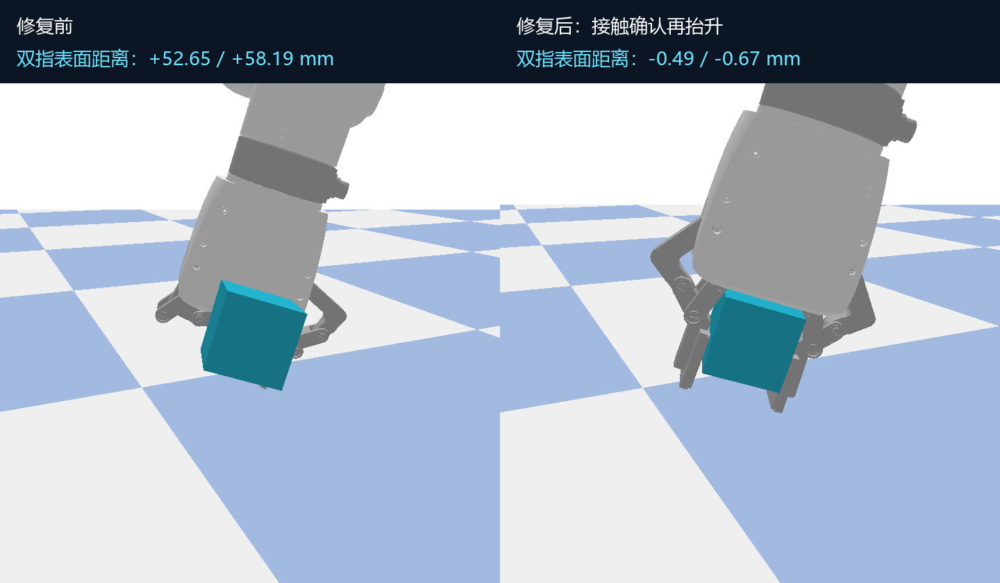

# 抛前方块悬空间隙修复

2026-10-20，50 mm、100 g 方块。用户指出的间隙已复现并修复。相同预摆关节目标下，修复前两指到方块的最近表面距离分别为 **52.65 / 58.19 mm**；修复后分别为 **−0.49 / −0.67 mm**，即接触求解中的亚毫米穿入，没有正间隙。



## 根因

- 初始抓取只控制 `drive_joint`，其余五个 URDF mimic 关节未驱动，受重力和运动影响后漂移。程序中的“闭合”状态没有约束真实指面位置。
- 固定抓持约束使用了 FK 连杆坐标系；Bullet 约束父框架实际相对于连杆质心坐标系。xArm6 末端的惯性原点有约 9.5 mm 偏移，错误变换会使约束锚点偏离实测抓取姿态。
- 原抓取允许在缺少双指受力证据时，仅凭距离阈值建立固定约束；“已抬升”因而不能证明方块贴合夹爪。

## 修复

1. 从场景开始就控制全部六个手指关节；按当前方块中心规划接近高度，并调整支撑台宽度，留出两指闭合空间。
2. 50 mm 方块必须先连续 **12 个物理步**检测到左右指面受力，并通过双指表面位置检查，随后才允许建立原有持物约束并抬升。
3. 以质心框架计算约束锚点，保存接触时六个关节的实测角度。持物期间保持这些角度，避免继续闭合到穿透方块的位置。
4. 预摆与上挥每一步检查双指表面，间隙或穿入超过 **2 mm** 就阻止发射。最终 20 次复测中最大正间隙为 **0**，最大接触穿入 **0.860 mm**。

取物后的初始持物仍使用接触确认过的固定约束；释放时移除。接回阶段依靠真实碰撞和手指夹持，没有物体固定约束。

## 验证与证据

新增回归覆盖：禁止远处闭合吸附、禁止动态物体或关节重置、约束锚点在创建瞬间准确、六个手指保持贴合、贴合丢失时禁止发射。包括既有回归在内 **60 项测试通过**，见 [测试日志](prethrow_grasp_fix_20261020/tests.log)。

- [修复前后测量及来源](prethrow_grasp_fix_20261020/comparison.json)：旧模型固定到 Git 提交 `0f2cc612ffc7f9b287327f22e5633943ecdfa23a`，新旧各自通过物理控制移动到相同预摆目标，未重置关节或物体姿态。
- [修复后的逐步抛前检查](prethrow_grasp_fix_20261020/fixed_probe.json)。
- [继续抛接后的结果：20/20，连续保持 1 秒](SHORT_VERTICAL_CATCH_RESULTS.md)。

此前 61 次实验保留为历史失败诊断；其初始抓持没有经过这套贴合验证，不能作为端到端抓取有效的证据。对应教训已经更新到通用候选 skill v25；另保存了限定条件下的短抛 verified skill。

```powershell
.\run.cmd docs\verify_prethrow_grasp.py
.\run.cmd -m unittest discover -s tests -v
```
