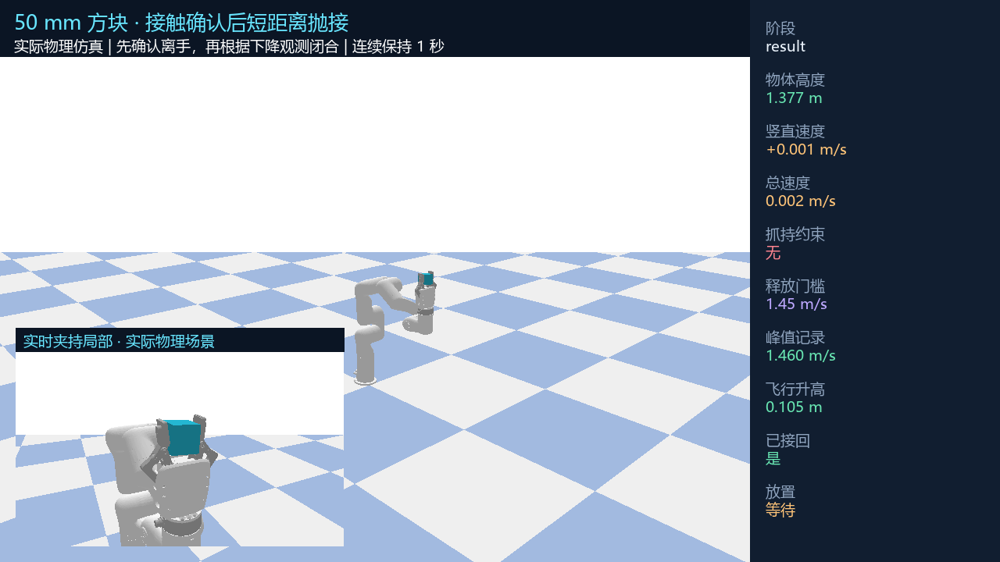

# 修复初始夹持后，短距离竖直抛接通过验证

2026-10-20。**50 mm 方块已经实现抛出后物理接回。最终 20 次新试验全部通过独立记录审计，每次连续双指接触至少 1.004 秒；接回期间没有物体固定约束。**

[观看实际仿真视频](short_vertical_catch_20261020_final/index.html) · [MP4](short_vertical_catch_20261020_final/validated_01.mp4) · [独立审计](short_vertical_catch_20261020_final/audit.json) · [20 次原始结果](short_vertical_catch_20261020_final/summary.json)



## 先修复抛前间隙

用户指出的悬空间隙来自未驱动的联动关节、错误的约束参考框架，以及缺少真实双指接触检查。修复前预摆位置有 **52.65 / 58.19 mm** 指面间隙；修复后双指贴合。详见 [根因、对照图及回归测试](PRETHROW_GRASP_FIX.md)。

这一步改变了实际抓持偏移和释放状态，因此重新验证发射动作，没有沿用旧飞行记录中的相遇坐标或关节终点。

## 从失败得到的新方案

| 失败或限制 | 本轮修正 |
|---|---|
| 大挥臂使物体横向漂移，下降段动作难以完成 | 按当前实测抓持偏移，在独立机器人模型上规划短距离竖直上抛 |
| 低抛时机械臂跟得过近，尚未真正分离就开始闭合 | 先保持打开并制动，位置观测确认离手；真实表面净空达到 15 mm 后恢复碰撞 |
| 追逐下降物体会带来关节位置或自碰撞问题 | 本方案保留释放后制动得到的位置，使用本轮下降观测决定闭合，不再追逐落点 |
| 只看 0.5 秒保持会遗漏较晚的滑脱 | 把保持检查延长至 1 秒，要求期间每一帧都有受力双指接触 |
| 持续全闭合使指面角度变化，方块被慢慢挤出 | 确认夹持后保存六个手指的实测角度，仅增加 0.015 rad 预紧，并把各关节保持力矩上限降至 1 N·m |

最终动作是：**接触确认取物 → 竖直小抛 → 释放并制动 → 观测确认分离 → 观测下降后闭合 → 双指接触后保持实测指角 → 连续保持 1 秒**。

竖直发射每轮根据本次抓取偏移和机器人运动学重新求解。发射门槛来自本次实测速度；闭合时机来自已经送达的位置观测。没有把过去的飞行轨迹、固定相遇时刻或固定拦截姿态当作控制输入。

## 最终 20 次验证范围

| 项目 | 实测或配置 |
|---|---|
| 物体 | 50 mm 方块；名义 100 g，对照 80 / 120 g |
| 实际上抛增高 | **100.97–112.10 mm** |
| 释放速度门槛 | 1.42 / 1.45 / 1.50 m/s |
| 位置观测 | 60 Hz；噪声标准差 0–2 mm；送达延迟 0–33.3 ms；漏帧 0–10% |
| 阻尼对照 | 0.025 / 0.04 / 0.06 |
| 连续受力双指保持 | 每次至少 **1.004 s** |
| 最大末端物体线速度 | **3.734 mm/s**，低于 50 mm/s 的检查上限 |
| 抛前最大正间隙 | **0 mm**；最大接触穿入 0.860 mm |
| 独立审计通过 | **20 / 20** |

这些是 20 组离散仿真组合的结果。当前验证覆盖约 10–11 cm 的小抛接回；高抛、视觉感知和真实硬件仍未验证。

独立审计重新从接触力和物理 CSV 计算了连续夹持、位置一致性、关节限位/速度/力矩、观测时间因果关系，以及释放后无物体约束。自穿透检查引用运行时保留的模型检测结果。原始观测、闭合决策、控制轨迹、物理 CSV、源文件哈希均保存在最终目录。

## 保留的失败记录

修复后共保存 98 次完整结果，包括发射、下降伺服、短抛和保持力矩搜索，以及最终 20 次复测；另有 1 次因 JSON 布尔值序列化错误中止并单独记录。搜索阶段更改过策略和保持标准，因此不将这些尝试合并成一个成功率。

较早的 8 次复测都通过 0.5 秒保持。后来延长至 1 秒的第一组 20 次测试只有 10 次通过，暴露了持续全闭合导致的指面转动和挤出。改成接触角度保持后，才得到最后这组 20/20，旧失败没有覆盖或删除。

目录包括 `catch_after_grasp_fix_20261020_*`、`prethrow_grasp_fix_20261020`、`short_vertical_catch_20261020` 和 `short_vertical_catch_20261020_final`。测试套件中的临时仿真不计入这些次数。

## Skill 与复现

- [通用失败经验 v25](../assets/skills/causal_throw_catch_candidate.json)：保留 candidate，记录初始抓持检查、坐标框架、离手观测、控制限制和夹持保持等教训。
- [限定任务的 verified skill](../assets/skills/short_vertical_throw_catch_50mm.json)：`short_vertical_throw_catch_50mm_v1`，只对上述短抛仿真条件登记 20 次验证。
- [经验语言版](CAUSAL_THROW_CATCH_SKILL.md)。

常规入口已经使用新的短抛配置。选择一个新的输出目录：

```powershell
.\run.cmd -m robotmp.throw_catch_online --cube-size-mm 50 --trials 3 --video --output docs\new_short_vertical_catch

# 重跑 20 组验证与独立审计
.\run.cmd docs\validate_short_vertical_catch.py --output docs\new_short_vertical_validation --video
.\run.cmd docs\audit_short_vertical_catch.py --output docs\new_short_vertical_validation
.\run.cmd -m unittest discover -s tests -v
```

审计脚本默认检查本次最终证据目录，也可用 `--output` 指定复现目录。视频为实际运行时同步录制，局部视图使用同一场景；末尾额外 1 秒是结果定格，不计入物理保持时间。

全部 **60 项代码测试通过**，见 [日志](prethrow_grasp_fix_20261020/tests.log)。
