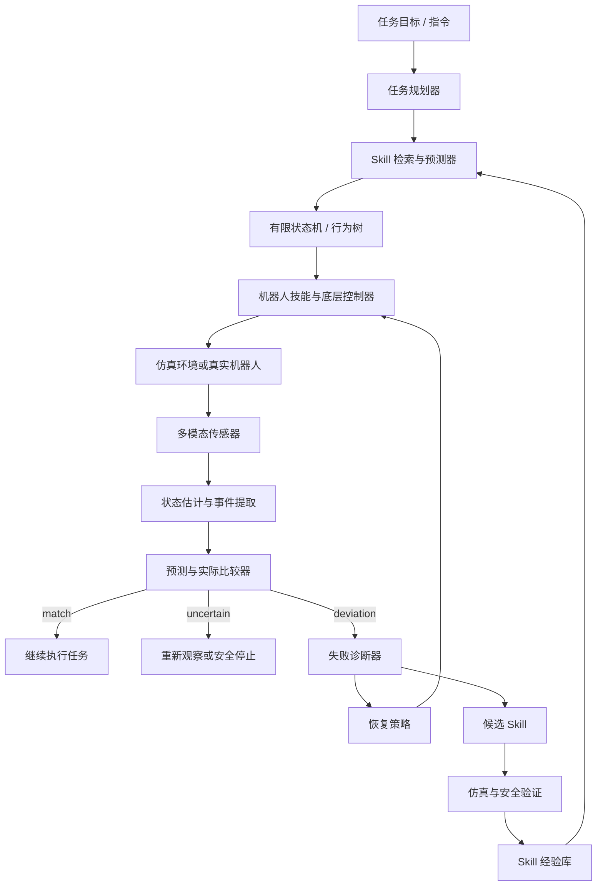

# 基于预测误差与失败经验 Skill 的具身智能系统

## 1. 核心思想

让机器人把物理世界转化为大模型能够理解、推理和查询的语义状态，并让大模型根据任务目标预测未来状态。机器人执行动作后，系统将实际观测与预测进行比较；当出现偏差时，诊断原因，把经过验证的失败经验整理成可复用的 Skill，用于修正下一次预测和行动策略。

**核心闭环：**

> 感知物理世界 → 构建时空状态 → 预测未来 → 执行动作 → 比较预测与现实 → 诊断偏差 → 生成并验证 Skill → 改进下一次预测

目标不只是让机器人“记住失败”，而是让失败能够改变未来预测所依赖的假设，并通过真实反馈验证这种改变是否有效。

## 2. 问题背景与设计原则

大语言模型擅长处理语言、分解任务、调用工具和进行高层推理；机器人则拥有摄像头、深度传感器、关节编码器、触觉和力传感器等，但这些传感器信号通常是高维、连续且具有时序性的。

一种自然思路是把传感器信息转成文字，再交给大模型。然而，单纯自然语言化可能丢失精确坐标、速度、力、时间和不确定性信息。

因此，建议采用分层表示：

- **原始传感器层：** 保留图像、视频、深度、关节、触觉、力等数据。
- **结构化状态层：** 记录物体、坐标、速度、接触状态、时间戳、置信度和状态关系。
- **事件语义层：** 将重要变化表示为事件，例如“夹爪接触杯子”“杯子开始滑动”“抽屉已打开”。
- **自然语言层：** 让大模型和人类能够理解、查询和解释当前状态。
- **行动与控制层：** 将规划结果交给经过验证的机器人技能和底层控制器执行。

原则：**语言是高层推理接口，而不是所有物理数据的唯一载体。**

## 3. 系统总体架构

```text
用户目标 / 自然语言指令
          |
          v
大模型任务规划器
分解任务、提出预测、选择技能
          |
          v
未来状态轨迹 / 预期事件
          |
          v
机器人技能与底层控制器
导航、抓取、放置、开抽屉等
          |
          v
真实环境中的动作执行
          |
          v
多模态传感器反馈
视觉、深度、关节、触觉、力
          |
          v
状态估计与事件提取
          |
          v
预测状态与实际状态比较
          |
     +----+----+
     |         |
     v         v
  符合预期   偏离预期
     |         |
     v         v
  继续执行   偏差诊断
               |
               v
      生成候选失败经验 Skill
               |
               v
        仿真 / 安全测试 / 验证
               |
               v
        Skill 经验库更新
               |
               v
  下一次预测前检索相关 Skill
               |
               +----> 修正预测与策略
```

这是一个持续运行的闭环，而不是一次性生成计划后执行到底。

## 4. 物理世界的时空语义表示

机器人需要知道的不只是“看到了什么”，还包括：

- 物体在哪里，处于什么姿态和运动状态；
- 状态何时发生变化，变化持续了多久；
- 哪些物体之间存在接触、遮挡或空间关系；
- 动作执行后出现了什么结果；
- 当前观测的置信度如何；
- 哪些信息是直接观测到的，哪些只是推断。

例如，一个杯子的状态可以同时有结构化记录和语言解释。

```json
{
  "object": "coffee_cup",
  "position_m": [0.42, -0.18, 0.76],
  "state": "possibly_grasped",
  "events": [
    {"time": 12.10, "event": "gripper_contact"},
    {"time": 12.16, "event": "grip_force_increased"},
    {"time": 12.22, "event": "cup_lift_detected"}
  ],
  "confidence": 0.93
}
```

相应的语言解释可以是：

> 杯子可能已经被抓住。系统检测到夹爪接触、夹持力增加，并观察到杯子开始上升。继续搬运前，应确认杯子已脱离桌面。

示例数值仅用于说明数据结构，不代表特定硬件的实测数据。

## 5. 预测—观测—比较机制

### 5.1 预测未来状态

在时刻 \(t\)，系统根据当前状态和计划动作预测未来：

\[
\hat{x}_{t+\Delta t}=f(x_t,u_t,\Delta t)
\]

其中：

- \(x_t\)：当前估计状态；
- \(u_t\)：计划执行的动作；
- \(f\)：状态预测模型；
- \(\hat{x}_{t+\Delta t}\)：未来状态预测；
- \(\Delta t\)：预测时间跨度。

预测对象可以包括位置、速度、物体是否移动、抓取是否成功、抽屉是否打开，以及某个事件是否应该发生。

### 5.2 与实际状态比较

当未来时刻到来，系统根据传感器估计实际状态 \(x_{t+\Delta t}\)，并计算预测残差：

\[
e_{t+\Delta t}=x_{t+\Delta t}-\hat{x}_{t+\Delta t}
\]

真实机器人不应只比较坐标差值，还要比较离散状态、事件、接触关系和置信度。例如，夹爪闭合并不等于物体已被抓住。

系统应根据预测误差是否超出合理范围，决定继续执行、重新观测、局部调整或请求大模型重新规划。

### 5.3 预测范围而非单一确定值

真实世界存在摩擦差异、传感器噪声、控制延迟和环境变化。因而，更稳健的系统通常需要预测一个可接受的状态范围或概率分布，而不是要求实际状态与单个精确值完全一致。

当观测超出预测范围，系统才触发进一步诊断；如果传感器证据不足，则应标记为“不确定”，而不是直接判定失败。

## 6. 失败经验 Skill：让失败改变下一次预测

### 6.1 基本机制

一次预测失败应被转化为一个结构化的学习事件：

1. 保存原始预测和预测依据。
2. 记录实际观测、时间戳及相关传感器证据。
3. 判断偏差来自预测假设、状态估计、执行动作、环境变化还是传感器异常。
4. 生成一个候选 Skill，描述触发条件、失败机制和修正规则。
5. 在仿真或安全测试中验证该规则。
6. 通过验证后，将 Skill 加入经验库。
7. 下次遇到相似情境时，在预测之前检索相关 Skill。
8. 根据新结果继续更新或撤销该 Skill。

**重要：** 不能把每次失败都直接写成事实。观察到的结果、推断出的原因和待验证的假设必须分开记录。

### 6.2 Skill 示例：抓取后没有检测到物体抬升

```yaml
name: grasp_without_lift
status: candidate
description: >
  夹爪闭合后，没有可靠证据表明目标物体已经离开支撑面。

trigger_conditions:
  - gripper_closed == true
  - expected_grasp_window_elapsed == true
  - object_lift_not_detected == true

observations_to_check:
  - gripper_contact
  - grip_force
  - object_relative_motion
  - visual_lift_evidence
  - possible_occlusion

lesson:
  - gripper_closed does not imply grasp_success
  - do not predict transport_phase_started
    until lift evidence is sufficient

recovery:
  - stop_transport_motion
  - refresh_object_pose
  - diagnose_grasp_point_and_contact
  - replan_grasp_if_safe

validation:
  - test_in_simulation_or_safe_setup
  - compare_false_success_rate
  - record_successes_and_failures
```

这个 Skill 的关键不是简单指示“再抓一次”，而是修正大模型未来预测时使用的假设：夹爪闭合与抓取成功是不同状态，必须有足够证据确认物体已经被拿起。

### 6.3 Skill 的三种类型

**预测修正 Skill**

修正对未来状态的错误判断。例如，夹爪闭合后，必须结合接触和物体运动证据，才能预测抓取成功。

**执行修正 Skill**

修正动作选择或执行方式。例如，确认抓取点偏离目标后，重新估计目标姿态并规划抓取动作。

**验证与安全 Skill**

在证据不足或风险较高时，要求重新观测、进行低风险验证或暂停动作。

## 7. Skill 经验库的治理

为了避免错误经验不断累积，Skill 经验库至少需要以下机制：

- **证据追溯：** 保存相关预测、传感器观测和执行结果。
- **事实与假设分离：** 例如，“杯子没有移动”是观测；“摩擦力不足”是可能原因。
- **适用范围：** 标记物体类型、任务条件、机器人硬件和环境限制。
- **验证状态：** 区分候选、测试中、已验证、已停用等状态。
- **置信度与成功率：** 根据重复测试更新可信度，而不是仅凭一次结果。
- **版本与回滚：** 新规则效果不佳时，可以回退到之前的版本。
- **冲突检测：** 对互相矛盾的 Skill 进行比较，避免不加区分地同时应用。
- **安全边界：** 任何 Skill 都不能绕过底层控制器的碰撞、力和运动安全约束。

## 8. 多时间尺度协作

并非所有纠偏都应交给大模型完成。建议采用分层控制：

| 层级 | 职责 | 典型工作方式 |
|---|---|---|
| 底层控制器 | 关节、平衡、速度和接触力控制 | 高频、低延迟、确定性控制 |
| 状态预测与反馈 | 状态估计、残差计算、异常检测、局部调整 | 持续运行 |
| 大模型规划器 | 任务分解、异常解释、Skill 检索和策略重规划 | 按任务步骤或异常事件触发 |
| Skill 学习与验证 | 从失败中形成候选规则并验证 | 任务间积累，或在安全时段执行 |

频率取决于硬件和控制算法。大模型不应成为高频稳定性控制的唯一执行者；紧急停止和安全动作必须由低延迟的本地系统处理。

## 9. 研究假设与实验设计

### 9.1 核心研究问题

> 让大模型把经过诊断和验证的预测失败转化为可检索 Skill，能否提升机器人在长时序任务中的预测准确率、失败恢复能力和跨任务泛化能力？

### 9.2 对照实验

可以用抓取杯子、开抽屉、把物品放入柜子等任务比较三种系统：

- **A：固定计划。** 生成初始计划后执行，不使用预测误差驱动的重规划。
- **B：反馈纠偏。** 比较预测与实际状态，并调整当前动作，但不积累跨任务 Skill。
- **C：反馈纠偏 + 失败经验 Skill。** 诊断失败、生成候选 Skill、验证并在后续任务中检索。

### 9.3 评估指标

- 任务成功率；
- 预测误差与错误状态判断率；
- 失败恢复率；
- 重复发生同类失败的频率；
- 完成时间与推理延迟；
- 模型调用成本；
- 不安全动作和错误恢复的发生率；
- Skill 在相似任务与不同物体上的迁移效果。

应进行重复实验，并记录失败类型。只有当 C 在可重复的测试中优于 A 和 B，才能支持“失败经验 Skill 提高了预测与恢复能力”这一假设。

## 10. 最小可行实现路线

第一阶段不需要重新训练大模型，可以从软件架构入手：

1. 在仿真环境中定义少量任务与机器人技能。
2. 统一记录预测状态、实际状态、时间戳和任务结果。
3. 实现预测残差和事件偏差检测。
4. 让大模型根据证据生成结构化的候选失败 Skill。
5. 建立 Skill 检索、适用条件和验证状态。
6. 在后续相似任务开始前检索 Skill，并要求模型明确说明预测修正依据。
7. 对比启用和禁用 Skill 时的实验结果。
8. 经过仿真与安全测试后，再逐步迁移到真实机器人。

早期版本可使用结构化日志、文件或数据库保存 Skill。积累足够数据后，再评估是否需要训练专用状态预测模型、改进事件检测，或微调大模型。

## 11. 核心结论

这套系统的关键不只是让大模型记住更多失败案例，而是形成一条可验证的经验改进链：

**预测未来 → 观察现实 → 检测偏差 → 诊断原因 → 生成候选 Skill → 验证经验 → 修正下一次预测。**

物理世界的时空语义表示提供了可供推理的状态；预测—观测闭环提供了误差信号；失败经验 Skill 则让误差转化为跨任务可复用的知识。

最终目标是让机器人逐步具备更可靠的预测、异常解释和自适应能力，而不是仅仅重复执行预先编写的动作序列。
## 12. MVP 实现方案

本节是对前述研究方案的工程化落地建议。MVP 的目标不是一次性实现完整的具身智能系统，而是先验证一个可测量的闭环：机器人第一次遇到抓取失败后，系统能够记录失败证据；下一次遇到相似条件时，系统能够检索失败经验并修正预测与恢复策略。

### 12.1 MVP 的最小任务范围

建议先选择一个仿真抓取任务：机器人从桌面抓取一个方块或杯子，并将其放到托盘中。

第一版只实现以下动作：

```text
observe_scene
approach_object
close_gripper
lift_object
move_to_target
release_object
```

第一版只关注一种失败：

```text
夹爪已经闭合，但目标物体没有真正被抓起。
```

该失败可以验证完整闭环：

```text
预测抓取成功
    ↓
执行闭合夹爪和抬升
    ↓
没有检测到物体抬升
    ↓
比较预测和实际状态
    ↓
生成 grasp_without_lift Skill
    ↓
下一次抓取前检索该 Skill
    ↓
要求先确认抬升证据，再进入搬运阶段
```

目标位置过时、视觉遮挡和物体滑落等失败模式可以在第一版闭环稳定后再加入。

### 12.2 推荐的软件组成

MVP 可以全部使用 Python 实现：

```text
仿真环境：PyBullet 或 MuJoCo
状态与数据模型：Python + Pydantic
日志存储：JSONL 或 SQLite
Skill 存储：SQLite
任务执行：有限状态机
大模型：只负责异常解释和生成候选 Skill
实验分析：Python + pandas
```

第一版暂不需要重新训练大模型，也不需要向量数据库、知识图谱或真实机械臂。大模型不应直接输出关节控制指令；高频控制、碰撞检测、力矩限制和紧急停止应由本地控制器负责。

建议的目录结构如下：

```text
mvp/
├── env/
│   └── pick_place_env.py       # 仿真环境和失败注入
├── state/
│   ├── models.py               # 状态、预测、观测数据结构
│   └── estimator.py            # 状态估计
├── executor/
│   └── primitives.py           # 抓取、抬升、放置等动作
├── predictor/
│   └── baseline.py             # MVP 的规则预测器
├── monitor/
│   └── comparator.py           # 预测与实际状态比较
├── skills/
│   ├── store.py                # Skill 库
│   ├── retriever.py            # Skill 检索
│   └── validator.py            # Skill 验证
├── llm/
│   └── diagnose.py             # 生成候选失败 Skill
└── experiments/
    └── run_ab_test.py          # A/B/C 对照实验
```

### 12.3 结构化状态

MVP 先使用少量、明确且可测量的状态字段，不要把全部物理信息都转成自然语言：

```python
from pydantic import BaseModel
from typing import Literal

class ObjectState(BaseModel):
    object_id: str
    position_m: list[float]
    visible: bool
    grasped: bool
    lifted: bool
    confidence: float

class RobotState(BaseModel):
    gripper_open: bool
    gripper_force: float
    end_effector_position_m: list[float]

class SceneState(BaseModel):
    timestamp: float
    phase: Literal[
        "observe", "approach", "grasp", "lift",
        "transport", "place", "finished", "failed"
    ]
    object: ObjectState
    robot: RobotState
    events: list[str]
```

一次预测也使用结构化格式：

```python
class Prediction(BaseModel):
    prediction_id: str
    action: str
    expected_phase: str
    expected_events: list[str]
    expected_object_lifted: bool
    expected_object_position_m: list[float] | None
    position_tolerance_m: float
    confidence: float
    applied_skill_ids: list[str]
```

例如，执行 `lift_object` 前可以生成如下预测：

```json
{
  "action": "lift_object",
  "expected_phase": "transport",
  "expected_events": ["object_lift_detected"],
  "expected_object_lifted": true,
  "position_tolerance_m": 0.03,
  "confidence": 0.82,
  "applied_skill_ids": []
}
```

必须区分观测事实、状态判断和待验证原因：

```text
gripper_closed       是观测事实
object_lifted=false  是状态判断
摩擦力不足           是待验证原因
```

### 12.4 预测器和比较器

第一版使用规则预测器即可。这样可以明确知道错误来自哪个预测假设，而不是一开始就把问题交给难以解释的学习模型。

```python
def predict_after_grasp(state: SceneState) -> Prediction:
    return Prediction(
        prediction_id="pred-001",
        action="lift_object",
        expected_phase="transport",
        expected_events=["object_lift_detected"],
        expected_object_lifted=True,
        expected_object_position_m=None,
        position_tolerance_m=0.03,
        confidence=0.8,
        applied_skill_ids=[]
    )
```

比较器至少处理三种偏差：连续值偏差、离散状态偏差和事件偏差。

```python
from dataclasses import dataclass

@dataclass
class ComparisonResult:
    status: str
    errors: list[str]
    severity: str

def compare_prediction(
    prediction: Prediction,
    observed: SceneState
) -> ComparisonResult:
    errors = []

    if prediction.expected_object_lifted and not observed.object.lifted:
        errors.append("expected_lift_but_not_detected")

    for event in prediction.expected_events:
        if event not in observed.events:
            errors.append(f"missing_event:{event}")

    if observed.object.confidence < 0.5:
        return ComparisonResult(
            status="uncertain",
            errors=errors,
            severity="low"
        )

    if errors:
        return ComparisonResult(
            status="deviation",
            errors=errors,
            severity="medium"
        )

    return ComparisonResult(
        status="match",
        errors=[],
        severity="none"
    )
```

MVP 中的比较结果可以分为三类：

```text
match       预测符合实际，继续执行
uncertain   证据不足，重新观测
 deviation  明确偏离，进入诊断和恢复
```

`uncertain` 不应直接被判定为失败。例如摄像头被遮挡时，系统应先重新观测，而不是立即生成新的失败经验。

### 12.5 使用有限状态机执行任务

动作执行由有限状态机控制，大模型只参与任务级规划和异常处理：

```text
OBSERVE
  ↓
APPROACH
  ↓
GRASP
  ↓
LIFT
  ├── 检测到物体抬升 → TRANSPORT
  ├── 没有抬升证据 → DIAGNOSE
  └── 传感器不确定 → REOBSERVE
```

核心流程可以表示为：

```python
def run_grasp_task(env, skill_store, diagnosis_model):
    state = env.observe()

    skill_context = skill_store.retrieve(
        task="pick_and_place",
        object_type=state.object.object_id,
        phase=state.phase
    )

    prediction = make_prediction(state, skill_context)

    env.execute("close_gripper")
    env.execute("lift_object")

    observed = env.observe()
    result = compare_prediction(prediction, observed)

    if result.status == "match":
        env.execute("move_to_target")
        env.execute("release_object")
        return "success"

    if result.status == "uncertain":
        env.execute("stop")
        observed = env.observe()
        return "reobserved"

    candidate_skill = diagnosis_model.generate(
        prediction=prediction,
        observation=observed,
        comparison=result,
        skill_context=skill_context
    )

    skill_store.save_candidate(candidate_skill)
    env.execute("stop")
    return "deviation"
```

### 12.6 失败经验 Skill 的 MVP 格式

可以采用如下结构保存候选 Skill：

```yaml
id: grasp_without_lift_v1
name: grasp_without_lift
status: candidate
version: 1

scope:
  task: pick_and_place
  object_types:
    - cube
    - cup
  robot: simulated_gripper

trigger_conditions:
  - gripper_closed == true
  - lift_window_elapsed == true
  - object_lifted == false

observations:
  - gripper_force
  - object_relative_motion
  - object_visibility
  - table_contact

facts:
  - gripper_closed_does_not_imply_grasp_success

hypotheses:
  - grasp_point_may_be_misaligned
  - insufficient_grip_force
  - object_pose_may_be_stale

prediction_correction:
  - do_not_enter_transport_phase
  - predict_grasp_success_only_after_lift_evidence

recovery:
  - stop_transport_motion
  - refresh_object_pose
  - retry_grasp_if_safe

validation:
  status: pending
  trials: 0
  false_success_rate: null
  recovery_success_rate: null
```

Skill 的状态建议限定为：

```text
candidate     候选，尚未验证
testing       正在测试
verified      已验证，可参与预测
disabled      效果不好或与其他 Skill 冲突
```

大模型生成的内容只能进入 `candidate` 状态，不能直接升级为 `verified`。

### 12.7 大模型的职责边界

大模型的输入应包括：

```text
任务目标
当前阶段
原始预测
实际观测
缺失事件
状态时间线
已有相关 Skill
动作执行结果
```

大模型只输出结构化诊断结果，例如：

```json
{
  "name": "grasp_without_lift",
  "facts": [
    "gripper_closed",
    "object_lifted_false"
  ],
  "hypotheses": [
    "grasp_point_misaligned",
    "insufficient_grip_force"
  ],
  "prediction_correction": [
    "do_not_predict_transport_started_until_lift_confirmed"
  ],
  "recovery": [
    "stop_transport",
    "refresh_object_pose",
    "retry_grasp_if_safe"
  ],
  "confidence": 0.76
}
```

程序需要检查以下内容：

```text
是否符合 JSON Schema
是否包含触发条件
是否区分事实和假设
是否包含安全边界
是否试图输出关节命令
是否与已有 Skill 冲突
```

### 12.8 Skill 验证和 A/B/C 实验

在仿真中人为制造不同失败条件：

```text
正常抓取
抓取点偏移
夹爪摩擦力不足
物体位置被随机移动
视觉短暂遮挡
```

然后运行三组对照：

| 组别 | 行为 |
|---|---|
| A | 初始计划执行到底，不比较预测与实际 |
| B | 比较预测与实际，发生异常后局部恢复，但不保存 Skill |
| C | 比较预测与实际，并检索已经验证的 Skill |

每种条件重复运行 20～50 次，记录：

```text
任务成功率
错误判断为抓取成功的次数
失败恢复率
重复发生同类失败的次数
平均完成时间
大模型调用次数
不安全动作次数
```

候选 Skill 可以在满足以下条件后升级为 `verified`：

```text
在多个独立场景中触发条件稳定
能够减少同类错误
恢复成功率不低于基线
没有增加不安全动作
适用范围没有超出测试条件
```

验证策略应放在配置中：

```yaml
verification_policy:
  min_trials: 20
  max_safety_violations: 0
  min_recovery_success_rate: 0.7
  max_allowed_false_success_rate: 0.1
```

### 12.9 MVP 开发顺序

1. 实现仿真环境和基础动作，能够完成抓取、抬升、放置，并读取物体位置、夹爪状态和抬升状态。
2. 建立统一日志，记录每一次任务中的状态、动作、预测、观测、比较结果、Skill 和最终结果。
3. 实现规则预测器和比较器，稳定检测“夹爪闭合但物体没有抬升”。
4. 加入抓取点偏移、摩擦力不足和物体移动等失败注入。
5. 接入大模型生成结构化的候选 Skill。
6. 加入 Skill 验证、版本和检索机制。
7. 运行 A/B/C 对照实验，比较使用 Skill 前后的错误率和恢复率。
8. 在仿真和安全测试通过后，再替换为真实机器人的状态估计器和动作执行器。

### 12.10 MVP 完成标准

```text
1. 系统能够记录一次任务中的预测、观测和偏差。
2. 系统能够检测“夹爪闭合不等于抓取成功”。
3. 系统能够生成带触发条件和修正规则的候选 Skill。
4. 候选 Skill 能够经过重复仿真测试后升级为 verified。
5. 后续相似任务会检索该 Skill。
6. 没有抬升证据时，系统不会直接进入搬运阶段。
7. C 组在重复实验中优于 A 组和 B 组。
```

MVP 的核心验证标准是：第一次抓取失败后，系统能够保存失败证据；第二次遇到相似条件时，系统能够提前修正预测，并避免把夹爪闭合误判为抓取成功。

## 13. 当前实现状态

截至 2026-10-15，仓库中的 MVP 已实现以下内容：

- 轻量级抓取仿真环境，可注入正常抓取、抓取点偏移、夹爪摩擦力不足和视觉遮挡等条件；
- 结构化场景状态、动作预测和观测结果；
- 预测与实际状态的 `match`、`uncertain`、`deviation` 比较；
- `grasp_without_lift` 候选 Skill 的生成、持久化、验证和升级；
- 已验证 Skill 的任务前检索；
- baseline、feedback 和 skills 三种模式；
- 可运行的命令行演示和单元测试。

当前本地诊断器是大模型的确定性替身，目的是先验证闭环和实验指标。后续接入模型时，应保持诊断器的结构化输入输出接口，并禁止模型直接绕过本地安全动作边界。

### 13.1 当前可运行命令

在仓库根目录执行：

```powershell
python -m unittest discover -s tests -v
python -m robotmp.cli demo --mode baseline --failure-mode low_grip_force
python -m robotmp.cli demo --mode feedback --failure-mode low_grip_force
python -m robotmp.cli demo --mode skills --failure-mode low_grip_force
python -m robotmp.cli validate --trials 20
python -m robotmp.cli experiment --trials 20 --failure-mode low_grip_force
```

`experiment` 命令会分别运行 A（固定计划）、B（反馈纠偏）和 C（反馈纠偏加失败经验 Skill），输出成功率、错误判断率、恢复率和 Skill 应用率。

## 14. 面向长期自主学习的开发计划

本章是后续 agent 的实施计划，目标是把当前 MVP 从“可运行的预测—偏差—恢复演示”逐步扩展为可审计、可验证、可回滚的机器人失败经验系统。

### 14.1 产品定位与边界

截至 2026-10-17，市场上的机器人平台已经分别具备仿真、模仿学习、视觉语言动作模型、可复用 Skill、运行时异常检测等局部能力，但尚未形成一个普遍可用的现场闭环：

```text
预测未来状态 → 执行动作 → 观察真实结果 → 比较预测与现实
→ 诊断偏差 → 生成候选 Skill → 在安全环境验证
→ 更新经验库 → 下一次任务前检索并修正预测
```

本项目的产品定义是：

> 具有运行时预测、失败诊断、局部恢复、经过验证的经验复用和完整证据追溯能力的机器人操作系统。

本项目不把“大模型直接控制关节”作为目标。大模型只负责任务级规划、异常解释和候选 Skill 生成；实时控制、碰撞约束、力矩限制和急停由本地控制器与安全系统负责。

### 14.2 总体架构



系统必须保留五类数据：

1. 原始数据：图像、深度、力、关节状态、控制器日志。
2. 结构化状态：物体、机器人、接触、位姿、速度、置信度、阶段。
3. 事件：接触、夹爪闭合、抬升、滑落、遮挡、碰撞风险等。
4. 推理数据：预测、预测依据、偏差、诊断事实和假设。
5. 执行结果：恢复动作、任务结果、Skill 版本、验证指标。

自然语言只作为查询、解释和高层推理接口，不能替代结构化物理状态。

### 14.3 核心数据契约

后续实现应逐步把当前 dataclass 契约扩展为带版本的 schema。建议至少包含以下实体：

```text
Episode
  episode_id
  task_id
  robot_id
  environment_id
  start_time / end_time
  initial_state
  final_result

ActionRecord
  action_id
  action_name
  parameters
  precondition_result
  start_time / end_time
  controller_result

Prediction
  prediction_id
  action_id
  expected_state
  expected_events
  confidence
  applied_skill_ids

Observation
  timestamp
  structured_state
  events
  raw_data_refs
  confidence

Comparison
  status: match | uncertain | deviation
  errors
  severity
  evidence_refs

Diagnosis
  facts
  hypotheses
  rejected_hypotheses
  confidence

Skill
  trigger_conditions
  scope
  correction
  recovery
  validation
  version
  status
```

必须显式区分：

```text
事实       传感器或状态估计直接支持的内容
假设       对事实的可能原因解释
策略       为验证假设而提出的动作
结果       策略执行后的观测和指标
```

例如：

```text
事实：夹爪已闭合，物体没有上升
假设：抓取点偏移或夹持力不足
策略：刷新位姿并换抓取点重试
结果：重试后抬升成功，恢复耗时 1.8 秒
```

### 14.4 运行时闭环规则

每个可能改变世界状态的动作都应形成预测契约：

1. 读取当前状态和相关 Skill。
2. 生成动作及其预期状态、事件和置信度。
3. 检查动作前置条件和安全边界。
4. 执行动作。
5. 在规定时间窗内采集观测。
6. 比较连续值、离散状态、事件和置信度。
7. 根据比较结果选择继续、重新观察、恢复或停止。
8. 记录完整证据。

比较结果的语义必须稳定：

```text
match       证据与预测一致，可以继续
uncertain   证据不足或传感器冲突，先重新观察或安全停止
deviation   有足够证据表明预测错误，进入诊断和恢复
```

\`uncertain\` 不能直接生成失败经验。只有在证据充分、偏差可重复或经过人工确认时，才允许创建候选 Skill。

### 14.5 Skill 生命周期

Skill 采用严格的状态机：

```text
candidate → testing → shadow → verified → deployed
                  \                         /
                   → disabled ← rollback
```

规则如下：

- 一次失败只能生成 \`candidate\`。
- \`candidate\` 不得自动改变生产策略。
- \`testing\` 在仿真或安全测试环境中运行。
- \`shadow\` 只记录“如果启用会怎样”，不改变真实动作。
- \`verified\` 经过重复、跨场景和安全验证后才能被检索。
- \`deployed\` 必须有版本号、作用域和回滚版本。
- 发现性能下降、触发条件漂移或安全风险时立即 \`disabled\`。

Skill 的最小内容：

```yaml
id: grasp_without_lift_v2
status: candidate
scope:
  task: pick_and_place
  object_types: [cube, cup]
  robot_capability: parallel_jaw_gripper
trigger_conditions:
  - gripper_closed == true
  - lift_window_elapsed == true
  - object_lifted == false
facts:
  - gripper_closed_does_not_imply_grasp_success
hypotheses:
  - grasp_point_misaligned
  - insufficient_grip_force
prediction_correction:
  - require_lift_evidence_before_transport
recovery:
  - refresh_object_pose
  - change_grasp_point
  - retry_grasp_if_safe
validation:
  trials: 0
  recovery_success_rate: null
  false_success_rate: null
  unsafe_action_rate: null
```

### 14.6 安全边界

安全系统必须独立于 Skill 和大模型：

- Skill 不能绕过碰撞检测、速度限制、力矩限制和工作空间限制。
- 所有恢复动作必须来自有限动作集合，并经过参数校验。
- \`stop\`、急停和安全降级由本地低延迟系统处理。
- 任何传感器冲突、置信度过低或状态不可观测时，默认进入 \`uncertain\`。
- 真实机器人上首次启用新 Skill 时采用 shadow 或低风险灰度模式。
- 禁止在任务执行过程中直接在线修改控制器参数或模型权重。
- 大模型输出必须经过 schema、前置条件、权限和安全策略校验。

### 14.7 分阶段开发路线

#### 阶段 0：基线冻结与可审计性

- 固定当前 \`baseline\`、\`feedback\`、\`skills\` 三种模式的结果。
- 为每次 episode 增加唯一 ID。
- 记录动作、预测、观测、比较和最终结果。
- 增加 JSON Schema 或 Pydantic 校验。
- 保证现有单元测试继续通过。

验收标准：

```text
每次 episode 都能完整回放；
同一故障在固定随机种子下结果可复现；
旧 CLI 和测试结果不回归。
```

#### 阶段 1：事件日志与持久化

目标：从“返回 RunResult”升级为“保存完整证据链”。

建议新增：

```text
robotmp/events.py
robotmp/episode_store.py
robotmp/schemas.py
robotmp/replay.py
```

优先使用 SQLite 保存 episode、action、prediction、observation、comparison、diagnosis 和 skill_version；原始图像和大文件只保存引用。

验收标准：

- 可按任务、故障类型、Skill 版本查询。
- 可从日志重放一次失败。
- 每个结论都能追溯到观测证据。

#### 阶段 2：扩展故障注入

至少加入：

```text
misaligned_grasp
low_grip_force
object_slip
stale_object_pose
occluded
unexpected_contact
collision_risk
sensor_delay
```

每个故障必须定义：注入方式、可观察证据、预期偏差、恢复动作和验证标准。

验收标准：

- 故障注入可重复，也支持随机化。
- 监控器能区分 \`match\`、\`uncertain\` 和 \`deviation\`。
- 不同故障不会被错误合并为同一个 Skill。

#### 阶段 3：预测器与状态估计器

优先实现：

- 抬升检测器。
- 滑落检测器。
- 物体位姿新鲜度判断。
- 视觉遮挡判断。
- 夹持成功概率估计。
- 事件时间窗和迟到事件处理。

先采用可解释规则和小模型，再评估是否需要训练专用模型；不建议一开始训练端到端控制模型。

验收标准：

- 每个预测都有置信度和有效时间窗。
- 传感器证据不足时不会误报确定失败。
- 预测误差可以按连续值、离散状态和事件分别统计。

#### 阶段 4：诊断器与候选 Skill 生成

诊断器输入：

```text
任务目标、当前阶段、原始预测、实际观测、缺失事件、时间线、已有 Skill、动作结果
```

诊断器输出：

```text
facts
hypotheses
rejected_hypotheses
prediction_correction
recovery
scope
confidence
```

大模型接入时必须使用结构化输出，并经过 schema、动作白名单、安全边界和冲突检测；模型只能生成 \`candidate\`。

验收标准：

- 事实和假设分开保存。
- 候选 Skill 能说明触发条件和适用范围。
- 无法解释的偏差进入人工复核或 \`uncertain\`，不能编造原因。

#### 阶段 5：Skill 验证、检索和回滚

验证至少覆盖：

- 多个随机初始位姿。
- 多个物体尺寸、质量和摩擦系数。
- 传感器噪声和延迟。
- 不同抓取点和不同失败注入强度。
- 与旧版本和无 Skill 基线的对照。

建议默认验证门槛：

```yaml
min_trials: 100
max_false_success_rate: 0.05
min_recovery_success_rate: 0.80
max_unsafe_action_rate: 0.0
max_regression_rate: 0.05
```

这些门槛是初始配置，后续应按任务风险分级调整。

验收标准：

- Skill 只能按作用域检索。
- 新版本必须与旧版本比较。
- 指标下降或出现安全违规时可自动回滚。

#### 阶段 6：仿真随机化与 A/B/C 实验

实验组：

```text
A  固定计划，不比较预测与实际
B  预测—观测反馈，执行局部恢复，不保存 Skill
C  预测—观测反馈，保存、验证并检索 Skill
```

每个故障、物体类别和环境随机种子都要分离训练、验证和测试集，避免同一轨迹泄漏到两组。

必须记录：

```text
任务成功率
false success rate
失败检测 precision / recall
恢复成功率
重复同类失败频率
平均完成时间
恢复耗时
模型调用次数和成本
不安全动作次数
Skill 迁移成功率
```

验收标准：

- C 在未见过的随机场景中优于 A 和 B。
- C 不增加不安全动作。
- C 的收益在多个故障类型上可重复。
- 结果具有置信区间，而不是只报告单次百分比。

#### 阶段 7：模型适配器

在本地确定性诊断器稳定后，再接入大模型。接口保持：

```python
class DiagnosisProvider(Protocol):
    def generate(self, context: DiagnosisContext) -> CandidateSkill: ...
```

实现至少包括：

```text
RuleBasedDiagnoser       本地基线
ReplayDiagnoser          从历史案例检索
LLMDiagnoser             结构化大模型适配器
HumanReviewDiagnoser     高风险场景人工确认
```

大模型调用失败、超时或输出非法时，系统必须回退到本地诊断器、重新观察或安全停止。

#### 阶段 8：真实机器人小范围试点

进入真实机器人前必须完成：

- 仿真回归和安全测试。
- 低速、低力、空载测试。
- 传感器断连和延迟测试。
- 控制器异常和急停测试。
- shadow 模式对比。
- 人工批准的 Skill 白名单。
- 可观测日志和一键回滚。

首个真实任务应选择低风险、可重复、失败后不会造成设备或人员伤害的抓取任务。真实机上只部署经过验证的恢复动作，不开放在线参数自动学习。

### 14.8 后续 agent 的立即任务清单

- [ ] 检查并统一文档和源码的 UTF-8 编码。
- [ ] 新增 \`Episode\`、\`ActionRecord\`、\`Observation\`、\`Comparison\`、\`Diagnosis\` 数据模型。
- [ ] 为 \`run_episode\` 增加 episode 日志和 replay 能力。
- [ ] 用 SQLite 替换或并行扩展当前 JSON SkillStore。
- [ ] 保持现有 CLI 行为不变，并增加 \`--seed\` 和 \`--output\` 参数。
- [ ] 增加 \`misaligned_grasp\`、\`object_slip\`、\`stale_object_pose\`、\`occluded\` 故障注入。
- [ ] 将 \`uncertain\` 分支改为重新观察或安全停止，并保存证据。
- [ ] 将 Skill 状态扩展为 \`candidate/testing/shadow/verified/deployed/disabled\`。
- [ ] 实现 Skill 版本、作用域、指标和回滚。
- [ ] 增加跨随机场景的 A/B/C 测试和置信区间。
- [ ] 为大模型诊断器定义 provider 接口，但先继续使用本地规则诊断器作为默认实现。
- [ ] 为所有新增行为补充有意义的回归测试。

### 14.9 当前阶段明确不做的事情

以下事项在数据契约、回放、验证和安全边界完成前暂不实施：

- 端到端视觉到关节控制。
- 让大模型直接输出关节角、速度或力矩。
- 一次失败后自动修改生产模型权重。
- 未验证 Skill 自动进入真实机器人。
- 用自然语言日志替代原始传感器和结构化状态。
- 只用单一固定场景的成功率证明系统具备泛化能力。

### 14.10 完成定义

面向长期版本的最低完成标准：

```text
1. 系统能保存并回放每次任务的预测、观测、偏差和动作证据。
2. 系统能区分确定偏差、不确定观测和正常执行。
3. 系统能生成结构化候选 Skill，并分离事实、假设、策略和结果。
4. 候选 Skill 必须经过重复、跨场景和安全验证才能部署。
5. 已验证 Skill 能在后续相似任务中被检索，并修正预测或恢复策略。
6. Skill 有作用域、版本、指标、冲突检测和回滚机制。
7. 任何 Skill 或大模型都不能绕过本地控制器和安全系统。
8. C 组在未见测试场景中持续优于 A、B，且不增加不安全动作。
```

后续实现应始终围绕这条主线推进：

```text
可观测 → 可预测 → 可比较 → 可诊断 → 可恢复 → 可验证 → 可复用 → 可回滚
```
